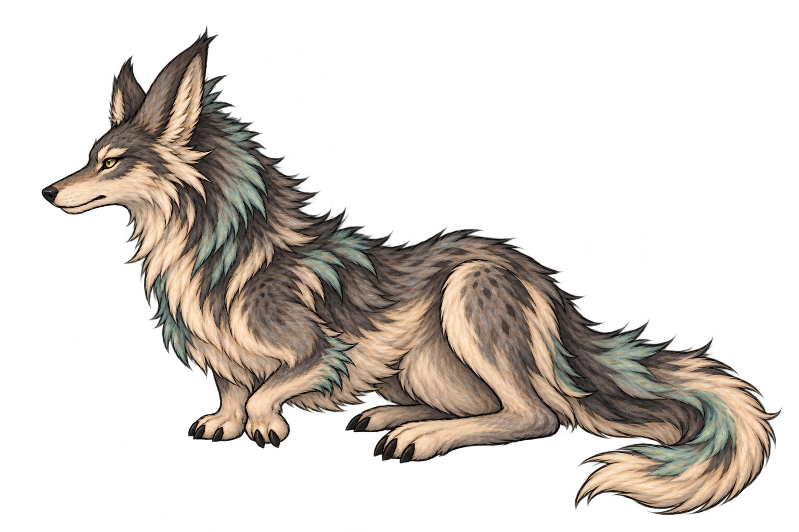

# 林地妖狈与狈首机制设计

2026-10-25。状态：首版属性、两项技能、狈首和攻击／受击姿态已接入，机制检查与实验室录制通过；完整实战长流程未验收。本案把“狈首”定义为狈指挥狼群的种族天赋名称。查看入口与记录见[技能和动作实施](../../美术规范/林地妖狈技能与动作_20261025/README.md)。

## 2026-10-25 已确认的首版实施参数

用户要求制作技能、攻击／受击动作并赋予属性；确认体魄6～8、灵慧7～9、神魂8～10及狈啸公式，并将唤猎目标从单狼改为全体友方狼，其余首版参数暂按本案执行。

| 项目 | 当前配置 |
| --- | --- |
| 物种／境界 | 林地妖狈，`forest_bei`；通智初期，与林地凶狼作为同阶段组合 |
| 体魄 | 最小6、均值7、最大8 |
| 灵慧 | 最小7、均值8、最大9 |
| 神魂 | 最小8、均值9、最大10 |
| 派生属性 | 沿用现行妖兽三项属性公式，不新增敏捷或独立属性；均值基础生命176，物理防御0 |
| 狈首 | 沿用本案已讨论规则，友方狼触发群猎时自身也获得1层逐猎，多狈不叠加，狈离场停止后续补给 |
| 狈啸 | 1体力、0法力；对指定1名敌方造成远程神魂伤害A；A=round(4＋灵慧×0.6＋神魂×0.8)。无附加状态，无构筑关键词。均值属性下基础值16，实际伤害仍走现有神魂对抗、会心与减伤结算 |
| 唤猎 | 1体力、0法力；使全体存活的友方林地凶狼各获得1层逐猎，包含现有同物种变种，不能超过3层；不作用于狈、敌方狼或其他兽种。构筑关键词：逐猎 |
| 限制 | 两招均占正常行动槽，不设额外次数或回合冷却；不返费、不抽牌、不生成额外行动；无祭出实体或灵识占用 |
| 技能库 | 狈啸、唤猎各一项，使用现有兽种技能库与正常队列，沿用3项行动容量配置 |
| 立绘动作 | 固定待机＋一张抬爪短啸出招图，受击独立一张收肩伏耳图；头身朝左，只露近侧眼；不增加蓄势／落地图或浮空循环 |

唤猎不需要点选单体，以发起者作为现有运行时结算锚点，再筛选全体友方狼；玩家所见目标和效果必须写明全体存活的友方林地凶狼，不显示为自身增益。满层或没有狼时不虚报增量，AI不主动选择没有实际受益狼的唤猎。

新增狈首和唤猎均调用已有逐猎状态，不改变逐猎每层物伤+10%、行动速度+5%、最多3层、战斗结束清除的规则。新增技能图、文字、资源及显示说明须使用本节同一套参数。暂不自行填入遁速、掉落与野外刷新配置；本次通过百科、战斗配置与表现预览查看。

## 现行依据与规则边界

- [生灵设计汇总](妖精魔鬼生灵设计汇总.md)：具备稳定天赋的兽类按入道生灵设计，不套用普通动物无天赋的口径；新物种的属性、境界与战斗配置须另行标定。
- [即时队列战斗总案](../战斗与构筑/即时队列战斗系统设计.md)：各单位使用自身行动队列，正常行动依次结算，不能凭表现额外插入攻击或结算。
- [状态系统](../战斗与构筑/状态系统设计.md)及现有 `resources/battle/statuses/逐猎.tres`：逐猎最多3层，每层物理伤害+10%、行动速度+5%，持续至本场战斗结束。这些是已有狼群机制的数值，不是本次新增平衡值。
- 现有林地凶狼的群猎本能：触发时给予同阵营其他存活的林地凶狼1层逐猎，不作用于发起者自己。旧[林地凶狼设计](生灵/林地凶狼设计.md)已标为历史稿，其敏捷、技能费用、前后摇及变种旧数值不沿用。

本次按已确认参数新增狈啸、唤猎两项技能及三项属性模板。既有体力、法力、行动槽与逐猎规则保持；危险度、遁速、掉落和野外遭遇频率继续待定，不据此自动加入旧遭遇池。

## 物种定位

拟名“林地妖狈”，与林地凶狼构成指挥者和扑击者的搭配。狼以强健肩背、前爪和扑击承担正面威胁；狈以窄脸、大耳、短前肢和发达后肢形成独立轮廓，蹲伏观察，依靠短促叫声协调同伴。

该物种的主要辨识来自群体协同。它自身不因“狈首”获得逐猎；独处或狼全部倒下后失去这项协同的受益对象。此时不额外附加恐惧、虚弱、逃跑或新的负面状态。

## 种族天赋：狈首

**效果文案：同阵营存在存活的林地妖狈时，林地凶狼触发“群猎本能”，也使发动者自身获得1层逐猎。同阵营多个狈首不重复生效。**

本条已接入现有群猎触发入口；没有狈时仍按原群猎规则结算。

1. 资源与费用：被动修正现有种族天赋，不占行动槽，不支付额外费用，也不提供返费、抽牌、资源生成或额外行动。
2. 对象：仅补给本次触发群猎本能的同阵营、存活林地凶狼；狼的现有变种仍按同一物种身份判断。不作用于狈、普通动物或其他妖兽。
3. 状态：只调用现有逐猎，补给1层；上限3层、每层增益和持续时间全部沿用现行来源，不能超过上限。
4. 触发：与群猎本能的同一个触发事件结算，补给一次。多段、追加、反击、未命中等边界均继承群猎本能本身，不另监听伤害段、飘字或特效，不创造第二次群猎触发。
5. 多狈限制：只判断同阵营是否存在存活狈首，多只不使一次补给变成多次。友方狼之间原有的群猎相互增益照常结算，不因本条重复给予其他狼。
6. 离场：狈全部倒下／离场后，后续群猎不再补给发起者自身；已有逐猎保留到战斗结束，狼之间的原群猎本能继续成立。

### 可读的组合变化

| 组合 | 结果 |
| --- | --- |
| 单狼 | 没有其他狼可接收群猎，也不能自行叠逐猎 |
| 双狼 | A出手帮助B，B出手帮助A，沿用原机制 |
| 一狈一狼 | 狼每次实际触发群猎时也帮助自己，可逐步达到既有上限 |
| 一狈多狼 | 原本“帮助同伴”补齐为“本次发起者也受益”，全队增长更齐整，但每次触发每只狼仍最多得到一次1层逐猎 |
| 先击败狈 | 截断后续自我补给；保留此前层数与狼之间的原群猎关系 |

玩家面对的是先处理直接伤害来源，还是提前截断狼群成长的选择。首版通过现有逐猎上限控制成长幅度，不提高层数上限，不新增“立即再扑一次”等额外攻击。

## 立绘与表现

- 正式保存路径：`textures/bestiary/static/forest_bei_v1.png`，1536×1024 RGBA透明底，单体全身。
- 头与身体都朝画面左侧，嘴吻、视线同向，仅露近侧眼；游戏中朝向对手时整体镜像，不单独转头。
- 窄长面部、大耳、短前肢、折起的强后肢、较低的蹲伏姿态；灰褐／炭灰毛、象牙白喉毛与少量灰青毛束，和现有凶狼同画风但轮廓不同。
- 图片不烘焙狼、石台、场景、阴影、文字或特效，主体固定，不做待机浮动。
- 已按“待机图＋一张出招图＋特效”制作指挥与攻击，生命受击单独使用收肩伏耳图。新图为 `textures/bestiary/static/forest_bei_attack_v1.png`、`forest_bei_hurt_v1.png`；三张均1536×1024 RGBA，头身朝左。出招与受击结束恢复固定待机，不插入第二次队列行动。

生成方式：内置 ImageGen。现有 `forest_wolf.png` 仅作画风与世界配色参考，不作为改色目标。提示要点：成年而狡黠的神话狈兽、短前肢和发达后肢、窄脸大耳、静止蹲伏、灰褐炭灰与少量灰青、完整四肢尾巴、透明背景；头和身体严格朝左，只见近侧眼，不望向镜头，不包含武器、衣装、光环或背景。

## 本轮完成与待定

已完成兽种模板、技能库、两项技能、种族天赋、卡牌词典图／文字、百科条目、战斗测试与原实验室入口。编译0警告、0错误；真实状态与辅助效果分发检查通过，覆盖原群猎、多狈不叠加、狈死亡、全体友狼、阵营／物种过滤、上限及零增量。90帧实际录制覆盖攻击、唤猎、受击与反向；姿态种类、固定待机与暂停检查通过。详见[实施与检查记录](../../美术规范/林地妖狈技能与动作_20261025/README.md)。野外遭遇、掉落、遁速和完整实战长流程继续待定。
