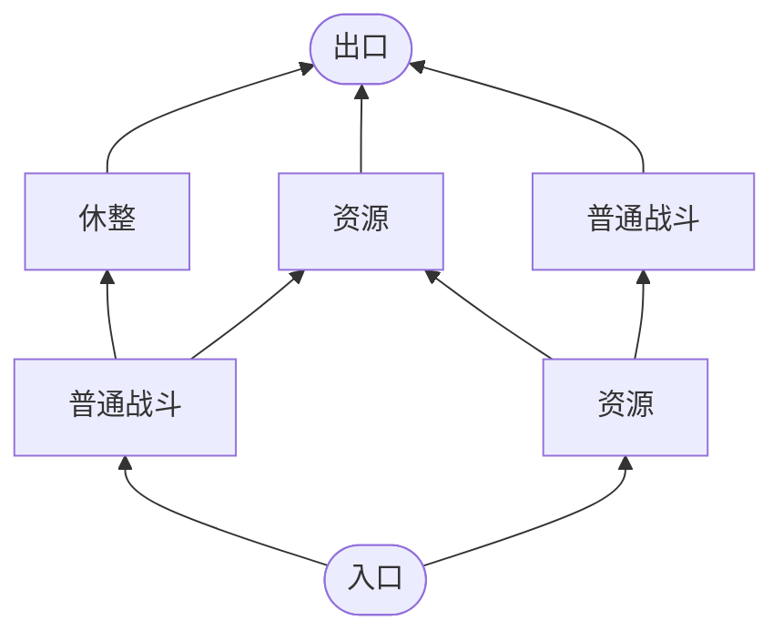

# 百川随机节点爬塔副本提案

日期：2026-11-10；2026-11-11 接入随机地图与爬塔节点图。状态：已接入首轮试玩，待实机游玩验收。用户确认节点位置在给定范围内随机、终点是出口；本案采用15个行进层。

> 本案替代[百川随机瓦片日常探索副本提案](百川随机瓦片日常探索副本提案_20261110.md)中的连续瓦片自由行走方案。此前“在瓦片地图上直接走格”的候选方向不再用于本副本。

## 一、核心玩法

副本作为随机生成的小地点直接出现在百川大世界地图上。玩家走到入口位置后，可以先查看副本详情和预计敌人境界范围，再决定是否进入。进入后，玩家看到由入口向上攀升的节点地图；每次从当前节点选择一个相连的上层节点，抵达后处理该节点对应的现有内容。玩家沿分支自行选择要经过的战斗、资源或休整节点，不接任务、不找线索，也不要求清空地图。

地图最上层以唯一的“出口”节点结束。它承担离开副本的功能，不自动附加首领战、通关奖励或任务结算。玩家走到出口并确认后，按现有副本返回流程回到大地图。

## 二、节点生成

本机安装的《Slay the Spire 2》版本为 v0.107.1。安装包没有独立的 `.gd`、`.py` 或 `.cs` 生成脚本；节点生成实现编译在 `sts2.dll` 中。只复用它的地图拓扑方法，不复制其房间内容、奖励或数值：

- 使用 7 列分层网格形成高低错落的节点位置；共15个行进层，入口和出口单独计算，不计入15层。
- 每层生成3至4个节点：先生成3个保证通向出口的主干节点，再以随机方式加入可达的侧枝节点；横向位置在7列范围内随机变化。节点总数为45至60个，入口和出口另计。
- 每个节点独立按战斗5、资源6、休整4的权重抽取类型；总数量会随节点生成结果变化，不强行固定每种类型的总数。
- 相邻层之间只连接同列或相邻列节点，玩家每次只前进一条连接。
- 每个节点位置、类型、遭遇生灵、资源种类和地形表现均按实例种子生成并写入快照；读档或重进不重抽。
- 每个有效节点都必须能从入口到达，并且至少存在一条继续通往出口的路径。不得生成孤立节点、死路或无法抵达出口的分支。

参考《Slay the Spire 2》的七列节点地图布局思路，项目使用自身的带种子生成器；不依赖玩家电脑上的另一款游戏安装目录，也不复用其房间内容、奖励或数值。

地图生成使用实例种子；生成后完整保存节点、连接、节点类型和坐标。重进、读档和地图视图刷新都恢复原图，不重新抽取。

以下只示意节点选择关系，省略了中间层；正式地图含15个行进层，不是固定路线或最终节点权重：

## 三、首期节点内容

首期只使用项目已有内容和行动，不因地图生成器提供其他节点类型就新增对应玩法。

| 节点 | 首期内容 | 结算边界 |
| --- | --- | --- |
| 入口 | 抵达副本后的起点 | 不消耗节点行动费用，不发放保底物品 |
| 普通战斗 | 林地凶狼、灰背野猪、林地妖狈群、青尾狐、赤鬃狼、岩背獾 | 沿用现有战前确认、固定招式盘、战斗和战后结算；立绘暂用现有贴图 |
| 资源 | 已配置的苦苔根、月露苔、雾铃花或灵石矿脉 | 沿用对应资源的库存、采集费用、恢复组和行囊结算 |
| 休整 | 复用现有休息行动 | 使用通用休息规则，不提供副本专属恢复加成 |
| 出口 | 地图终点 | 仅执行现有离开与返回结算，不追加首领或通关奖 |

暂不生成商店、宝箱、精英敌人、首领、洞府遗物或依赖新物品的节点。现有幽谷事件选择中带有“辨路、揭开路线、循痕迹找方向”的内容，不迁入新塔图。以后若配置事件节点，必须是可直接体验的独立内容，不能变成线索或任务链。

### 资源点按类型抽取

首期不从全部材料中无差别抽取，也不在每次采集时重新随机。每个资源点先确定子类型，再从该类型预设材料池中随机选定一种；材料、剩余储量和恢复组写入副本快照，重进与读档不重抽。现有50种材料定义中，副本采集行动目前只配置了苦苔根、月露苔、雾铃花和灵石；其余来源按[副本生态来源规划](副本生态来源刷新与多层地图提案.md)逐项登记后再加入对应池。

| 资源点子型 | 本塔预设材料池 | 当前可用范围与边界 |
| --- | --- | --- |
| 草木采集点 | 苦苔根、月露苔、雾铃花、云雾菌、砾地菌伞、青岚藤心、荒藤结节、青木芯、赤瓤木核、凝露松脂、松心炭、霜叶枝、风络藤丝、凝霜叶、青髓芽、朱阳花籽、雾心菌核 | 当前只启用前三种；其余按林地、湿地、松林等来源配置行动后加入。每个点只从与所处生境相符的子池抽取。 |
| 泉泽点 | 灵泉藻、灵泉露、回泉珠、溪纹藻丝、月露菌汁 | 当前未配置采集行动，暂不生成；启用前登记泉眼／湿地来源、储量与恢复。 |
| 矿脉点 | 赤纹燧石、地脉焰炭、风纹石英、裂甲石、褐铜砂、铜髓矿、玄铁、盐纹石膏、泥脉石团、紫砂灵土、瘴泥珠、灵石、砂脉石片、风窍晶屑、沉云玉屑、清音玉片 | 当前只启用灵石；其他材料须配好明确矿脉、采掘行动、储量与恢复后再加入。炼器燃料也不能随机撒在普通岩地。 |
| 兽材来源 | 山蝉蜕壳、赤鳞蜕、石蜂蜡、乌羽片、斑甲壳片、断角骨片、兽骨、兽皮、玄甲薄片、山蚕长丝、青羽翎、伏地兽筋 | 不作为普通采集点。当前凶狼战斗沿用兽骨、兽皮掉落；其他材料须等对应生灵或明确巢穴来源接入。 |

以上四池按现有50种材料目录分组。首期真正启用的采集产物仍只有苦苔根、月露苔、雾铃花和灵石；狼战斗另掉兽骨、兽皮。其余材料是本塔的预设候选池，不表示当前已有可采行动。尤其新增的16种材料目前没有正式副本来源；本表只按现有子类标注待归池方向，具体生境来源和行动配置完成前不启用。随机性发生在“同类资源点选哪种已配置材料”，不发生在“任何地点都能挖到任何材料”。每个实例只从已启用的子池抽取并保存具体材料与储量，重进副本或读档不重抽。

## 四、移动、精力与节点行动

用户已确认：从当前节点前进到下一节点要消耗角色现有精力，且费用按目标节点类型分别配置。每次移动只沿一条有效连接前进一步；不允许跨节点直达，也不沿已走路径回退。

节点移动费用与抵达后的行动费用是两笔独立结算。精力上限为现行100点；普通有效交互为1点，副本采集通常为2点，休息每小时恢复1点。首期移动费用为：普通战斗节点3点、资源节点2点、休整节点0.5点、出口节点1点。采集继续收取各自现行费用，战斗继续使用战斗内资源。进入休整节点先扣0.5点，之后可执行每次1小时的通用休息行动，按现有每小时恢复规则恢复精力。

按15个行进层再加出口计算，完整爬升需16次移动；仅移动费用范围为8.5至46点，实际值取决于所选节点类型。资源采集等抵达后的行动费用另计。节点地图采用纵向七列布局，突出当前层与可选连接；可上下滚动查看全塔，不缩减层数适配单屏。

| 目标节点类型 | 移动精力 | 节点行动费用 |
| --- | --- | --- |
| 入口 | 0 | 起点，不执行移动结算 |
| 普通战斗 | 3 | 按现有战斗规则 |
| 资源 | 2 | 按对应资源行动配置 |
| 休整 | 0.5 | 按通用休息规则，不附加副本恢复量 |
| 出口 | 1 | 现有副本离开流程 |

## 五、地图显示与游玩边界

- 全图显示节点类型和连接，突出当前节点以及下一步可选的直接相连节点；地图可滚动查看全层。
- 节点位置使用上下攀升的布局；视觉上保留本项目角色模型和已确认的浅苔绿色水彩纸纹风格。
- “查看出口”只移动地图视角，不替玩家规划或自动行走；每次只可手动前进一个连接，不允许跨层或回退。
- 爬塔中可随时暂离返回大世界；当前层、已执行行动和遭遇状态会保存，原入口保留并可再次进入。抵达出口并离开后本次才算完成，大世界随后生成下一处入口。
- 连接只说明节点间可走关系，不显示任务目标、线索、完成度或路线推荐。
- 玩家到达战斗和资源节点后，由玩家主动执行对应行动；节点本身不自动采集或强制开战。
- 唯一地图终点是出口，共15个行进层。大世界同时保留一处有效爬塔入口；首次打开地图时生成，入口位置在野外地点周边范围内随机并保存，通关后再生成下一处。

## 六、世界地图入口与现有实现边界

### 原有副本入口

- 大世界地图到达“东林地”可进入节点并主动确认；当前接线会直接打开东林地副本，从林缘入口开始。
- 在林缘入口可选择“蕨林采径”，进入固定9节点的小副本；它是现有可用的短副本样板。
- 为试玩战斗组合，蕨林采径暂配置三处遭遇：林径凶狼、灰背野猪、林地妖狈与凶狼同行。它们分别复用凶狼的撕咬／游身架招与群猎本能、野猪的拱撞／拱身架招与厚皮、妖狈的狈啸／唤猎与狈首；立绘使用现有贴图。野猪的固定面板只用于这次试玩，不作为正式随机属性范围。
- 蕨林采径保留为东林地内的旧固定短副本样板；随机爬塔从大世界独立生成，不以东林地作为必经入口。
- 三种新增生灵的固定招式盘、技能组和占位贴图已接入战斗节点；本塔也会随机抽取林地凶狼、灰背野猪和林地妖狈群。

### 本案入口流程

- 大世界同时生成并保留一处有效的小副本地点标记，位置在野外地点周边76至122地图单位的范围内随机；生成位置与副本实例绑定保存，避免贴近已有地点，玩家需实际走到入口处。
- 抵达后打开地点详情，可查看名称、预计敌人境界范围，并选择“进入”或返回大世界。查看详情不重新生成副本，也不消耗副本内节点移动精力。
- 预计境界由该实例实际抽中的妖兽模板计算；境界一致时显示单一境界，不一致时显示最低至最高境界。不按玩家当前境界动态改变，也不作为禁止进入的门槛。预览与实际进入共用同一实例种子和敌人配置。
- 进入后载入同一实例保存的15层节点图；中途暂离后从保存的当前节点继续，抵达出口并离开后返回大世界入口附近，并生成下一处入口。
- 入口只保留一处有效点；大世界位置按随机种子选定并存档，优先避开已有地点标记。

首轮已接入 `MainScene.DynamicDungeon.cs` 与当前使用的 `BaiChuanFreeWorldRuntime`：大世界地图同步一处有效入口，抵达详情显示该实例实际遭遇的预计境界范围，确认后打开同一份保存的节点图。入口保留至通关；暂离不重置路线、资源或遭遇。节点移动费用为战斗3、资源2、休整0.5、出口1点；休整行动按通用规则每小时恢复精力。战斗节点从现有生灵模板和固定招式盘中生成遭遇。

已有 `DungeonGraph` 数据结构包含入口、战斗、精英、事件、资源、休整和出口类型；已接入的“蕨林采径”则是固定单链样板。本案应复用通用节点数据和现有副本行动结算，但需要独立节点地图生成与展示；不得把随机瓦片地图或旧单链样板误报为本案实现。

已通过 C# 项目编译；生成器内置15层节点范围、相邻连接及入口到出口全节点连通校验。随机种子批量冒烟、读档／暂离续行和实机地图展示仍待实际运行确认；当前机器的 Godot .NET 场景启动未能完成，因此不能把这些项目记作已验收。节点地图的可读性、镜头移动、爬塔节奏、数值权重和材料范围都可依据试玩体验继续调整。
