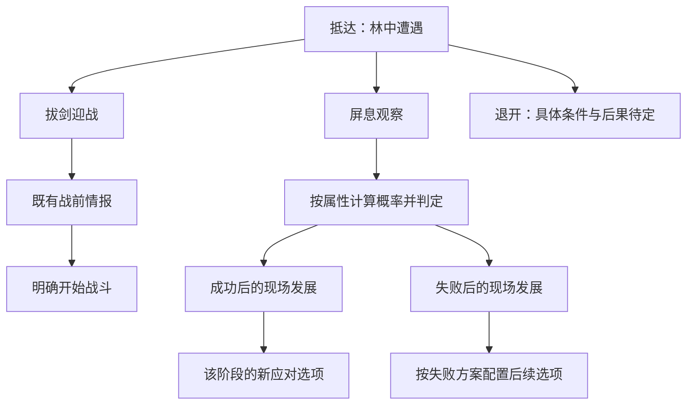

# 副本事件条件判定与后续窗口

日期：2026-10-26。状态：框架草案；用户最新确认按属性计算概率，不设硬性属性门槛，覆盖此前先检查属性资格的选择。尚未实现运行时判定或新事件窗口。

首个样板已形成[林中遇狼完整事件设计](林中遇狼首个完整事件设计_20261026.md)，含四项应对、公式、逐页旁白、成功／失败去向与费用。该样板具体内容以完整稿为准；参数与新增驱离结局仍待审。

## 已确认与待确认

用户要求部分应对选项需要判定，并能展示事件发展的后续窗口。最新修订为：**相关属性计算概率，不设计最低属性资格门槛**。低属性角色也能选择同一应对，只是成功机会不同；不再采用此前“先满足属性资格再随机”的方案。

沿用上一轮要求：左图右文，取消地点小标题，紧凑应对选项；选“拔剑迎战”后才进入既有战前情报，明确开始才进入正式战斗。

以下两项此前未单独选择；用户本轮要求先设计完整首个事件，因此已在完整样板中提出可审阅方案，其他事件仍需逐案设计，不将建议冒充用户已确认：

- 选择前显示依据及风险、依据及具体概率，还是仅提示需要判定。
- 失败后按事件分别设实际后果、普遍保留自由选择，还是主要改变旁白。

通用公式、属性权重、耗时、精力、重试条件和失败代价需按事件设计；首个遇狼样板已给出待审数值。本稿不据此给运行数据填参数，也不再补最低属性门槛。

## 一、选项判定分层

| 层次 | 处理方式 | 例子 |
| --- | --- | --- |
| 无额外判定 | 明确意图后进入已定义流程 | 拔剑迎战→现有战前页 |
| 执行事实校验 | 仅核对行为真实可执行，不设最低属性 | 实际存在的道路、尚未结算的行动、足够支付已明示费用的资源 |
| 属性概率判定 | 直接按相关属性与事件难度计算机会，结算一次结果 | 屏息观察、扬声驱赶、辨认痕迹、尝试说服；具体哪些选项采用此类需逐项配置 |

无效执行与判定失败分开处理。资源不足、已尝试过、真实对象已不存在时说明原因并阻止无效调用；不以“神魂未达某值”等理由锁定概率选项。后续节点移除已经使用的机会属于事件进度，不是属性门槛。

角色数据来源按[人物属性主案](人物属性、因果与心境系统设计.md)：体魄、灵慧、神魂、福缘、悟性、魅力、交际、治事。观察类可优先评估神魂，理解类可评估灵慧，交涉可评估交际等相关项；这些是待逐项定稿的映射，不是已接入的公式。不新增独立感知、潜行、勇气资源或统一“事件能力值”，也不把福缘默认塞进所有判定。

事件中间加权值只用于算概率，不新增角色属性或资源；具体成功、失败与消耗由事件定义，不把概率失败默认等同于扣血或自动开战。

## 二、事件是连续节点，而非一次性菜单

每个节点包含现场插画、旁白和当前有效的应对选项。行动结果进入对应后续节点，既能继续选择，也能结束事件或接入正式战斗／现有采集等流程。不是每按一次按钮都关闭窗口重回地图。

“后续窗口”建议由同一个居中事件窗口翻到下一页：替换旁白与选项，情境变化时换图；未变化时保留原图。避免在原窗上再叠判定窗、结果窗和下一步选择窗。进入战前时转交现有战前页，战后返回按真实战果续接事件。

## 三、遇狼分支的具体候选

### 观察前

现场旁白沿用眼前遭遇，初稿三项扩为“拔剑迎战”“屏息观察”“扬声驱赶”“缓缓退开”；逐项判定、费用与风险见完整样板，不设最低属性资格。

### 观察成功后的页面

候选旁白：

> 你稳住呼吸，盯着它伏低的身形。凶狼每次抬爪前，肩背都会先向一侧绷紧。

成功需要带来与现场相符的新信息及后续选择，例如更准确的风险描述，或在确有地形通路时识别可选的接近／绕行办法。具体信息与效果待事件配置，不能凭这句旁白直接赠送命中、先手、伤害、敌人受伤等游戏事实。若观察仅有重复文案又不影响判断，则不值得单设随机判定。

后续可保留迎战与退开的意图；若已识别新的合法办法，再加入对应选项。该页不再提供同一条件下的“重新观察”以供无限抽取成功。

### 观察失败后的页面

候选旁白：

> 一截枯枝在脚下轻响。凶狼猛地抬起头，低吼着向前逼近。

这是待审的叙事样例，不预先承诺狼会强制开战、造成伤害或封锁退路。用户确定失败尺度后，再指定这一页的可选行动及实际后果。失败页要通过现场发展让玩家理解变化；判定依据和概率是否显示，等待展示偏好确定。

### 选择迎战

应对选择→原战前页→明确开始→正式战斗→真实胜败／撤退结算→对应事件后续或地图。是否因某个失败节点限制取消，必须另行明确，不能以新事件系统自动覆盖现行战前取消。

### 选择退开

上一版“关闭现场窗口、回到实际格位”的候选仍需与新判定方案核对。主动脱离危险是否需要判定、失败如何发展，不能直接借用战斗内撤退公式：战前事件应对与正式战斗撤退是两套语境。

## 四、后续页面与多选项排版

- 标题保持事件主题；可在叙述中表达当前发展，不恢复冗余地点行。
- 同一页的判定信息紧贴相应选项或经悬停展开；不在主旁白内堆公式。具体显示风险词或数值仍待用户选择。
- 判定结果以现场旁白推进，必要时有短结果提示，不另堆一排浮动窗口。
- 文本较长时右侧叙述区独立滚动；选项区在下方保留稳定位置。选项较多时该区独立限高滚动，插画与标题不随内容无限长高。
- 结果节点可以只提供“继续”，也可以提供一组新的应对；数量由真实分支决定。

## 五、结算、保存与验证建议

建议每次明确执行的判定生成稳定行动记录：事件实例、节点、所选办法、输入条件快照、判定结果、目标节点、已提交消耗和已领取产物分别保存。首次结算后先持久化结果，再展示后续；刷新、关窗、重开和读档恢复同一结果，不能自动重新抽取。

重试必须由事件显式配置条件变化或新的行动机会；不能靠重复点按钮实现无成本反复判定。是否允许、何时允许以及费用均待具体事件确定。

单纯翻阅已结算页面沿用查看不推进时间的规则；实际执行耗时行动仍同步推进世界与NPC。若行动中断，按现有中断主案及该事件已明确的事务规则处理，不提前写成功结果或发奖励。

后续实现应验证：低属性仍可尝试、真实执行校验有效、一次判定只提交一次、失败正确转页、重新开窗／存读档不重抽、真实战前和战后续接、长文本及多选项适配。当前仅完成设计核查，未接入公式、运行测试或新插画。

## 依据

- [东林地疏路与抵达旁白](东林地疏路分区与抵达旁白_20261026.md)
- [插画窗口与应对选择理想图](../美术规范/副本事件插画弹窗_20261026/README.md)
- [战斗流程与战利品](战斗流程撤退与战利品提案_20261009.md)
- [地点模板与节点互动](地点模板与节点互动框架.md)

本方案只为副本事件建立判定与连续页面，不改变宗门交往、炼丹、炼器或战斗技能各自现行的判定方式。
