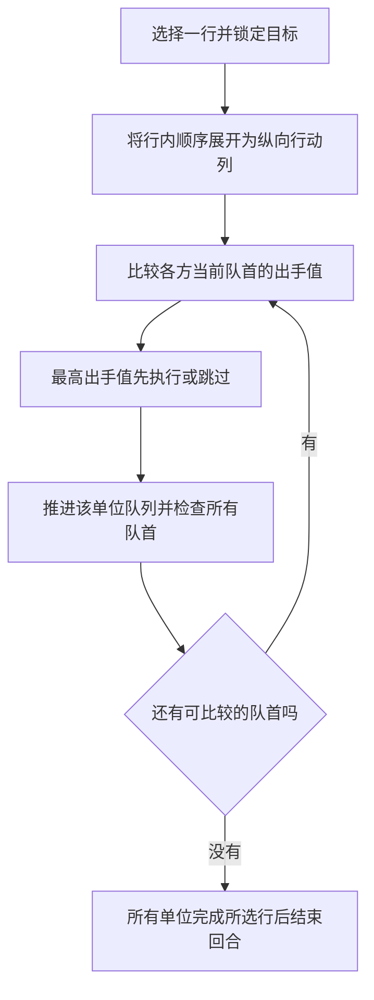

# 灵台选行竖直行动序列与舞台式演出提案

> 状态：2026-11-12，整体体验提案仍待审；行选择、目标锁定、出手排序、应对与失神仍以[灵台选行战斗规则](灵台选行战斗规则_20261111.md)为准。本提案不覆盖这些规则。2026-11-13用户明确授权借鉴《废墟图书馆》的交锋聚焦、命中慢放与背景暗化表现。
>
> 2026-11-13边界更新：真实走位、远程理想距离和射程复查改读[走位与射程补充案](灵台选行走位、射程与遭遇阶段规则_20261113.md)。本案中“走位只作演出、动作结束回固定站位”的旧限制被覆盖；纵向行动列和已接入的舞台打击演出仍适用。

## 目标

- 保留灵台的横向构筑与每回合选行，让玩家按自己排好的顺序展开一行。
- 选行后把该行的行动按纵向队列展示，使当前行动、后续行动和出手先后容易辨认。
- 让现有出手值清楚解释行动先后；走位演出负责表现目标关系与接敌过程，不把抵达时刻当作先后判据。
- 保留小人物与林间石地的舞台表现。演出负责表现人物抢先、接近、出招和应对，规则仍由灵台与技能定义结算。

## 首轮实现记录

- 主控选中行现以简洁纵列显示，保持盘面从左至右的顺序；队首高亮并显示实际出手值，后续行动显示估值，空格注明经过时回复体力。现有招式资源未单独覆盖 `board_tempo_multiplier`，均由默认公式按当前行占格、费用与属性推导；敌方招式、行与行动顺序仍隐藏。
- 运行时已有短促进身、命中停顿、受击反馈与回到锚点；首轮接入轻击、重击、格挡与挥击音效，分别跟随真实命中、全挡与实际出手触发。
- 2026-11-13舞台反馈修订：命中与实际化解接触时，镜头贴近攻受双方并短促震动后平滑复位；真实伤害接触暂停角色姿势与动作特效约0.06秒，无伤害的化解接触约0.045秒。局部招式牌 `BattleActionCue` 已移除，当前行动信息只留在底部竖直行动列，不在角色旁重复弹出倾斜黑牌。
- 2026-11-13聚焦慢放与暗化：聚焦区域保持清晰，战场周边以水墨暗色渐隐；真实接触后进入0.22倍短时慢放，并保持命中定格，约0.34秒实际时间后还原原时间倍率。相机缩放、背景遮罩与震动采用缓入和回收。慢放只改变演出和行动经过的时间，不改目标、费用、效果、伤害、随机结果或既定行动顺序。
- 2026-11-12 项目编译通过（0错误；1个NU1900警告来自不可用的NuGet漏洞信息源）。使用项目自带Godot .NET运行时完成无窗口试演冒烟，47项检查通过，覆盖首页直达入口、二十招来源、进入真实战斗、玩家选行、行动列出手值显示、完整一轮整理及返回试演配置；未切换正式存档。运行中有一条`user://logs/godot.log`无法打开提示，但进程以0退出。
- 2026-11-13既有原生Windows开局基线：项目构建0警告、0错误，62项检查通过；这份报告早于本次慢放与背景暗化实现，不能作为新效果的画面验收。更新代码的项目构建通过；当前本机Godot .NET运行器停在模块初始化，无法完成本轮原生画面复验，故慢放与暗化保留为待实机观感验收。
- 整体多单位行动列、全局行动记录及原生窗口视觉验收仍待完成；本次无窗口检查不代替视觉验收。

## 参考边界

《废墟图书馆》官方介绍将战斗描述为舞台式对战，使用卡牌与骰子，并让玩家观察客人的行动牌后选择应对牌；骰子结果决定冲突结果。[官方介绍](https://store.steampowered.com/app/1256670/Library_Of_Ruina/)

开发者更新另说明：低速度角色即使先到目标位置，也会等待高速度角色完成行动后再行动；其他更新分别调整过角色移动速度、攻击速度、镜头速度和整体战斗演出。[速度与抵达顺序更新](https://store.steampowered.com/news/posts/?appids=1256670&enddate=1597395459) · [移动与攻击速度更新](https://store.steampowered.com/news/posts/?appids=1256670&enddate=1592018480) · [战斗演出节奏更新](https://store.steampowered.com/news/posts/?appids=1256670&enddate=1594984883)

这些公开资料表明，角色抵达目标与获得行动机会不是同一判据；资料没有说速度值会直接决定移动距离或移动速度。本项目借鉴舞台调度、纵向阅读行动和目标关系呈现，行动顺序仍用现有出手值决定，不采用随机骰。

## 保留的现行战斗规则

1. 每回合主控人物选择一个已解锁行；其余单位依固定盘或战斗规划选行。
2. 所选行的单体目标按现行规则锁定。目标在招式执行前失去合法性时，该招式跳过，不付费、不扣次数、不改选。
3. 行内从左向右。每个单位只有当前行队首招式进入下一次出手值比较；招式结算或跳过后，该单位下一项才加入比较。
4. 出手值使用现行公式：80 × 招式节奏倍率 + 招式主属性加成。人物速度只用于真实战场走位；移动、射程和远程距离策略见走位补充案。
5. 敌方所选行与招式仍隐藏，只显示已选目标。应对仍按待命与化解结算，不加入攻对攻拼点、普通化解打断或目标改派。
6. 体力、法力、灵识、招式效果、费用、次数、冷却、定力与失神时限均沿现行专题。

## 回合与竖直行动序列

### 选行与展开

玩家完成行选择及目标确认后，主控人物所选行从横向盘面展开成纵向行动列：原盘面从左到右的顺序对应从上到下。各行动保持原占格身份；跨行招式只在本次所选行按当前规则检查一次，多格续格不复制成第二个行动。真正空格保留在对应顺序中，经过时仍按现行规则回复体力。

每个可见行动者可以使用一列纵向队列。队首是该单位当前待施展招式，后续招式依原行顺序排列。敌方队列不显示敌方招式、费用或招式顺序，敌方信息沿现行规则只显示目标意图。

### 动态比较与执行

每次只比较各单位当前队首。最高出手值先执行；相同值继续按固定参战顺序和行内位置稳定处理。一个行动完成或跳过后，该单位队列向前推进一项，再重新比较新的队首。这样纵向画面表示实际逐步揭示的行动序列，不把整行预先排成静态速度榜，也不让后续招式越过前项。

### 行动记录

竖直行动记录按实际发生顺序逐项显示：执行者、行动名称与图标、目标、出手值、实际费用与结算结果。未轮到的后续行动仍留在各自行动列中；被跳过的招式保留跳过反馈，但不显示虚构的费用或效果。敌方行动在开始执行时才显示具体招式，事前仍只呈现现有目标意图。

玩家能看到当前自方待施展招式的出手值。玩家公式使用易读的“出手值”，不显示 `board_tempo_multiplier` 等程序字段；详细规则可查[当前出手值公式](灵台选行战斗规则_20261111.md#回合与选行)。敌方具体行动及其排列仍遵循当前隐藏规则。

## 速度与走位演出

- 出手值只决定行动先后。队列轮到行动时，执行者再朝已锁定目标演出接近与出招；接近得早、早到目标或走得更快都不提前行动，也不改变队列。
- 近身攻击可由执行者沿空出的表现通道短促接近目标，命中或化解后回到自己的固定锚点。远程与术法攻击从固定锚点出手，使用现有弹道或光效表现。移动路径用于让玩家看清谁正对谁行动，不做寻路或距离判定。
- 应对招式按自身队列位置进入待命；触发时表现格挡或化解动作，不移动到攻击者位置。
- 动作结束回到固定站位。演出不得改变锁定目标、距离、范围、碰撞、伤害、费用、行动顺序或状态时钟；不新增路径搜索、自由移动、闪避或推拉规则。
- 首版不把出手值换算成移动速度、移动距离或起手帧数。先用队列高亮、先手标记和行动时间线清楚显示速度差；移动与攻击演出的持续时间作为独立表现参数调整。
- 暂停继续冻结动作演出与模拟时钟；倍速只加快显示，不重排行动或改变结算结果。

## 界面分区草案

| 区域 | 表现职责 |
| --- | --- |
| 战斗舞台 | 保持现有俯视石地与小人物锚点；以朝向、短步、起手和命中反馈表现速度与招式性质。 |
| 左下灵台 | 继续直接选择行；当前行高亮，完成选择后保留行来源提示。 |
| 竖直行动列 | 将自方所选行按原顺序纵向展开；顶部标出当前队首，其余排在下方。 |
| 交锋提示 | 显示可见自方当前行动的出手值、锁定目标和是否先手；行动队首变化时同步更新。 |
| 结果记录 | 将实际执行与跳过事件按发生顺序纵向追加；不提前揭示敌方招式。 |
| 资源与状态 | 沿用当前体力、法力、灵识、定力和状态显示；费用只在原规则实际支付时扣除。 |

## 不在本提案内变更的事项

- 不增加可移动格、战场坐标、射程、碰撞、冲锋、击退或拉近。
- 不增加攻击互拼、截击、改派目标、随机骰或额外行动。
- 不提前公开敌方行、招式名称、费用或招式顺序。
- 不更改技能、资源、敌人AI或存档结构；首轮运行时变更限于本案所述的行动列与演出反馈。

若后续要让走位实际改变位置，或像《废墟图书馆》一样公开并对抗敌方行动，需要另行调整目标、距离、应对与信息规则；本提案没有预先替代这些裁定。

## 待验收范围

进入实现前，按一对一与三对三场景核对：行内左右到纵向上下映射一致；只比较队首且行动后再推进；同速稳定排序；目标失效、费用不足和条件失败均正确跳过；空格与多格续格不新增检查；暂停、倍速不改变结果；近身动作结束后回到原锚点；敌方行动在开始前保持隐藏。

该清单是后续设计验收要求，不代表本提案已经运行验证。
