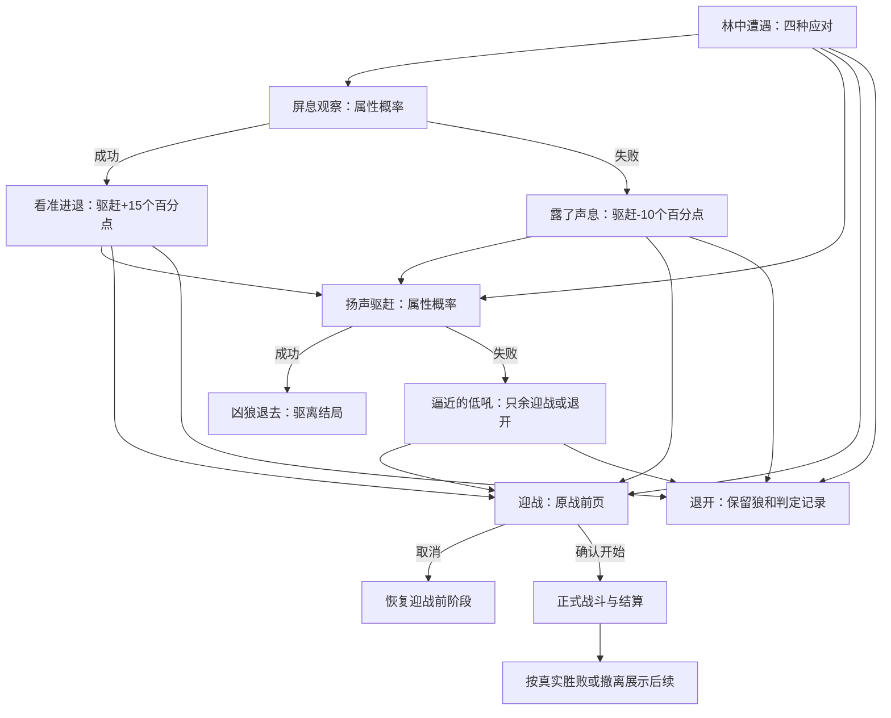

# 林中遇狼：首个完整事件设计

日期：2026-10-26。状态：完整待审设计，未实装。本稿遵循用户最新要求：**用相关属性计算判定概率，不设硬性属性门槛**。本稿的公式、修正量、费用及新增“驱离”结局均为本次拟定参数，不冒充已确认的运行规则。

## 一、范围与体验

以东林地浅林现有 `root_hollow` 单狼遭遇为首个样板，复用当前林地凶狼模板、强度、正式战前／战后与地图出口。只制作这个事件的连续分支，不新增狼点、战斗卡、材料或永久属性奖励。

事件标题仍为“林中遭遇”，内部内容名“盘根下的凶狼”。玩家可以直接迎战、观察后再决定、尝试赶走它，也可以安全结束接触。失败的首轮代价为时间、精力和本次机会，保留现行可绕行规则；不擅自增加随机扣血、强制战斗或封路。

观察不是免费战斗增益：成功帮助后续驱赶，失败使驱赶更难；所有修正只影响本事件的驱赶判定，不成为Buff、不改变狼的战斗属性。驱赶是区别于击杀的真实结局，不掉落兽骨和兽皮。

## 二、首次抵达页面

触发：自然移动到该点，且当前存在真实活跃遭遇。途中路线停止，棋子落稳后打开事件。地图不提前显示狼；刷新、读档或战后恢复不当作新的首次抵达。

插画：左侧沿用已审方向的单只凶狼、盘根、蕨叶与林径；右侧标题、旁白和紧凑选择。不显示地点小标题。

旁白：

> 枝叶忽然一晃，一头凶狼从盘根后现出身形。它没有立刻扑来，只伏低身子，目光紧盯着你。
>
> 你停下脚步。蕨叶间传来粗重的鼻息，来时的林径仍在身后。

| 选择 | 首期拟定结算 | 去向 |
| --- | --- | --- |
| 拔剑迎战 | 不作额外事件判定，地图费用0 | 现有战前情报，明确开始才进入战斗 |
| 屏息观察 | 属性概率判定；0.5游戏小时、1精力，成功失败都投入 | 看准进退／露了声息 |
| 扬声驱赶 | 属性概率判定；0.5游戏小时、1精力，成功失败都投入 | 凶狼退去／逼近的低吼 |
| 缓缓退开 | 不作概率判定，不额外耗时或精力 | 结束本次接触，回到实际格位地图 |

所有初始应对不因属性低而隐藏或锁定。精力不足、无活跃遭遇、行动结算中等仍需按真实状态阻止无效执行；这些是资源与执行校验，不是属性门槛。

退开只结束这次近距离接触。玩家留在实际格位，自行选择已知道路，后续行走按原规则耗时；不传送回入口，不伪造已走完一条退路。

## 三、判定公式与首轮参数

### 属性来源

读取玩家选择时的实际有效属性，不读取人物页格式化字符串；同一笔判定保留该次输入快照。观察取神魂（洞察）与灵慧（理解），驱赶取体魄（身体威势）与神魂（镇定）。不新增感知、威压、潜行属性；下列加权值只是计算中间量，不成长、不显示为新的角色面板属性。

狼在首次遭遇生成时固定一份真实个体快照，事件概率和之后战斗都用同一只狼；不能事件判定用模板均值，进入战斗再重抽个体。当前代码到战前才生成狼，这一接口需要调整。

### 观察

`观察能力 A = 0.7 × 自身神魂 + 0.3 × 自身灵慧`

`观察难度 B = 本只凶狼神魂`

`P观察 = 限制到5%～95%(100% × A ÷ (A + B))`

### 驱赶

`驱赶能力 C = 0.6 × 自身体魄 + 0.4 × 自身神魂`

`驱赶难度 D = 0.6 × 本只凶狼体魄 + 0.4 × 本只凶狼神魂`

`P驱赶 = 限制到5%～95%(100% × C ÷ (C + D) + 观察修正)`

观察修正：未观察为0；观察成功为**+15个百分点**；观察失败为**−10个百分点**。修正只存于当前遭遇的事件记录，结束后不带到另一只狼或正式战斗。

下限、上限及全部系数为首轮候选平衡值。低属性也有机会，高属性更稳定；上下限是概率边界，不是行动资格门槛。算法以完整精度结算，显示四舍五入到整数百分比。对 `u∈[0,1)` 的一次随机样本，仅当 `u < P` 成功（P以0～1传入）。

有效属性输入须为有限非负值，狼快照缺失或分母为0时拒绝此次结算并保留原页，不用编造的默认敌人值兜底。

上下限只在加上观察修正之后应用一次，不能先将驱赶基础率钳制后再加修正，避免低属性边界出现额外机会。

### 示例核算

只为解释曲线，假设玩家相关三属性均为表中值，并以狼模板均值体魄9.75、神魂7.75为示例；实装使用本只狼快照，不能固定用这组均值。

| 玩家相关属性 | 观察成功率 | 直接驱赶 | 观察成功后驱赶 | 观察失败后驱赶 |
| --- | --- | --- | --- | --- |
| 均为5 | 39.22% | 35.84% | 50.84% | 25.84% |
| 均为10 | 56.34% | 52.77% | 67.77% | 42.77% |
| 均为20 | 72.07% | 69.08% | 84.08% | 59.08% |
| 均为40 | 83.77% | 81.72% | 95.00% | 71.72% |

观察增加一笔投入，也可能使局势变差；不是必走的免费最优步骤。退开始终可选，观察或驱赶失败不会把弱角色锁进必须获胜的战斗。

## 四、后续窗口逐页文案与选项

所有页在同一事件窗内更新，窗口位置与图文比例不跳动。括号内的判定过程是配置说明，不塞进旁白；主栏是否显示准确概率按第八节候选口径执行。

### N1：看准进退（观察成功）

> 你稳住呼吸，留意它每一次抬爪与停顿。凶狼虽然龇着牙，却始终没有离开盘根旁的阴影。
>
> 它也在试探你。看准它迟疑的瞬间，也许能将它逼退。

选项：**扬声驱赶**（本次+15个百分点）／**拔剑迎战**／**缓缓退开**。移除观察选项，避免同条件重复判定。插画可复用初始图，镜头不凭空新增另一只狼。

### N2：露了声息（观察失败）

> 衣袖擦过枝叶，发出一声轻响。凶狼的目光骤然一紧，獠牙间挤出低低的咆哮。
>
> 它已留意到你的试探，再想将它吓退，恐怕更难了。

选项：**拔剑迎战**／**扬声驱赶**（本次−10个百分点）／**缓缓退开**。同样移除观察。局势变化只影响事件驱赶机会，不增加战斗伤害、行动速度或“警觉”状态效果。

### N3：凶狼退去（驱赶成功）

> 你踏稳脚步，朝盘根旁喝出一声。凶狼僵了片刻，终于收回前爪，低吼着退入树影。
>
> 枝叶摇晃了几下，便归于沉寂。这一处暂时安静下来。

选项：**继续前行**。点击仅关闭结果页回到当前格，之后由玩家决定实际路线，不自动走到下一格。

实际结果：本只狼离开该点，该遭遇记为“已驱离”，从活跃遭遇中移除；保留个体历史，不记为死亡、击杀或战斗胜利。不发战利品、贡献、经验、属性成长，不满足要求“击杀／战斗胜利”的目标。

该普通兽源后续仍按既有14日检查补充，产生新个体ID，不复活已驱离个体、不立即满额刷新、不重置整个点位。若玩家正站在该格，沿用延后补充的规则。本稿不承诺驱离后整整14日绝对安全，因为现行规则是全局检查周期。

### N4：逼近的低吼（驱赶失败）

> 你的喝声在林间散开，凶狼却没有退去。它压低头，向前迈出一步，爪尖刮过湿土。
>
> 它不肯让步。继续虚张声势已没有意义。

选项：**拔剑迎战**／**缓缓退开**。本遭遇的观察与驱赶机会均结束，不能关闭重开后再刷一次。狼仍活跃，保留原强度；不自动扣血、开战、追加伤势或发放物品。

### N5：暂避锋芒（任意未解决阶段选择退开）

> 你收住动作，缓缓拉开与它的距离。凶狼仍伏在盘根旁，目光追着你，却没有扑来。
>
> 这场接触暂且告一段落。是否再来，由你自己决定。

选项：**回到林径**。仅关闭结果页，不执行地图移动。狼保留；事件仍记录本次已用的观察／驱赶机会与结果。再走入同一只狼所在格时，恢复仍可用的应对，而不是重新抽签。尚未尝试的驱赶可以在以后选择；已失败的驱赶不恢复。

### N6：战前与战后续接

**选择迎战**：进入现有正式战前情报，展示真实敌方与既有开始／取消操作。取消后恢复选择迎战前的事件阶段，保留已发生的判定与消耗；不产生胜败页面。仍可退开，不改变当前允许取消的规则。

**真实胜利且正式结算返回后**：

> 凶狼终于倒在盘根旁。你稍稍平复气息，林间只剩下风穿过枝叶的声音。

选项：**回到林径**。只有真实胜利清除该遭遇；兽骨、兽皮等沿用原战利品结算与待领账本，此页不再发第二份奖励。未领物品仍留在原待领入口。

**正式撤离返回后**：

> 你摆脱了凶狼的纠缠，重新站稳脚步。树影里仍传来它的低吼，这一处并未平息。

选项：**回到林径**。保留真实战末气血、法力、战备消耗与伤势，狼仍在；已用事件机会不重置。战斗内撤退照原公式，与事件安全退开分开处理。

**败北／平局返回后**：旁白依据真实结果分别表达失利或未分胜负，不能统一写成“击败凶狼”。选项为**回到林径**；伤势与返回位置完全沿用当前正式战斗回传规则，不能以新窗口回满资源或新增惩罚。

## 五、完整分支与结束条件

- 最终解决：真实战斗胜利，或驱赶成功。
- 暂时结束：退开、正式撤离、败北或平局；狼仍在，已结算的事件记录保留。
- 图形结果页／战前页只是呈现，不得同时再调用一次行动结算。
- 本只狼最多一次观察、一次驱赶，最多投入1游戏小时与2精力（不包含行走、NPC打断、正式战斗等其他行为）。不是每次靠近都重复收费或重抽。

## 六、消耗、中断与保存

观察／驱赶沿用当前调查类0.5小时、1精力作为首轮候选，不收战斗体力或法力。执行前检查当前个体仍活跃、精力足够、行动未占用。查看、悬停、结果翻页、取消和无效操作不收费。

开始执行后扣精力并按现有驻足行动切片推进时间与NPC。到完成时才判定并提交目标节点；途中若发生正式中断，已投入精力／已过时间沿用原规则不退，未完成时不抽取结果、不记成已成功或已失败。再次完整执行是一笔新行动，界面必须先明确显示费用；中断不能发出驱离或战利品。

完成提交前再次核对遭遇个体仍是原来的活跃对象；若现场变化导致对象失效，中止结果提交，不能对新补位个体套用旧判定。行动执行中锁定其他应对，暂停／中断沿用现有规则。

保存要点：地图实例、狼源格、遭遇个体ID、狼真实快照、当前事件节点、观察结果、驱赶结果、判定输入／实际概率／随机样本、消耗事务及结果展示状态。判定完成时原子提交结果与目标节点，再翻页；刷新、重开、退出和读档不重复收费、抽签或发物。

玩家成功结束后再来只看到地形／现场已平息。后续生态新个体有独立记录；不把旧狼的观察优势沿用到新狼。正式存档任意页面中断后恢复相应页面；未结算的中途行动采用当前既定行动中断策略，不能先推进结果再补扣费用。

## 七、实现接口差异与边界

当前代码的狼行动完成与胜利清怪相连，普通兽源也读取该完成记录作为补位前提。**驱离不能直接调用原胜利完成回调来冒充击杀。**需增加明确的遭遇处理结果，分别表达“击败”与“驱离”，让活跃查询／生态补位共同读取“已离开此点”，而战利品／击杀任务只读取真实胜利。

“驱离”是遭遇记录的结局字段，不是新战斗状态或关键词。实现前应把静态初始狼、14日补充狼的身份与占位规则一并收敛；只处理当前样板点，不顺带改所有地图的狼。

不读取不可见的其他狼来修改概率，不因命名为首个事件而弱化现有通智初期凶狼。退开的安全规则与现有可绕行一致，驱赶后的空位是本次新增设计，需审定后才接入生态。

## 八、概率与窗口的展示建议

用户尚未最终选择“隐藏概率／风险词／具体概率”的口径。本样板为便于审阅，建议选项主行只写应对名，悬停说明相关属性、当前成功率、真实费用、成功／失败的直接后果；详细显示档再在结果后紧接代入公式，遵循当前全局简略／详细规范。不能把该建议视为用户已确认。

在观察结果页，可用一句小字说明“你已看准它的迟疑，驱赶机会提高”或“它已警觉，驱赶机会降低”。该提示要与真实修正一致，细节放悬停，不把内部阶段ID写给玩家。

未执行行动时，X／Esc可直接收起并保存当前阶段，留在实际格位；再次打开恢复原页与已用机会。显式选择“缓缓退开”则先呈现N5收束旁白。这两种关闭都不替玩家移动、不新增随机结果，也不恢复判定机会。

判定后沿用同一窗口更新旁白与选项，不叠弹窗。初始、观察成功／失败可以共用场景图；驱离结局使用同一场景的空林径，驱赶失败可用狼逼近的构图。新增图均需正式制作并审阅，不能拿初始图直接宣称所有页已经有图。

## 九、逐项验收与当前完成度

设计验收：四项应对无属性硬锁；每条结果均有旁白、下一步及结束规则；成功与失败有实际区别；退开不瞬移；正式战前确认保留；驱离与击杀分账；事件内加权值不新增人物属性；不新增战斗Buff、卡牌、物品或奖励。

数值核查：已独立计算示例表，检查概率上下限与属性单调性。公式与样例只验证本稿算术，不等于游戏已完成该判定。

实装后必须验证：固定狼快照与战斗一致；双击／读档不重抽；精力不足无消耗；中断不提前判定；观察修正不进战斗；驱赶不发击杀奖；驱离后14日补位新个体；战前取消回原阶段；真实胜败／撤离与待领回传；四选项、三选项和结果页在两种画布适配。

当前仅完成完整策划与算术核查。没有修改运行数据、实现判定、生成后续插画或运行新增事件冒烟。

## 现行依据

- [事件判定与后续窗口框架](副本事件条件判定与后续窗口_20261026.md)
- [东林地疏路与抵达旁白](东林地疏路分区与抵达旁白_20261026.md)
- [人物属性主案](人物属性、因果与心境系统设计.md)
- [东林地行动与费用](东林地节点行动短测与界面.md)
- [生态与恢复](副本生态来源刷新与多层地图提案.md)
- [战斗流程、撤退与战利品](战斗流程撤退与战利品提案_20261009.md)
- [信息简略与详细规范](信息展示与规则详解分层规范_20261026.md)
