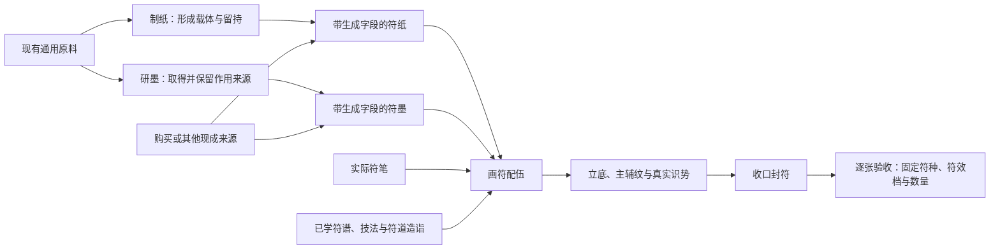

# 符箓三工艺完整规则方案

2026-11-08，完整细案的逐份字段修订。整体分工、保留有用旧字段、现成纸墨路径与自动操作方式，沿用用户已认可的[三工艺整合方案](符箓三工艺深度整合与画符配伍方案_20261108.md)。本页统一纸墨字段、原料自动匹配、功用分配、生克对象及画符至封符的因果顺序，作为后续细化的完整规则入口。

**当前原生接入（2026-11-09）：**[接入说明](符箓三工艺原生接入_20261109.md) · [首轮候选参数](符箓三工艺候选参数与实装_20261109.md) · [实际图集与对齐复验](../../../美术规范/符箓三工艺原生接入_20261109/README.md)。用户授权补定候选参数并接通完整制作，追加造诣参与。现已接天工峰真实材料与库存、纸墨生成、技艺研习、三笔备置、画符和固定成符使用及保存；两档各394项与战斗85项通过。顶栏、数量框、文字边界已按炼丹炼器复验。历史网页样稿的手填成品未移入游戏。

**规则与数值来源：**下文保留纸墨字段、自动匹配、逐品级来源与生克的因果细案；具体曲线、单位、产量、费用和首轮固定符效，以2026-11-09用户授权拟定的候选版为准。下文早期示例仍为真实原料的非数值说明，不能替代实装候选参数或实际产物快照。

**用户最新材料裁定：**研墨主体只用致密、颗粒或液体，纤维退出研墨；黏胶仅作可选结合、定墨辅料。液体可以直接作为墨源，不再强制另加固体墨料。本页已按此修订，覆盖旧稿纤维研取及纯液体不能成墨的条款，不为补齐功用把纤维加回。

本轮补出的具体分配顺序、合格墨取用口径、辅纹工艺和策略为细案建议；尚未接游戏。公共转换曲线、生成曲线与标准单位、学习门槛、用度与符效档阈值待标定，不把它们写成已批准数字。此处的工艺量、负担与来源账不是新增人物资源或战斗关键词，不扣人物修炼进度，也不另设画符法力费。

**当前展示方向修正：**用户明确要沿第一版纸性、墨性的维度展开，只补灵力层次；后台可以有多字段，玩家不需要逐项计算。本轮撤去把纸分成灵力容量、传导效率、稳定性、封存能力四项玩家指标的提案。以下主栏字段是本轮建议，具体标签、单位与数值未定；复杂来源与工艺记录保留后台，不是把玩法一并删掉。

**用户最新对象裁定：**每张符纸、每份符墨共用各自的字段结构，字段值由本批材料、份数与做法生成。撤去先列厚承纸、细纹纸、护持墨等有限成品类型，再套固定能力的组织方式。纸墨生成后保存实际结果，不靠无缘由随机词条区分；同批均质是首版建议，不是要求每张随机不同。

**主要玩法：**玩家看纸能容多少墨、是否容易洇开、是否结实，以及墨有什么功用、浓淡和铺展特点；纸墨各用一项灵性表达灵力层次。材料、用量、十二功用、生克和工法在后台生成这些结果；画符时显示相关配伍问题与技艺选择，不要求玩家手算完整损耗链。

## 一 全链对象与结果



符谱确定最终符种、完整效果、费用、目标和使用条件；纸决定容墨、渗墨与行纹时的保持，墨提供实际作用来源和书写特点，笔负责控墨与收锋，技艺改变已有条件的使用方式。不同材料与做法可以生成不同字段；相同字段结果的购买品与自制品同质。画符不回查旧原料或制造者补加效果。

成品先沿固定符种、有限符效档的组织，不以新增战斗符式为前提。纸墨不随意给符附加护盾、治疗、追踪、持续或群体；三工艺的复杂度先体现在配伍、成符、档位、数量、工作和损失上。

## 二 符纸：纸性为主，只补一项灵性

每张纸共用四个主栏字段，材料和工法生成自己的值，不分预设纸种。灵性补齐原案遗漏的修仙层次，其余保留原版纸材与配墨特点；不把同一灵力过程拆成四个玩家评分。

| 玩家主栏字段 | 一句话含义 | 展示与选择 |
| --- | --- | --- |
| 灵性 | 这张纸的灵力层次。 | 用统一品阶或简短层次表达，不另列容量、传导等灵力子评分；按实际术式软性适配，不按境界硬禁用。 |
| 承墨量 | 这张纸能承接多少墨。 | 来自每张实际纸基与组织；墨要落得更多、更集中时需考虑，显示统一容量或少／中／多等结果，具体量纲待定。 |
| 渗墨性 | 墨落下后，是留在表面还是容易渗开。 | 偏低／适中／偏高等倾向，不是越高越好；与墨的流动、附着及写法配合，实际进入有效通路与无效洇散分别处理。 |
| 韧性 | 画符时，这张纸是否容易受损、断纹。 | 用直观强弱表达；聚势、复杂行纹或配伍干扰更考验纸的保持能力，不要求玩家另算一个稳定率。 |

灵性只占一个玩家维度，不能又与通用品阶、原料品级各乘一轮。与现行品阶显示如何统一，在数值映射时明确，不更改通用材评公式或把最高一项功用品级直接当成整张能力。所有层次必须来自实际生成结果，不增加原料字段。

后台仍可保存可用纸基、实际连接、均匀、损伤、结构保持、留持及各品级来源。承墨量与渗墨性按第一版维度恢复，但不直接还原旧固定规格表；韧性概括玩家需要判断的承纹保持。旧纸面精细度不回到主栏，精细处理只通过真实连接、均匀与纸墨送达发挥。

封符仍由纸的实际留持、墨中固／藏、笔的收锋和技艺共同处理；封存不再单列一个纸材主栏评分。相关问题直接提示“收口支持不足”等真实原因。同一损失只记一次，不把承墨、渗墨、传导、稳定与封存再连乘一遍；不新增寿命或储存衰减。

五行、真实保留功用与可调用支持、张数按共同资料保存。主栏不是全部保存字段：影响画符的完整数据与版本相同才可合并。同批可同质，不逐张随机；购买品与自制品按相同数据使用。

## 三 符墨：作用方向与书写特点分开

墨沿第一版的浓淡、铺展、附着与定纹维度形成使用差异，主栏只保留最方便决策的四项。

| 玩家主栏字段 | 一句话含义 | 展示与选择 |
| --- | --- | --- |
| 功用 | 这份墨能提供哪些作用。 | 展示实际保留功用，最多四项；功用品级及可调用支持在详细资料分项记录，不让玩家先手算一个总池。 |
| 灵性 | 这份墨中作用来源的灵力层次。 | 统一用品阶或简短层次表达，具体归纳映射待定；真实各功用品级分层不丢，不平均品级、不以少量高品覆盖整批，也不再另加万能威力倍率。 |
| 浓淡 | 墨料相对配液是集中还是较淡。 | 淡／适中／浓等直观结果；由实际可用墨基、配液、收配与分份推导，不由功用品级直接计算，浓墨也可能更难承接。 |
| 流动性 | 墨容易铺开，还是更容易聚在落笔处。 | 偏低／适中／偏高等倾向；与纸的渗墨、实际笔和写法相配，不是越高越好。 |

附着、凝定、分散均匀与实际损失可以继续作为后台过程或结果数据，不硬压成一个万能稠润度。它们真正影响当前配伍时，在制作页提示“容易洇墨”“不易附纸”“接续较难”等实际问题；玩家不需要先比较一整张书写系数表。基本资料可查，不以造诣隐藏真实条件。

每份墨量与库存份数是数量资料，不作为第五、第六条品质评分。浓淡不是直接增加伤害的系数：实际墨量与功用来源同步支出，稀释不增加总功用；附着、流展、凝定同一段实际损失只记一次。旧独立稠润度不继续作为额外倍率或必填主栏。

主墨源仍只有致密、颗粒、液体；黏胶仅作可选辅料，纤维不进入。液体可直接制墨。现库墨源缺引，需要纸上确有可调用余量的真实来源或未来合法原料，不能凭描述补出。

## 四 原料如何自动发现与匹配

### 输入只有现有材性与份数

玩家只选原料、份数和已学工法，不给每味材料指定岗位。后台依次处理：

1. **质地确定实物用途。**是否有真实纸基、墨源、介质与可选结合料，先决定能否启动。
2. **功用确定怎样加工和留下什么。**先支付确实需要的处理，再分给结构与可调用余量，不能每种用途各算满额。
3. **五行影响这次实际接触。**相生可帮助处理或保留，相克增加对应对象的损伤和保留负担，不套全批统一倍率。
4. **份数与工法决定每单位分到多少。**同一批分成更多张／份，每单位分到的实际纸基与来源也要重分；不是所有材料一多、全部字段就变好。
5. **从实际结果生成字段。**先得到产物与后台资料，再形成四项主栏，最后保存实际数量；不按名称命中预设纸种、墨种。

原料工艺仅读取：质地、十二功用及其真实品级、五行集合、实际投入份数。名称、图标与身份用于显示和扣库存；相性、材料总品阶、描述、旧材类、炼器加工档案不参与本版原料资格、费用、字段与产量计算。

制作条件另读工具、已学工法、符道造诣、制作取向及实际资源，它们不是新原料字段。

| 质地 | 制符纸 | 研墨 |
| --- | --- | --- |
| 纤维 | 提供实际纸基。 | 不接收。 |
| 液体 | 制浆、调和介质，也可以自带实际功用。 | 可直接作为液墨源，也可按本批方案参与配液、分散和调墨。 |
| 黏胶 | 可选结合、施面和边界支持。 | 仅作可选结合、附着、凝定辅料，不能单独充当主墨源。 |
| 致密 | 不接收。 | 先做必要解料，再形成可分散墨料。 |
| 颗粒 | 不接收。 | 从研细与分散开始，不重复整块解料。 |
| 气体 | 不接收。 | 不接收。 |

制纸最低需要真实纤维纸基与液体条件；制墨最低要有致密、颗粒或液体中的实际墨源。固体墨源调制需要实际配液；液体墨源本身可同时满足该墨的液态调和条件，不强制第二味液体，也不强制固体墨料。黏胶是否需要由本次方法和实际结合条件决定，纯胶不能代替主墨源。

液体能进墨源候选，不代表能制任意法性。它只能提供自身真实功用与层次；液体本身只带聚、化，就不能据此制出破或护方向。新液体只填既有字段即可自动进入，不另加“可作墨源”开关、含水率或天然浓度。

胶虽只作辅料，在配伍已有真实主墨源时，仍可按其实际功用贡献处理或保留支持；“只作辅料”不是把它的功用删除，也不是允许它替代主墨基。

同一份液体只有一次实体投入。它形成液墨基并具有调和条件是同一实物的不同作用，不能把本份墨源体积和配液体积各记一份再相加。额外投入真实液体可增加相应墨基及其自带来源，增加多少可用份数及每份能力，仍按实际墨基、来源和成形条件计算。

### 确定的匹配顺序

1. 从通用原料定义和实际库存发现材料，校验合法质地、五行、功用及品级、正整数份数。缺少某项功用与存在非法功用品级不是同一回事；无五行来源可以合法存在，只是不参加生克。
2. 五行去重、排序，功用按共同词典整理。重复或非法功用定义须修正，不通过夹取品级掩盖错误。
3. 用“质地＋五行集合＋完整功用品级组合”组成材性签名，同签名先合并实际份数。不是只取最高一项功用，也不按材料名或添加顺序排优先。
4. 按上表进入本工艺质地路线；再由本次制作取向与已学工法决定各部分本批承担的处理、结构和留存。
5. 工具先完成能启动的基础处理，只有已经取得的实际来源才能进入后续辅助；未研取部分不能提前满额帮助自己的研取。
6. 依工法统一分配顺序，处理真实接触与损失，再逐张或逐份验收。基础形态未成时形成残余／未成材记录；成形后依据实际结果生成字段，不查固定产物降规表。

同属通用原料、同材性签名、同份数和同制作条件，必须同表现。材料身份只保留扣料与来源追溯，异名拆分或换添加顺序不改变结果。新通用原料只填现有字段即可被发现，无须补制纸／制墨岗位或专属配方。

自动分配只在玩家已选材料范围内进行，不自动补料。先联合预留本次成形、调和与保留策略所需的真实支持，再按实际工序支付已可用支持；同一多功用来源被占用后，其其他用途的可分配余量同步减少。随后才按工法偏好安排可选细整、保络或留持，最后处理余量。联合预留只是工作规划，不允许尚未取得的来源提前调用；同优先级采用材性签名的固定顺序，不用名字、物品ID或加入顺序选择获益方。

已登记为纸墨半成品的定义走自己的完整用途合同，不丢掉每份来源账、再退回裸原料按品级补满预算。纸墨返工回收本轮不开放；已登记半成品若合同缺项，应报待补，不能回落为通用原料。这是输入对象边界，不是给通用原料增加可制纸等字段，也不按材名排除。

### 当前材料核对

按现有物品和其材性引用只读核对，共50项通用材料：纤维18、致密22、颗粒5、液体3、黏胶2。制纸候选23项；制墨主墨源30项，另有2项黏胶辅料，制墨选材候选合计32项。这只是候选范围，不等于任意单材能做出完整产品。见[原料资料核对](符箓原料自动匹配资料核对_20261108.json)。

实际同字段组包括云雾菌／砾地菌伞／青岚藤心，以及斑甲壳片／玄甲薄片；前组只在制纸候选中、后组只在制墨候选中。同份数、同条件下，同组原料在其适用工艺中同表现。不同名字、旧子类或相性不会另发收益。

## 五 实物与功用分别记账，品级分层保留

### 实物账

每份原料只有一份实物。纤维可以形成纸基，同时自带通、固等作用；实体与自带能力不是互斥岗位，但实体数量不能重复生成纸、墨或分层。

```text
本批实际投入 = 留入合格产品的实体 + 处理残余 + 实体损失
```

同质地的公共换算与工序得率统一维护，不给原料补天然体量、丝长、含水率或粒度。凝纸和配墨中的中间状态由本批输入及工法产生。

### 功用账

一份多功用原料共享该份来源的可分配支持。处理、纸墨结构、后续可调用部分与损失都写清去向；不是每项功用都独立获得该份全部支持。

```text
同一来源的全部用途分配份额之和 ≤ 该来源实际可用份额
某功用的有效支持 = 分给该功用的真实份额 × 该功用品级的公共强度 × 当前处理保留
```

这里的份额由目标、工法和策略自动分配，不是玩家百分比滑杆。不同功用的强度不直接加成一个万能总量；功用账先按来源份额守恒，再按各项实际品级兑现。

品级内部1对应九品、9对应一品；品级强度沿公共非线性曲线标定，不将内部序号当线性倍率，也不另乘材料总品阶。

五行、功用、品级与剩余支持始终绑定来源，不先拆成两座无关联总池。被克或被排出的哪一部分，要能追到对应功用与品级。实体残余离开时，其尚未转移的来源一起离开；只有公共工序确实把来源转移并留在另一真实载体时，才允许该部分继续留下。

### 防止少量高品洗高整批

**灵性从哪里来：**纸读实际留入本张结构与调用部分的品级支持，墨读实际留在本份各作用中的品级支持。高品材料若已用于加工或随残余离开，就不能继续抬高产物。数量主要改变各品级的可用量，纸厚、墨浓、相生或造诣不会自行把低品来源改成高品。

灵性是这些真实结果的概览，不是结算时再乘一份系数。例如墨实际留下通八品与生七品，就继续分项使用八品通和七品生，不能显示一个七品后把通也改为七品。单项概览与现行品阶如何归纳的公共映射仍待标定；本轮明确其来源与边界，不伪造输出品阶或平均真实来源。必要差别在功用详情或配伍提示中可查。

来源保留“来源、功用、真实品级、剩余支持”分层账。每张／份分别记录实际品级与足够真实支持，不取最高品覆盖整批，不平均品级，也不让同一高品份额同时支付处理、结构与成品留存。

低品多投入可以增加该层支持与可得数量，不直接把保留功用改写为更高品级。当前不另设自动升阶炼化。高品来源如何支持较低目标，由公共转换口径与目标要求明确，不能默认跨品级无损兑换。

实际断角骨片具有破八品，裂甲石具有破九品。两者同批处理时，能做多少份要求破八品实际支持的墨，仍受处理后真实八品来源限制；九品不因本批出现过八品就全部升级。

同一固用于形成纸的保持能力，可以以结构形式留在产品中；它不是全部消失，也不能再作为一份满额可调用固。产品若仍留可调用余量，必须在本份预算中另行声明。

## 六 制符纸：材料怎样形成四字段

允许投入纤维、液体与可选黏胶。玩家选材料、份数和工法，角色自动“化材→蕴养→凝纸”，不操作现实纸槽、筛网或压纸时机。

| 字段 | 后台形成依据 | 十二功用怎样参与 | 实际取舍 |
| --- | --- | --- | --- |
| 灵性 | 每张实际留下的结构、法意与可调用支持，按真实品级分层。 | 各功用的实际品级与保留份额决定层次；藏、护等可以保住对应部分，不能无中生有升品。 | 高品源用来加工后未留存，不继续抬高纸；多做几张必须分掉本批支持。 |
| 承墨量 | 分到本张的有效纸基、可利用结构、结合与剩余损伤。 | 固支持实际结合，聚保住已有纸料，通帮助利用真实内层连接；都受实际纤维与工法限制。 | 每张多分纸基可能让出张数；胶结和密整可能压缩可利用空间，不保证纸料多就容墨同步翻倍。 |
| 渗墨性 | 本批形成的开放连接、胶结与面整结果。 | 化帮助调匀，通、引、行帮助真实连接和铺布；不是拥有它们就直接“渗墨加分”。 | 开放的纸利于进入已有通路，也更需防无效洇散；胶与密整可能减少渗入，同时改变后续入墨。 |
| 韧性 | 实际结合、均匀、完整度与残留损伤。 | 固形成保持；护减少对应损伤，镇处理真实波动；生有真实余料时补缺，明辅助识别，破只处理允许打散的结滞。 | 更充分处理会增加工作，也可能带走纸料；没有实际问题的护、镇、明不各赠一轮通用韧性加成。 |

藏形成的留持、实际连接、均匀与损伤继续保存在后台。它们影响画符时，直接给出相关来源或配伍说明；不为了主栏只有四项就删掉实际区别，也不把它们全变成必读评分。

加工时先让实际纸基形成，再用已经可用的功用调和、结合和保留，最后分张。未成页的部分不生成符纸；分张后每张字段与实际支持合计不能复制整批投入。

| 已学工法取向 | 改变的实际处理 | 玩家需要承担什么 |
| --- | --- | --- |
| 养脉 | 偏保可用连接和纸内通路。 | 要配能利用这些通路的墨与写法，也要处理真实渗散。 |
| 凝纹 | 偏均匀、完整与结构保持。 | 多工作，可能损失纸料或减少开放通路。 |
| 叠脉 | 将真实纸基组织成更能承接的结构。 | 每张用料与结合工作增加，不能免费增加张数。 |
| 敛灵 | 偏保实际边界与收口留持支持。 | 占用真实来源，也可能改变入墨条件，不赠一份满额藏。 |

工法是加工方式，不是预设纸种；不能点选就保证某字段或品阶。具体工法转换、单位与阈值待标定。

## 七 研墨：材料怎样形成四字段

致密、颗粒、液体可作主墨源；黏胶仅作可选辅料。致密先解料，颗粒从研细分散开始，液体可直接调墨；所有路线都按实际来源形成结果，不要求液体也研碎。

| 字段 | 后台形成依据 | 十二功用怎样参与 | 实际取舍 |
| --- | --- | --- | --- |
| 功用 | 原料真正取得后、按本次取舍留入墨中的作用，最多四项。 | 破、化等帮助允许的取得；镇、护、藏等分别处理波动、损伤与保留。其他作用可以留给画符，不强行折成书写属性。 | 用于加工、结构的部分不再满额供主效；原料有功用不代表成墨全部继承。 |
| 灵性 | 各保留功用的实际品级与每份真实支持。 | 分品级兑现，不取最高一项替代全部；护、藏等保护的是已有来源。 | 高品支持有限就只能提供有限真实份额，不能一滴高品把整批洗高。 |
| 浓淡 | 实际可用墨基相对配液的集中程度，经收配与分份形成。 | 聚可减少散失或集中已有墨料；化帮助调开。它们不等于直接提升浓度或符效。 | 多加液可能更淡、更易铺开，但总功用不凭空增加；浓配可能让出可用量并增加承接负担。 |
| 流动性 | 实际液胶配比、分散、匀调与处理后的书写状态。 | 化、行、通只在真实调匀和送达问题中起作用，固支持结合，不能同时免费提高全部书写性能。 | 易流动利于铺展，也可能洇散；多胶可能更易附着、定纹，也可能影响接续。 |

浓淡不是功用总强度，不将十二功用品级相加作为墨的浓度。相同浓淡可具有不同品级、功用和真实支持；加胶增加的结合负载也不是额外主效。附着、凝定与均匀保留后台，用相关问题提示解释，不再压成一个万能稠润度。

液体本身可以是墨源，也可能自带聚、化等功用。不能把所有液体当成没有作用的水，更不能把同一份液体作为墨源和介质计两次实体。纯胶仍不能替代主墨源。

| 已学方法取向 | 改变的实际处理 | 玩家需要承担什么 |
| --- | --- | --- |
| 均研 | 完成必要取得与匀调，兼顾可用量。 | 不自动达到所有精细书写条件。 |
| 澄灵 | 处理真实未解、结滞与可分离残余。 | 多工作，弃去部分可能携带有效墨料与功用。 |
| 聚蕴 | 在真实墨基中集中已有来源，按方法收配。 | 通常让出可用量或份数；去液带走的来源须照实扣除，不默认纯去水而无损。 |

研墨按取得、必要匀调、加工与保留分配、实际调制、分份成材执行。工具先完成普通基础处理，尚未取得的功用不能提前满额帮助自己的取得。

## 八 十二功用在三环中的具体位置

功用既可用于本次处理，也可形成结构或留给画符。以下是统一语义，不要求每个工法、每种纸墨都使用全部十二项。

| 功用 | 制纸 | 研墨 | 画符 |
| --- | --- | --- | --- |
| 固 | 支撑实际结合、固形与纸面保持。 | 支撑结合、附着与定纹。 | 稳定已形成的纹域或参与符谱明确的作用，不能替代藏的全部留持。 |
| 聚 | 收拢已有纸料、减少真实散失。 | 收拢已得墨料与来源。 | 把有限支持集中到允许的主纹，挤占其他用途或后续张数。 |
| 通 | 形成可用连接、利用已有纹层。 | 支持已分散来源的连贯送达，也可保留。 | 主辅纹有效连接；先有通路再获得其帮助。 |
| 化 | 调匀实际纸源与结合部分。 | 帮助允许的取得、分散和调合。 | 处理本批成品墨的实际调合，不改变库存墨或任意转换缺失功用。 |
| 引 | 引导已有支持归位。 | 分配已有来源，也可主要保留供术式调用。 | 引导来源进入所选主辅纹，或执行符谱已定义的引发作用。 |
| 破 | 打散本版允许处理的真实结滞。 | 解开致密料、未解部分与团聚。 | 为符谱明确的攻伐／解破作用提供来源，不自动增加破甲。 |
| 护 | 减少成材损伤和干扰扩散。 | 保护已得来源，减少实际互损。 | 护纹限制其成立后的真实损伤，也可作护持符主效；两种用途分别用量。 |
| 镇 | 处理真实结构波动。 | 处理多源调合或凝定波动。 | 识势后处理实际失稳；不自动给任意符附加控制。 |
| 生 | 使用真实余料补缺，不生出纤维。 | 可主要保留为生养来源，不强行变成墨性加分。 | 执行符谱既定生养，或在允许修补动作中用实际余料补结构，不追回已失来源。 |
| 明 | 识别缺陷与分布问题，辅助处理。 | 辨识未解与可分离残余。 | 辨识当前工况或为既定辨明符术供给；识别不代替处理。 |
| 藏 | 支持把已成结构和法意留下。 | 减少真实散失，保留实际可调用部分。 | 封持已经形成的术式，不封存尚不存在的主纹，也不自动增加寿命或延时。 |
| 行 | 运送、铺匀已有纸源。 | 匀调和运送已分散墨源。 | 沿有效通路送达，不能替代通建路、引定向，也不自动产生位移。 |

普通工具能处理基础问题，缺某辅助功用不等于连普通工序都不能启动；真正需要的特殊作用来源则不能由工具或造诣凭空补出。当前制纸候选不因缺破、明、镇就借矿料进入纸页。

## 九 五行生克按接触、方向和剩余份额结算

相生为木→火→土→金→水→木，相克为木→土→水→火→金→木。每次先确定谁实际接触谁、接触了多少、当时还有哪些来源，再处理有方向的关系。

### 制纸：影响纸基与结合、纹面

| 关系 | 实际影响 | 可能传到的结果 |
| --- | --- | --- |
| 介质／胶生纸基 | 帮助本次处理、结合或保留。 | 保住可用纸基、均匀和稳定条件，不全字段加乘。 |
| 纸基生辅助来源 | 若确有支持分流，则帮助处理或结合。 | 支持用掉一部分，不能两边各记满额。 |
| 辅助来源克纸基 | 纸基保留或结构保持受损。 | 可影响承墨、韧性、实际连接或留持，具体看受损部分，不向四个主栏字段统一扣分。 |
| 纸基克胶料 | 胶结或施面来源兑现受抑制。 | 可能不利稳定与封存，也可能改变实际连接；不全字段统一扣减。 |

例如水行灵泉露接触木纤维，可帮助本次调和与保留；木纤维接触土行结合来源，则要检查结合兑现。生克不是把五行名称翻译成现实“土吸水”等额外物性。

### 研墨：影响取得、留蕴与配制

| 关系 | 实际影响 | 可能传到的结果 |
| --- | --- | --- |
| 介质生正在取得的墨源 | 改善本次允许的取得、分散或保留。 | 可用墨体或目标来源保住更多；是否多产仍看实际墨基、可分来源及成形条件。 |
| 墨源生介质／胶 | 实际支持分流帮助调和、结合。 | 流动、附着或凝定条件可能改变，分流部分不能全额留给主效。 |
| 介质／胶克墨源 | 墨源的兑现、保留或处理受抑制。 | 物性达标也可能因主功用不足而减产。 |
| 不同墨源相克 | 实际被克部分增加处理和留存负担。 | 需真实镇、护、调和或分离；不能先平均成冲突消失。 |
| 墨源克介质来源 | 介质方本有来源在本次处理中的兑现受影响。 | 可能增加调和工作，不能倒写成墨源被克。 |

灵泉露虽有聚七品、化八品，其水性对木行致密青木芯与对火行致密赤纹燧石有不同关系。化仍可帮助允许的分散，火方的受克损失也须核算；不是水料一律不能制火性墨。纯液墨批次也按实际液体来源之间的接触处理，不强造一段固体研磨。

### 画符：影响实际入纸、成纹与留持

| 关系 | 实际影响 | 必须分清 |
| --- | --- | --- |
| 纸生墨 | 纸的实际支持帮助承接墨中来源。 | 受纸的承托与实际余量限制，不复制墨功用。 |
| 墨生纸 | 墨中部分支持用于稳底或活化有效纹层。 | 被分流部分不能同时全额进入主效。 |
| 纸克墨 | 需要写入的来源受抑制。 | 按实际被抑制部分处理，不把整份墨全部清零。 |
| 墨克纸 | 纸的对应承纹结构承受损伤。 | 护、镇与技艺只能处理真实问题，不无条件取消相克。 |

多墨互相接触也按其实际份额和剩余状态处理。同行不自动加成，无五行不参加生克，但照常有质地、功用、墨性与工艺要求。

### 多行与重复接触

现有多行标签先去重；一次接触中，元素对子共享该次作用预算，权重按双方标签数等分，不新增原料元素占比字段。例如双方分别有若干标签，子对的关系权重合计只覆盖这一份接触，不能每对都领取整份增益。

每对子只记录一次有方向关系，不把反向查表再计一次。相生、相克作用到不同对象时分别记账，不正负平均消失；不同接触对象也不能各自领取同一来源满额支持。

同一接触不因自动动画、定纸、翻页或回看再结算。新加入或新暴露部分只按当时真实余量处理，已排出或已经封持的部分不再参与。

## 十 生成字段、产量与保存

本轮纸墨按“生成结果”组织，不从预设纸种、墨种表选一份固定属性，也不要求先命中一个成品模板。

1. 根据实际原料和工法完成处理，检查普通成纸／成墨的基础条件，形成真实可用实体与功用支持。
2. 按公共标准单位和本次方法的用料组织，形成可得张数或份数，再按每单位实际分到的支持计算字段。分张／分份与能力计算必须共同守恒，不能把整批能力复制给每张。
3. 首版建议同批相同加工结果均质，按各品级真实支持均分或依已明示方法分配；没有随机品质。高品支持分到各单位后仍是对应实际份额，不把全部低品改记高品。
4. 基础形态成立后，可以得到字段较弱但数据完整的纸墨；不因为未命中厚承纸或某类墨而降规。若连基础成形、调和或必要实体条件都不能满足，记未成材与残余，不生成无来由产物。
5. 生成后冻结字段与版本，供购买、存储和画符读取；不因换主人、开页或查看重新计算。

纸墨输出数据至少包括主栏字段、影响使用的后台结果、五行、各保留功用品级及真实可用支持、结构与调用边界、标准单位、数量与规则版本。产品五行根据本次实际保留结构与墨源形成，不能将所有加工介质标签全复制，或因木生火就造出火源；归一及接触份额按公共规则明确，不取名字或未声明占比。

墨的每份量可标准化计量。加液可能增加体积与可分份数，同时摊薄每份已有支持；若新增的是有功用的液墨源，也按实际投入增加对应支持。两种情况都不能增加投入之外的总来源，浓淡可随实际配液变化，但不承诺稀释后每份仍有相同来源。

普通原料当前按定义同质堆叠；纸墨生成字段是本轮专属半成品结果模型，需后续适配保存与库存。字段不同的同名纸墨不能仅按定义ID合并；全部影响画符的字段和版本相同，才可按属性签名合并数量。签名不包含制造人、批号或仅用于追溯的原料名称。

本调整只针对纸墨半成品。最终符箓仍按符谱、已有固定效果档位组织，不据此自由生成战斗词条。

## 十一 画符准备：玩家先做少量关键决定

**玩家操作链：选符谱 → 配纸、墨、笔并选写法 → 自动画符 → 必要时应变 → 自动封符、鉴看。**

主界面必需项是已学符谱、实际纸墨笔、准备数量与一种写法，未另选写法时可用符谱常法。纸墨可自制，也可直接取得现成品；会画符不要求先学造纸、研墨或炼器。

辅纹、主效／收口分配和自动应变属于可选进阶配置，共同形成一份执行方案，不再各设一个每次必填的控制栏。玩家不逐笔指定供墨或百分比，不自由画几何。普通准备只展示当前相关的少量配伍提示与真实用度。

后台将这些选择展开为已学符谱、纸材及投入上限、成品墨清单及预留份数、实际符笔、允许辅纹、主法、分配与应变策略。只读纸墨已保存的实际数据，不回查旧原料，也不在画符中重研墨或生成新瓶墨。

符纸若在完整结果数据中另有真实可调用功用，也可按符谱与阶段用途加入本张来源账，例如补足墨源目前没有的引。它与纸的结构能力分账，不能把已形成结构的部分再全额调用；本张纸的剩余来源不抽回成公共墨池供下一张重复使用。

### 基础封符先预留，主效使用真实余量

本轮推荐按“下一张完整基础用料包”预留：该张主纹启动、所选必要连接与基础收口都具备真实支持，才落笔消耗一张纸。预留不等于已经消耗，也不保证成功；实际负担增加后仍可能需要额外收束或应变。

主效会聚默认只调用未锁定余量，不先耗尽基础封符部分。若下一张已经无法组成基础包，就不再落笔，释放未用纸与未启用墨；不为了用完纸而强制制造失败。

### 高层分配策略候选

| 策略 | 自动分配取向 | 实际代价 |
| --- | --- | --- |
| 常法均衡 | 按符谱基础工艺兼顾主纹、连接与收口。 | 不专门把所有余量集中给某一项。 |
| 主效优先 | 基础完整包成立后，将可用余量偏向当前主纹。 | 局部负担增加，应变及后续张数余量可能减少；不保证升档。 |
| 留余稳收 | 基础包外保留更多可用于实际稳纹和收束的余量。 | 主效高档潜力或后续利用率可能让步；没有真实问题时不凭空得到稳定加分。 |

策略决定实际分配，主技法决定怎样执行，两者合成同一方案，不是两套独立加成。玩家不直接选保证满效、保证数量或逐笔百分比分配。

预检区分真实缺项与软适配：缺必要作用来源、没有可利用纹层却选透纸法、无法分清必要接头，属于具体条件不足；灵力容量相对偏低、配伍较难驾驭则按真实负担和损失处理，不翻译成境界禁用。

## 十二 成品多墨怎样混用

### 先保留分项，不能平均成万能墨

相同生成字段的墨先归并数量；不同字段的墨保留各自剩余墨量、功用品级分层、来源支持及浓淡、流动与实际附着、凝定状态。可累计实物量与对应支持，但不平均功用品级、不取每种墨最优特征。

本轮推荐把合格标准墨定义为均匀可取用的一份，按实际取走的墨量比例，同步迁移该份对应的各来源；这是本细案补入的统一取墨建议，尚未接运行。

```text
本次取用比例 = 本次实际取走墨量 ÷ 该标准份完整墨量
随取用移出的某项来源 = 本份该项完整支持 × 本次取用比例
```

每次仍受该份真实剩余量限制，不能把整份支持重复套到余量上。取用时携带这份墨的整包墨性：不能只取得镇来源，却不承担它偏流润或凝敛的接续条件。

混用按各实际份额及真实接触，统一处理纸墨笔与技法的实际送达；可推导本批书写状态，但不另设混合浓度威力乘数，不把流展、附着、凝定按同一损失再扣三次。少量凝敛墨不让整池都取得它的长处，其实际加入也可能增加接续工作。

系统按已选方案自动取用并处理接触。一次取用到混合、落纹和留存的去向都记真实变化，同一次损失只记录一次。混用状态只属于本批，不修改库存墨、不生成拥有全部功用的新材料，不恢复主／辅／封三个必填墨槽。

## 十三 主辅纹、符笔与技艺的因果顺序

主纹由符谱固定。辅纹只从该谱允许的整体式样中选择，不自由摆坐标、笔序、接点或分砚。

| 工艺辅纹候选 | 解决的问题 | 成立与生效顺序 | 代价 |
| --- | --- | --- | --- |
| 导通辅纹 | 后续主辅纹之间的实际连接问题。 | 先靠纸笔基础送达与已可用来源成纹，再帮助后续连接；不能反向帮助自己的首次成立。 | 实际墨、通／行等支持、纹面与工作。 |
| 护纹 | 已形成后发生的真实损伤和扩散。 | 成立后才保护对应部分，不追回之前损失。 | 墨与护等来源、精细承载和工作；无损伤时不发泛用奖励。 |
| 封藏辅纹 | 收口边界与既成术式留持。 | 可先立规定边界，真正封持必须等主纹存在。 | 结构、固／藏等实际支持和工作，挤占其他用途。 |

每项辅纹要逐谱写明前提、支出、占用和失败退路，不能全选最优。已投入的辅纹不能免费擦掉重来；是否可以改沿常法收束由该谱工艺明确，不临时保证成功。

符笔读取实际承墨、出墨均匀、聚锋精细、运锋与收锋适用。毫性和锋形是阅读说明，不按硬毫、长锋等名字自动发能力。工具不逐张提供造笔原料的功用，也不生成墨。

| 已有技法候选 | 本批改变什么 | 必要条件与代价 |
| --- | --- | --- |
| 束墨留痕 | 减少墨越过有效纹域的渗散。 | 纸仍有有效纹域、笔可精控，增加工作；不永久改变纸的生成字段。 |
| 透纸行墨 | 利用已有内层通路。 | 纸有可用纹层、墨可进入、实际通行支持与适用笔具备；底层分走墨与来源。 |
| 匀铺长行 | 改善允许连续段的送达与接续。 | 纸墨笔能承接长段，实际占用承墨与均匀送达能力；不适合所有急折细接头。 |
| 凝毫聚势 | 把有限支持集中到主纹允许的位置。 | 有真实聚与主效来源、纸笔能承托；挤占未锁余量并增加局部负担。 |
| 匀息镇纹 | 处置已经出现的真实波动与扩散。 | 已学、剩余镇／护等支持与用度满足；消耗余量，不追回旧损失。 |
| 舍势收符 | 停止继续会聚，尝试收束已有主纹。 | 已有可收束结构与实际收口条件；放弃继续追求高主效，仍可能封符不成。 |

准备时选一种主法；处置方法仅改变当前剩余问题的执行，不是再叠一个常驻增益。高造诣改善已学方法驾驭、真实损失、工作效率和具体识势，不自动授技、不生成缺失来源、不提高同定义成符的隐藏威力。

## 十四 自动成纹、识势与封符串联

玩家并不逐行操作下面的后台阶段。其体验按下表呈现：

| 玩家阶段 | 玩家做什么 | 系统做什么 |
| --- | --- | --- |
| 选谱 | 选已学符谱，看最终效果与基本需要。 | 符谱给出固定主纹、必要来源、可用方法与已有符效档。 |
| 配伍择法 | 选纸、墨、笔、投入上限和一种写法；进阶配置按需展开。 | 查来源与工具，预留完整一张的主纹、连接、收口基础用料；数量不承诺全部成功。 |
| 自动行符 | 看凝墨、成纹的修仙意象与少量有效提示。 | 实际接触、启墨、必要连接、主纹与辅纹按因果形成，真实损失只记一次。 |
| 有事应变 | 真实问题出现时选择处理、继续或停止聚势尝试收符。 | 只用尚余来源与已学方法，重核实际用度；可复用明确批次策略，不每张弹窗。 |
| 封符鉴看 | 通常自动完成，查看数量、各档效果及主要原因。 | 只封住真实尚存且完整的术式，再按符谱验收；下一张缺完整基础用料便停止。 |

各因素的职责如下；这些不是额外的玩家评分条：

| 因素 | 主要负责什么 | 不额外提供什么 |
| --- | --- | --- |
| 符谱 | 符种、效果、主纹、必要来源与允许符效档。 | 纸墨不能自行附加谱外战斗效果。 |
| 纸性与灵性概览 | 容墨、渗入、保持与实际层次；真实支持仍分层使用。 | 灵性不再乘一份万能威力。 |
| 墨的功用、用量与墨性 | 实际作用、各品级支持、浓淡、铺展与后续书写条件。 | 多配液不增加原有作用总量，浓淡不等于品级。 |
| 五行 | 当前实际纸墨或多墨接触及对应份额的相生相克。 | 不重演旧原料生克，不套全批统一倍率。 |
| 符笔 | 承墨、匀送、精控、行笔与收锋。 | 不把造笔原料功用再赠给每张符，也不生成墨。 |
| 写法与可选辅纹 | 改变既有来源的送达、聚势、保持和收口方式。 | 不免费补缺失功用，不全部叠成常驻增益。 |
| 符道造诣 | 驾驭已学方法、实际保留、效率和更具体判断。 | 不自动授技，不抬高同档固定符效，不绕过真实缺料。 |
| 实际库存与用度 | 决定能否开工、能做多少及能否继续处置。 | 不借未投入材料，不透支后免费继续。 |

下表为后台阶段细节，保留给实现与核对，不要求玩家逐阶段点击：

| 阶段 | 结算重点 | 输出给下一阶段 |
| --- | --- | --- |
| 准备核验 | 符谱、库存、工具、技法、辅纹、基础包和真实用度。 | 合法工作单与预留；失败零消耗。 |
| 启墨配伍 | 启用实际标准份，取用整包来源与物性，处理真实接触。 | 各墨剩余量、当前混用状态与已用支持。 |
| 立底起式 | 以基础纸笔及可用来源建立必要底层、连接、辅纹边界。 | 已成立部分及其后续可生效范围。 |
| 主纹成形 | 由纸的容墨、渗墨、韧性，墨的流动、附着、凝定及笔与技法统一本次送达；后台按真实术式负担与波动记损失。 | 有效主纹、缺口、损伤、当前实际余量。 |
| 识势处置 | 有真实未决矛盾时继续、处理或收束。 | 尚未完成部分的方案调整、真实支出和剩余问题。 |
| 收口封符 | 收束已经存在的主纹，以实际结构与封存支持完成定纹、留持。 | 真正留下的法意及完整封持状态。 |
| 逐张验收 | 必要主纹、有效连接、作用来源和封持同时成立。 | 固定符种的实际符效档，或未成符。 |
| 批次结束 | 清算已用、未启用预留、明确残余与真实工时精力。 | 一次提交结果和记录，普通物品按通用领取。 |

### 封符的具体规则

1. 准备时按符谱收口合同预留基础支持，不要求每谱都填独立封墨，也不默认所有谱必须相同固、藏组合；结构能力与可调用来源各写清角色。
2. 主纹存在后才开始真正收束。纸的实际留持条件与笔的收锋决定实际来源怎样使用，不额外生成来源。
3. 固等处理对应载纹保持，藏等保留已经存在的法意；实际要求以该谱合同为准，不能把两者无条件当成同一个万能数值。
4. 最终只封住当时尚存、结构完整且有真实支持的部分，不恢复前段散失。进入封持状态的来源不能再抽回主纹增强后重新封一次。
5. 舍势收符是尝试保住当前结果，不是最低档保底。若仍缺必要连接、主效或收口支持，结果为未成符。

### 档位与数量

先检查可成符的完整条件，再从该符已有固定档位中选择全部条件同时满足的最高档。不是将主效、连通和封持求平均；没有必要连接不能靠主效超额变成低档合格符。

本批逐张执行，实际合格数不超过实际落笔纸数，实际落笔纸数不超过预留纸上限。不同纸张可因真实分配及剩余条件得到不同既有档位，不掷随机品级。档内成品效果固定，不保存制造人倍率或连续隐藏分数。

过程选择按批次复用，仅实际新工况或策略失效时再等待玩家。跳过只到未决节点或确定结果，不代选；读档不刷新问题、恢复墨池或重扣。必要精力、工时与人物合法性始终重核，不能透支后免费继续。

**后台结算与玩家字段分开：**后台按真实接触处理入墨、送达、超负担、过程损伤和最后封存；可保存多个有独立用途的过程字段。玩家主栏使用纸的灵性／承墨量／渗墨性／韧性，墨的功用／灵性／浓淡／流动性，不将后台步骤全部变成必读评分。每项只作用于真实对象，同一损失只记一次，灵性也不另叠一个通用倍率。

## 十五 用现有材料说明：原料是真的，产物数值不虚填

下表已读取所列正式物品及其材性资源核对；功用品级内部1为九品、2为八品、3为七品。材料名只供说明，同字段材料适用同一规则。

| 现有材料 | 质地／五行 | 实际功用与品级 |
| --- | --- | --- |
| 山蚕长丝 | 纤维／木 | 固九品、藏九品。 |
| 兽皮 | 纤维／木 | 固九品、护九品。 |
| 月露菌汁 | 液体／水 | 化九品。 |
| 凝露松脂 | 黏胶／木 | 固九品。 |
| 青木芯 | 致密／木 | 通八品、生七品。 |
| 玄甲薄片 | 致密／土 | 护八品。 |
| 灵泉露 | 液体／水 | 聚七品、化八品。 |
| 石蜂蜡 | 黏胶／土 | 固九品。 |

### 制纸例：山蚕长丝＋月露菌汁＋可选凝露松脂

山蚕长丝提供实际纤维纸基，月露菌汁满足液体条件并用化帮助允许的调匀。工具先完成基础处理，固再按真实分配支持结合，藏可形成留持或保留真实调用余量。水生木作用于本次实际接触的纤维或结合部分，帮助允许的处理与保留，不使全部字段统一升高。

四字段分别形成：灵性看每张真正留下的分品级支持；承墨量看分张后的纸基及可利用结构；渗墨性看开放连接和胶结；韧性看实际结合、均匀与损伤。多加松脂可能更好结合或附纸，也可能使纸更封闭、影响渗墨或可利用容墨，不保证四项一起好。

把长丝换成兽皮时，两者同为木纤维、同有固九品，不能因名字直接宣布兽皮更韧或长丝更高品。实际差别是藏换成护：前者有留持来源，后者能减少实际损伤；没有相应损伤的场景不免费追加一项护收益。若这项差别影响当前画符，就用简短的留持／护持来源提示说明。

玩家成材后仍只先看四项实际结果，可再查看相关功用。示意解释可以写“胶结较多，较少渗入”“有留持来源”，而不是展示整张来源表。由于工法与份数尚未定量，不填写这批纸的品阶、容量数值、强弱档或张数。

### 研墨例：青木芯＋月露菌汁＋可选凝露松脂

青木芯虽然名字带木，但质地是致密，因此进入研墨，不能按名字放进制纸。工具完成必要解料，月露菌汁的化帮助允许的分散与匀调。水生木可帮助对应木方来源的处理和保留；通八品、生七品是否留下、留下多少，按真实加工与保留取舍计算。

胶的固可用于结合，也可有实际保留余量。候选功用合计通、生、化、固四项，不超过四项上限；可以只保留其中部分，不把四项都当成整份满额来源。

四字段分别形成：功用取本批实际留下的组合；灵性读各作用的真实品级与支持，不能把通八品和生七品统一改为七品；浓淡看实际墨基与配液、收配、分份；流动性看匀调与胶液条件。多加液体可能更淡、更易铺开，但同时分散已有来源；加胶可能帮助附着／定纹，也可能增加接续负担。液体自带化仍要照实计入来源，不是无属性的水。

玩家主要比较“有什么用、层次如何、浓不浓、是否容易铺开”，相关配伍才提示“较易定纹但接续较难”等真实后果。这里不写成一个固定墨种，也不宣称已经算出确定产品字段。

### 生克取舍：玄甲薄片墨中加入凝露松脂

玄甲薄片是土行致密墨源，有护八品；凝露松脂是木行黏胶，有固九品。胶可以帮助实际结合，木克土又使土方护来源的保留面临负担。因此配伍可能有“更易附纸”和“保住护来源”的取舍，不能无条件说加胶更好、加胶必失败或护效降低某个百分比。

若换土行石蜂蜡，胶与主墨同土，没有这处木克土关系；若再接触水行配液，仍按真实接触处理土克水，不能直接宣布蜡全面更好。同一五行关系只在对应实际接触及剩余份额上结算。

### 接到画符：先看符谱需要什么

若所选符谱需要护来源，青木芯这份通／生方向墨不能因为灵性较高就替代护。应选有真实护支持的成品墨，再看实际纸的承墨、渗墨和韧性，与笔、写法、五行是否相合；纸上的藏若有实际留持或调用支持，可按符谱帮助收口。

易渗纸配易铺展墨，在当前表层写法下可能洇散，玩家可改纸墨，或在已学且具备条件时用束墨留痕；如果已有可利用内层通路和真实通／行来源，也可能选透纸行墨。这不是给某种纸墨贴永久好坏标签。自动成纹后才按实际问题决定镇护、继续或舍势，最后用剩余及预留来源封符。

以上是因果示例，不是新卡牌、正式配方、产量实算或已验收的运行结果。真实源文件见 `resources/entities/items/材料名.tres` 及 `resources/material_craft/材料名材性.tres`，全量资料见[原料核对](符箓原料自动匹配资料核对_20261108.json)。

## 十六 显示与结算边界

**展示分层：**主栏只显示上述纸性／墨性结果，每项一个值或短词；五行与实际数量按共同资料展示。配纸、配墨时根据真实条件给少量有用提示，例如“墨容易洇开”“纸张承墨不足”“收口支持不足”，不展示整张来源与损耗表。造诣用于更具体的判断与应对，基础资料始终可查。详细模式按现行显示规范提供对应结果必要说明，不把全部中间账搬上主区。当前未标定数值，不显示虚构成功率或保证产量。

制纸、研墨页先显示本次处理、保留取向及已投原料，再按关联显示字段依据、工法及真实缺项；画符页先显示符谱、纸墨笔、主辅纹与技法，再显示各真实用度和可查详情。所有基础信息可查，造诣不锁基本材料资料。

准备页不能将目标字段伪装成当前批次必然结果，不显示虚构成功率、保证档位或保证产量。熟悉配伍可以保存完整策略，载入重核真实库存、已学资格和工具，不保存保证结果。

制纸研墨合法投入按其真实批次提交，预检失败零消耗；画符纸按实际落笔、墨按标准份启用与实际支出处理。已启用剩余不重新生成满份墨，未启用预留可释放；没有已定义回收物时，残余只记记录。领取与结果只提交一次，不按查看或动画重复扣发。

本页补齐的是统一规则与因果口径。尚需标定：质地公共换算、品级强度、各工法得率与工作、字段形成曲线、生克强度、纸墨生成规则、主辅纹与封口要求、实际笔的能力、造诣驾驭、符效档阈值、资源用度。未标定前不把本案当作可执行生产数据。

## 十七 本轮核对与后续验证

已从当前正式物品及其材性引用核对50项原料；依用户最新质地范围取得23项纸候选、30项主墨源及2项黏胶辅料，共32项制墨候选。墨源覆盖十一项功用、当前缺引。未改原料字段，当前资源无本次检查所列非法材性。该结果仅验证资料与候选路由，不代表任何配方、产量或符效已实算。

规则检查重点为：玩家字段与后台过程分层、纸墨各只保留一个灵性维度、同次损失不重复扣减；同材性异名同表现；品级分层不洗高整批；多功用共享预算；未取得来源不自举；纸结构与调用不双计；多墨整包迁移；辅纹先成立后生效；相生相克有实际接触份额；基础封符预留不可被聚势偷用；缺必要条件不靠平均或降档兜底；相同字段的购买／自制品同质；跳过与存读不刷新结算。

本轮没有修改或运行游戏制作、战斗卡、场景与存档测试，也未把旧样稿56项界面验证冒充本案模型验证。具体平衡参数与运行接入完成后，再按这些规则做数值、性质与场景验证。

## 现行依据

- [三工艺已认可的整体分工](符箓三工艺深度整合与画符配伍方案_20261108.md)。
- [原料自动匹配、制备用途及生克分工](纸墨双工艺与字段自动匹配主案_20261108.md)。
- [纸墨笔字段与技艺](符箓纸墨笔字段与技法规范_20261108.md)。
- [成品结构及固定效果边界](符箓成品分类与画符界面方案_20261108.md)。
- [字段与配伍资料模板](纸墨规格与画符配伍填写模板_20261108.md)。
- [共用材料、功用品级与品阶](../../物品与装备/物品词缀系统设计.md)。
