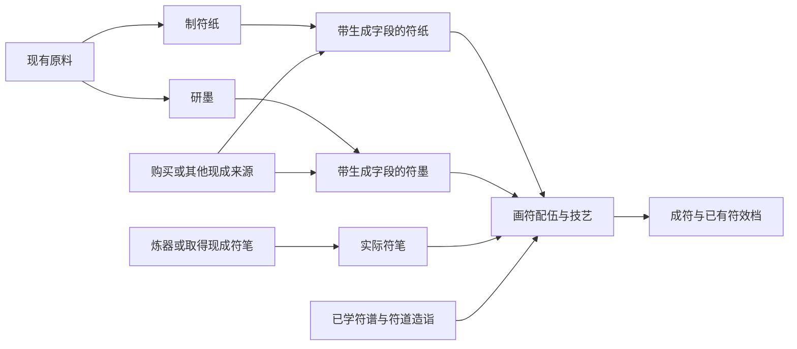

# 符箓三工艺深度整合与画符配伍方案

2026-11-08，当前三工艺整体规划入口，用户已回复“可以”确认本案汇报的整体方向。旧字段中有用的部分保留；制符纸、研墨、画符合计达到炼丹、炼器的系统深度，允许略复杂；符纸、墨可直接取得现成品，画符在购买纸墨后仍是一套有独立深度的制作玩法。

**本轮因果与流程细化：**[当前完整细案](符箓三工艺完整规则方案_20261108.md#六-制符纸材料怎样形成四字段)补齐纸墨四字段的材料与功用依据、现有原料例子、五行实际取舍及画符因素分工。玩家只需选谱、配纸墨笔并选写法，角色自动行符，有真实问题才应变，最后自动封符、鉴看。辅纹与细分分配为可选进阶配置，数值与产量未标定，不把因果示例当成实算结果。

**纸墨对象修订：**每张符纸、每份墨共用各自的字段结构，材料、份数与做法生成实际值；不再先分有限纸种、墨种并套固定能力。同批可同质，不额外逐张随机。下文以此取代预设规格组织，完整口径见[当前细案](符箓三工艺完整规则方案_20261108.md)。

**本轮精简入口：**[三工艺完整规则方案](符箓三工艺完整规则方案_20261108.md)现已串清字段形成、自动归并路由、共享来源与品级分层、生克接触、多墨取用、主辅纹、技艺和封符验收。本页保留已认可的整体结构，后续细化以该完整文档为入口；本轮新增的具体口径仍是细案建议，公共数值未标定，未接运行。

**随后墨源裁定：**研墨主来源只用致密、颗粒、液体；纤维退出研墨，黏胶仅作可选辅料。液体可以直接制墨，无须强制加入固体；现有主墨源30项，加黏胶辅料共32项候选，不再按原50项研墨池规划。

本案以结果导向和三环配伍为主，本轮合并重复字段，保留材料、工具与技艺之间的实际取舍。早期[结果导向提案](符箓纸墨法性符势与成符结果重设计提案_20261108.md)仅作设计来源；有限符式继续是可选扩展，不是三工艺成立或画符做深的前提。

确认范围是三环分工与整体深度、现成纸墨路径、保留有独立作用的旧字段，以及纸墨笔配伍、主辅纹、技艺、识势和封符形成画符深度。原料不加字段、十二功用与五行生克、自动执行和境界软适配继续有效。具体工法与辅纹目录、各项预算、公式、费用、学习条件和纸墨生成规则仍待细化标定；不能把整体认可记为全部未定数字或实现已获验收。本轮不改游戏、战斗卡、正式资源或存档。

后续统一使用[纸墨规格与画符配伍填写模板](纸墨规格与画符配伍填写模板_20261108.md)补齐资料，不再重新询问已确认的整体分工。优先补共同字段结构、生成规则与来源预算，再统一画符阶段结算和真实用度，最后据此修订界面与接入游戏；各环节不分别维护一套相互矛盾的能力值。

## 一 对标的是相互牵制，不是按钮与字段数量

| 系统 | 现有深度主要来自 | 本案如何对应 |
| --- | --- | --- |
| 炼丹 | 君臣佐使的材料及剂量、实际功用品级、整炉配伍、掌控与来源分配，最终映射丹种、药效档和产量。 | 纸墨的实际支持、用途分配与画符驾驭须有类似牵制，不能材料越多所有结果越好。 |
| 炼器 | 身材、质材、性材、和材等分工，成材、送达、收益之间分摊实际潜力，最终形成器物。 | 制纸、研墨形成各有性质的半成品，画符再对主效、连接、护纹、封存分配真实支持。 |
| 符箓三工艺 | 上游定向制备，或直接取得成品；下游纸墨笔、主辅纹、技艺、识势与封符互相影响。 | 三环合计达到相近或略高的深度；制纸和研墨各自聚焦，画符承担主要组合与驾驭。 |

参照的是[炼丹当前结算](../炼丹/炼丹完整结算与正式接入_20261023.md)及其[现行扩充](../炼丹/首批八种丹药扩充与接入_20261104.md)、[炼器主案](../../物品与装备/器物系统现行主案_20261023.md)与[材料过程推导](../炼器/材料与过程量驱动炼器设计_20261022.md)，不移植它们的数值、岗位、原料加工档案或造诣门槛。丹器的自动执行不等于没有配伍深度，符箓同样不靠微操增加难度。

## 二 三环独立成材，画符成为汇合点

| 环节 | 专注问题 | 必须有的取舍 |
| --- | --- | --- |
| 制符纸 | 做出什么承载、纹面与留持条件的纸。 | 承载、精细、渗入、稳定、封存、实际产量和处理用度相互牵制。 |
| 研墨 | 留下什么功用，以及它以怎样的墨性供画符使用。 | 来源保留、功用方向、墨量、负载、流展、定纹与处理损失相互牵制。 |
| 画符 | 用现有纸墨笔怎样完成既定术式。 | 主效、导通、护纹、封存、细纹承载、工具能力、驾驭与后续张数争用同批支持。 |

纸墨都是有完整生成字段的可库存半成品，可以自制，也可配置购买、委托或探索等现成来源；具体市场供给和价格另配。购买不免除画符中的配伍，制造也不附带隐形成符加成。相同生成字段的购买品和自制品同质，画符不查制作人或旧原料记录加成。

## 三 玩家看纸性、墨性，后台做真实配伍

用户最新要求沿第一版维度展开，只补灵力层次。上一轮纸的四项灵力指标撤去；当前主栏建议如下。

| 对象 | 玩家主栏 | 判断重点 |
| --- | --- | --- |
| 符纸 | 灵性、承墨量、渗墨性、韧性 | 层次、容墨、是否容易渗开、承纹时是否结实。 |
| 符墨 | 功用、灵性、浓淡、流动性 | 作用、层次、来源集中程度、是否容易铺开。 |

脚本可以保留更多真实字段：纸的连接、均匀、损伤与留持，墨的附着、凝定、分散与品级支持，不全部变成必读主栏。问题影响当前配伍时给简短原因提示，基本资料始终可查。

灵性各占一项，按实际术式软适配，不再拆成容量、传导、稳定、封存四份玩家计算。浓淡不等于品级，渗墨和流动不一律越高越好；同一损失不重复扣减。后台的来源守恒、真实生克和工序先后继续适用，具体映射与数值待标定。

基础操作仍为选谱、配纸墨笔、选写法；角色自动完成。技法、辅纹和应变按需要展开，过程只在真实未决问题出现时等待选择。

## 四 制符纸：按材料和做法生成纸材字段

准备时选择材料、份数与已学整体工法，改变实际容墨、渗墨、韧性与灵性形成；复杂推导留在后台。实际加工后生成每张的字段和数量；基础成形不成立才记未成材，不查预设纸种或降规表。

材料仍只接纤维、液体、可选黏胶，不引入致密／颗粒填面或气体路线。原料不加字段、不手动分配岗位，不按材名识别纸源。具体来源与成材遵守[纸墨原料联合规则](纸墨双工艺与字段自动匹配主案_20261108.md)。

| 工法取向候选 | 想获得什么 | 要付出的代价 |
| --- | --- | --- |
| 养脉、保络 | 保住可用纹层和连接，适合利用内层行墨。 | 墨进入和扩散更活跃，需要相合墨性或约束技法。 |
| 精整、凝纹 | 处理真实不均与缺口，改善送达和过程稳定。 | 更多处理工作与真实损失，不能同时完整保留所有开放纹层优势。 |
| 叠脉 | 增强实际承托，给较重纹势和局部会聚留余地。 | 每张占用更多真实支持，分层结合和工作要求增加，产量可能减少。 |
| 敛灵、留持 | 偏重实际封存和边界保持。 | 结合与留持要分走支持，也可能改变后续入墨条件。 |

这些是整体方法方向，不恢复现实纸槽操作，不让玩家逐工序按按钮。自动过程只作化材、蕴养、凝纸意象。十二功用分别用于实际结合、导通、分配、保护和保留，不要求每张纸用齐十二项；基础工具可以完成普通处理。

制纸的专业价值是能定向准备适合自己纸墨笔打法的库存，并研究成本与产量；不是只有自己造的纸才能达到最高符效。

## 五 研墨：围绕作用来源与书写条件的配制

研墨选择实际材料、份数、希望保留的真实功用及已学配制方法，按本批结果生成字段。制备重点是留下哪些真实来源，付出怎样的损失，最终墨性是否适合所需用法。

致密、颗粒通过公共处理取得墨基，液体可直接作为液墨源，也可参与配液；黏胶仅按需帮助结合。不增加粒度、纯度或天然含墨量等原料字段；纯液可以按实际条件制墨，纯胶不能单独充当主墨源。液体是否适合某种墨仍取决于其真实功用和层次。

| 方法取向候选 | 想获得什么 | 要付出的代价 |
| --- | --- | --- |
| 兼顾留蕴 | 保住目标所需的多项实际来源。 | 必须面对混合后的真实干扰、墨性与后续驾驭负担，不能所有功用同时满额。 |
| 精研、澄灵 | 提高均匀、送达或定纹适用，处理未融与夹带。 | 更多工作，可能连带丢失有效墨料及来源，不直接等于更强。 |
| 聚蕴、浓配 | 在有限墨量中集中已有负载。 | 可用墨量或份数可能减少，纸笔的承接与匀送负担提高。 |
| 调性、稳纹 | 按实际配液与结合调整流动、附着和凝定条件。 | 配液及结合占用真实材料，不能既提高所有墨性又完整保留全部来源。 |

各方法改变真实处理与分配，字段由实际结果生成，不能直接滑动成品属性。每份最多四项保留功用；相同字段结果同质，不同配伍可改变字段、数量、损失与用度。演出只作化材、融灵、凝墨意象，不增加研磨节奏游戏。

## 六 画符：取得现成纸墨后仍完整成立

推荐将画符做成“看谱配伍→定纹择法→自动成纹→识势处置→封符鉴看”。制纸、研墨提供的能力在这里汇合，但不会要求再做一次原料处理。

| 决策 | 玩家选择什么 | 与其他部分的牵制 |
| --- | --- | --- |
| 看谱 | 已学符谱、准备投入的批次材料和制作策略。 | 符谱给出固定主纹、必要来源与完整结果边界，不能直接选择保证满效或保证张数。 |
| 配纸 | 实际持有的一种完整纸材与份数。 | 同时影响承载、入墨、精细、稳定与封存；不是只选最高通用品阶。 |
| 配墨 | 一种或多种成品墨与份数。 | 需要同时考虑主效来源、连接、护纹、封符、五行接触和实际墨性。多一种墨也可能增加冲突、负担和损失。 |
| 定纹 | 固定主纹，以及符谱允许的整体工艺辅纹。 | 辅纹解决实际制作问题，也占墨、来源、可用纹面和工作，不能全选最优。 |
| 择笔 | 实际符笔的承墨、出墨均匀、聚锋精细、运锋与收锋能力。 | 所选墨性、细纹与长段需求不同，同一支笔不对所有组合通用最优。 |
| 行法 | 一项已学主技法与明确的本批策略。 | 改变送达、分配、聚势或保留，必须满足纸墨笔条件并承担实际代价。 |
| 识势 | 实际矛盾出现时继续、处理或收束。 | 只能用尚未消耗的支持与预留用度，不倒算已有纸张、不凭技法补出来源。 |
| 封符 | 使用事先保留和实际剩余的收口支持。 | 主纹有力不等于一定能封住；主效会聚与最后封存争用同批来源。 |

### 成品墨配伍与研墨的边界

使用统一成品墨清单，不强制“主墨、辅墨、封墨”三个必填槽，也不强制每次多种墨。配伍只形成这批如何取用、转移与分配的有限状态，不重新研取原料、不生成库存新墨、不永久修改任何瓶墨的字段。

系统根据符谱、辅纹和方法分配真实来源，玩家不逐笔分砚或安排蘸墨坐标。同一份墨可以含多种功用，但每项份额与实物只记一次；多瓶相同字段的墨不能拆开名字绕过负担。画符混用后也不把多份墨自动合成一个拥有全部功用的可交易新材料。

### 主辅纹的作用

主纹由符谱固定，玩家不画几何。导通、护纹、封藏等工艺辅纹是候选整体式样，逐谱配置哪些可用、解决什么问题、需要什么支持。

导通辅纹可以处理真实连接问题；护纹可以限制实际损伤扩散；封藏辅纹可以帮助已有术式收束。它们不是额外战斗效果槽，也不各赠送一套满额来源。增加辅纹会与主效、纸的容量与送达、墨池、封符余量和工时发生竞争。

### 技艺、造诣与过程处置

保留现有候选中的束墨留痕、透纸行墨、匀铺长行、凝毫聚势、匀息镇纹、舍势收符等不同方法，仍按[技法规范](符箓纸墨笔字段与技法规范_20261108.md)核对对象。方法不是全部叠加的常驻增益。

造诣沿用符道造诣，不新增制纸、研墨、运笔三条同义经验条。方法可以分别学习，造诣影响驾驭、实际损失、复杂配伍处理、工作效率与具体识势，不自动授予所有技法、不提高同定义成品的隐藏威力。

过程选择按批次处理，仅在真实矛盾需要决定时出现，不每张重复弹窗、不随机抽事故。熟悉条件可保存明确策略；无策略时等待玩家，跳过只推进到未决节点，不能代选。玩家全程不描线、按节拍或把握干湿时机。

## 七 后台需要协调的关系（不全做玩家字段）

| 关系 | 实际取舍 |
| --- | --- |
| 纸墨实际送达条件 × 笔与技法 | 按实际连接与送达分配来源，纸、墨、笔共同作用，不各叠一次省墨。 |
| 灵力容量 × 实际来源 × 主效分配 | 集中当前主效可能增加术式负担，并让出应变或后续张数的余量。 |
| 稳定性 × 真实干扰 | 容忍正在发生的波动，必要时用剩余来源处置，不随机抽事故。 |
| 封存能力 × 剩余来源 × 收锋与封符 | 只处理最后剩余状态与收口，不能补回旧损失或凭空补料。 |

十二功用与五行仍影响真实来源、形成和接触；不按名字加成、不平均品级，不把同一份支持用在多个去向。

## 八 购买纸墨后的完整选择例子

以下只有工艺情境，不新增卡牌、配方或数值。

玩家已取得一批纸，灵性与承墨量符合本次需要，渗墨偏高，韧性尚可；所选墨具备符谱需要的主效来源且偏润，并有一份实际通／行兼用墨和适用符笔。符谱又有需要分清的细接头。

| 方案 | 选择与用途 | 放弃或承担什么 |
| --- | --- | --- |
| 约束表层渗散 | 用适用精控笔与束墨留痕，集中保持有效纹域。 | 需要真实精控与工作，不会改写纸本身字段，也不自动取得内层连接收益。 |
| 利用内层通路 | 配入实际通／行兼用墨，选允许的导通辅纹及透纸行墨。 | 底层支撑、连接和额外辅纹分走墨与来源，可能压缩主效及后续张数。 |
| 更换纸材或墨性 | 改用实际持有且适合表层细纹的另一组合。 | 放弃原组合某些优势或另占库存，不保证换成通用品阶更高就全面更好。 |

若第二方案随后出现真实会聚波动，玩家只能按剩余来源和已学方法决定处理。已经耗尽镇来源，就不能凭匀息镇纹免费获得镇；仍可按实际条件继续，或停止会聚尝试收符。封符也继续检查真实余量，不因画完主纹直接成功。

这些选择改变成符、已有符效档、张数、用度和损失。完成后应说明主要瓶颈与实际去向，帮助玩家下次调整，而不是给每一项一条泛用增伤。

## 九 制作闭环、显示与后续标定

同一符种、同品阶、同符效档的完整效果继续固定；材料不随意附加护盾、治疗、持续、群体或其他谱外能力。有限符式若以后采用，须另行逐谱定义，不能作为当前画符深度不足的补丁。

各阶段只提交一次实际消耗，预检失败零消耗；纸按实际落笔、墨按标准份启用与来源支出记账，未启用预留释放、已用部分不退。工时、精力与灵识需求按本系统真实处理标定，不复制丹器数值。符笔制造仍归炼器，使用不要求会造。

纸墨保存每份已经生成的字段与完整来源数据，画符记录保存本批实际配伍、主辅纹、方法、笔快照、造诣、阶段余量和处置。保存配伍不保存保证产量；载入重核库存与资格。公共参数更新不回改已经保存的纸墨生成结果。

玩家准备页显示实际字段、相合与缺项、已知技法和真实用度，不提供保证成符、保证档位或虚构成功率。中央沿用修仙意象，不展示写实造纸研磨器具；完成后展示实际固定效果、档位和张数。基本与详细模式按现有显示规范，基础信息不靠造诣解锁。

后续需要统一标定：纸墨字段与来源的形成、已学工法、共同字段结构与生成规则、画符允许辅纹和用途分配、混用成品墨时的接触模型、笔的能力合同、造诣与过程用度、逐张验收及公共资源事务。参数未定时不填示例数字冒充实算。

正式验证应覆盖：新材料自动匹配；同字段同条件同表现；相同字段的自制与购买品同质；主辅墨实际预算守恒；加辅纹非全优；不同纸墨笔技法各有适用；封符预留不被复用；软适配不变成境界硬锁；跳过不代选；批次复用不重扣；结果同定义同效。本轮仅完成整体设计整合与文档检查，未执行这些游戏验证。
