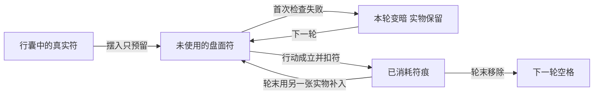

# 符箓系统设计提案

> 2026-11-07。新体系设计候选，供评审，尚未接入游戏。用户已明确旧雷击符、爆炎符属于很早的旧案，本次不沿用其费用、伤害、描述或资源表现，直接重新设计。本文不将候选条目登记为已开放卡牌。

> **2026-11-08制作最新入口：**[三工艺与画符技艺主案](符箓三工艺与画符技艺主案_20261108.md) · [纸墨笔字段与技法规范](符箓纸墨笔字段与技法规范_20261108.md)。用户明确制符纸、研墨制墨、画符三个小系统；纸墨各自有专属字段，笔制造归炼器，角色自动行笔并由玩家作技艺层面的关键抉择。已有符道造诣参与掌握与执行，旧“原料直投并全程无选择”及逐笔编排均不再作为现行方向。具体字段值、生克曲线、技法和消耗仍为候选。

> **2026-11-08成品与早期界面：**[成品分类与画符界面方案](符箓成品分类与画符界面方案_20261108.md)保留固定符种、有限符效档的建议及早期布局。符谱确定完整用途，制作决定档位与合格张数；档名、阈值和数值仍待定稿，不批准下文候选战斗数值。当前制作与技艺以页首最新主案为准。

> **2026-11-08早期工艺深化：**[十二功用与符纹工艺重设计](制符十二功用与符纹工艺重设计_20261108.md)保留材料与来源分账参考，分砚、主辅纹编辑不再作为现行交互。当前三工艺、专属字段和技艺按页首主案评审，下文战斗条目不变。

> **2026-11-08制作层细化：**用户明确画符需要符笔，并要求设计不同笔的作用及不同符箓的材料。见[制符界面与符笔材料设计](制符界面与符笔材料设计_20261108.md)。实际符笔成为制作必选工具；不同笔通过运笔、回蘸、工时和精力体现差别。该补充覆盖原设施符笔仅作演出道具的简化，具体笔型、配伍与参数为候选，不改变战斗条目。

符箓是**提前制成、封存术式、临战消耗的实物**。玩家在出发前取得符谱、准备材料并制符，再把有限的成品摆入招式盘，以材料、工时、行囊和盘面空间换取临战能力。符箓让没有学习某项术法的修士，也能借助成品使用该项效果；使用者仍须满足成品明示的境界条件。

本案的战斗层保留一块一张、实际一次消耗的候选方向。制作层按2026-11-08最新要求分为制符纸、研墨制墨和画符，结合纸墨笔专属工艺字段、技艺选择与符道造诣。普通符支付体力、通常不另付法力且不占持续灵识的战斗方案仍待单符定稿。

## 一 现行依据与项目现状

### 规则来源

| 内容 | 本次采用的来源与边界 |
| --- | --- |
| 战斗费用与公共资源 | [战斗总规则](../../战斗与构筑/design-plan.md)。普通费用为体力0—3，法力不自动恢复，灵识只约束持续实体；不恢复抽牌堆、弃牌堆或手牌循环。 |
| 人类战斗时序 | [人类招式盘实施与验收](../../战斗与构筑/人类招式盘实施与验收_20261107.md)。采用逐行行动、真正空格回体、共同轮末整理。符箓的检查方式由本案单独提出，不套用丹药的双格检查。 |
| 材料与制符底座 | [物品词缀系统设计](../../物品与装备/物品词缀系统设计.md)。共用五行、质地、功用、相性、品阶及十二项基础功用；同定义成品同质、结果不随机。制符的分砚、主辅纹和过程成符为本轮专题扩展候选，不再受旧固定条件配方的简化约束。 |
| 物品与实际占地 | [行囊索引与空间联动](../../物品与装备/行囊索引与空间联动方案_20261029.md)。当前普通物品逐件占格，清册只汇总数量。本案不沿用早期“同类无限堆为一格”或村庄共享仓库作为个人库存的规则。 |
| 百工与地点 | [炼器炼丹地点接入](../炼器/炼器炼丹游戏内接入_20261025.md)。百工查资料，实际制作在地点进行；[丹房与器作租用](../../剧情与宗门/天工峰丹房与器作租用入口_20261107.md)只确认这两类设施的收费方向，不自动给符室增加租金。 |
| 效果与展示 | [状态系统](../../战斗与构筑/状态系统设计.md)、[跨境界状态与净化](../../战斗与构筑/跨境界状态与净化系统规划.md)、[信息分层规范](../../界面与美术/信息展示与规则详解分层规范_20261026.md)。复用已定义结算，玩家正文只写真实费用、目标、效果和必要限制。 |

### 已有接口与缺口

| 项目 | 当前事实 | 后续需要补齐 |
| --- | --- | --- |
| 人物造诣 | 已有`HumanData.talisman_proficiency`及创建时的符箓造诣。 | 符谱学习、制符资格与工时读取。 |
| 物品定义 | `ItemData`已有符箓分类、占地、用途、`battle_skill_path`及组合数据入口。 | 正式符箓定义、专属图标、符谱与材料条件。仅有分类不等于已有可用符。 |
| 百工 | `BaigongPanel`的符箓页仍调用占位页。 | 已知符谱、选材方案与制符记录。 |
| 招式盘 | `CombatBoardPlacement.ObjectKind`已有招式、化法、周天指示物和丹药，没有符箓种类。 | 独立符箓对象、真实预留、执行、消耗与回传。不能伪装成无限次已学招式。 |
| 旧战备 | `BattleSupplyRules.Load`只认可正式战斗丹药，并排除未定稿符箓。 | 新盘按本案接入；旧三战备位不直接成为新符上限。旧战斗中的符箓继续关闭。 |
| 正式成品 | 本次在`resources/entities`未检出正式符箓成品；旧两符只保留技能原型与历史卡图。 | 按新案逐项建立物品、效果、图标、来源和验证，不从旧存档或测试技能补发物品。 |

## 二 玩法定位与组成

### 与其他百工的区别

| 系统 | 核心产物 | 玩家主要决定什么 |
| --- | --- | --- |
| 炼丹 | 供服用、恢复或养成的成品 | 准备哪种药效、何时服用，以及丹毒等已有代价。 |
| 炼器 | 长期持有的器物 | 投入怎样形成器物，并如何手持、穿戴或御使。 |
| 制符 | 一次释放的封存术式 | 为这次行旅备哪些效果，在哪一轮、哪一行投入一张符。 |
| 阵法 | 持续工作的配置 | 如何组织元件、信号、供能与负荷。 |

符箓的优势是准备完成后使用直接，能补充当前招式构筑的短板；代价是每次都消耗实物，并持续挤占携带与摆盘空间。常用招式承担可反复使用的基本能力，符箓承担有成本的临战补足和关键投入。

### 符谱 成品与施符

- **符谱**规定术式族、主纹骨架、辅纹资格及允许形成的成品定义。学会后进入百工资料，不在每次制符时消耗一册符谱；保存的配伍不锁定成品结果。
- **成品符**是实际物品。本轮建议按固定符种、品阶与有限符效档分别建立定义；同一正式定义的完整效果一致，不保存随机威力、制作者加成或隐藏纯度。具体档名、阈值与数值按同日成品补案定稿。
- **施符**是使用成品的行动。持有成品且满足使用条件即可，不要求使用者同时学会符谱或对应招式；符箓造诣服务制作，不成为普通施符的第二道学习门槛。

制作与使用的境界条件分别配置；成品品阶不自动换算使用境界，也不允许凭持有高阶符越阶施放。

## 三 制符工艺

制作层按[三工艺与画符技艺主案](符箓三工艺与画符技艺主案_20261108.md)评审。原料先通过制纸、研墨工艺形成固定规格半成品；画符使用成品纸墨、实际符笔、符谱及已学技法。玩家选择材料组合、主用方法和有限关键处置，角色自动执行具体行笔，不设置逐笔排程。

### 准备与过程

纸墨各自保留共用材性，并拥有专属工艺字段；墨的墨量、浓度、流展、附着与凝定，纸的承墨、渗墨、精细度、稳定与封存适用，和笔的实际工具能力共同约束画符。功用与生克按制备及纸墨接触的实际阶段发挥，不复制丹器系数，缺少加工档案不默认可用。

制作前可保存库存纸墨、数量、符笔和主用技法，并按明确策略复用同类处置。基础材性、专属字段、资格与用度可查，造诣不锁基础信息；阶段识势、技法可用性及执行范围受已学方法和实际条件约束。成符规格和张数在实际结算后揭晓，跳过演出不代选。

### 同源分账与批次

制备时记录原料成为半成品能力、结构、损失或未用部分的去向；画符只读取成品纸墨，不额外加回旧原料。工艺性能、工具能力和技法改善真实执行，不复制功用供给。纸张为候选上限，已启用墨份形成有限批次墨池，逐张支出。

符箓造诣服务工艺掌握与资格；制作层建议接入既有可支配灵识，约束同时处理的材料、功用、墨池与接点复杂度。灵识不是一次性蓝条，不新增符力或成品持续占用。具体负担、掌握、工时与精力曲线由制符独立标定，不复制丹器系数。

### 正式制作与成果

准备和预检零扣料，正式开始核对纸墨、笔、技法、人物资格与全部已定用度，冻结并预留本次上限。最新推荐按实际落笔消耗纸、按标准份启用符墨，未启用的纸墨释放；应变只能使用预留的实物，不在演出中补造材料。消耗与回收合同尚待审定，未修改正式库存。

过程只映射到符谱允许且已定义的固定成品，不生成同定义随机威力。阶段状态、抉择、余料及已用来源一并记录，演出与略过不重扣或补发；旧库存不推造历史。正式过程需要分阶段结算，旧HTML动画没有这些能力。

## 四 成品与真实携带

首批普通纸符建议采用**行囊1×2、招式盘1×2，允许横竖旋转**。这是本案针对符纸形状和九格起盘提出的新占地方案，不是从丹药瓷瓶推导出的既有规则。以后异形或大型符须逐项另定占格，不能只放大图片。

每一张符都是一件实物，独立占据行囊空间；清册同定义合并显示数量，双击依次定位。效果、品阶或变体不同的符不能只因同名就合并为同一种成品。制符不自动扩充行囊，不给符箓开设无限容量的专用符袋。

战斗取用范围建议先与新盘丹药一致：只从本人普通行囊读取，储物空间中的符须在开战前取出。持有储物器具不直接开放隔空取符。

成品威力由自身定义固定，使用者不再通过符箓造诣、制作者属性或原型技能的灵慧系数重算一份基础效能。之后的命中、闪避、防御、护盾、会心及真实通用修正沿战斗规则处理；不把固定基础伤害写成无视防御的最终扣血。

## 五 入盘与施符规则

以下为本案提出的首版战斗规则，尚未改变运行时。

### 一块一张与真实预留

每个盘面符箓对象预留一张实际成品。摆入、转向、移动、移出和取消只修改预留，不提前消耗；提交时检查同一种符在所有摆放中的未使用总量不超过本人可用实存，并落实到实际可扣的物品身份，避免多块引用同一张。

首版不另设角色每轮“只能施一符”的通用上限，也不直接继承旧三战备位、每位五件。能摆多少张，由真实库存、盘面空间和单符明示限制共同决定。战前与每个共同轮末可以补入，战斗正常运行中不能随时插符。

### 首次检查与费用

本案建议符箓采用**每张每轮首次扫到时检查一次，整张变暗，本轮不在后续占格重试**。这是一项明确的新规则，和当前丹药逐占格检查区分。

首批基础攻符与护符建议均为**体力1、法力0，每次实际消耗一张**。它们以制作时封存的术式降低临战法力压力，以体力和实物限制投入；不因为一次性消耗就默认全体系0体力。后续强符可以按总案使用其他费用档位，必须逐符写明。

- 没有合法目标、体力不足或不满足明示条件：本次不施放、不扣物品、不付款，本轮已经检查；未使用的实物保留，下轮可再检查。
- 条件满足且原行动成立：一次提交费用、扣符与已消耗标记，再按既有战斗结算执行。演出重复或回传不能再次扣符，也不能补发符。
- 已正式施符后，攻击未命中、被闪避、被化解、护盾吸收或减益被抵抗，均不退符。这些是效果结算结果，不是未使用。
- 若现有明确规则在施符成立前取消原行动，沿被取消行动的既有口径不付款、不扣符；实现不得用演出是否播放判断行动是否成立。
- 符名和材性不自动赋予破绽、打断、麻痹、灼烧或新的出手距离。直接攻击仍明确近身或远程出手方式，具体目标与应对沿正式效果定义。

普通单体攻符沿当前自动随机选择合法敌人的口径；首批自护符只作用自身。以后需要指定队友、指定状态或其他选择的符，先补全自动战斗中的选择规则，再开放该符。

### 耗后占格与轮末整理

符使用后标为已消耗，以淡灰符痕保留本轮原占格。符痕不再次施放，不在后续格变成回体空格，也不生成一件“灰烬”放进行囊。

共同轮末整理时可以移除符痕，或用另一张同种真实成品补入；补入只是新预留。若保留符痕继续战斗，它仍占格且不回体。这样，消耗符既不会在当前轮免费腾出回体格，也不会要求玩家承担永久的盘面废格。

草稿、确认盘、战斗盘和回传盘分别保存，移动、换方案或重新生成摆放编号不能把已消耗符恢复成未使用。战斗结束只保留实际库存结果；未使用预留解除，已使用不退还。胜负、撤退、场景返回都走同一消费记录，撤退时机仍沿其自己的现行范围，不借本案新增撤退规则。

## 六 首批内容与效果边界

首批先打通一攻一护两条完整链路。以下名称为新方案工作名；数值定稿后再制作正式卡图、物品与效果资源。

| 工作名 | 目标与出手 | 核心效果 | 构筑用途 |
| --- | --- | --- | --- |
| 炎矢符 | 单体合法敌人，远程 | 一次固定基础物理伤害。火焰是表现，不增加火属性伤害类型、不附加灼烧。 | 让未配远程攻击的构筑付出实物成本补一次远程出手。 |
| 护身符 | 自身 | 获得固定基础护盾，沿公共护盾吸收、叠加与清理规则；不创建另一种符盾状态。 | 在盘序前段提前防护，或在后段为下一轮保留防护。 |

两种首符共同采用上一节的一张、1×2、体力1、法力0方案；基础伤害、护盾量、使用境界、符谱门槛和配方用度尚未定值，不从旧两符或旧丹药抄数。这些值在正式单符评审前不以0或任意示例填入运行资源。

首轮平衡应在同一真实角色、同一目标和盘面上比较：一次攻符与已学同费用攻击的收益，护符与已有护盾招式的收益，以及持续用符的材料、工时和携带成本。费用、盘面面积与不可重复使用已经形成差异，基础威力不应再随使用者符箓造诣无限放大。

后续再扩展以下方向，不与首版一起开放：

- **控制符**：先定义具体状态、属性关系和时长，遵守跨境界施加规则；不能把旧“麻痹”描述直接变成已支持机制。
- **净化符**：只处理明列类别、位阶与层数。当前净化专题要求玩家指定状态，新盘尚无相应自动选择规则，须先解决该接口，不擅设隐藏优先级。
- **群体符**：明列目标范围、逐目标结算与更高费用，不把爆裂特效当成已有群攻判定。
- **探索或修行符**：分别对接世界行动或修行专题；不因战斗符接入就顺带增加遁行、窥图、跳过关口或凝核收益。

## 七 与现有构筑的联动

符箓是独立的实物来源，不登记为角色已学招式。当前只匹配招式的化法、复命与周天指示物不能自动选择符箓；周天也不能免费再释放一张已经消耗的符。若以后设计专门的符法联动，应同时明确它消耗哪张实物、费用、机会与限制。

普通符不默认生成炁、气血、念，不返体力、不返法力、不抽牌、不授予额外行动。若未来单符确实生成公共资源，逐项审查其真实消耗和现有周天触发链，不能借“消耗品”跳过防循环限制。

已有心法若按真实攻击或护盾事件触发，符箓实际造成相应事件时沿其明示条件判断；不能因符箓使用独立对象就丢失本来合法的公共事件，也不能把一次用符伪报为多次招式。没有剑器实际来源的攻符不享受器物锋锐。

NPC遵守同样的持有、预留、费用、目标和消耗规则，不凭造诣或宗门身份凭空生成符。只按已公开信息决策，不读取玩家尚未暴露的符种、库存或位置；首期NPC备符与补货来源未接好时，不给其无限测试符。

## 八 入口 画面与经济

### 百工资料与地点制作

人物百工的符箓页分为已知符谱、保存的选材方案、制符记录。符谱展示用途、成品、学习状态、材料条件与本人造诣差距；查看不消费资源，不在百工远程开工。

实际制作建议在玉虚天工峰新增“符室”入口，先沿现有宗门成员资格检查。进入后左侧选符谱，中间展示符纸、真实选用的符笔与落笔演出，右侧核对纸、墨、胆、张数、工时、精力和成品；换笔会更新行笔、回蘸与用度比较。选材复用现有材料悬停及五行、功用筛选；不为制符改写材料百科。具体见[十二功用与符纹工艺重设计](制符十二功用与符纹工艺重设计_20261108.md)。

制作确认必须能清楚看见投入与产出，不只展示画符动画。画符必须选用真实符笔，作为本次工艺工具，不增加战斗装备槽；笔本体不消耗，不设耐久，不默认设施会免费生成一支笔。租用符室及收费须另行明确，本案不借丹房、器作的收费方向自动扣贡献。

### 玩家信息与美术

行囊、交易和领取使用同一成品悬停，展示名称、品阶、使用条件、费用、目标、效果和真实占格。库存数量放清册或操作处，内部路径、预留编号和兼容说明不进入效果正文。固定数值不凑公式；真正依赖计算的项目才按现行简略与详细模式显示。

战斗来源列表显示实存与已预留，盘面明确区分未使用、本轮检查过和已消耗三种状态。解释失败原因时写“体力不足”“无可用目标”或“已使用”，不能只用颜色让玩家猜。

纸符采用项目现有水墨淡彩与128源像素／格规范，以纸形、符纹走势和克制的功能色区分。名称、费用、状态角标由界面绘制，不烙进图标。卡图主页面只放玩家文案，内部规则放“策划说明”页；本次不沿用旧两符含内部说明的主图。

### 获取与交易

首版先保证本人制符到本人使用的闭环，再将正式成品加入经过定价的善功堂或坊市来源。新符不因分类已经存在就自动上架，不按每次打开页面补满库存，不从未开放公库领取材料。

符谱获取、材料获取和成品交易分开定价。买到一张符不等于学会制作，学会符谱也不自动获得成品。宗门贡献和坊市灵石沿各自交易规则结算，不新增符箓专币。可售成品按固定定义报价，制作记录不生成专属价值词条。

## 九 实施顺序与验收

| 阶段 | 交付 | 必须通过的检查 |
| --- | --- | --- |
| 1 单符与工艺定稿 | 两种首符的效果数值、境界、主辅纹骨架、纸笔与材料加工档案、十二功用工序、来源预算、用度与图标。 | 每个投入和产物都有正式定义；材料能实际取得；不靠旧原型或不存在的纸墨补齐，不用单一总分代替工艺短板。 |
| 2 制符闭环 | 符谱学习、百工资料、符室入口、分砚配墨、布纹、逐张成符、真实结算及领取记录。 | 取消零扣；非法输入整次拒绝；同源与整批逐张供给不复制；合法尝试失败消费先定稿；重复点击防重；演出略过结果一致；满包不吞成果。 |
| 3 新盘用符 | 独立符箓对象、占格与预留、首次检查、扣符、耗后符痕、轮末补充和回传。 | 一张不能多块复用；后格不重试；失败不扣符；已施符未命中不退；消费与效果只结算一次。 |
| 4 构筑与存档 | 与公共事件、化法限制、NPC实物和正式保存衔接。 | 移动、换盘、重进与读档不复制物品或刷新消耗；旧档不补发；周天与复命不绕过实物。 |
| 5 扩展来源与符种 | 定价后开放交易，再逐类考虑控制、净化、群体与世界用途。 | 不虚构补货或公库供给；新状态和目标选择先有完整规则，再接卡牌。 |

新盘目前先覆盖全人类对战，符箓的首轮接入随此范围验收。妖兽及混合战斗仍走旧流程时，不把新符误标为已在这些战斗可用；完成旧战斗适配或统一迁移后再扩展。

需要补充的数据包括符谱身份与学习事实、正式成品及效果定义、本人制符记录、盘面符箓身份与消耗状态。优先复用`ItemData`与组合用途数据；通用配方匹配器仍需核查和补齐，不能把词缀校验器当成已实现的全套制符接口。存档版本及消费回传时机在实施时按当前正式结构设计，不覆盖旧十槽或丹药记录。

正式卡牌制作前，逐项填齐伤害或护盾数值、效果公式、费用、目标、境界、关键词、占地、材料、时间与精力；缺一项都不以默认值冒充定稿。验证应覆盖编译、材料及卡牌数据检查、真实制符领取、全人类新盘实战与隔离存读，不以静态示意图代替实测。

## 十 首版核对记录与后续定稿

- **效果 费用与目标**：本案提出新的一次性用符体系及一攻一护首批方向；体力1、法力0和1×2为新候选规则，具体威力与配方用度未写成已确认数值。旧符不再作为规则依据。
- **属性 资源与状态**：未增加角色属性、局内支付资源、战斗关键词、伤害类型、射程或位移。符谱、符胆岗位和符痕分别属于工艺资料、投料职责与盘面记录。
- **零费与额外收益**：首批方案不设0体力、不返费、不抽牌、不生公共资源、不授予额外行动；实际库存约束不能被复制、移动或周天绕过。
- **实现 图文与展示**：本轮仅建立系统提案和索引，未编辑卡牌资源、旧卡图、正式物品或运行时，也未将候选内容标成可用。后续逐符定稿时同步数据、词典与玩家正文。
- **验证范围**：本轮验证文档结构、相关来源与本地链接；没有编译或场景测试结果可作为本系统已实装的依据。上述阶段验收为后续实施要求。

上述为首版核对记录；制作层后续按十二功用与符纹工艺重设计评审，战斗层再逐符确定效果、费用、目标与实际消耗，不用新工艺替代战斗规则定稿。
