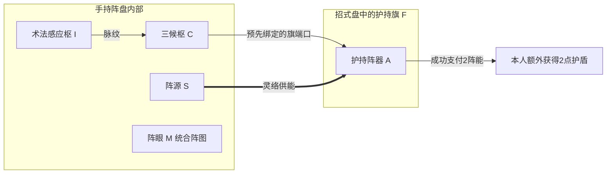

# 三候护持阵盘旗运行完整示例

> 历史教学稿：本轮统一待验收稿为[阵法系统完整策划提案](阵法系统完整策划提案_20261108.md)，已补齐真实接口、盘旗格形、灵识、阵体、触发与局部失效。本页只保留推演来源；互斥旧候选不与新稿并行作为默认，新稿尚待整体验收。

> **复核提示（2026-11-08）**：本页保留单旗承载护持阵器的候选演示，不代表所有护持都必须有旗。最新讨论为[全内置与可选外置的构筑取舍](阵旗可选外置与阵盘构筑取舍候选_20261108.md)：同一真实输出可按资格装盘或装旗，旗用于腾出内部空间，不是额外强制开关。新定位尚未确认，本页的展开、局部停转与计数仍属候选；内置配置须另算输出足迹和线路，不据本图直接出图。

> 日期：2026-11-08。
> 状态：纯策划演示，沿旧样例展示新盘旗结构；不是新增正式战斗卡、制作配方或已实现功能。
> 当前分工：[手持阵盘与招式盘阵旗协作规划](手持阵盘与招式盘阵旗协作规划_20261108.md)。手持盘、旗入主盘表示布置、各部件可被攻破沿已确认方向；本例事件时点、局部停转与占用处理为完整演示候选。

> 最新确认：阵盘和阵旗都是器物；盘采用手持，本身不占御使灵识，F在招式盘按御使方式启用。旗只按阵图工作，不附类别普攻；盘内节点是子部件，不逐件登记御使。受击目标、防护余伤与旗承伤池适配仍待审。

使用已有“云息·三候护持阵”：旗展开后，本人每成功施放三次实际支付法力的术法，向护持阵器送出一次信号；供能满足时支付2阵能，额外获得2点护盾。三次、2阵能和2点护盾来自原样例，不是本轮新增的平衡数字。

本例只用一件手持阵盘、一面护持旗F、一份已学云帔。每个共同回合施放一次云帔，跨三个回合观察计数；不需要假设有三份术法在同一回合连续发动。

读到F只检查展开，不附送攻击或施法事件；本例三次输入仍来自人物真实完成的合格施法。

## 一 演示条件与不填的数值

| 项目 | 本例条件 |
| --- | --- |
| 知识与制作资格 | 已掌握原阵图需要的输入／输出阵法录，满足候枢及所有部件的资格；不借此例重定门槛。 |
| 持用 | 阵盘占唯一手持槽，不同时手持剑；手持节点在旗F首次检查前生效。 |
| 阵旗 | 真实持有F，绑定本盘的护持输出；可用灵识足够其明示持续占用。 |
| 术法 | 一份现有云帔，沿原定义体力0、法力1、自身护盾及两格占地；人物实际具有完成三次付款的法力。 |
| 其他联动 | 不配置代付、减费、额外施法或产生周天追加施放的心法与化法；本例只追踪这三次云帔。 |
| 供能 | 第三次事件到来时，阵源余量至少2，阵源、灵络与阵盘峰值均至少2。 |
| 承伤 | 起始部件完整；破坏分支以一次合法破阵攻击已令指定部件崩解为前提，不新增敌招或伤害数值。 |

旗尺寸、灵识占用数、阵体上限均未定，本例不补数字。主盘摆法只表达相对扫描次序，不把一面旗暗定为单格，也不保证某个九格摆法已通过几何验收。

原样例资源的阵图门槛、旧装配界面与主案候枢门槛存在既有差异。本例直接以前置资格已满足开始，不修改这些资源，也不把旧门槛当成统一定案。

## 二 阵盘内部怎样走线

| 标记 | 部件与位置 | 本例职责 |
| --- | --- | --- |
| I | 盘内术法感应枢 | 识别本人实际支付法力的成功施法，每次产生一个瞬时信号。 |
| C | 盘内三候枢 | 每个合格信号使计数增加，达到三次时归零并输出一个信号。 |
| S | 盘内阵源 | 向旗端阵器供能，余量与峰值受硬件限制。 |
| M | 阵眼 | 统合这张阵图，不额外计数，不凭空输出效果。 |
| F | 主盘中的护持旗 | 表示这件旗已被安排布置；读取时检查展开，承载本盘的护持输出。 |
| A | F上的护持阵器 | 收到信号后检查本件有效、供能与原有限制；成功时支付2阵能，为本人增加2点护盾。 |

信号路线只有 I → C → A。C的输出通过预先绑定的旗端口送至F上的A；端口是连接标记，不再复制一份阵器效果。S通过灵络给A供能，与上述信号路线分开。



C的1／3或2／3是元件进度，不是储存了一枚或两枚可支付的阵脉。每次输入信号在本次处理中结束；只有计数状态留下。

## 三 阵旗在招式盘怎样摆

本例要求的相对顺序如下，箭头只表示扫描先后，不表示物品格数：

```text
手持盘的读取节点 → 旗F的首个占格 → 云帔的首个占格 → 其余盘格
```

在合法盘面内，旗F整体占格与云帔真实两格不能重叠，且F先被首次检查。手持节点的具体外围挂点沿手持规则核验，不为本例新建一个开战即免费持盘生效的时点。

这个简单阵没有贴邻、围合或方向要求。F不必紧贴云帔；感应读取本人的合格施法事件，不是因为云帔挨着旗才监听到。F的位置在本例主要影响首轮展开先后，其所占格始终不是回体空格。

云帔本身给人物的护盾正常结算。它不会因为被本阵感应而改费、重放或变成护阵能力；A另给的2点护盾单独说明，也不自动保护旗或盘内元件。

## 四 三个共同回合怎样触发

本例建议在云帔本次真实付款及自身效果成功结算后，发送一次合格术法事件。事件只有一次，不按云帔两格、动画、护盾数量或命中目标数重复发送。

### 第一共同回合

先读到手持盘节点，使本盘来源有效。再首次扫描F：来源、绑定、完整性和灵识条件满足，登记其持续占用并展开；不扣体力、法力，也不立即送出护盾。

随后扫到云帔，实际支付1法力并结算它原有的护盾。I产生一个信号，C从0变为1／3，不向A输出；本阵不扣阵能，也不增加额外护盾。

轮末正常整理。F仍保持展开与原持续占用，C保留1／3，不清零、不回满阵源。

### 第二共同回合

F原本已展开，再扫描不重复启用。云帔正常使用，仍付1法力并结算原护盾；I再发一个信号，C从1／3变为2／3，本阵仍无输出。

轮末C保留2／3，F跨回合维持。人物法力沿既有规则跨回合保留余额，不凭过了一轮自动回法。

### 第三共同回合

云帔第三次正常使用，再付1法力。I发出第三个信号，C达到三次，本次计数归零并向A发出一个控制信号。

A检查F与本盘仍有效、原有限制允许，且阵源余量、阵源峰值、灵络峰值与盘体负荷均满足。在本例供能条件下，支付2阵能，本人额外获得2点护盾。若信号抵达前余量记为E，支付后为E−2，不虚构回充数或法力转换。

这不是再施放一次云帔，不额外付云帔费用，也不额外占一次施法灵识。轮末C为0／3，之后再按新的三次事件计数。

| 共同回合 | 云帔实际付款 | C处理后 | 本阵本回合消耗阵能 | 本阵额外护盾 |
| --- | --- | --- | ---: | ---: |
| 第一回合 | 1法力 | 1／3 | 0 | 0 |
| 第二回合 | 1法力 | 2／3 | 0 | 0 |
| 第三回合 | 1法力 | 归零为0／3，输出一次 | 2 | 2 |

表中不合计云帔自己的护盾，也不表示人物护盾跨回合完全不变；正常受击和状态清理仍沿原规则。本例每回合只有一次施法，不借此统一旧“自身行动”和新版“共同回合”的高频限次差异。

## 五 如果旗摆在云帔后面

若首轮先用云帔、后展开F，第一回合这次施法不计入本阵。F后来展开也不补发这一信号。

下一回合F已经维持，第二回合云帔才记为1／3，第三回合记为2／3，到第四回合的下一次合格施法才达到三次。可见本例旗摆得靠前，价值是更早接上首轮事件，而非凭空加大护盾或变成前排肉盾。

## 六 部件被攻破后怎样失效

### 场上这面旗如何受击（新手示意候选）

用户已确认：阵旗在招式盘安排布置，布置后确实在战场显示，没有第二次场地摆放。本轮推荐在旗被读到并成功展开时显现旗实体和阵体；这是显现时点候选，不把“摆入盘”直接等同于启用成功。

新手只需认这条过程：**盘上安排护持旗 → 读到后展开 → 场上看见同一面旗 → 敌人可用允许攻击阵法的招式打它 → 阵体耗尽，护持输出停止。**

- 普通攻击仍打原本合法的角色；明确允许攻击阵法器物的招式才能选择合格旗，敌人意图显示“攻击护持旗”。这是本轮推荐，尚未定为所有攻击的目标通则，也不新建具体敌招。
- 盘上F图标与场上F实体共用F的阵体和展开状态。攻击命中旗体只扣F，不能对两处显示各扣一次，也不自动连带扣A、C、I或S。
- F被击破后，盘上保留破损占格，场上显示折断；本例停止本件护持、释放F的持续占用。普通云帔照常运行，先前已经给人物的护盾照常保留。
- 人物护盾不自动保护F；旗摆得靠前只表示早展开，不代替人物挡普通攻击。移到后面也不增加免疫，收回重摆不恢复阵体。

图示只画旗早读、云帔后读的相对区域，不把F画成已定单格，也不为战场旗引入距离、落点或前后排规则。

### 手持盘内部怎样受击、护阵件怎样保护（待审）

本轮用一个明确保护三候枢C的被动承伤护阵件演示：它占阵盘内部空间与材料，不额外占招式盘或逐件登记御使；不自动保护其他节点和场上F。保护关系在制作时指定，不与计数／供能线路混为一条线。

**明文允许盘内损伤的破阵攻击指定C → 护阵件先承伤 → 余伤仅给C → C自身阵体耗尽才断路。** 这是单层候选，敌方意图点名节点，动画打在手持盘上；普通打人物或打F不自动传伤盘内。两件分摊一次合法来袭，不各扣全额；直接攻击护阵件不向C自动传伤，也不扩散别件。

若护阵件挡完本次伤害，C仍保留原2／3，可继续计数；若余伤使C崩解，则按下表停止计数与转发，F不因此一起折断。没有新增盘壳或全阵总生命、伤害类型、资源或数值；目标资格、保护先后与余伤算法均待审。

本例推荐F作为可受击器物对象管理，内件作为盘的子部件，不新建角色速度、独立行动条或移动规则。F的阵体与御使稳定度最终如何对应仍待审，只用一份局内承伤池，不叠加两份生命。

### 各部件失效演示

以下从C为2／3、尚未完成第三次触发的时点分别观察，互为独立分支。只假设合法攻击已按相应保护处理使指定部件崩解；实际破阵目标、保护余伤及阵体均待审，不新增敌招或数值。

| 崩解部件 | 本例采用的失效候选 | 对正常云帔的影响 |
| --- | --- | --- |
| 旗体F | 本件旗停止御使，释放其持续占用，仍占原格；唯一有效旗端失效，本阵不再接收新的合格输入，C旧进度保留而冻结。 | 云帔仍照常付款并结算自己的护盾，不给本阵攒待补发信号。 |
| F内阵器A | 旗体与其他部件不凭空损坏，但护持输出关闭；本例保留完整旗的展开与持续占用，轮末主动撤旗才释放。 | 云帔正常；本阵此后不提供额外护盾。 |
| 三候枢C | C停止计数与转发，无法产生第三次放行；完整的F并未崩解，本例仍保持其展开与持续占用，显示控制支路断路。 | 正常施法不再推进这枚已毁元件，不因缺触发而退还技能费用。 |
| 感应枢I | 失去本路事件来源，C进度不再增加；完整旗仍按上述停转候选维持，直到主动撤下或其他明示停用。 | 云帔正常，但此阵收不到它的信号。 |
| 阵源S | 供能不可用，A无法支付阵能；控制线若仍完整，后续第三个信号仍按下节处理为一次失败输出。 | 云帔自己的护盾正常，不借人物法力替阵源付款。 |
| 阵眼M或整个持盘来源 | 本盘整体控制失效，依赖本盘的旗停用并清理实际持续占用；实体格位与本场损伤记录保留。 | 不依赖此阵盘的云帔仍可正常施放。 |

完整旗因局部断路是否自动停用仍是待定项。为让此例完整，本例推荐把“旗仍完整但输出停转”和“旗体已崩解”分开：前者维持占用直到主动撤下，后者停止对应御使。该选择只用于本例评审，不将它写成全部器物的既定通则。

F与A若分开记录阵体，通常只扣实际受击部件，F与A之间的余伤关系另定。仅在上文明确的护阵关系候选中拆分一次来袭，不能对护阵件和受护目标各扣全额，也不能自动把旗体、阵器与盘内节点都扣一遍。

如果A此前已经成功给过本人2点护盾，后来F或C被破，只阻止后续输出，不倒扣已取得的护盾；正常来袭仍可消耗这份护盾。人物护盾不替F或C承伤，部件保护须由实际加固或另有定义的护阵能力承担。

## 七 第三次到了但供能不足怎么办

本例推荐“候枢达数即归零放行，阵器成功才扣阵能”的顺序，与原样例解释器当前顺序一致，但仍作为新版细则候选：

1. 第三个有效输入抵达C，C归零并送出一个瞬时信号。
2. A因阵源被破、余量不足或峰值不够而失败，不产生额外护盾，也不扣一笔不存在的阵能。
3. 信号在本次处理后结束，不作为待发攻击或待付费用储存。C不会因此停在2／3等待补能。
4. 下次想再尝试，需要后续合格事件重新累计三次，并在输出时满足供能。是否扣阵器本轮成功限次不在本例另定；失败不冒充成功输出。

这与F尚未展开时不接收事件不同：前者已经在运行的控制线达数，只是输出供能失败；后者支路尚未成立，不提前记输入。

## 八 整理与本场结束

轮末移动F、合法转向、收回再放或切方案，不恢复阵体、不回满阵源、不重置C计数，也不补发错过的信号。已崩解的同一实物不因换一个摆放编号重新完整展开。

若将完整F撤下，本件实际占用释放，本场记录仍在；重新放回须检查当前来源与条件，沿用原记录。真实修复、替换新旗或战后恢复另有规格前，本例不开放这些操作，不推导永久销毁或免费维修。

## 九 本例明确了什么 还需定什么

该例明确一条控制线、一条供能线、旗的展开顺序、三回合计数，以及破旗和破公共元件的不同后果。没有新增资源、关键词、抽牌、额外行动、位移或射程。

仍待审的事项包括：旗格形与灵识数值、各部件阵体、实际破阵攻击的目标与保护顺序；事件发布时点；候枢放行后供能失败的处理；局部损坏而旗仍完整时是否继续占用；高频场景的阵器限次与回充节奏。

本轮只新增策划示例与索引，完成原资源字段及演示表的静态核对。未改代码、卡牌、物品或正式存档，未运行编译或场景；不能把此演示当成游戏内已验收结果。

### 核对来源

- [阵法底层主案与旧样例](阵法系统设计.md)、[当前盘旗协作](手持阵盘与招式盘阵旗协作规划_20261108.md)。
- [原护持阵资源](../../../../resources/formations/云息周天护持阵.tres)、[云帔原资源](../../../../resources/activeskills/玄枢含章经/云帔.tres)、[招式盘词典](../../../卡牌词典/招式盘/README.md)。
- [人类招式盘规则](../../战斗与构筑/人类招式盘实施与验收_20261107.md)、[御使启用与持续灵识](../../物品与装备/新版御使灵识与锋锐来源规则_20261108.md)、[三资源总案](../../战斗与构筑/design-plan.md)。
