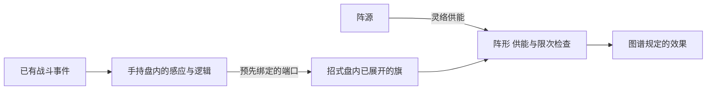

# 手持阵盘与招式盘阵旗协作规划

> **当前结构改革（2026-11-08）**：[独立阵盘与分阵旗定位](阵法改革_独立阵盘与分阵旗定位_20261108.md)。用户已明确并非所有阵法需要旗；基础盘可独立运行，高阶旗推荐作分阵中枢。上一轮强制旗端输出和任意点打盘内件不再作为默认推荐，分阵定位与内部耐久适配尚待评审。下文和旧1.0保留底层及历史来源，旧验算不覆盖改革。

> 日期：2026-11-08。
> 状态：用户确认没有独立场地布置，阵旗放入招式盘表示布置，布置后确实在战场显示；阵盘占唯一手持槽，与手持剑互斥，各部件可在局内被攻破。以下端口绑定、启用、阵形、覆盖及承伤细则为推荐，尚未实装。
> 底层主案：[阵法系统设计](阵法系统设计.md)。本页为已确认盘旗关系及历史讨论来源，替代更早的真实场地落旗、预设场地阵位；本轮统一验收入口见上方完整提案。[早期制作与接入讨论](阵盘制作与招式盘接入规划_20261107.md)保留制作和迁移资料。

> 最新确认：阵盘与阵旗都是器物。阵盘采用手持，阵旗放入招式盘采用御使；阵旗只按阵图工作，不额外附送类别普攻。盘内元件是阵盘子部件，不逐件算御使物。下文盘内定点受击、护阵余伤、器物目标身份及承伤池适配仍为候选。

阵盘负责保存与执行局外编好的逻辑，阵旗是摆入招式盘的真实布阵器物。按本轮可选外置候选，旗的摆放表示部署其所载部件，成功展开后外置支路才能工作；完整内置支路不因此额外依赖一面空旗。布置后阵旗在战场显示；具体扫描与显现时点仍待审。局内无需另选地面坐标、布场地阵位或增加人物移动。

完整教学示例：[三候护持阵盘旗运行](三候护持阵盘旗运行完整示例_20261108.md)。用一面旗与每轮一次云帔，走完局外接线、外部读取顺序、三回合计数、阵能支付及各部件被破后的失效；只沿用旧样例的三次／2阵能／2护盾，不填旗格形、灵识或阵体数值。局部断路是否维持占用等新细则单列为候选。

我的推荐是让阵旗本身承担布置入口，普通自动阵不再强制多放一张操阵牌；额外主动操阵能力是否需要独立入口，按能力另审。这是本轮简化建议，不冒称用户已经逐项批准。

## 一 已确认边界

- 阵盘是实际手持的器物，占唯一手持槽，与手持剑互斥；手持盘本身不占御使灵识。其他御使器物按自身资格与持续占用处理，不因持盘免费获得。
- 阵旗放入招式盘就表示安排布置，布置后确实在战场显示。盘上图标与场上旗对应同一件实物，不另设地面落点操作，不从显示位置生成第二份坐标、距离或范围规则。
- 阵旗是器物，在招式盘中按御使方式使用，合法启用后登记本件持续占用。旗只按阵图工作，不额外附送类别普攻；阵图明确授予的攻击仍按该能力处理。
- 阵盘内部各部件、阵旗及其明确部件都有自己的局内承伤值，阵法可以被攻破。名称“阵体”仍为建议，与永久物品损耗分开。
- 局外做好内部走线；回合间整理招式盘不等于重写阵盘内部线路。
- 阵脉只传瞬时信号，阵源储存并提供阵能；合流、分流和计数不生成阵能。
- 沿[最新御使规则](../../物品与装备/新版御使灵识与锋锐来源规则_20261108.md)：启用御使只检查灵识，不收体力、法力或其他启用费用；灵识只有持续占用，没有每次施法的临时占入与退还。

## 二 两层空间怎样分工

| 层级 | 玩家安排什么 | 决定什么 |
| --- | --- | --- |
| 阵盘内部 | 感应、逻辑、阵眼、阵源及其内部线路，保存旗端口的连接。 | 感知何种事件、怎样筛选计数、驱动哪个输出、内部承载及保护。 |
| 招式盘 | 旗的真实占格、位置与合法转向，以及与招式、化法、丹药等对象的组合。 | 启用先后，以及图谱明确规定的覆盖与阵形关系。 |

盘内元件是阵盘子部件，不会各自摊进招式盘，也不逐件登记御使或灵识；手持盘不再复制成一件主盘御使物。摆入主盘的旗引用本人真实持有的器物，单件实物不因多格、方案或多个接口变成多份。

阵盘内部格数、旗的战斗占格、行囊占格分别定义，不相互换算。旗的尺寸与可摆数量尚未定，不由当前图标或旧材料数推断。

最低阶盘的具体形制与出图尺寸另列[5×5盘与双路走线候选](基础阵盘形制与双路走线占格候选_20261108.md)：用户指出九格偏小，改荐25格；原8部件格、8线路格、9空格仅验证旧旗端输出布局。命令与供能分别占空格、基础同层不交叉仍为候选。输出位置正在复核；若输出移入盘内，须增加其真实足迹并重排两路，不能沿用旧验算锁定图标。

## 三 盘与旗怎样连接

### 主控与感知执行端（用户类比后的候选）

盘里编排逻辑与供能，旗在盘外承担图谱允许的感知或执行职责。感应端向盘回报事件，盘按计数等逻辑决定是否命令执行端；阵源给实际执行阵器供能。回报与命令同属信号，不新增第三类线。盘上接口只对应终端，不重复产生一份战斗效果。

“在哪里感知、效果作用谁”先用招式盘内的明确绑定或图谱允许的覆盖来表达，战场显示沿用已确认方向，不另布场地。输入仍可盘内感应，同一旗也可兼有授权的感知与执行功能；不为类比强制拆成两旗。外置节省空间为装配取舍之一，不再作为旗的唯一主要价值。下列安装方案仍待选，不能把特定目标、覆盖或足迹当作已确认。

### 输出的两种安装方式（新候选）

底层两条线路始终以输出阵器为功能终点，旗不是“输出阵器”的同义词；阵源的阵能不因旗的存在改成另一笔免费供能。

- **全内置，待审**：感应、逻辑与输出阵器装在盘内，命令线与供能线分别接输出。完整的基础个人阵按手持来源及自身条件工作，不再额外强制摆一面空旗。
- **可选外置，待审**：将图谱及成器允许外置的同一件输出阵器移装到兼容旗上，两路线通过预存端口接实际阵器。腾出它真实占用的盘内空间，付出旗的招式盘位置、持续灵识和外露支路风险；全图复杂度、阵源及峰值检查仍在，不凭旗复制效果或能源。

护持阵示例采用同一件阵器比较：内置时它直接接两路，外置时由旗承载、只有本件旗合法展开才可工作；其效果和费用不因换载体自行增强。空旗不额外提供护盾，旗被破只使实际依赖它的支路失效，不自动伤盘或使完整内置支路停转；已给角色的护盾按原效果处理。安装关系局外确定、本场固定，不一件两用或搬回盘内刷新状态。此前“输出留盘但所有护持仍必须插旗”的单纯支点方案不再作为首推，仍保留为未采用的比较方向。这些都是新候选，不改已确认的旗御使、按阵图工作与无附送普攻。

以下端口举例仅针对选用旗载部件的外置支路，不表示所有阵法或所有输出都必须有旗。

推荐在局外阵图中给各旗设置明确端口，再把内部线路接到这些端口。局内摆旗时引用对应实物和端口，不在主盘重新画一套脉纹。

例如，盘内的一路感应经候枢与分脉枢，分别连接甲、乙两个旗端口。甲旗和乙旗摆到主盘后，各自仍使用保存的那条线路，不因靠近另一招式就自动改成监听该招式。

招式盘中旗与盘的绑定按来源与端口识别，不要求信号经由招式盘空格，不把人物招式块当导线，不默认存在距离衰减。阵盘内部怎样铺线另按形制候选评审，不以本段否定内部空格走线的设计。端口有效不等于阵形、供能与启用已经满足，几项检查分别进行。

同一旗若允许切换多个已学功能，切换方式、时机和本场账本应另定；首期建议本场固定绑定，避免整理时把改功能伪装成移动。

## 四 位置怎样产生构筑选择

我建议旗的位置只承担三种清楚的意义，不把盘面同时当作真实战场前后排。

| 位置意义 | 推荐规则 | 边界 |
| --- | --- | --- |
| 启用顺序 | 排在前面有机会更早展开，接收后续事件。 | 旗不会追补展开前的施法或周天，也不因多格重复展开。 |
| 能力覆盖 | 能力明确作用于盘内招式或其他部件时，按其已定义格形、方向与资格寻找目标。 | 角色护盾或敌方伤害不因放在某格，就自动改成只作用于相邻招式。 |
| 阵形关系 | 某图谱明确要求旗组位置时，按所需连接、共边或指定结构校验。 | 不为所有阵法强加围圈、固定旗数或贴邻要求；早期应能用简单结构体验。 |

旗在第一行主要表示较早扫描，不自动替角色承伤；放在最后一行也不自动免疫破阵。保护来自明文护阵能力、部件加固及已定义的受击规则。

推荐基础图谱先支持简单独立支路，高阶再加入明确的旗组关系。多旗的组合价值应来自图谱授予的结构，不是任意多插一旗就叠加一份全阵效果。

## 五 摆放 展开与成阵分开

**摆放**是配置，**展开**是本件旗进入运行状态，**成阵**是某条线路或某种阵形满足工作条件。三者分别展示。

本节只处理选用旗的外置支路；完整内置个人阵不额外等旗展开。手持来源生效、旗扫描与具体输入时点仍须定案，不由外置候选新建开战免费生效时点。

1. 配招时从真实库存选择旗，校验手持盘、端口、格位、物品数量和图谱资格。仅摆放或切方案不占灵识、不产生效果。
2. 本轮首次扫描旗时，检查盘的手持来源已经有效、本件旗完整、绑定合法且可用灵识足够；符合则登记本件持续占用并展开。启用不收费，也不默认送出一次攻击或护盾。
3. 首次检查后本轮不在后续占格重试，是本轮推荐的易读规则；失败原因显示，下一共同回合再检查，不冒称这是所有器物已获批的通则。
4. 已展开旗跨共同回合保持。后续再扫不重新占灵识、不满充阵能、不重复取得启用收益。
5. 已展开但阵形尚未满足的旗仍占自己的真实灵识与格位，显示“已展开、未成阵”；不能提前运行需要完整旗组的能力。
6. 只有有效线路接收之后的事件。缺旗、失去控制或连接无效时，不积攒待补发的阵脉。共享元件的计数按同一元件身份延续，不按旗数复制。

普通手持盘本身不新增灵识。首期推荐逐件旗保存来源和明示持续占用，内部元件不再重复计同一份占用；成套旗的整体身份若以后开放，需另有定义，不能靠改名合并成本。

启用御使的零费用与阵器发动费用分别处理。旗展开只建立运行资格，真正输出仍须支付明示阵能，并同时满足阵源余量、阵源峰值、灵络峰值及阵盘负荷。具体主动能力如果有体力／法力费用，按该能力另审，不能加回成通用展开费。

## 六 成阵后怎样运行

本节运行图仅演示可选旗载输出的支路，不把本图当成输出必须装旗、所有内置支路必须有旗的依据。

事件先进入盘内感应与逻辑，信号到达被绑定的旗，再核对该旗已展开、阵形有效、供能和输出限次，最后调用已有战斗效果。

旗只按阵图工作，不附送类别普攻。旗本体不是一次主动施法，扫描只检查展开，不自动出招或发送术法事件，也不被复命复制成实物。周天、复制或普通化法能否调用具体阵法能力，必须有明文定义，不能从占格外观推导。

法力支付事件读取真实结算，范围或多段招式不重复算成多次施放；周天遵守已有不递归附加效果的边界。回复、输出限次按共同回合统一的方向继续评审，不因读取一行或多占一格额外结算。

## 七 旗的作用对象要明确

| 能力对象 | 旗的位置有什么意义 | 效果按什么结算 |
| --- | --- | --- |
| 角色本人 | 决定展开先后及该阵要求的旗组关系。 | 如原护持能力仍给本人护盾，不把格位变成角色距离。 |
| 敌方角色 | 决定该支阵器是否已经有效工作。 | 沿图谱与原能力的合法目标，不从旗朝向自行增加射程或手选目标。 |
| 盘内招式 | 只有图谱明确监听或强化盘格招式时，覆盖才决定具体哪份符合条件。 | 费用、次数与原技能身份继续有效，不凭覆盖赠送额外出手。 |
| 阵法部件 | 护阵能力明确保护旗、盘内某节点或对应支路时，按其真实目标映射。 | 人物护盾不自动用于部件，护阵也不自动获得人物全部防御。 |

感应、输出、护阵、供能可以作为旗的用途候选，但每件旗只运行图谱及成品实际授予的功能。盘内输入也可以直接感知所属角色事件，不强制所有输入都再经过一面感应旗。

首期优先用已有护持输出验证控制链。邻格强化、护阵或特殊阵形是后续要单独审定的能力方向，不在本轮生成新卡或数值。

## 八 两旗支路的结构示意

以下甲、乙仅为端口标记，不规定旗数上限、占格或赠送两件实物。

局外把一路合格感应接到候枢，再经分脉枢送往甲、乙两个已授权输出端口。局内将对应旗摆入主盘，甲较早被扫描，乙较晚被扫描：

- 甲已展开而乙未展开时，只有甲的独立有效支路能收到后续脉冲；乙不会在展开时补放此前错过的效果。
- 两路均有效时，各输出分别支付阵能与检查限次，不能因为共享一个脉冲就共享一笔只付一次的输出费用。
- 甲旗被破，只关闭实际依赖甲的支路；乙支路在条件仍满足时继续运行。
- 共用候枢被破，两路都失去这一路触发；这正是集中控制的脆弱点。
- 若图谱明写某效果必须甲乙共同成阵，少一面有效旗就关闭该组合效果，不把它当作两条独立阵器处理。

若以后加入保护共边旗的护阵能力，护阵旗放在哪里会决定保护谁；该例只是覆盖设计方向，保护机制、费用和目标须另行定义。

## 九 可攻破与玻璃大炮

部件各有局内承伤值已确认，名称“阵体”为建议。推荐盘内元件和外部旗各按真实部件记录，不再叠加一条会重复扣同次伤害的全阵总生命。

阵旗作为可受击器物对象管理、盘内节点作为其所属盘的子部件，是本轮身份适配候选；不为它们新建角色速度、独立行动条或移动规则。旗的局内承伤最终采用“阵体”还是御使稳定度、两者怎样对应仍待审；同件旗只用一份局内承伤池，不叠加两条生命或直接套用剑器稳定公式。

| 受损对象 | 推荐失效范围 |
| --- | --- |
| 阵旗或旗端阵器 | 本件输出、输入或支持功能关闭，依赖该旗的组合效果重新校验。 |
| 盘内感应或逻辑节点 | 仅关闭实际依赖该节点的后续路径，其他完整线路继续。 |
| 阵眼或关键供能部件 | 按其实际统合或供能范围停转，不自动增加爆炸、反噬或伤害回灌。 |
| 护阵结构 | 先按明文保护规则处理；保护失效不等于受护部件已经崩解。 |

被破的旗仍占原格，不能变成回体空格。崩解停止对应御使并按本件规则释放持续占用，普通停用、轮末变暗与崩解分别显示。

哪些攻击可以破阵、怎样选取盘内元件、保护先后及是否允许余伤穿透仍待定。招式盘摆放本身不改写普通攻击目标池，也不让前排旗自动分担角色的随机来袭。

### 本轮推荐的场上受击流程（待审）

1. 旗展开后，战场显示对应的同一面旗及其阵体。盘上图标与场上实体读取同一份旗体状态，不各算一条生命。
2. 普通攻击沿原角色目标规则；只有明文允许攻击阵法器物的招式，才可把符合条件的已展开旗纳入目标。这里“破阵招式”仅是说明用语，不新增正式关键词或战斗卡。
3. 敌人若选择旗为目标，意图明确显示“攻击护持旗”及对应目标标记。该旗由招式盘布置自动显示，玩家不需要再到战场拖放一遍。
4. 攻击实际命中旗体时只结算本次合法伤害，扣这件旗自己的阵体，两个视图同步。人物护盾不自动替旗抵挡；不因为打中旗就同时扣旗端阵器、盘内候枢或其他部件，保护与余伤另审。
5. 旗体耗尽时，场上显示折断或崩解，盘中图标同步破损并保留原占格；本件输出停止，释放本件实际持续占用，已给人物的护盾不倒扣。收回重摆不修复本场损伤。其他完整支路按原依赖关系继续。

推荐首期用明确攻击旗的目标表现教会玩家反制。盘内定点受击与护阵余伤见下列候选；范围攻击是否波及旗、随机选器物及其他穿透关系仍另审。场上显示在哪一侧只负责识别，不决定前排承伤或后排免疫。

### 盘内定点受击与被动护阵件（待审）

- 只有明文允许损伤盘内部件的破阵手段，才可对其指定合法节点造成损伤；敌人意图标出该节点，动画冲击手持盘并显示受损处。普通打人物、打阵旗不自动传伤盘内，也不从旗的连接线推导伤害回灌。
- 护持阵示例在制作时给三候枢指定一件被动承伤护阵件。护阵件消耗内部空间与材料，不额外占招式盘，不逐件登记御使；保护关系单独明示，不默认保护其他节点或外部阵旗。
- 单层保护候选：原目标为受护三候枢时，本次合法来袭伤害先扣护阵件阵体，挡不住的余伤仅给原被护目标；两件合计分摊同次伤害，不各扣一次全额，不继续扩散其他部件。直接攻击护阵件时，不自动把余伤传给它保护的三候枢。
- 护阵件崩解只撤去这份保护；三候枢只有自身阵体耗尽才停止计数与转发。首期不叠套多层护阵，不新增盘壳／全阵总生命、伤害类型、资源或数值；合法目标、防护顺序和余伤算法仍待审，不据此生成正式敌招或护阵卡。

精密阵法的风险可来自关键节点过度集中、旗体脆弱或保护投入较少。精炼不必统一减阵体；材料与造诣可以选择加强坚固，也可以把更多投入用于紧凑、输出或供能，但同一潜力不能全额重复使用。

## 十 回合间调整与方案

仅在已确认的共同轮末整理窗口修改外部摆放。推荐同件旗移动或合法转向时保留已展开状态、阵体、阵能、计数与次数，只重算实际受影响的几何关系，不补发此前事件。

取下旗会失去相应功能并按规则释放占用，本场记录仍保留；放回同件旗须检查运行条件，不能恢复其阵体、充能或重新领取已用机会。已崩解部件不因放回而修复，真实修复另行定义。

持盘来源失效后怎样停用仍须完整规格。首期推荐依赖本盘的旗停止后续调度并清理实际持续占用，但保留原占格与本场账本；恢复来源不自动补发或重置。脱手自主阵法须另有图谱授予，不作为通用能力。

方案保存手持盘来源、各旗身份、端口和外部摆放意图，不保存可供恢复的灵识、阵体、阵能或库存副本。盘内阵图版本本场固定，改外部位置不改变内部连接。

## 十一 制作成长与信息展示

图谱授予输入输出及明确的阵形能力；造诣决定可用逻辑、制作规格与材料发挥；材料决定对应部件的承载、供能、效力和坚固潜力。具体材料映射、公式与加工门槛仍待审，不把综合材评直接换成输出倍率。

基础逻辑的含义保持确定，普通与精炼构型主要改变空间及复杂度，不随机漏触发。输出的效力、阵能消耗和峰值负荷一起生成并展示，不默认只提高收益。

局内查看旗时显示其所属盘与端口、未展开／已展开／未成阵／崩解、实际作用对象、阵体、持续灵识及不能运行的原因。盘内线路通过查看阵盘打开；主盘只对当前查看对象显示连接或覆盖，不把整套内部线路常驻铺满。

## 十二 定案与实施顺序

本轮只明确系统结构，不填写旗尺寸、可摆份数、灵识数值、伤害、护盾或阵体上限。优先待审：

- 旗端口与真实物品的绑定，以及是否接受同一图谱的多件副本。
- 首次扫描展开、失败不重试与跨轮保持的完整时序。
- 基础图谱的阵形要求，及哪些能力真正涉及盘格覆盖。
- 逐面旗的持续占用、容量不足与来源失效处理。
- 合法破阵目标、单层保护与余伤、旗承伤池适配、局部失效及修复边界。

若采纳可选外置，先用已有护持用途比较全内置闭环与同件阵器旗载的空间取舍，再验证旗御使展开、两路到实际阵器、破旗只停相关部分、破公共节点及整理不刷新状态。新的护阵或覆盖能力按项目卡牌流程另审，不先修改战斗卡或运行数据。

本轮验证为文档与引用检查，未运行编译或场景，未改代码、卡牌、物品或正式存档。

## 文学参照

- [《凡人修仙传》第231章《惹祸上门》](https://www.yunshuzhai.com/book/5104/231.html)：阵旗与阵盘可插入或埋入地面，灵石置于阵眼供能，手持主阵旗用于控制；说明“盘必定手持、旗必定装输出”不是统一小说规则。
- [《仙府长生》第136章《修炼青阳功》](https://www.piaotia.com/html/15/15305/10627705.html)：阵盘接收操控指令并驱动阵旗，阵法形成青石与光罩防护，供本项目借鉴控制、节点与防护的分工。
- [《凡人修仙传》第2412章《阵眼》](https://www.bidutuijian.com/books/FanRenXiuXianChuan/1981.html)：金柱、禁制与看守围护阵眼，供本项目借鉴重要结构需要保护的构筑取舍。

小说的真实场地布设不作为本项目操作规则；当前仍以招式盘表达布置。盘内逐件受击、单层护阵分摊余伤及器物单位适配都是本项目候选，不冒称小说固有规则，也不据小说加入自动修复、反噬或新数值。

补充核对[《我在修仙界种长生》布阵段落](https://www.jpxs123.com/book/10436/165.html)：控阵盘、布于方位的阵旗节点、阵眼与地脉供能分开描述。本项目可借鉴控制、成阵节点和能源的分工；“可编程感应／逻辑／输出模块”及其安装位置是本项目设计，不能据小说片段直接定为旗载输出。
