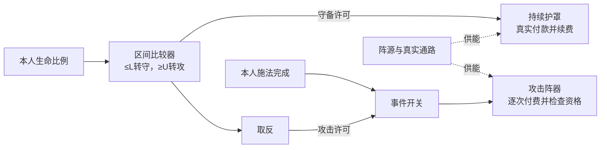

# 阵法输入输出与状态控制改革方案

2026-11-09。用户随后明确批准第一批实施：状态输入、比较器、开关、持续护罩、计数合并及可实际试运行的守攻阵，见[当前实装入口](守攻阵状态控制实装_20261109.md)。本页保留完整接口方向；正式图谱数值、实体占格、累计统计、记忆／边沿／选择及独立储能等未实装部分仍为候选，不把独立试验参数视为正式平衡。

原基础来源为[五件逻辑实施记录](阵盘基础逻辑元件实装_20261109.md)与[4×4单层接线](基础阵盘四格单层接线实施_20261108.md)。图谱、造诣、材料及供能来源沿[底层主案](阵法系统设计.md)；人物时序沿[人类招式盘实施](../../战斗与构筑/人类招式盘实施与验收_20261107.md)，公共护盾沿[状态系统](../../战斗与构筑/状态系统设计.md)。本稿取代先前高级r1的方向，实施范围以最新实装页为准，不混入未完成部分。

## 一、改革的主要决定

1. 输入不再只有“发生一下”，增加持续状态和有单位的数值。
2. 输出不再全部“收到一下就执行一下”，分瞬发、持续、储能控制；第一批优先瞬发与持续，独立储能须有普通预算保留无法替代的物理价值。
3. 计数器与分频器不再规划为两种独立物品；改为一类计数器的不同模式。单阈值比较、区间比较也尽量作为同类器件的设置，不堆同质件。
4. 效果、能源与控制各司其职。逻辑决定请求和策略，阵器决定能做什么，供能账本决定是否做得起。
5. 最低4×4保持；复杂示例先验功能，不声称已能装入基础盘。

明确改变的旧规则是“朱砂线只传瞬时脉冲”。改为朱砂线传以下三类有类型的信息；赭金线仍只负责真实供能。不增加第二时间轴，也不把状态值或计数变成第四种人物战斗资源。

## 二、三类信号

| 类型 | 玩家理解 | 例子 | 固定边界 |
| --- | --- | --- | --- |
| 事件 | 刚刚发生了一件事 | 本人施法完成、一次直接受击结算完、真实共同回合边界 | 带独立发生身份；没来事件不等于false |
| 开关状态 | 此刻条件是否成立 | 需要守备、阵器正在运行、器件就绪 | 真／假／未知；保持到下一次真实更新，不每帧重复算一次发生 |
| 数值 | 此刻有多少 | 本人生命比例、公共护盾、盘内可用阵能、本器实际储量 | 带单位、来源、有效性；伤害值、档位、次数和阵能不能混算 |

三类都可使用朱砂材质，但端口和线路网络须类型匹配。不能把事件缺席接成“没受伤”，不能把数值3接成三份阵能，也不能让同色线成为免费多类型总线。一个线格仍只承载一种网络，不增加跨线或隐藏层。

状态与数值网络须有唯一写入来源；多个状态必须经过明确的与／或，多个数值必须经过同单位选择，不能硬接后自动择值。普通合流只汇集事件；分流可以复制信息，不能复制能源或制造多个独立发生。

事件进入“开关”后，只在许可成立时转发这次事件；许可后来变真，不补发此前被挡的事件。状态变化要变成一次事件，须经过明确的边沿转换。首个样本用于建立基线，普通重启不能伪造一次上升沿。

三值判断固定为：AND有一个已知假即假，全部真才真，其余未知；OR有一个已知真即真，全部假才假，其余未知；NOT未知仍是未知。事件开关只有明确真才放行。信号无效后恢复的首个样本同样只重建边沿基线，不追补缺口中的变化。

失效只影响依赖它的判断，不让无关传感器故障停掉全图；OR因另一个充分的已知真得到真，仍是有效许可。区间比较器遇到未知时保留内部历史模式，向外标未知，恢复有效采样后再按同一历史判断，不把缺口洗成新的初始模式。

## 三、输入与自监接口

| 来源 | 首批建议内容 | 信息限制 |
| --- | --- | --- |
| 人物事件感应 | 本人原始施法实际完成、敌方原始直接伤害对本人结算完成 | 多段同一动作只形成一次对应事实；阵器派生法术不自动成为“本人又施法” |
| 人物数值感应 | 本人当前生命／上限、生命比例、公共护盾、法力 | 由相应图谱授予，不能凭一个逻辑件窥读敌方隐藏意图 |
| 既有时序感应 | 共同回合边界、原有合法回复机会 | 依附已有时钟；周天等入口须实际接通才可用，不因有名字便视作已实现 |
| 阵源自监 | 当前可用阵能、容量、当前承载与真实已预留量 | 只读本盘硬件；读数不是又一份可花的能源 |
| 阵器自监 | 运行／停止、冷却就绪、实际成功／拒绝、本器储量或剩余护罩 | 随相应已掌握器件提供明确白名单；“内部就绪”不等于目标、供能与费用最终都通过 |

既有“出牌／术法”事件不能悄悄改发生阶段。新“施法完成”入口需要等实际施放成立后发出，并给旧入口保留兼容定义。本例受击入口继续在伤害结算后，不插入新的抢先应对机会；后开护罩只保护后续伤害。

每个数值必须说明其观测时点。当前盾、余额在相应节点读取，实际执行时复核；原始伤害幅值按已完成动作的真实损失记录保留，不被执行结果覆盖。缺数据标未知，不能用0替代。

## 四、输出改革

### A. 瞬发阵器

保留现有一次护持、法力回复和合法法术攻击等效果。基本入口是“发动”事件；具有调节能力的图谱可另外提供数值型“档位”入口，未定义档位的旧阵器保持原效果。

档位对应图谱明确的`费用C(u)、负荷P(u)、效果F(u)`，范围有限且由真实成器承载。信号强度不是输出功率；受击数值大，不会自动让火击变强。高档不默认更高效，也不能通过任意数值口超出图谱。

出口可提供实际成功事件、拒绝原因和实际结果。只有效果真正提交才有成功；拒绝不扣费、不占成功账本，也不保存待攻击。回执不是新受击或新施法。目标、冷却、次数与全部供能检查仍由执行器负责，不另做“付款元件”或强迫每张图重复摆一套资格判断。

### B. 持续阵器：以护罩为首个新图谱候选

控制口为开关状态“允许维持”；反馈为“实际运行”、本器防护余量及断供／停止原因。**希望维持**和**已经生效**分别表达，不能把控制线为真当作护罩已经得到。

该图谱定义：每个既有共同回合防护段真实支付`C维`，提供本段容量为`H`的本器护罩，并占用明确的维持负荷`P维`。数值由图谱与硬件另定，不沿用旧2阵能／2护盾冒称新常驻能力。

- 从未运行到运行：在合法启动处理点尝试本段付款，成功后才建立护罩；受击后启动不倒改已受伤害。
- 继续运行：真实回合边界先处理旧窗结束及关机条件，再决定新段是否续付；账本上旧段剩余容量先到期，再由成功付款建立新段H，禁止跨段叠加或免费延续。不是每帧付费。
- 当前段运行中重复许可：不再付款、不叠加容量、不刷新当前余量。
- 许可关闭、合法停用或本人失去战斗资格：停止该持续效果，撤去本器尚存防护；已付费用不退。
- 同一器件同一防护段最多取得一次新容量。该段取得容量后关闭再开，明确拒绝重建；既有付款／成功账本保留，直到下一真实防护段才可能重新建立容量。
- 未付款或续费失败：没有下一段护罩，也不形成虚假的“已运行”。失败不占本段成功名额；新的合法可用机会可以重新尝试，不原地死循环。
- 护罩被正常伤害耗尽：本段防护停止并释放后续维持承载，成功／容量账本仍已使用，不自动补满。持续请求可以保留，下一真实防护段再按费用重建；不要求玩家加一个逻辑件来关掉完全耗尽的空罩。

持续效果不是旧瞬时加盾换一个名字。它有真实运行期限、续费、关机与断供的损失；玩家可以避免安静期费用，也必须接受关机后的防护空档。

首次装备启用与后续维护是图谱明示的生命周期处理点，可以按当时许可申请服务；它们不向全电路伪造边沿。轮初若同时有原规则的真实补给／次数更新，先按其来源结算，再发送可用机会与处理维护。本稿不凭一个“轮初”给阵源多回一次能，也不拿旧每自身行动回复量冒充新持续器已经平衡。

续段的“成功”是新服务段已经真实付款并建立，并不要求公共护盾净增量大于0；同容量合法续段仍可能成功。它与瞬发“实际加盾”使用不同结果类别。旧容量到期与新容量建立对外按一次边界事务发布最终盾值，内部过渡值不得伪造“被打破／受伤”；续费失败则旧段正常到期，最终只保留其他来源的真实防护。

器件所依赖的最终控制许可为未知时，禁止新攻击；失效前仍在运行的护罩可保留原服务许可，继续按段真实付款。未运行或已耗尽停止的护罩，未知期间不允许首次启动或重建，等有效许可及新合法机会。**持盘资格或供能来源实际失效**则直接按停用停止，不属于可续费的普通观测缺口。

**公共护盾适配是本项前置依赖。** 护罩容量仍计入本人公共`shield`，不新增第二条玩家护盾或固定公共护盾上限；但必须增加来源记录，知道本器还剩多少。关机只撤本器剩余部分，不清普通护持、心法等其他来源。各来源按取得先后吸收，同批用稳定来源顺序；旧无来源聚合值只能登记为普通既有护盾，不能猜成某个阵器提供。缺少这层记录时，本图谱不能宣称可接入。

维持负荷占用实际承载通路。其他输出还须在剩余承载中运行；本段已消耗的阵能与当前真实维持承载分别记账，关机释放后续承载不会退回已经消耗的阵能，也不清同一事件的瞬发峰值账本。

### C. 储能与释放：有条件的第二阶段

阵源本来就会储能。“等余额够了再打”只需余额判断，不能据此证明必须再造一个储能件。

独立储能只有在以下结构确有价值时才立项：真实的隔离储量、容量、充放通路与限制，使其他支路不能直接花掉其中的阵能，同时付出格位、眼下防护预算和等待。若普通最低余额约束能够完全替代，就用预算约束。

候选操作口为“申请充入q”“释放合法档位”“取消未提交预留”；反馈实际充入量、真实储量与释放结果。充入必须使源实际减少、储量相应增加，计数或受伤不能产能。已实际转入的能量不因取消瞬间回源；回流需要真实路径和传导限制，尚未提交的预留才可直接解除。

储能不自动增加峰值。未另定义真实放电硬件之前，所有原供出、通路与盘体限制继续检查。储量满可以经边沿通知一次；若要自动释放，必须接明确释放支路，那是当前新控制请求，不能补打一记旧失败攻击。同一结算波不靠充放循环净增能量或重开额度。

## 五、逻辑元件怎样收敛

| 功能名称 | 输入→输出 | 真正解决的问题 |
| --- | --- | --- |
| 比较器 | 同单位数值与门槛→开关状态 | 当前生命、护盾、余能是否达到玩家选择的条件 |
| 条件门 | 开关状态→开关状态；与／或／非分别配置 | 同时满足、任一满足、对已知条件取反；不接两个瞬时事件冒充同时成立 |
| 开关 | 事件＋开关许可→事件 | 只让这次合法事件进入指定执行支路，不保存被拦的旧事 |
| 记忆器 | 明确置位／清除事件→保持的开关状态 | 记住未完成需求或历史模式，直到合法解除 |
| 计数器 | 事件→累计数值，或间隔事件 | 真正统计历史；间隔模式包含原计数／分频的起步设置 |
| 边沿器 | 开关状态变化→一次事件 | 就绪一次通知一次，持续为真不反复发动 |
| 选择器 | 一个条件＋两个同单位值→选中的值 | 按资源策略选择图谱许可的输出档位 |
| 分流／合流 | 同类型信息分送；事件择一路汇入 | 分流不复制能源；事件合流去重，不当作布尔OR或数值求和 |

比较器的区间模式允许“≤L打开、≥U关闭、中间保持”，`L<U`。这是带记忆的比较功能，避免同一阈值附近反复切换；不再要求为同一个区间状态额外摆记忆器。普通单阈值模式没有这种保持行为。

记忆器只保存独立的历史需求。输出反馈的“实际运行”属于执行事实，控制者的“希望维持”属于策略；不能为一个可直接读取的事实又存一份可能失真的替代标志。执行器若采用自带保持开关的接口，就不再用外件重复保存同一开关意图；本稿持续型统一用外接许可，不在执行器再藏另一份策略模式。

旧筛选器的内置来源／幅值筛选继续保留兼容。新外接条件开关与旧内置筛选属于同类事件放行功能，实体设计优先合并成同一类开关的不同配置；同一条件不强迫串摆两件。端口增加须真实重画、重验占格与复杂度，不凭改名免费多一口。

计数器累计模式到达阈值不自动归零，清零点明确；窗口统计须接真实边界，先封存旧报告再重置本窗。间隔模式才每N次放行，保留“数满再发／先发一次”等起点。若只需要“本窗有没有受击”，一位标志即可，不要求使用完整次数统计，更不加“第三次才有护盾”。

延迟不进入第一批最小件：以后只能把明确任务安排到既有合法边界，到期重新检查，不能复制旧受击资格、免费等待或无限重试。

## 六、第一个完整例子：守攻切换阵

玩家策略：生命进入危险区就转守，恢复到较高水平才转攻；恢复一点不立刻撤防，尚未重伤也不频繁中止攻击。

设低阈值`L`、恢复阈值`U`，生命比例为`h`：

```text
h ≤ L：守备状态=真
h ≥ U：守备状态=假
L < h < U：保持之前的守备状态
```

守备状态控制持续护罩；取反后作为攻击许可。本人真实施法完成事件先经过该许可，再进入瞬发攻击。额外希望保留防护预算时，将“攻击后还能留下C维”与攻击许可相与，并把该最低余额约束绑定到执行请求，最终原子复核。



例如仅作演示，取L=30%、U=60%。同样是45%生命：从20%恢复上来，继续守；从80%下降过来，仍可攻。当前数值相同、历史不同、选择不同，这就是区间记忆的实际用途。数值不是本轮平衡定稿；本例新开战首次有效采样位于中间区时默认守备，同场重启不能反复取得新的初始状态。

代价也明确：守时付维持费并主动舍弃攻击，攻时放弃该持续护罩。固定“永远先护后攻”可用执行顺序和保底预算解决，不需要这一套；愿意作历史模式选择的玩家才装区间控制。

两路使用同一守备状态，不再存第二个模式位。模式切换先落实停用与释放后续承载，再处理新的启动／攻击请求；真正付款与实际运行以结果为准，不能用期望许可绕过资源事务。

## 七、第二个例子：受袭开罩、安静关罩

玩家策略：一次合格受击后开始请求护罩；完整一回合没有再受袭，就在下一次续费前关掉。

- 受击事件建立持续防护请求；实际启动成功才有保护，第一下伤害不会被倒改。
- 后续受击只更新本窗记录，正在运行时不重新叠容量或收启动费。
- 真实窗口结束时，只有“完整观察且没有受击”才解除请求；然后才决定下一段是否续费。
- 观察有缺口不能当作安静。该策略保留原有请求；失效前仍运行的服务可以继续承担续费，已停止者按上文未知策略不重建。不将未知开放为攻击许可，缺失观测也不能凭空建立此前没有的请求。

这里保存的是“继续维持护罩”的请求Q，只有明确的解除条件才清除；启动成功不清Q，外界普通补盾也不清Q。旧r1“只补一次盾、补成便结束”的待补防P是另一种策略，不能把两者接成同一状态。区间守攻例则直接使用区间比较器自己的状态，不再重复保存Q。

常开方案会在安静期继续花能；只连受击事件只能负责启动，无法可靠决定何时停止。这里新增的关闭操作、状态反馈和完整窗口记录都有可观察作用；单纯旧瞬时加盾没有可撤销的持续效果，因此不能替代本例。

本例只读“有没有受袭”时，一位记录足够。只有玩家进一步选择“上一完整窗确实受袭密集时，下一窗限制攻击档位”等需要实际次数的策略，才使用计数器；不以这个例子强证每个阵都需要计数。

## 八、结算与防循环协议

1. 事实提交后更新授权观测，再求值无环的组合逻辑；状态写入按明确因果顺序。逻辑变化不会自己推进战斗时间。
2. 请求按确定顺序提交；停止服务与关闭许可先于同阶段的新消费。费用、效果、次数和预留作为事务；拒绝撤销预留，已经提交的其他效果不被后续失败退款。
3. 结果回报只更新实际事实或进入明示的后续支路。反馈可跨真实结算点形成控制闭环，不准同一结算波靠“成功→就绪→再次发动”无限循环。
4. 原始动作ID用于因果与预算归属；事件事实ID区别真实施法、受击、窗口与执行结果；消息ID区别分发与回报。计数按声明的原始动作／事实去重，执行按实际请求与阵器去重，续费按器件与真实防护段去重。
5. 分流、回执、边沿和串行支路不重开同源本次峰值。控制许可变化不刷新阵源，取反不把未知变为安全。
6. 首次采样不向外伪造边沿；停用／重新装备不刷新源余量、储量、原次数、付款窗口和区间记忆。合法停止立即停止本器持续效果，重启需重新核实权限和当前事实。
7. 事实失效时，已提交结果按本身规则处理；本例进攻停止，新请求不得用旧安全判断。维持中的防护按上节明确策略承担费用，不能借缺数据免费持续。
8. 本例只接本人原始施法、敌方原始直接伤害等明示范围；阵器和反震派生伤害不自动重入同一反击输入，不扩大现行人物应对次数。

## 九、验收与下一步

| 验收情况 | 应看到的结果 |
| --- | --- |
| 相同生命45%，但分别从低区恢复／从高区下降 | 区间模式维持不同守攻选择；单阈值控制则没有这份历史 |
| 维持与攻击都各自付得起，但余额不足以同时支付 | 策略真实舍弃其中一路，不能两路都成功 |
| 持续许可一直为真 | 每段只按协议续付一次，容量不因重复消息叠加 |
| 开罩后在同段关闭再开 | 不刷新护罩容量、不退款、不刷新次数 |
| 新段续费成功，但新旧公共护盾总量恰好相同 | 服务实际续成并真实付费；不因净增量0误报失败或退款 |
| 刚受击才开罩 | 只防后续伤害，不抹去第一下损失 |
| 完整安静窗结束 | 在下一续费前停止，少付一段维持费，之后存在防护空档 |
| 有观测缺口的空样本窗 | 不认定安静，不将未知放为攻击；仍运行的服务续费，已停止者不重建 |
| 别的来源同时有普通护盾 | 关罩只撤本器剩余，普通护盾保持 |
| 充入、分流、取消或重启储能 | 同一份阵能不被复制，旧消费不退款，峰值不凭串行刷新 |

下一阶段推荐先实现三类信息协议、本人状态与器件自监、比较／开关，再做有来源记录的持续护罩及守攻切换；计数合并与旧保存迁移同批明确。物理端口、足迹、复杂度与造诣在功能定后另表核验，不给高级图免费压进4×4。图谱给新观测和新输出，材料给真实硬件，基础瞬发护持仍可直连。

## 机制参考

- [TI双阈值比较器](https://www.ti.com/tool/CIRCUIT060078)：借鉴不同进入／退出阈值；游戏不照搬电子噪声或电压数值。
- [TI S-R锁存器](https://www.ti.com/product/SN74LS279A)：借鉴置位、复位与保持；游戏对同阶段矛盾命令采用明确停止优先，不引入硬件的不确定输出。
- [TI带输出寄存的计数器](https://www.ti.com/product/SN74LV8154)：借鉴计数与读数分离；游戏窗口仍来自已有共同回合，不新增时钟。

上述是现实机制参考，阵器费用、防护段、档位与输入权限均为本项目候选规则，不是芯片资料提供的游戏平衡。
