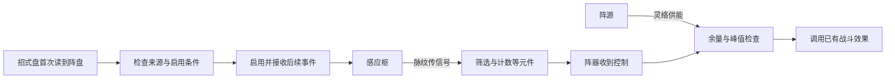

# 阵盘制作与招式盘接入规划

> 后续整合入口：[阵法系统完整策划提案](阵法系统完整策划提案_20261108.md)，待用户整体验收。本页保留制作与迁移讨论；真实场地落旗、整盘占主盘格及强制另摆操阵牌等旧方向，已由用户后续手持盘、主盘御使旗的澄清及新提案替代，不据此实现。

> 2026-11-08 最新澄清：阵盘占唯一手持槽，与手持剑互斥；旗放入招式盘表示布置，没有独立场地落点。当前以[手持阵盘与招式盘阵旗协作规划](手持阵盘与招式盘阵旗协作规划_20261108.md)为入口。旗本身承担展开读取、普通自动阵不强制另摆操阵牌为新建议；本文保留制作与迁移讨论，整盘主盘御使及真实场地布置旧案退出。

> 日期：2026-11-07。
> 状态：局外走线、唯一手持盘、旗放招式盘表示布置、部件独立局内承伤已确认；本页为早期制作与接入讨论，具体启用与协作以当前入口为准，尚未实装。
> 主文档：[阵法系统设计](阵法系统设计.md)。本文补充新版招式盘的接入规划，不另立一套阵法底层规则。

阵法的核心玩法是：**局外把战斗条件编成阵图，局内持盘、将旗摆入招式盘表示布置，再由已展开旗接收内部线路的控制。**内部走线与外部摆旗分别承担逻辑组织和时序／几何选择。

首期建议先用现有护持阵验证这条循环，再开放自由走线和正式制作。按2026-11-08确认方向补齐部件受击与失效；地点聚灵、全队战阵和高境界状态机另行规划。

## 一 已确认方向与推荐选择

### 已确认方向

- 最新澄清：局外保存内部线路；盘实际手持，旗摆入主盘表示布置。内部元件不摊进主盘，也不另选场地坐标；额外主动操阵入口不作为自动阵强制配置。
- 2026-11-08新增：阵法能够在局内被攻破，各部件具有独立局内承伤值；精密而缺少保护的线路可以脆弱。
- 阵脉只传瞬时信号，阵源才储存并提供阵能。合流、分流和候枢计数都不能产生阵能。
- 阵法录提供输入与输出接口，阵道造诣决定可用元件，阵盘硬件约束规模和负荷。
- 首期个人阵法只服务所属角色。阵盘不增加独立行动条或第二时间轴；战中不重新接线。
- 新版人类招式盘按[人类招式盘实施与验收](../../战斗与构筑/人类招式盘实施与验收_20261107.md)处理共同回合、逐行扫描和回合间整理。阵盘占用的真实格子不属于回体空格。

### 启动方式比较

| 方案 | 实际行为 | 构筑影响 | 判断 |
| --- | --- | --- | --- |
| **首次扫到后启动，跨回合保持** | 首次通过启用检查后持续接收后续事件，直至停用或战斗结束。 | 靠前摆放能更早工作；靠后可能错过首轮事件，启动后不反复收起。 | **最推荐**。有摆放顺序价值，也符合持续阵法的直觉。 |
| 每轮扫到后启动，轮末停止 | 每共同回合都重新等待扫描。 | 持续效果更依赖盘序，也更容易形成固定的前排必放位置；轮初事件难以利用。 | 适合以后明确设计的短时阵式，不宜作为全部阵盘的通则。 |
| 开战即运行 | 入盘并满足战前条件就开始运转。 | 主要考验占地取舍，位置先后几乎没有作用。 | 易上手，但没有充分利用当前逐行招式盘的玩法。 |

推荐把“启动阵盘”和“发动阵器”分开：扫到整盘负责启动；此后的合格事件经内部线路控制阵器。扫到后续占格、下一轮再次经过阵盘，都不额外发动一次输出。

以下章节按第一种方案展开。它是供评审的完整候选，不表示其费用、限次和时序已经获批。

## 二 玩家循环与构筑代价

```text
掌握阵法录与元件
→ 取得或制作阵盘硬件
→ 局外装入元件、接脉纹、检查供能
→ 试演事件序列并保存阵图
→ 局内手持阵盘，在招式盘摆入真实阵旗
→ 扫描时检查来源与持续灵识，展开后接收后续事件
→ 战后查看触发记录，再调整线路与构筑
```

阵盘有两种不同的空间限制。

| 空间 | 决定什么 | 不直接决定什么 |
| --- | --- | --- |
| 阵盘内部 | 可装元件、线路布局、阵眼复杂度与硬件供能。 | 不按内部每个元件额外占一格招式盘。 |
| 招式盘占地 | 旗与招式、化法、丹药竞争位置，决定展开先后及明文覆盖／阵形。 | 不表示同件盘再次御使，也不按格数增加输出或阵能。 |

阵盘内部形制与旗的主盘占格分别配置，手持实物不按内部元件数占主盘。旗尺寸与旋转另定，不按图标推断。

阵法的代价由唯一手持槽、旗的主盘空间、真实持续灵识及内部阵能承担。普通手持不新增灵识，旗启用只检查持续灵识、不收体力／法力；输出消耗及具体能力费用另按明文，不能重复收启用费或引入临时灵识。

阵能只属于阵盘内部，不新增角色的第四种技能支付栏。阵器不作为免费招式供复命、周天指示或普通化法自动调用；需要这类适配时，应另有明文定义。

## 三 局外制作与走线

### 阵法录与成长

阵法录解决“感知什么、能做什么”，阵道造诣解决“能接多复杂”。同一种输出可以通过不同事件和逻辑触发；提升造诣主要增加组织能力，不直接放大伤害。

保留主案的云息成长表作为规划依据：

| 阵道造诣 | 主案解锁内容 | 首期学习目标 |
| ---: | --- | --- |
| 5 | 感应枢、脉纹、单阵器 | 看懂一次事件怎样触发效果。 |
| 15 | 鉴脉门 | 筛选来源或振幅。 |
| 30 | 候枢 | 理解每若干次事件放行一次。 |
| 45 | 节律枢 | 控制放行节奏。 |
| 60 | 分脉枢、合脉枢 | 组合多路输入与输出。 |
| 75 | 基础元件精炼 | 在相同功能下节约内部空间和复杂度。 |
| 90 | 云息圆满阵图 | 完成较完整的组合阵图。 |

三候样例的实际门槛，以及多阵法录混搭与90节点的关系存在冲突，见第九节。上表不授权直接改资源，也不补造取得造诣的次数、耗时、学费或成长公式。

教学建议依次给出直连、筛选、计数、分合的练习阵图，让玩家逐次理解变化。它们是教学结构，不等于新增阵法录、奖励或正式成品。

### 硬件与材料

沿用胚体、纹料、阵眼、阵枢、阵基五类制作职责，按[物品词缀系统设计](../../物品与装备/物品词缀系统设计.md)复用材料条件检查。材料性质参与生成硬件参数；具体输出仍须由阵法录、阵器定义和合法线路授予。

现行材料已使用“固、聚、通、化、引、破、护、镇、生、明、藏、行”基础功用，旧阵法硬件仍读取“通脉、蕴灵、聚灵”等词缀。应先制定并确认阵法专用的材料映射，再定义真实配方。不能将旧词自动一一替换后保留旧加值。

正式制作需要补齐：有效材料与份数、产物身份及占地、造诣门槛、工时与精力、制作地点、失败或取消边界。规则未齐前，只做不扣真实材料的隔离试演。

### 编辑器

沿用百工阵法页的三栏职责，交互从固定示范扩展为可编辑阵盘：

| 区域 | 内容与操作 |
| --- | --- |
| 左栏 | 本人实际掌握的阵法录接口、可用元件与解锁条件；拖入元件前预览内部占用。 |
| 中栏 | 摆放元件、连接输入输出、删除线路、查看信号方向；脉纹与灵络用不同线形表达。 |
| 右栏 | 实时读取当前阵图的格位、复杂度、储能、回复、峰值及错误，点击错误定位对应对象。 |

“保存阵图”保存配置；“试演”用指定事件检验线路；“制作／刻录”在投入产出规则明确后才执行真实事务。三者不合并成一个会暗中扣材料的按钮。

我的偏向是先让供能连通关系清楚可见，保留阵源、灵络和负荷的约束，不在首版增加走线长度损耗、拐角惩罚或随机短路。灵络是否要求逐段绘制、交叉和脉纹层数如何限制，仍需单独定案。

个人百工承接图样、配置与记录；真正制造硬件是否需要地点设施，应沿地点制作方向另定。现有丹房／器作租用不自动扩展为阵法收费或制作权限，宗门公库也不因此开放领料。

## 四 入盘与运行推荐方案

### 入盘校验

主盘旗引用真实物品、对应手持盘与局外保存的端口。蓝图与实物分别管理，复制线路不产生旗或盘的副本。

入盘前检查形制与旋转、可用格、重叠、来源、阵法录、逐元件造诣和硬件承载。多格阵盘仍是一件对象；放置编号、移动、换方案都不能创造第二件阵盘或第二份供能。

阵盘采用手持，旗在主盘展开；不复制同件盘为御使物。部件独立承伤不自动授予器蕴或主动技能，旗连接、持续灵识及受击细则按当前协作规划。

### 启动与停用

当前推荐首次扫描旗时检查展开，须有有效手持盘、真实旗、合法绑定与足够灵识；启用不收体力法力。首次失败是否本轮不重试仍为建议，成功后接收后续事件，不另做场地部署。

失败处理建议沿新版招式的易读原则：本轮只检查一次，显示缺失原因，下轮再检查。此项属于阵盘的新候选规则，不直接套用丹药的双格重试或法宝未定的逐格启用方案。

启动后跨共同回合保持。已启动阵盘不会因为每轮重扫而重复扣启动费用、占灵识或回复阵能。停用立即关闭后续事件订阅，已结算的护盾、伤害等依原效果规则处理，不倒算。

2026-11-08用户确认阵法可被攻破、各部件独立承伤，替代此前暂缓阵法受击的建议。战中改线仍未开放。

### 部件承伤与阵旗候选

用户已确认可攻破与各部件独立承伤。本节其余命名、失效行为及阵旗用途为推荐，尚未实装。

建议称局内结构承伤值为“阵体”，显示“阵体上限／剩余阵体”，与器物系统已有“器体”的局内概念对应，不等同长期物品损耗。各部件分别记录，不再额外叠加一条重复扣减的全阵总生命。

| 部件 | 被破后的推荐影响 |
| --- | --- |
| 感应枢 | 该输入停止产生后续信号。 |
| 逻辑元件 | 停止处理与转发，实际依赖它的分支停转，其他完整线路按原接线继续。 |
| 输出阵器 | 该输出停止发动；已结算效果依原规则处理。 |
| 阵源 | 该源停止供能，不自动产生爆炸、反噬或连锁伤害。 |
| 阵眼 | 失去其统合的阵图停转，具体核心关系须明示。 |
| 盘体及连接 | 壳体保护方式、脉纹／灵络是否按连接段承伤另定，避免对同一受击重复扣除多层数值。 |

推荐未破部件按明确逻辑正常运行，破后关闭功能，不以随机漏触发表达损伤。回合切换、移盘、收回再放入不恢复本场阵体；战中修复、修复后的计数及战后恢复另定。

精炼不必统一降低阵体。制作应在效能、紧凑与坚固之间分配真实材料潜力，高造诣改善工艺，但同一投入不能全额重复用于所有方向。关键节点保护、并行的独立分支、本体加固形成不同构筑；并行分支需要真实元件与供能，不能在损坏后自动改线。

阵旗建议定位为“连接阵盘的可受击外接阵位”：阵盘统合内部逻辑，旗承载指定分支。小型阵法可以只用阵盘，不强制带旗。以下仅列用途候选，不创建物品或技能：

| 阵旗用途 | 推荐职责 |
| --- | --- |
| 输出 | 在外接阵位承载图谱授权的输出，被破时失去该支输出。 |
| 护阵 | 保护关键部件；护罩、代受或阻挡须选定具体机制，不默认兼有。 |
| 感应 | 承载图谱允许的输入，不自行增加感知事件或距离。 |
| 供能 | 承载真实阵源或供能支路，按实际容量、回复与通量计入，不凭旗数生成阵能。 |

优先评审输出与护阵两类用途。输入输出资格仍来自阵法录，逻辑受阵道造诣约束；旗不免费复制输出或阵能池。阵旗作为持续实体按总案评审真实灵识占用，不新增独立行动条。失去一旗通常影响其实际承载与依赖分支；核心被破导致全阵停转时，核心关系必须明示。

本轮明确旗放招式盘表示布置，没有独立场地布置。局外绑定内部线路，外部旗位影响展开先后及图谱明示的覆盖／阵形，详见[当前协作规划](手持阵盘与招式盘阵旗协作规划_20261108.md)，不新增人物移动或场地距离。

受击先明确哪些攻击可以破阵、目标是整盘还是部件、伤害怎样分配、保护怎样拦截。不能让普通攻击无说明地直点内部阵眼，也不能将现有仅保护人物的护盾直接用于部件。首期建议以外部阵盘／阵旗为受击入口，再定义内部承伤路径；明文破阵技能能否点选部件另审，不在此创建技能。

后续验证补充：节点失效只影响真实依赖分支；部件与旗不重复扣伤；崩解仍占原格、不回体；移盘和换方案不复原阵体、阵能与计数；旗失效后正确关闭功能和清理真实占用。

### 供能与频率

沿现有阵法主案，阵器收到控制信号后，须同时满足阵源余量、阵源峰值、灵络峰值和阵盘峰值负荷。信号到了但供能不足，应显示原因；不扣角色体力／法力代替阵能，也不把信号存起来当资源。

现有运行时采用单场阵能，入场初始化到硬件容量，战后不写回余量。**首期试演建议保留这个模型**，避免同时增加实物电量、灵石燃料和局外充能系统；正式制作是否继续采用此模型，须确认后才开放。单场初始化不是给行囊补发灵石或其他实物。

新版时序建议统一为：共同回合开始时，对已启动阵盘结算硬件规定的回复，并重置阵器本轮限次；首次中途启动仅取得本场尚未使用的初始状态，不额外领取一次轮初回复。角色更快、走过更多行，不多结算回复。

主案“每自身行动回复／阵器至多启动一次”在新版中有三种可能含义：一次招式、一次整行或一次共同回合。**我偏向共同回合**，以免行动速度、空格和多格对象额外放大供能；这项迁移会影响频率，必须经确认后改动。

候枢的计数可沿现有运行时跨回合保留；它只是内部进度。阵源不足时，脉冲是否直接失效、是否消费阵器本轮机会，以及多阵器争用供能的顺序应在事件规格中明确，不靠资源数组顺序决定。

### 回合间整理

回合间可以整理招式盘，不等于打开局外阵图编辑器。建议本场固定每件阵盘的硬件与线路版本，允许的摆放调整沿招式盘整理窗口进行。

| 调整 | 推荐处理 |
| --- | --- |
| 同件阵盘换位置或改外部朝向 | 保留启用状态、剩余阵能、候枢计数及本轮已用机会；只改变占格和后续扫描位置。 |
| 移出阵盘 | 停用并按明示规则释放占用；本场账本仍保留。 |
| 把同件阵盘放回 | 按启用规则恢复，继续本场余量与进度，不再次满充。 |
| 换入另一件阵盘 | 须有真实来源和合法占地；按该件本场账本处理。战中是否允许新阵盘换入，待确认。 |
| 切换方案 | 只换配置引用，不载入方案保存的阵能、次数、启用状态或库存副本。 |

“战中可换盘”与“战中可改线”是两个问题。我的偏向是先开放移动同件阵盘；换入其他阵盘等真实来源和账本验证后再开放。

## 五 战斗事件与现有构筑衔接

推荐先迁移已有接口，再逐项扩展。引擎能发送事件，不表示所有角色无须阵法录就能使用该输入。

| 事件 | 推荐口径 | 必须审定的边界 |
| --- | --- | --- |
| 回合开始 | 每共同回合对已启用阵盘发送一次；新启动不追补。 | 回复、重置限次和轮初状态的先后。 |
| 原出牌事件 | 迁为实际成功施放一次招式的事件，不按扫描次数发送。 | 普通施放、应对、复制和周天额外施放分别是否纳入。 |
| 原术法事件 | 保留主案按真实法力支付识别的方向，使用本次实际支付结果。 | 原价需法力但本次免付或代付时是否算；不能继续仅检查原始费用字段。 |
| 完成周天 | 在公共周天真实结算处接入，遵守现有不递归触发附加效果的边界。 | 阵法属于附加效果链，不能通过另一套事件入口绕过保护。 |
| 受击等其他事件 | 后续逐项定义输入端口与授权。 | 命中、护盾吸收和生命损失不能混为一种事件。 |

一次多段或范围招式不能因为多个伤害结果就重复发送“施放一次”事件；若需要逐段感应，应另有明确接口。失败检查、待命、空格回体、服丹与仅产生状态变化，也不能自动伪装成施法。

阵器输出首期仍限既有护盾、法力回复与法术伤害。伤害、获得状态、死亡和战斗结束应经过既有结算入口；不能直接扣生命而漏过相关流程。法力回复仍受容量约束，不额外创造炁或周天。



## 六 首期内容与玩家信息

首个验证对象沿用“云息·三候护持阵”：累计三次合格术法事件后，阵器请求支付2阵能，为自身提供2点护持。次数与效果数值来自旧样例，不是本轮新增的平衡表；启用、频率、护盾名称和门槛统一后，才形成新版正式文案。

先验证该阵盘与耗法力招式的配合，以及把阵盘放在相关招式之前、之后产生的首轮差别。稳定后，再验证已有法力回复、法术伤害两类输出。没有对应阵法录、目标和费用的输出不因枚举存在就开放。

局内图标显示整块阵盘的形状、名称与状态；不在小格里绘制全部线路。状态至少能区分待启动、运行中、供能不足和配置无效，不只用同一种灰色表达不同原因。

悬停优先告诉玩家触发条件、实际效果、阵能消耗、适用限次和当前不能运行的原因。内部线路在主动查看阵图时展示。简略／详细沿[现行展示规范](../../界面与美术/信息展示与规则详解分层规范_20261026.md)，不把资源路径、兼容字段或实现备注放进玩家效果正文。

## 七 数据与存档接入

现有线路模型可继续使用，但需补上“整块阵盘来源”和“招式盘摆放”两层。

| 数据 | 负责内容 | 生命周期 |
| --- | --- | --- |
| 阵法录与元件目录 | 输入输出资格、逐元件门槛、占用与功能定义。 | 静态配置。 |
| 阵盘硬件与已保存阵图 | 真实来源、硬件参数、内部布局与连接。 | 随人物／物品保存；来源模型待确认。 |
| 招式盘摆放 | 引用阵盘来源及阵图版本、外部位置和转向。 | 保存布局，不复制一件实物。 |
| 单场运行账本 | 启用状态、阵能、计数、已触发机会和因果链标记。 | 按真实来源标识保存于本场内存，移出再放回仍沿用。 |

阵盘实物的身份可以采用实例记录或现有物品配置绑定，选型须与物品存档方案一致；本轮不擅自把所有同定义材料改成实例制。相同蓝图的两件实物也不能混用一个剩余阵能账本。

局外草稿、已提交阵图和战斗快照应逐项隔离，防止改草稿直接改到正在运行的阵盘。当前阵图数组复制不等于深复制内部资源，需专项检查。

旧 `formation_circuits` 不应在新版中继续提供盘外自动效果；也不能在没有真实阵盘与占格规格时，迁移成免费实物。推荐保留旧记录并显示待迁移状态，待映射明确后生成未确认草案，由合法来源校验后启用。

当前新版战斗专题记录存档格式13；旧存档主文档仍有v11阶段说明。本次仅补规划，不预占下一个版本号；实际实施应按当时现行迁移链更新并验证。

## 八 实施顺序与验收

| 阶段 | 交付 | 通过条件 |
| --- | --- | --- |
| 规则定案 | 启动时机、行动口径、真实来源、占地及费用、事件表。 | 关键项无歧义，主案、样例和展示一致。 |
| 隔离闭环 | 以已有护持阵测试整块入盘、启动、事件、供能及停用。 | 不接正式制作；真实战斗路径能完整运行，不依赖旧出牌入口。 |
| 编辑与教学 | 可视化走线、校验、事件试演、保存和触发记录。 | 与战斗使用同一套校验及解释规则，错误能定位。 |
| 正式取得与制作 | 经确认的材料、工艺、来源、记录和存档迁移。 | 扣料、耗时、产物及所有权一致，取消与读档不重复结算。 |
| 扩展内容 | 新录、新阵器及更高阶元件。 | 每项有独立定义，不从高境界或五行名称推导效果。 |

验收重点：

- 阵盘真实占格；所占格、失效阵盘格与后续重复占格均不回体；不占用或改写外围唯一手持槽。
- 首次启动时机符合选定规则，启动前事件不追补，多格与多行不重复启动；启用失败处理与展示一致。
- 共同回合、速度和暂停不会多发回复或限次；移盘、换方案和放回不满充、不清计数。
- 少阵法录、接口未授权、造诣不足、非法连接、反馈闭环、超格或超复杂度均被正确拒绝。
- 阵源不足及每一项峰值不足分别验证；多路合流和多阵器的顺序可复现，128跳保护不替代合法性检查。
- 真实支付法力、免付、代付、应对、复命与周天各有明确事件预期；多段／范围施放不重复计数，周天不递归。
- 阵器调用共享战斗结算，护盾、法力、伤害和胜负结果均一致；不增加抽牌、额外行动、位移或未定义状态。
- 阵图、物品、词典图文和悬停使用同一份效果与费用；跨进程存读档不丢来源、不复制实物、不修改其他旅程。

本轮完成项目文档与实现静态核对、规划整理和文档链接检查；未修改战斗代码、资源或卡牌图，也未运行编译或游戏场景。上述是后续实施验收要求。

## 九 已发现差异与待定事项

| 项目 | 当前证据 | 规划处理 |
| --- | --- | --- |
| 启用层缺失 | 旧战斗在初始化时直接加载角色全部阵图；招式盘对象枚举尚无阵盘。 | 先加入经确认的整块入盘与启用流程，再停用新版中的盘外效果，防止两套叠加。 |
| 新版缺施法信号 | 新盘已在共同轮初调用阵法运行时；`card_played`、`spell_played` 仅在旧手牌分支发送。 | 补正式事件表与统一接入，不能只把字段搬进盘面。 |
| 样例造诣不一致 | 主案候枢30，样例资源需求5，装配按钮要求15；运行时只检查整图门槛。 | 建议以主案30为依据统一样例，并做逐元件校验；修改前确认。 |
| 多录门槛不清 | 主案允许混搭，90节点又写混用多录；护持样例已引用两本录。 | 确认基础输入输出对接与进阶多路组合如何区分，不自行补门槛。 |
| 界面硬件值写死 | 阵法页显示固定的容量、回复、复杂度与峰值，没有读取样例硬件的有效值。 | 改为从同一份计算结果展示，不把当前文字当平衡值。 |
| 端口授权不完整 | 当前仅检查所需阵法录ID，元件未绑定具体端口；输出最低费用和材料要求未参与阵图校验。 | 建立元件与授权端口的对应校验，不能靠填入一本录ID就使用任意输出。 |
| 拓扑与占格不完整 | 当前格位按元件数量检查；精炼占用、内部坐标、层数、重复线和闭环未形成完整规则。 | 先定义合法图，再实现布局；安全跳数只作最后保护。 |
| 材料规则新旧未接 | 样例和硬件读取旧细分功用，材料主案与青木芯等有效资源使用基础功用。 | 专门审定硬件映射及配方，不做自动同义替换。 |
| 事件定义与实现不同 | 主案称实际支付法力；旧代码检查原始 `mana_cost`。周天接口仍未发送。 | 读取真实结算结果，明确与周天附加效果链的关系。 |
| 元件语义未齐 | 鉴脉门当前只比较振幅；节律枢按收到信号计数；`priority`尚未参与调度。 | 明确筛选位置、放行规则及冲突顺序，避免凭名称推断。 |
| 输出结算需迁移 | 法术阵器当前直接扣目标生命；另两类直接改字段。 | 复用既有伤害、状态及胜负结算，不扩大输出种类。 |
| 取得与制作未闭合 | 有两本阵法录资源和装配示范；未形成真实阵盘物品、完整配方与授予闭环。 | 分开验证知识、实物、蓝图与试演，不能把示范装配当正式生产。 |

需要用户抉择的优先顺序：

1. 是否采用“首次扫描启动、本场保持”，以及首次失败本轮是否重试。
2. 是否把回复和阵器限次统一到共同回合；哪些事件实际参与计数。
3. 阵盘真实来源、占地、旋转、同时携带限制，以及启动费用／持续灵识占用。
4. 正式制作的材料映射、取得方式、工时与地点；是否沿用单场阵能模型。

这几项确定后，再整理具体阵盘形制和卡图；当前不填新的伤害、容量、费用、范围或位移数值。

### 主要核对位置

- [阵法运行时](../../../../csharp/formation/FormationCircuitRuntime.cs)、[阵图校验](../../../../csharp/formation/FormationCircuitData.cs)、[硬件参数](../../../../csharp/formation/FormationHardwareData.cs)。
- [战斗阵法接入](../../../../csharp/battle/BattleManager.Formation.cs)、[新版逐行流程](../../../../csharp/battle/BattleManager.CombatBoard.cs)、[旧出牌事件](../../../../csharp/battle/BattleManager.SkillQueue.cs)、[周天结算](../../../../csharp/battle/BattleManager.Segments.cs)。
- [百工阵法页](../../../../csharp/panel/BaigongPanel.cs)、[现有护持阵样例](../../../../resources/formations/云息周天护持阵.tres)、[招式盘对象](../../../../csharp/resources/CombatBoardPlacement.cs)。
- [物品词缀主案](../../物品与装备/物品词缀系统设计.md)、[外围手持与护具分工](../../物品与装备/外围手持槽与护具分工设计_20261107.md)、[卡牌词典](../../../卡牌词典/README.md)。
