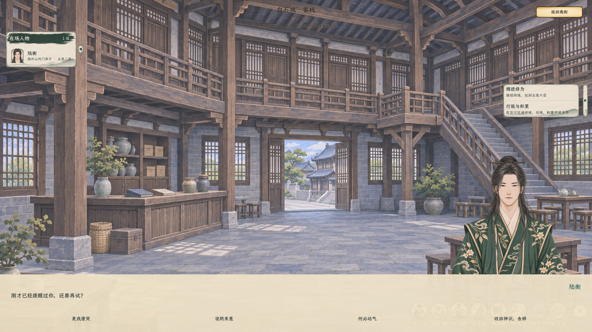
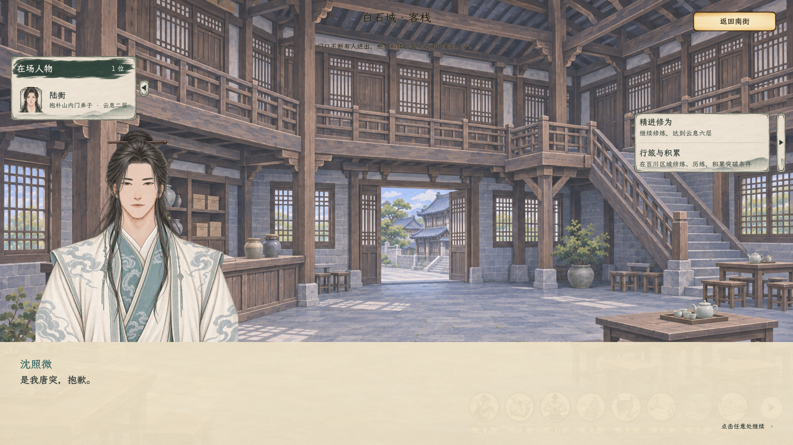
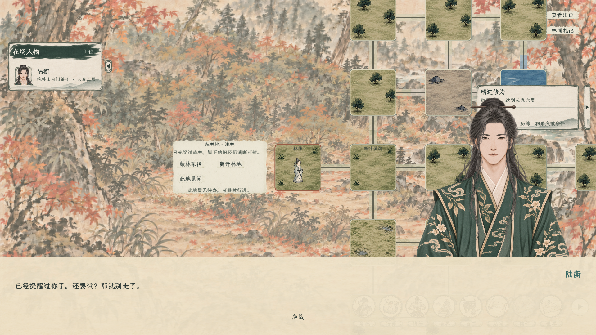

# NPC身份、探查与底部对话

2026-11-06。规则见[当前主案](../../plans/人物与修炼/NPC身份展示与探查交互_20261106.md)，[打开全部实机画面](实机预览.html)。

后续视觉修订已改为底部留边纸卡和对话栏右上方、底边动态贴合的独立竖排选项；[查看当前排版与实机](../对话选项贴合对话栏_20261107/README.md)。本页截图保留探查接入时的旧排版，作为功能验证记录。

## 当前实现

人物名单、小页与档案共用公开名头口径：真实弟子等职务显示所属宗门和地位，普通职业不占身份栏，没有已知名头时小页省略该行。模板出身文案已删除，原职业和世界行为数据保留。

小页提供“探查”，对话时收起。确认、结果旁白、NPC提醒／质问／出手前台词、玩家回答及选项，全部使用屏幕下方原 `StoryDialoguePanel`。NPC说话显示NPC原立绘，玩家回应切换玩家立绘，随后再切回NPC。

## 探查与反击

云息起可探查真实在场人物，每次1精力；取消、精力不足和回应对话不另收费，不推进游戏时间。`p=S/(S+T)`，成功后再以p判隐蔽，三结果为p²、p(1−p)、1−p；同神魂时25%／25%／50%。确认前不显示由隐藏神魂推算的成功率。

成功保存带日期的属性快照。失败不覆盖旧资料，免费查看旧记录也不会刷新当前属性。双击名单只打开公开概览，属性页必须已有成功探查记录。未有正式数据的属性保留未知，不把临时参战角色的默认数据当作NPC资质。

被发现后按性情、已知实力、旧怨、提醒记录判断忍下、质问或出手。白石与玉虚禁私斗，玩家攻击与NPC反击共同受限；场所可明确覆盖节点规则，友好切磋独立。允许交手地点可实际进入原回合制战场，关闭威胁对话也不清除已发生的冲突。

反击保存NPC为实际发起者、玩家窥探为诱因，沿用真实伤亡、实际随身物品转移及双方各自受到伤害的关系事件。战后回原历练场景，探查所得仍是战前快照。窥探本身不登记实际伤害，交手中的身体受伤才登记原伤害事件。具体罚款、拘捕、秘密功法和额外灵识资源不属于本次接入。

## 验证及画面来源

编译0警告、0错误。探查专项覆盖三结果概率边界、取消与精力、未察觉不知情、双击防绕过、旧快照、底部说话与选择、存档续接、禁斗与子场所覆盖、NPC真实反击、发起者／诱因、伤亡、实际领取和原林地返回。原生窗口另验证底部布局、小窗口和截图；分组结果见[探查验收汇总](探查验收汇总.json)。

| 分组 | 结果 |
| --- | --- |
| 探查功能专项 | 108项通过，含最后追加的实际林地节点核验 |
| 原生图形场景 | 122项通过，含底部布局、小窗口和13张原生截图 |
| 非同门友好切磋 | 26项通过 |
| 原主动攻击与领取 | 35项通过 |
| 白石序章与同行 | 73项通过 |

图形与功能分组有重叠，不将这些数量相加视作互不重复的用例。

这些图由正式主场景与原对话框原生渲染。探查专项使用隔离存档和稳定人物数据覆盖不同反应，正式游戏仍沿用原有随机人物，不固定此测试人物。检查注入受控胜负验证真实战场往返，不冒称已人工打完全部NPC对战；不覆盖玩家正式存档。早先身份修订的44项界面检查保留在[原记录](原生界面检查.json)。日志仍有既有资源UID回退及退出提示，不以专项通过宣称全项目零诊断。

验收还修复战利品页面在返回过渡中打开导致的暂停残留，领取结束后能继续底部对话；战前容量读取改为读取正式场景配置，避免临时实例化整套战场及其人物UI。
