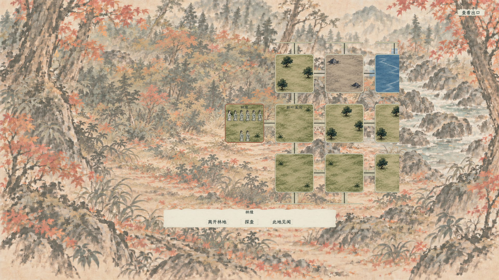
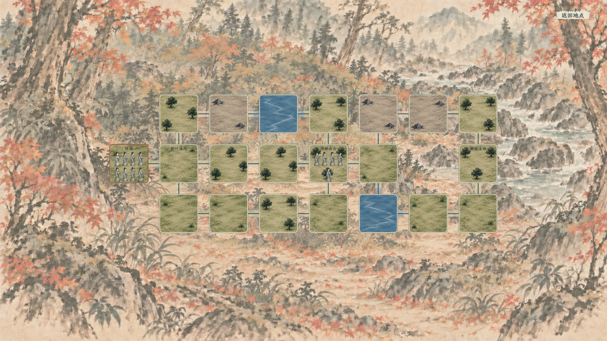

# 东林地节点地图：水墨地格与共享棋子

## 最新：委托回报与林间札记

巡查现场复核后回宗回报才核发贡献，复用地图文字层、行动条与原事务板详情，不新造任务控件。宗门事务进入共用任务栏和见闻；新增素雅札记入口，只读已探明内容和实际余量。见[闭环与探索补充](../../plans/东林地委托回宗闭环与探索补充.md)。编译及三个独立检查通过，带画面复核了巡查提示、回报按钮与札记；`实机验收/委托与札记/` 中事务板为独立控件测试，未加载实际和光峰背景，不能据此当作新背景设计。未专项验收正式地图往返、整场战斗与正式存档槽重启。

## 最新：128 格外围与镜头

复用现有背景、四类各四款水墨地块与 v6 共享棋子，外围扩至 128 格，保留旧节点。默认以玩家为中心显示局部图；中心滚轮缩放、右键拖动、右键单击回中。棋子与地图同比例缩放，主角与 NPC 过渡均在地图坐标内，避免拖镜后移动跳位。连线和样式只在相关状态变化时重建。玩法、参数及验证边界见[实施案](../../plans/东林地外围扩图与镜头实施.md)。下文固定 21 格及旧布局为历史阶段。

实际截图：`实机验收/外围128格/`。编译及地图／行动检查通过，1920×1080 与 1280×720 地图截图均已查看；包括中心缩放、真实地格滚轮、拖动回中及原路径／动画检查。独立地图场景不包含正式 HUD，正式任务全链路及存档槽重启尚未重跑。

状态：本轮实施，视觉仍待玩家验收。玩法权威为[地点模板与节点互动框架](../../plans/地点模板与节点互动框架.md)。

## 最新：棋子 v6、地格放大与主角摇摆行进

后续 NPC 同步（2026-10-11，已接入）：副本 NPC 复用主角同一份棋子和摇摆函数，逐条接收真实正交路线边，多人并行、高遁速连续跨格均显示过渡，不从起终点抄斜线。播放速度按主角／NPC 遁速比调整，长行动积累的队列压缩表现时间但保留每条路线边；动画不推进游戏时间、不重新判定遭遇、不改真实 NPC 节点。固定站位隐藏同 ID 的行进替身，播放结束才恢复，不重复显示。正常探查／采集结束保留正在播放的 NPC 动画；Esc／遇袭中断、关闭／隐藏、恢复状态清理表现队列并落回已结算状态；死亡或移出副本清理对应替身。场景退出解绑事件，读档不重播历史动画。

编译 0 警告／0 错误；地图与行动冒烟通过。新增检查覆盖双 NPC 并行与摇摆、遁速 100／200 行动次数、遁速 1000 的十条真实邻接边、动画零额外时间、中断不回滚、死亡、隐藏与重进、驻足行动完成后不提前清除动画。已运行带画面 1280×720 行动测试并查看 `实机验收/节点行动/08_NPC并行移动_720.png`；为稳定取帧，截图测试临时将主角视觉遁速设为 400，正式角色数值未改。原有图标缺失与图形退出贴图释放日志仍存在；本轮未专项跑完整 NPC 遭遇战。

2026-10-11 用户要求棋子贴合地格风格，稍放大地格，并沿连接线摇摆移动。使用 imagegen 技能与内置生图工具重绘 `textures/ui/world/player_pawn_marker_v6.png`，大世界与副本共用 `player_pawn_marker_v6.tres`。无五官、束发、袖内拱手和单个矮底座保留，衣纹简化为淡青灰大块墨染；旧 v5 留档。原图有透明边距，AtlasTexture 使用 `(261,104,546,1340)` 主体区域，不编辑原 PNG，不裁人物。

最终生成提示：以简约地形图集 v2 为画风与色彩参考、v5 棋子为轮廓参考，生成一枚透明背景修仙地图棋子；淡灰绿衣袍、米白内衫、炭墨发髻、无五官，略矮实的微缩轮廓、宽松淡墨块面、少量软笔轮廓、减少衣纹细节；略高三分之四正面视角，完整人物、双手藏袖、单个低矮灰石椭圆底座；无武器、无景物、无字、无背景投影，主体上下紧凑，适合 60–90 像素显示。输入图分别仅作风格参考和身份轮廓参考。

副本图可用宽度从屏幕 64% 调至 70%，中心横向为 53%，保持左侧 18% 安全线；当前格边长约增加 9.4%，未改格数与路线拓扑。修复放大后密集同格棋子横向越界，尺寸同时受行高与列宽约束。

主角每步约 0.42 现实秒的过渡：先由同格站位靠到路线中线，沿水平／垂直连接线移动，再落到目标格站位；轻微左右摇摆与上下起伏。动画期间阻断再次起程／WASD，自动路线等待当步动画结束。游戏位置和行动耗时仍逐边只结算一次，动画本身不额外推进游戏时间。Esc 中断会清理过渡棋子，落在已结算的当前格，不回滚扣时。NPC 后续也已接入过渡，见本节顶部。

编译、地图与行动无窗口冒烟通过；地图测试增加过渡棋子存在、摇摆角度和中断清理检查，大世界四档缩放的主体／脚印比例检查通过。已查看 1920×1080 实际行进截图；正式 HUD 与整条委托尚未重跑，既有原生图标缺失和图形退出贴图释放警告仍在。截图目录：`实机验收/棋子v6与移动/`。

## 最新：简约四款地形库 v2

用户已确认简约方向与每类四款：草地、林地、岩地、水域，清晰统一、可复用、留白放棋子；水域完全为水。新的运行素材为 `textures/dungeon/terrain_ink_20261011/terrain_variants_v2.png`，4×4 等分图集，列依次草／林／岩／水，行依次四个款式。旧繁密图集保留留档但东林地不再引用。`DungeonTerrainVisuals` 提供跨副本复用入口，稳定哈希副本 ID＋地格 ID，避免每次刷新随机变化。

地形图生成时保持满幅正方形，运行时统一 7% 圆角遮罩与圆角状态框，避免把白角烘焙进素材。连接段只取地格中央地面，不将树石挤压成长条。背景与共享棋子不换；干溪／湿地仍保留原描述及规则，首轮复用浅色地面表现，不新增通行类型。

本轮使用内置生图工具。最终提示要点：参考已确认样张，严格4列4行无字无边距图集；同视角、同笔触、浅纸淡墨、中心留白；草地少量草簇、林地三个小树、岩地两块矮石、全水面少量淡涟漪；四行只改变位置与墨染，不增加密集装饰。源图按版本新增，不覆盖旧素材。

v2实机验收截图位于 `实机验收/简约四款v2/`；已编译，1920×1080及1280×720的四款独立区域、确定性选款、恢复不换款、圆角材质与原行走／悬停／返回检查通过，截图已查看。首轮独立测试退出时出现 Godot 托管数组回收异常；测试脚本补充树内释放测试节点并排空托管包装器后复测，保留项目既有图标缺失及退出纹理回收日志。未完整验收正式任务链路。

## 已确认方向

- 环境背景保持林地正常风景视角，无人物、无 UI；不能因为地格需要俯视而一起改背景视角。
- 地块为实际方形地形，用较远的斜俯视表现，偏正面但不能眼平近景，也不是垂直卫星视角。树木、石块应小于地格主体，留出多棋子空间。
- 水墨笔触明显、淡青灰与暖纸色、温和反差。格间连接适度拉长并显示地面过渡，不增加斜线。
- 用户最新指定的带底座无五官人物用于大世界及副本，两处共用 `textures/ui/world/player_pawn_marker_v5.png`。使用实际内容边界裁去透明留白，不裁人物、不叠加第二底座。大世界沿用原来的格内锚点与地图同比缩放。
- 无左上大字标题；地块悬停信息使用共用纸墨字体与面板。路径预览才出现紧凑耗时提示，右上返回不使用复杂花边。

## 素材与运行时拆分

| 素材 | 用途 |
| --- | --- |
| `textures/world_locations/east_woods_ink_20261011/terrain_atlas_v1.png` | 3×2 图集，依次为林地、草地、岩地、浅溪、干溪、湿地；运行时 AtlasTexture 取区域，不重复存六张切图 |
| `textures/world_locations/east_woods_ink_20261011/forest_background_v1.png` | 全屏纯森林环境背景 |
| `textures/ui/world/player_pawn_marker_v5.png` / `.tres` | 用户附件原图直接复制，未重绘；共用 AtlasTexture 区域 `(376,0,481,1278)` 排除边缘几乎透明的杂点与留白，不改原图 |

地形映射只控制表现，不额外修改节点耗时或通行系数。旧节点 ID、NPC 邻接演算、巡查结算、存档及战败规则保留。

生图要求摘要：地形图集采用中国水墨／淡彩、斜俯视远景、真实地面而非窗口风景、六个等大正方形、无人无字无 UI；森林背景使用无人物无地图无 UI 的正常林地风景，中心柔和以承托运行时节点。

## 验收

独立场景 `tools/EastWoodsMapSmoke.tscn` 检查图集接入、21 格正交邻接、HUD 安全区、悬停开关、点击预览／再次启程、WASD、路线状态恢复、返回一次关闭，以及同格八棋子是否越界。该场景不修改正式角色或旅程存档。

2026-10-11 验收结果：编译通过（百科面板现存一处空引用警告）；1920×1080、1280×720 两种窗口的独立场景检查均通过，截图已人工检查。`tools/VerifyWorldMarkers.gd` 只读验证共享棋子及脚印在 0.02／0.25／1／2.5 倍缩放下的格子比例与脚底锚点，全部通过。删除并重建了本轮损坏的单份图集导入缓存，源素材未删除。

范围说明：本轮未完整跑正式角色的宗门接任务至巡查交付链路；NPC 在测试场景内临时注入，仅验证多棋子显示，不代表新调整了 NPC 生成。启动仍报告项目原有图标缺失 `images/icon.ico`，独立场景退出时有纹理资源回收日志；编辑器扫描另有已存在的插件端口占用和行囊旧节点路径警告，本轮未扩改这些系统。

