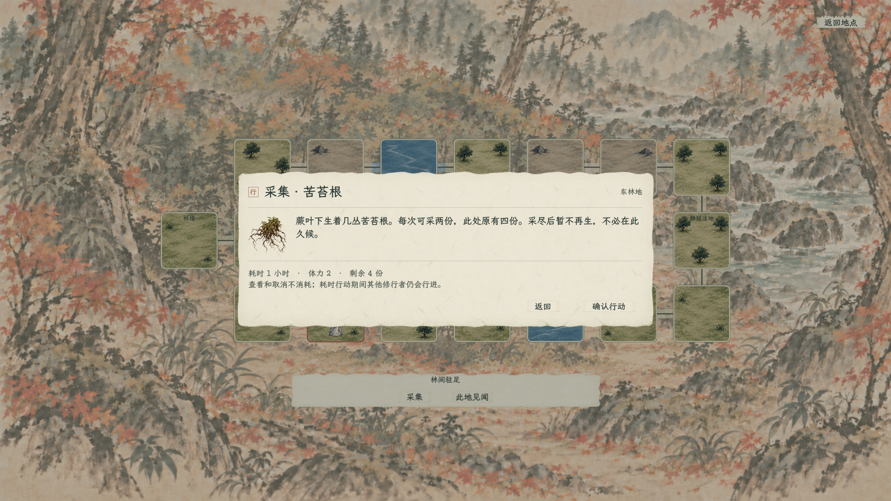
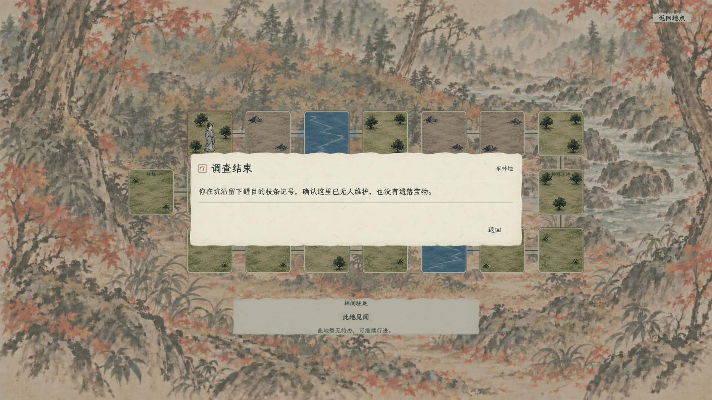
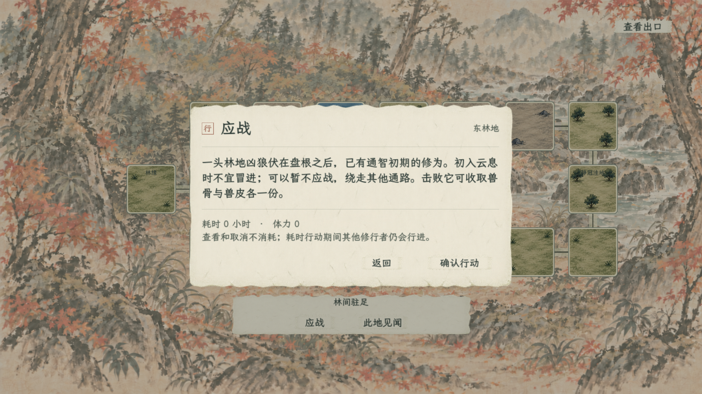

# 东林地节点行动界面 · 首轮实机

2026-10-11。复用 WorldHudStyle 的暖宣纸、深墨、朱印、字体和按钮，未生成第二套外观素材。采集详情直接使用有效物品的原图标。地图下方当前格行动条只提供本格有效行动；路径预览时隐藏，详情打开时阻断地图输入。Esc／返回先关详情，再回地点内景。

## 画面

以下为隔离验证场景的真实游戏控件截图，不是生成的理想图。测试场景只加载地图与行动面板，未加载正式场景的常驻时间／人物 HUD；正式入口保留原常驻 HUD。

## 验证边界

参数与行为见[现行短测案](../../plans/东林地节点行动短测与界面.md)。独立场景 `tools/EastWoodsActionsSmoke.tscn` 使用不运行开局和存档的 MainScene 派生测试场景，实际调用行动回调；不修改正式玩家存档。通过探查、采集、事件、储量、费用、行囊满、状态序列化恢复、NPC 同步、战斗快照／战前取消和胜败返回条件检查；旧地图移动回归通过。完整战斗与正式宗门任务联调仍待实玩。
