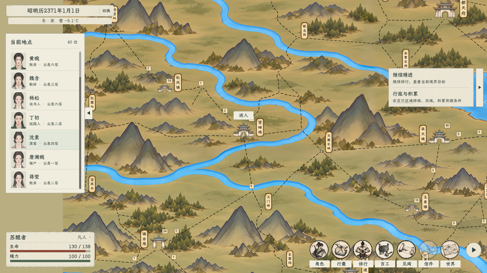

# 主界面：地点交互与留白优化

后续状态：本轮地点交互、布局与输入修复继续有效；纯色纸面与普通细边的观感被用户指出太素，后续美术以[主界面水墨美术迭代](../主界面水墨美术迭代_20261104/README.md)为准。本页原有截图保留为上一阶段记录。

2026-11-04。用户否定此前理想图，明确双击地点前往，在所在地点显示“进入”，右上角操作框多余，并授权直接优化游戏内UI。现行规则见[UI视觉规范](../../UI视觉规范.md#主界面交互与留白2026-11-04-用户修订现行)。

## 本轮实施

- 删除正式地图右上角固定地点框与“前往所选地点”按钮。双击行旅复用原输入链路；单击只选择并在目的地旁显示真实路程与预计时间。
- “进入”直接锚定当前可进入地点，固定屏幕字号与点击面积，随地图拖动／缩放跟随；与远处地点选择解耦。行旅、遭遇锁定与地标出屏时隐藏，途经点不提供进入。保留双击当前位置进入的快捷方式。
- 人物名单浅纸、墨字、淡线分隔，头像沿用正式外观；取消黄色嵌套行框，左边距22，与时间／状态对齐。短名单缩短，七行封顶，更多人物滚动；小窗口按可用高度滚动，并随左下状态摘要增高让出空间。把手统一短纸签，收起后释放空白输入区域。
- 底部水墨图标改为80×76，18号标签各自带小纸签，不铺整块底板；原顺序、解锁、信件提示与收起功能保留。左下状态栏收紧，数值在条外，不增加资源。
- 任务标题和行动摘要仍最多两项；修正切换窗口尺寸时收起条的旧位置残留，保持与正文同顶同底。

## 原生窗口画面

以下使用正式主场景和控件，在隔离用户数据中设置已离开序章、位于望曲城的测试状态；名单读取该地点的实际NPC，任务读取原有长期目标。不是生成理想图，也不是用户正式旅程截图。

- [1920×1080](主界面_1920x1080.png)
- [1280×720](主界面_1280x720.png)

## 验证

- 全项目C#编译通过，0警告、0错误；正式地图脚本加载及节点行旅／耗时检查通过。
- 实际窗口1920×1080、1280×720检查通过：没有旧右上角框；当前位置入口随拖动定位；远处选择不改变当前入口对象，路程提示不截获输入；行旅与遭遇锁收起入口。
- 实际窗口验证八项导航同时显示不与状态栏重叠；两行状态摘要占位时名单让出空间，导航与名单收起／展开保持可用；查看UI不推进时间。通过真实鼠标事件点击地点旁“进入”，打开正式地点内景。
- 原生双击回归通过：三档缩放下单击选择、图标／名牌双击起程，滚轮与拖拽打断连击、不同目标重置、行旅锁与遭遇锁防误触、尾节点暂停恢复，以及双击当前位置进入。未改行旅耗时、目的地或进入判定数据。
- 青溪里名单头像与布局检查通过：短名单按内容收拢、七行可见、第八行滚动；0／1／7／25人名单的滚轮、标题区域和滚动末端捕获、世界／副本滚轮隔离检查通过。
- 任务栏稳定性回归通过：两种逻辑画布、单项／双项、每种50帧重复刷新、每画布8轮内容变化与隐藏恢复；收起条与任务正文同顶同底，空任务隐藏，不推进时间。
- 最终截图已目视检查，均为原生控件渲染，没有用生成图替代。日志仍保留旧“卸力”资源UID回退提示；本轮不修改卡牌资源来消除该既有提示。

通过检查的原始日志：[实际窗口](验证日志/ui_window.log)、[双击](验证日志/double.log)、[任务栏](验证日志/tracker.log)、[名单布局](验证日志/roster.log)、[名单滚轮](验证日志/scroll.log)。使用隔离APPDATA，未读取或覆盖正式玩家旅程。

## 实现入口

- [正式地图](../../../gdscripts/world/BaiChuanNodeMapRuntime.gd)：地点旁操作与路程提示。
- [人物名单](../../../csharp/panel/CellCharacterList.cs)、[收起](../../../csharp/panel/CellCharacterList.SideToggle.cs)。
- [主HUD](../../../csharp/panel/MainHUD.cs)、[导航](../../../csharp/panel/MainHUD.Navigation.cs)、[任务栏](../../../csharp/panel/MainHUD.TaskTracker.cs)、[共用样式](../../../csharp/panel/WorldHudStyle.cs)。

不修改地点目录、路网、行旅耗时、资源公式、卡牌、存档结构或正式玩家存档。
