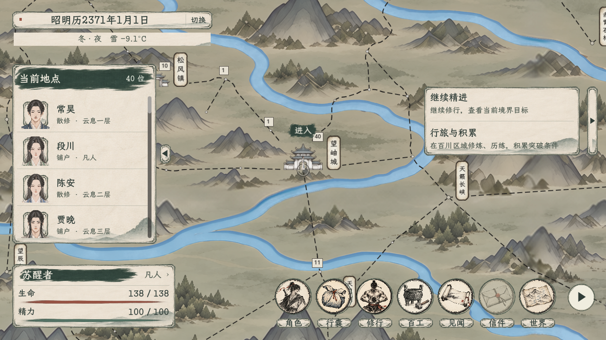

# 主界面水墨美术迭代

2026-11-04。用户指出上一轮只做简化后太素、太单调，要求整体水墨画风、克制但有细节，并明确提醒尺寸与比例。本轮以美术材质与笔触为重点，保留上一轮已经接入的地点交互。状态：已接入本地项目，最终观感待用户评价。

## 美术变化

- 原来的普通浅色矩形改用共同的宣纸纸面、细干笔墨框与很淡的底部山水洗染；边角保持完整，不做撕纸、金饰或繁复卷轴。
- 人物名单加一条深松墨标题刷带，正文保持干净；姓名与“进入”也只使用小面积墨刷，以浓淡建立层次。
- 生命、精力改为有自然收笔的墨色条；底部沿用项目水墨图标，统一细墨圆环与纸签，不增加整块导航底板。
- 地图只做静态色调收敛，降低亮蓝与金黄的突兀感，保留原贴图、节点、建筑、路网与明暗关系。滤色在MapLayer内、HUD下方，忽略鼠标输入。
- 无发光、闪烁、粒子或新增玩法标记；人物姓名、任务、数值、解锁与进入判定仍使用原数据。

## 尺寸与比例

以下为逻辑像素；窗口与地图缩放由原有界面系统处理，不通过改变立绘或图标长宽比例适配。

| 元素 | 实装尺寸／处理 |
| --- | --- |
| 日期主签 | 430×46；天气辅签416×28 |
| 人物名单 | 宽312；行高76；最多七行，小窗口与长名单滚动 |
| 名单标题墨刷 | 304×57，固定在标题区，底缘不越过正文起点 |
| 人物头像 | 沿用PortraitRenderer的头像模式与裁切，不修改外观部件比例 |
| 导航按钮 | 80×76；图标由原生按钮等比显示 |
| 墨色圆环 | 80×80，居中等比，保留图标与文字间距 |
| 导航纸签 | 80×26基准，文字保持清楚的原生字号 |
| 人物状态 | 宽352；无状态摘要时高142；摘要增高时名单避让 |
| 任务正文 | 宽336，高度随最多两项内容变化；收起条与正文同顶同底 |
| 地点“进入” | 80×34；随地点定位，保持固定屏幕字号与点击面积 |

纸框采用九宫格绘制并按素材半倍率保留细边与角部，避免把整张纸框任意拉成长条。纹理不参与布局最小尺寸，防止原图像素尺寸把控件撑大。两档实际窗口均检查了八个入口同时显示、状态摘要增高、标题与第一行间距、圆环边界和收起／展开。

## 当前实际窗口

以下为正式主场景原生控件渲染，使用隔离测试状态与对应地点NPC，不是用户正式旅程截图，也不是带字生成图：

画面采集在本轮后段自由行旅迁移切换之前，展示的是本轮UI材质与尺寸；不代表新的全域地图已经验收。

- [1920×1080](主界面_1920x1080.png)
- [1280×720](主界面_1280x720.png)

## 美术方向稿与生产素材

- [水墨方向稿v2](水墨主界面_方向稿_v2.png)、[完整方向稿提示词](方向稿提示词.txt)。方向稿同时演绎了地图笔法；实装仍沿用原地图贴图，以实际窗口为准。
- [透明素材图集](../../../textures/ui/world_ink_20261104/ink_ui_atlas_v1.png)、[完整素材提示词](../../../textures/ui/world_ink_20261104/素材生成提示词.txt)。两张图都通过内置imagegen生成，未使用CLI/API回退。
- 图集为1024×1536 RGBA，按2列×3行制作。已检查原生Alpha：背景可完全透明，纸面与墨迹保留连续透明度；保留生成原图，不通过阈值抠图替换Alpha。
- 六类元素为宣纸主板、深墨刷带、横向纸签、空心墨环、淡山水角饰、可着色白笔触。原生AtlasTexture资源按测得区域读取，源图不覆盖既有素材。
- 所有字、数字、头像与业务状态均由游戏控件绘制，图集不包含预烘焙文字。

## 验证

- 全项目C#编译通过，0警告、0错误；新图集已导入，AtlasTexture区域与原生Alpha已检查。
- 实际1920×1080、1280×720窗口通过：八项导航同时显示不碰状态栏；第一行人物不被标题墨迹覆盖；装饰圆环不越过窗口；两行状态摘要占位时名单避让；地图拖动时入口跟随，远处路程提示不截获输入。
- 实际窗口的导航／名单收起展开、查看UI不推进时间，以及通过Viewport鼠标事件点击“进入”打开正式地点内景均通过。这些通过结果来自地图迁移切换之前的本轮原生画面检查。
- 更新素材后，任务栏两种尺寸、单项／双项、连续刷新与隐藏恢复稳定性回归通过；0／1／7／25人名单滚动、标题和末端滚轮捕获、世界／副本滚轮隔离回归通过。
- 后续整场景双击回归遇到同一工作区正在实施的全域自由行旅迁移：旧测试的手动节点行旅锁断言已不适用于新控制器，再次运行时新地图的九块贴图／通行数据尚未生成到位。因此本轮不宣称最新自由行旅地图流程通过；没有回退或覆盖该项迁移。
- 运行日志保留旧“卸力”资源UID回退提示；本轮未改卡牌资源。

日志：[本轮原生UI窗口](验证日志/ink_ui_window.log)、[任务栏](验证日志/ink_TaskTrackerStabilitySmoke.log)、[名单滚轮](验证日志/ink_RosterScrollSmoke.log)、[地图迁移期间的整场景失败记录](验证日志/ink_double.log)。全部游戏检查使用隔离APPDATA，没有读写正式玩家旅程。

实现：[纸墨绘制](../../../csharp/panel/WorldHudFrame.cs)、[共用素材](../../../csharp/panel/WorldHudArt.cs)、[导航](../../../csharp/panel/MainHUD.Navigation.cs)、[正式地图](../../../gdscripts/world/BaiChuanNodeMapRuntime.gd)、[地图色调](../../../shaders/world_ink_wash.gdshader)。
