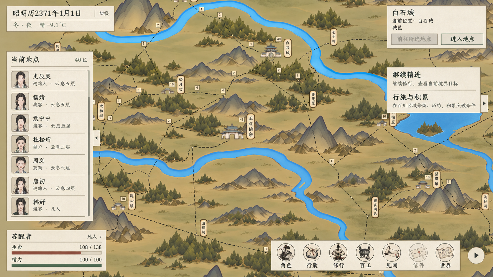

# 主界面统一纸墨：理想图候选

2026-11-04。用户明确本轮对象为进入游戏后的地图、时间、状态与底部导航，先查看理想图。

**状态：用户已否定，作为历史留档；未接入游戏，不作为现行 UI 规则。** 用户明确双击地点前往，在当前位置显示“进入”；右上角操作框多余。后续以[主界面交互与留白优化](../主界面交互与留白优化_20261104/README.md)及[UI视觉规范](../../UI视觉规范.md)的2026-11-04修订为准。

## 来源与边界

- 现行依据：[UI 视觉规范](../../UI视觉规范.md)、[常驻时间与状态栏](../常驻时间与状态栏_20261011/README.md)。
- 对照素材：[百川地图实际窗口](../百川地图人数避让_20261103/近景人数避让.png)；同时检查了现有主 HUD、时间栏、任务栏和导航实现。
- 截图为既有实机记录，本轮没有把它当成新采集截图。只优化叠加 UI；地图地形、河流、建筑、地点与路线作为背景参照保留。
- 使用内置 imagegen 生成，不使用 CLI/API 回退。[完整生成提示词](生成提示词_v1.txt)。
- 图中的姓名、数值和任务来自对照截图，仅用于排版示例，不向正式存档写入数据。

## 统一方向

1. 所有信息面板使用同一浅暖宣纸底、深墨字、灰褐细边、整齐直边与一致内边距；减少当前人物列表的黄色底与多层嵌套框。
2. 字体保持常规楷体观感，按标题、正文、辅助信息分层；不使用粗大书法、金饰、撕纸边、泛光或阴影。
3. 日期与天气归为紧凑两行；保留“切换”，日期不显示小时、时辰、暂停或倍速。
4. 人物名单保留头像、姓名、身份／境界与人数，改用淡分隔线区分条目。任务保持最多两项和原摘要，不添加奖励或虚构进度。
5. 生命与精力保留原称呼、数值和条形结构，数字置于条外。生命赭红、精力灰绿，不增加资源。
6. 底部图标缩小、间距与基线对齐，文字落在连续浅纸条上以保证复杂地图上的可读性；保留右下圆形三角收起按钮。

完整入口顺序仍为角色、行囊、修行、境界、百工、见闻、信件、世界；是否显示、是否可用沿用既有条件。对照截图为凡人，理想图不增加原本隐藏的“境界”，所以展示七项。

## 理想图

## 验证范围

本轮只评审视觉构图、主要文字和 UI 内容边界，不修改 C#、场景、素材引用或玩法数据；不宣称已完成实机适配、交互验证或编译验证。理想图的字体与像素位置是生成结果，后续若实施，文字和数值需由原生控件绘制，并验证 1920×1080 与 1280×720 下的布局、遮挡和原有点击操作。

