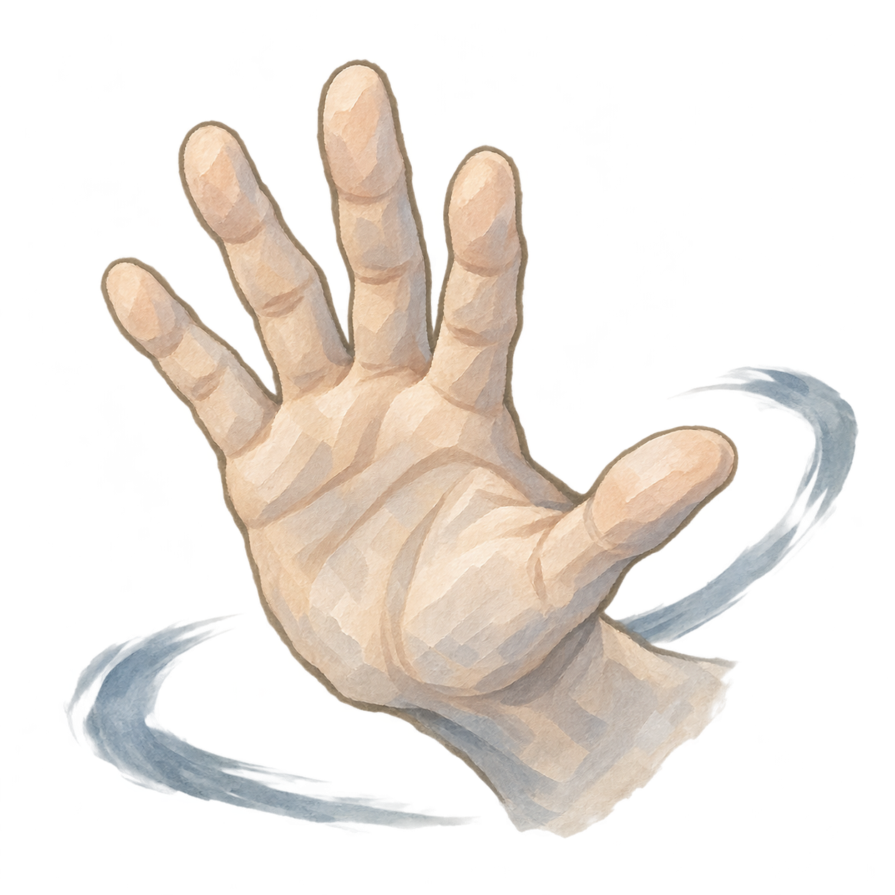
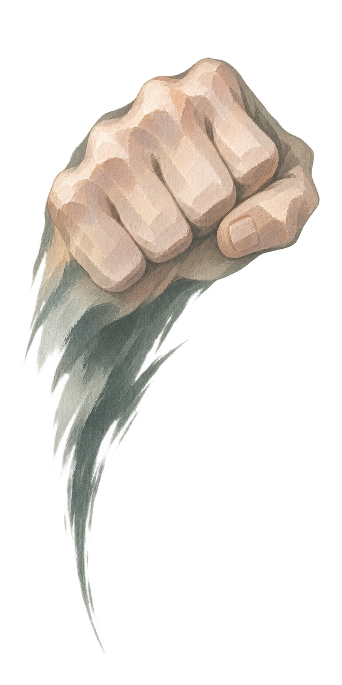

# 招式图标样张：应敌与痛击

2026-11-06。**两张均为待用户审阅的视觉概念样张，不是正式图标，不代表占格、技能效果或游戏运行已确认／接入。**应敌以方形一格、痛击以竖向两格展示，仅用于比较格子适配与辨识度。两者均由内置图像生成工具分别生成，未修改正式资源或战斗数据。





## 参考和意图

- 以用户确认的[行囊物品风格定稿](../行囊全物品图标与占地_20261029/风格定稿.md)及其中的[用户指定瓷瓶母图](../行囊全物品图标与占地_20261029/风格参考_用户指定瓷瓶.png)为笔触、材质和光感参考；同时参考项目实际[灵石 1×1](../../../textures/items/inventory_density_20261029/spirit_stone_1x1.png)与[瓷瓶 1×2](../../../textures/items/inventory_density_20261029/pill_container_empty_porcelain.png)。参考图不作为本次绘制主体。
- 延续柔和淡彩、有限明暗、手绘纹理和清楚轮廓；用手势与劲势区分招式，不制作附底纸卡、实体拳套、玉牌、武器、文字或边框。招式图形不赋予装备条件、属性、额外伤害或其他新规则。
- 保留生成原图的完整透明与原始尺寸，没有进行抠图、裁剪、重采样或覆盖旧图。正式行囊目标为每格 128 源像素；本轮**没有**将样张导出为 128×128／128×256 的正式游戏资源，最终小格辨识度、是否采用和游戏内显示均待审阅。

## 原始文件与检查

| 样张 | 原始像素 | 格子比例 | 透明与边缘检查 |
| --- | ---: | --- | --- |
| 应敌 | 1254×1254 | 1:1 | RGBA，透明通道范围 0—255；四角透明；画布边缘最大不透明度 1/255；不透明度大于 8/255 的像素范围为 `(88,82)–(1202,1174)`，主体没有贴边裁切。 |
| 痛击 | 887×1774 | 1:2 | RGBA，透明通道范围 0—255；四角透明；画布边缘最大不透明度 1/255；不透明度大于 8/255 的像素范围为 `(59,147)–(829,1695)`，主体没有贴边裁切。 |

两份项目内文件的 SHA-256 分别与图像生成工具保存的原始文件一致；人工查看原图，可区分张掌与拳劲。尺寸和透明通道检查不等于已完成实际游戏内 128 像素视觉验收，也不表示本轮新画风已经得到用户最终认可。

## 图像生成提示词

两次调用都使用灵石、现行瓷瓶及用户瓷瓶母图作为风格参考，并要求真正透明底。以下记录传给内置工具的完整提示词。

### 应敌

```text
Use case: stylized-concept. Asset type: ONE original Chinese xianxia game inventory-grid move icon, square 1-by-1 slot, transparent PNG. Input images: image 1 spirit stone, image 2 existing porcelain bottle, image 3 user-approved bottle painting: these are STYLE REFERENCES ONLY, do not reproduce their objects. Match their soft hand-painted watercolor/opaque-gouache texture, restrained diffuse modeling, clear hand-drawn silhouette, quiet mineral colors and tactile brushstrokes, no photoreal shine. Primary subject: "应敌", a basic unarmed attack represented as ONE complete clearly readable bare human open palm thrusting forward, seen from a natural three-quarter view, with anatomically plausible fingers; the wrist and a single small flowing muted blue-grey ink-brush motion stroke blend gently into one unified move silhouette. It is a symbolic fighting gesture/force, not an actual object worn by a character. Center the complete distinct silhouette in a SQUARE canvas and leave modest safety margins; it must read immediately at 128×128 pixels and visually harmonize with the given inventory items. Background: genuinely fully transparent, clean alpha. Avoid all background paper, UI, borders, badges, plaques, jade, talismans, books, weapons, gloves, gauntlets, sleeves or any implied required equipment. No body or character portrait, no text, no watermark, no harsh highlights, no external glow, no flame, no fire element, no heavy black scene. Each reference is for style only, not an object to copy.
```

### 痛击

```text
Use case: stylized-concept. Asset type: ONE original Chinese xianxia game inventory-grid move icon, vertical 1-by-2 slot, transparent PNG. Input images: image 1 spirit stone, image 2 existing porcelain bottle, image 3 user-approved bottle painting: these are STYLE REFERENCES ONLY, do not reproduce their objects. Match their soft hand-painted watercolor/opaque-gouache texture, restrained diffuse modeling, clean hand-drawn silhouette, quiet mineral colors and tactile brushstrokes, no photoreal shine. Primary subject: "痛击", a heavy UNARMED blow represented as ONE complete bare clenched human fist seen in a strong three-quarter angle, with anatomically plausible knuckles, and a LONG narrow downward dark grey-green ink-brush stroke suggesting the force of impact. The wrist/force is a coherent painterly gesture fading organically, not an actual object worn by a character. Visibly different from the open-palm 应敌 move. Compose the full silhouette in a transparent VERTICAL CANVAS with WIDTH:HEIGHT of 1:2, intended for a 128×256 source game inventory slot, with modest safety margins; the fist shape and long stroke should remain readable at 128×256. Genuinely transparent background, clean alpha. No human body, no gloves, no bracers, gauntlets, weapons, armor, plaques, jade, talismans, books, badges, labels, text, box, border, UI, watermark, ground, halos or outside glow; no photoreal shine, no fire element, no silhouette clipping. Each reference is for style only, not an object to copy.
```
