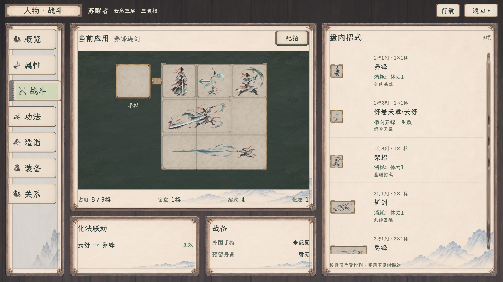
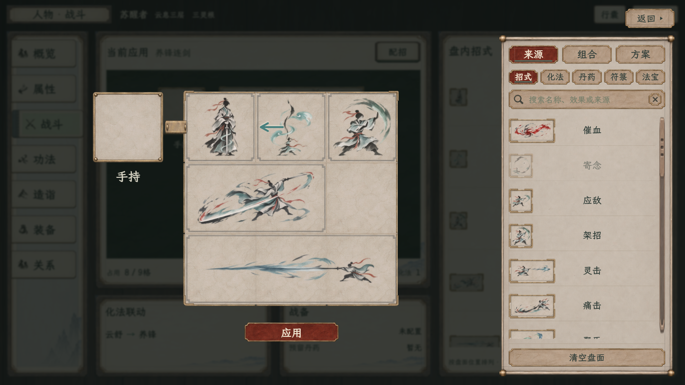
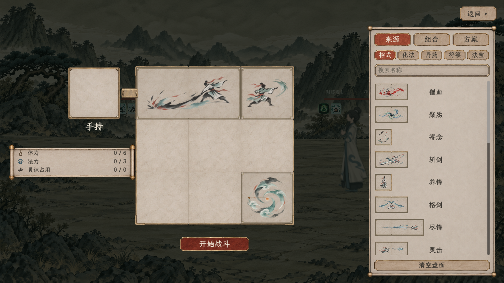
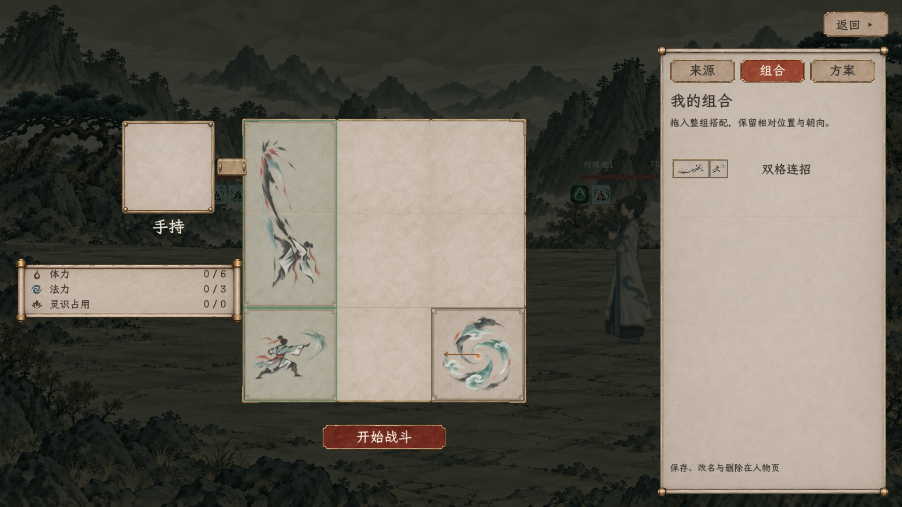
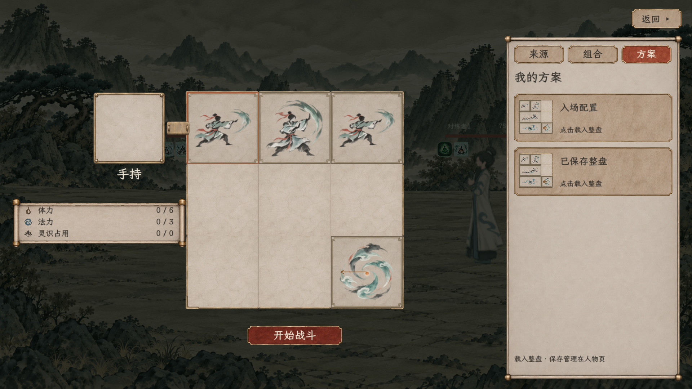

# 人物战斗总览与局内配招统一

最新方案布局见[方案列表修订](方案列表修订/README.md)：盘下“保存为方案”命名确认，右侧每套“应用、改名”，旧底部管理按钮撤去。本次人物样稿155项两档回归通过；不重计下面的历史原生验收。

2026-11-09 · 最新修订见[已学持有清册、同款分类按钮与紧凑配招](紧凑与清册修订/README.md)。首页只列已学／持有，当前应用移至配招，两边盘缩小，局内资源栏放盘下；下方四区首页、放大盘和当时构建状态均为历史记录。

[完整规则与范围](../../plans/界面与美术/人物战斗总览与局内配招统一_20261109.md) · [人物样稿入口](../角色与静室纸墨木石样稿_20261108/index.html#character/battle) · [原生战斗试演入口](../../../tools/run_combat_board_test.cmd)

人物战斗页补为招式盘、盘内清单、化法联动、战备四区；点击配招保留原页并压暗。原生局内采用同样的放大盘、材质边框及来源／组合／方案三栏，局内只载入，保存管理仍归人物页。

## 人物独立样稿

[1280总览](人物战斗总览_1280.png) · [1280暗幕配招](人物暗幕配招_1280.png)

截图只隐藏了网页样稿查看工具条，人物顶栏、导航与战斗正文保持实际渲染，没有修改人物公共文件或重绘图片。

## 游戏原生局内

| 画面 | 1280×720 | 1920×1080 |
| --- | --- | --- |
| 来源与主盘 | [查看](1280x720/01_整份占形边框与紧凑来源.png) | [查看](1920x1080/01_整份占形边框与紧凑来源.png) |
| 组合整组转向 | [查看](1280x720/11_组合整组转向预览.png) | [查看](1920x1080/11_组合整组转向预览.png) |
| 整盘载入 | [查看](1280x720/12_统一方案载入页.png) | [查看](1920x1080/12_统一方案载入页.png) |
| 实际共同回合整理 | [查看](1280x720/09_回合末整理.png) | [查看](1920x1080/09_回合末整理.png) |

## 上一版结果（历史）

| 检查 | 结果 |
| --- | --- |
| 战斗改动构建检查点 | 先前全项目0警告、0错误，原生测试使用此程序集 |
| 最后一次工作区重建 | 并行符箓代码缺接口，6处错误，见[构建日志](battle-unified-final-build.log) |
| 原生1920×1080 | [112项通过](1920x1080/验收.json)，进程退出0，标准错误为空 |
| 原生1280×720 | [112项通过](1280x720/验收.json)，进程退出0，标准错误为空 |
| 网页配招回归 | 115项通过 |
| 网页新总览与暗幕 | 27项通过 |
| 入口与共同回合 | [45项通过](入口复验/验收_无窗口.json) |
| 原始日志、汇总及素材指纹 | [最终验收汇总](验收汇总.json) |

原生测试从真实试演进入战前页和实际战斗管理器，使用真实来源、份数、库存预留和共同回合。测试库只在隔离用户目录准备，读取前后文件字节一致；未写正式旅程。素材继续引用现有PNG，没有改写原图。

1920最终采样以`--max-fps 60`稳定渲染节奏，1280使用默认设置；没有修改回弹参数或移除断言。曾有一次截图保存期间漏采动画峰值，及一次窗口切换中止记录，均未当作通过报告。最后两档均包含成功结束标记、退出码0和空标准错误。

本线最后一次全项目重建仍被符箓分线未完成的接口阻断，原生图片和流程来自此前已成功构建的战斗版本。缺项为`TryCraftTalisman`、`TryBuyTalismanBrush`、`TryLearnTalismanMethod`、`EvaluateDrawing`；未改该分线来消除错误，也未用编译排除项绕过。程序集指纹与重建日志另记在汇总中。

四个网页区域只读已应用副本；检查覆盖编辑时原页保持、应用后同时刷新、化法无效指向、两档面板边界与背景输入恢复。旧121／156项和旧原生84项不计入本轮。

**人物页仍是独立样稿，网页内存模板与原生库尚未互通。** 原生有读取组合、方案及真实提交能力，没有把网页示例或验收组合预填到玩家正常库。游戏里保存库为空时显示空态；人物原生保存管理继续由对应接入任务负责。
