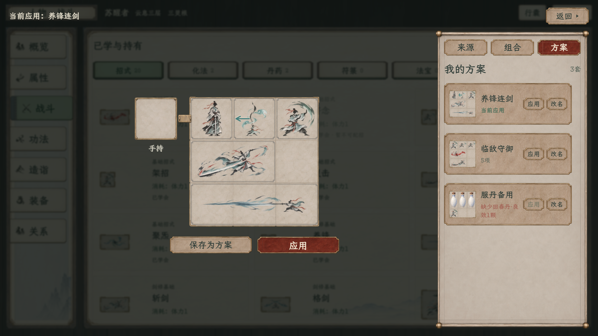
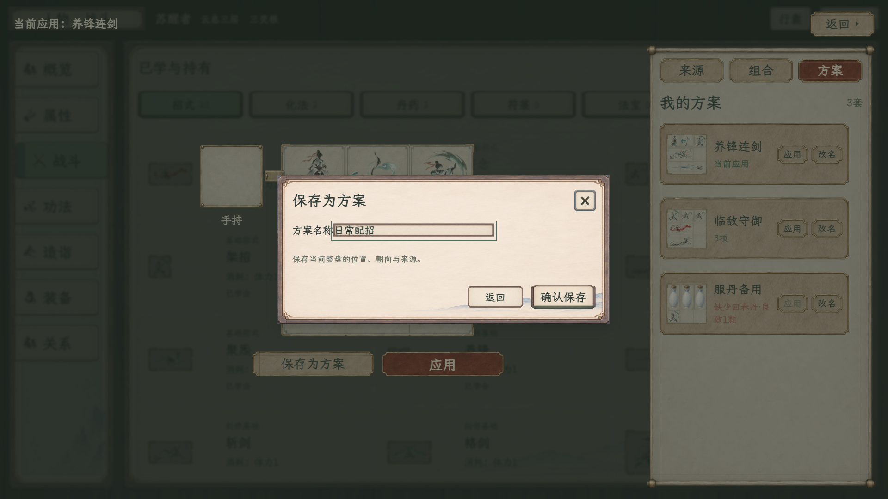
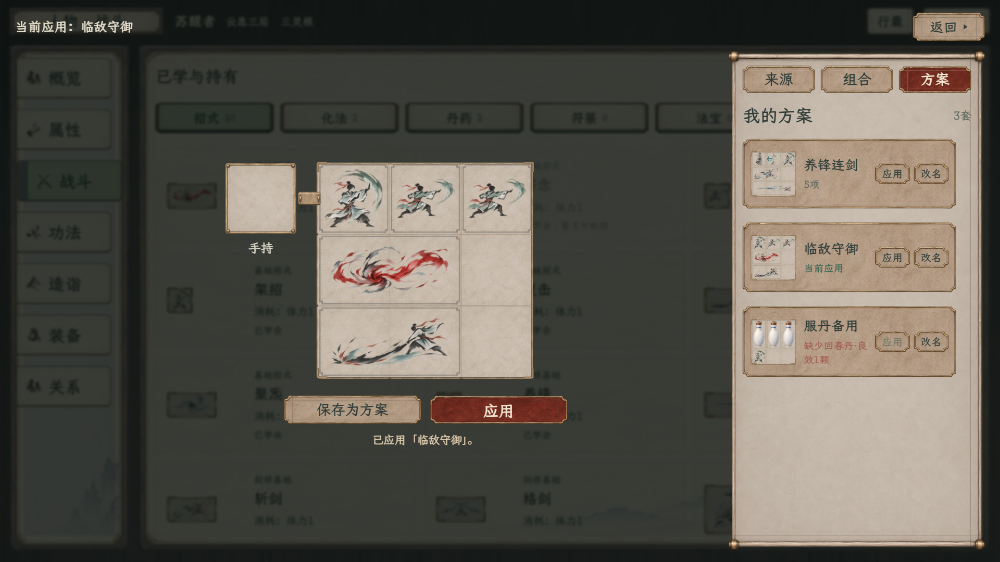

# 方案列表、逐项应用与命名保存

最新按用户反馈改为[操作竖排与命名框对齐](竖排与命名对齐/README.md)：每项“应用、改名”上下排列，命名标签／输入框分列，底部按钮等高，长文字保持在框内。下方横排画面和155项是上一轮功能记录；本次另核对13种排版状态。

2026-11-09 · 人物独立样稿最新修订。[当前流程与边界](../../../plans/界面与美术/人物战斗总览与局内配招统一_20261109.md#人物配招的方案列表2026-11-09最新) · [战斗专用入口](../../角色与静室纸墨木石样稿_20261108/battle-workspace.html)

右侧撤去底部全部管理按钮，只保留方案列表，每项末尾显示“应用、改名”。盘面下新增“保存为方案”，与原“应用”并列；命名确认后保存当前整盘，列表滚到对应项。原盘下“应用”继续用于直接应用当前编辑盘。

列表的“应用”直接更新当前应用与编辑盘，并留在列表；点击卡片正文不切换。缺少来源、份数、库存或可用格时完整拒绝，不部分修改配置。每项“改名”只改该项，已应用方案改名后同步标题，不改盘面。

保存与应用分开：保存不自动替换当前应用，覆盖模板也不修改已经应用的开局副本。同名输入会先显示覆盖提示并将按钮改为“确认覆盖”；空名或重复改名留在输入框提示，取消不改数据。右侧不再设置新建、另存、覆盖或删除的固定按钮。

| 页面 | 1280×720 | 1920×1080 |
| --- | --- | --- |
| 列表与保存入口 | [查看](方案列表新排版_1280.png) | [查看](方案列表新排版_1920.png) |
| 名称确认 | [查看](保存为方案_命名_1280.png) | [查看](保存为方案_命名_1920.png) |
| 逐项应用 | [查看](方案逐项应用_1280.png) | [查看](方案逐项应用_1920.png) |

两档浏览器155项交互回归通过，包含原盘面拖放、转向、组合及新方案流程；覆盖空名、取消、同名提示与确认覆盖、保存副本独立、逐项应用、缺药拒绝、非当前方案改名、重名拒绝、已应用名称同步、多套滚动、库存不变及原盘下应用。未发现脚本错误或缺失素材。[原始记录](方案列表_交互回归.log) · [汇总与来源指纹](验收汇总.json)。

人物页继续为独立网页样稿，命名模板仅保存在本次查看内存，刷新重置，未接正式人物存档或原生库。原生局内保持只载入、不提供命名与保存管理；本次未改原生代码、战斗资源或结算规则，旧原生检查计数不混入本轮。
