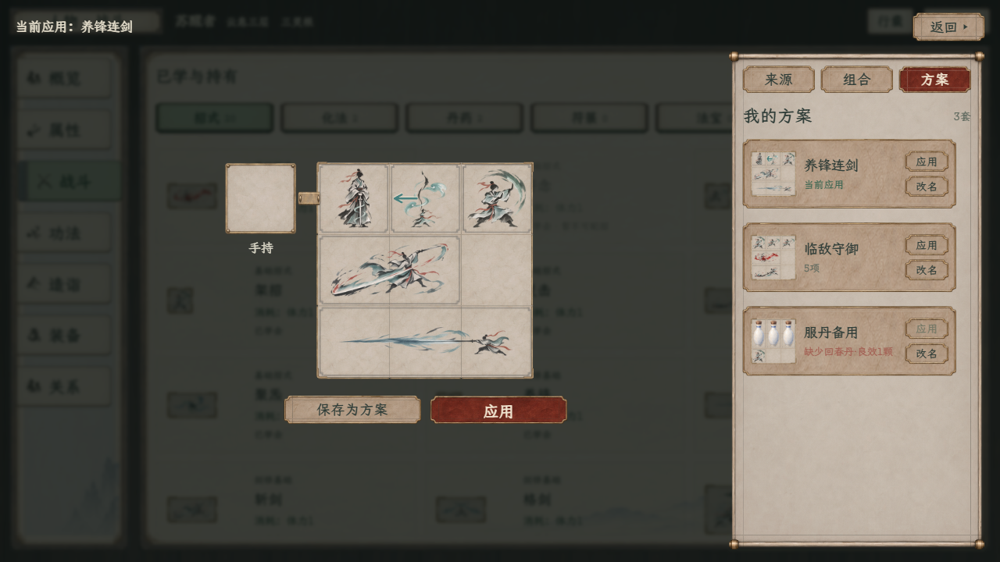
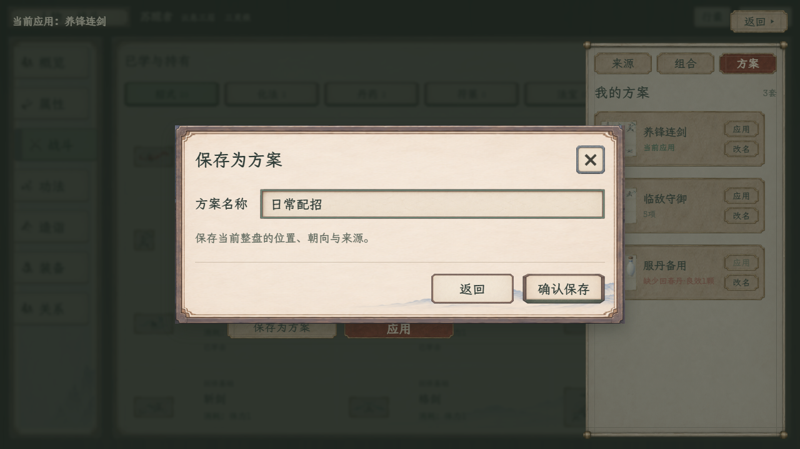

# 方案操作竖排与命名框对齐

2026-11-09 · 按用户反馈，将每套方案的“应用、改名”改为上下排列、等宽，缩略盘、名称与操作组在卡片内居中对齐。文字列获得更大宽度，长名称自动换行，卡片随内容增高。

命名保存与改名共用弹窗：名称标签固定一列，输入框伸展一列，二者垂直居中且留出间距；标题、表单与说明左对齐，底部返回／确认按钮等高。输入文字保留框内边距，长名称在输入框内部查看，覆盖提示自动换行，弹窗高度不足时滚动正文。保存、应用与改名通知使用短提示，不重复整段长名称。

[1920方案列表](方案按钮竖排_1920.png) · [1920命名框](方案命名对齐_1920.png) · [长名称覆盖提示](方案长名称对齐_1280.png)

两档完整画面、命名保存、空名错误、长名称卡片、同名覆盖提示及逐项改名共13种排版状态已复核，另含640×480命名弹窗检查。未发现标签／输入框错位、底部按钮高度差、横向溢出、文本越过纸框、脚本错误或缺失资源。[几何与实拍记录](排版复核.json)。

本次只调整样稿排版与提示文字，保存／覆盖／应用／改名规则保持。上一轮155项功能回归单列，没有把它计为本次重新运行；未改原生代码、正式存档或玩法数据。
