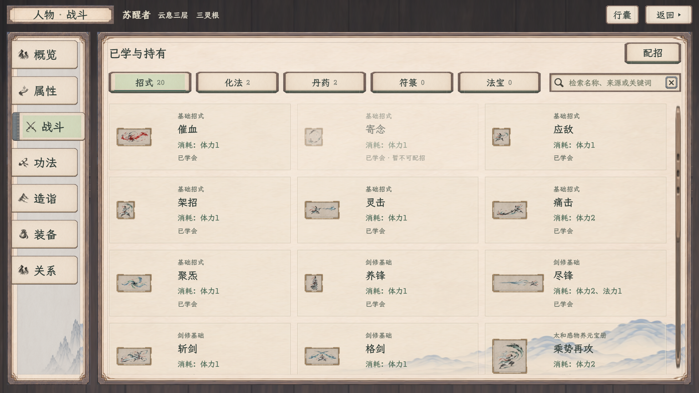
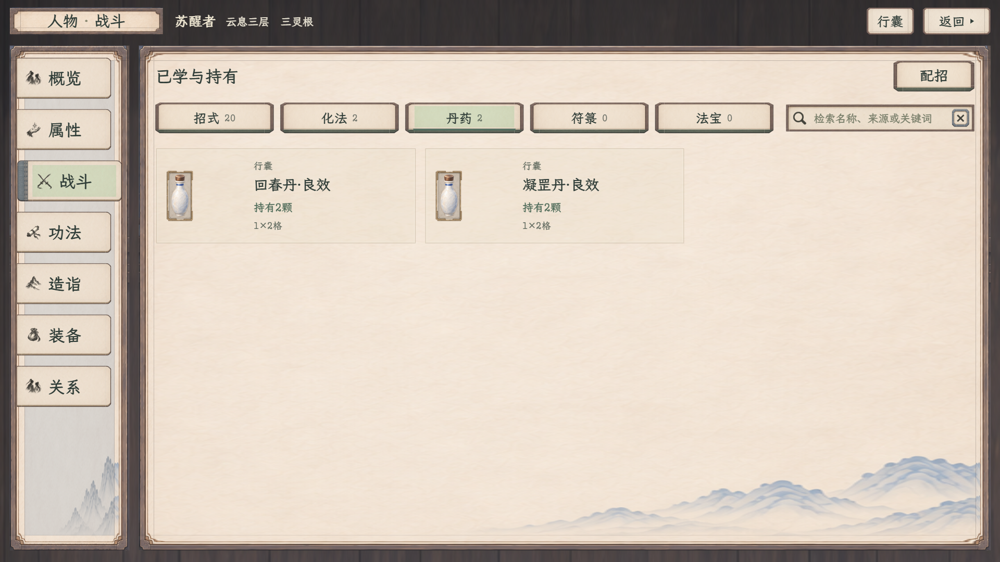
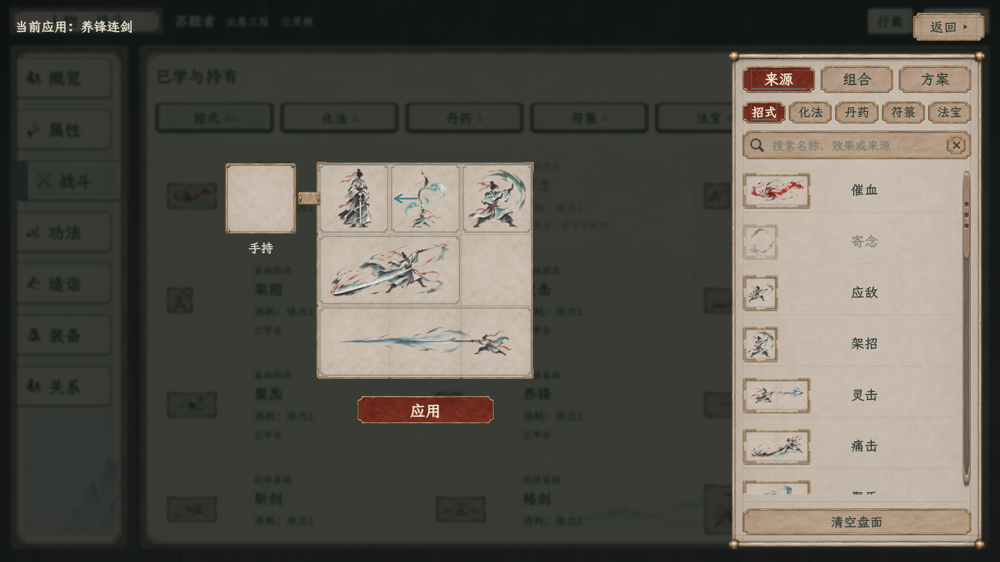
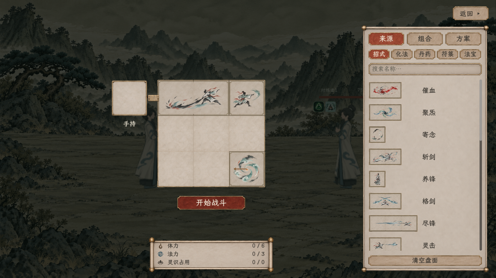

# 战斗页清册与紧凑配招

2026-11-09追加：侧栏与分类选中改为整纸轻染色，已去除中间文字区域的矩形底色，见[最新战斗页](../../角色与静室纸墨木石样稿_20261108/战斗_整纸选中_1280.png)。下方截图及148项／198项为本次纯样式修正前的验证记录，不重计为本次检查。

2026-11-09 · 当前修订，待用户查看。[现行规则与接入范围](../../../plans/界面与美术/人物战斗总览与局内配招统一_20261109.md) · [战斗专用样稿](../../角色与静室纸墨木石样稿_20261108/battle-workspace.html)

人物战斗首页只列当前已经学会、已经持有的招式、化法、丹药、符箓与法宝。五个分类按钮使用与“配招”相同的材质边框，选中项保留浅绿色。当前应用名称与整盘仅在点击配招后的全屏编辑层显示；原人物页保留并压暗。

[1280招式清册](人物已学持有_招式_1280.png) · [1280持有丹药](人物已学持有_丹药_1280.png) · [1280配招](人物已学持有_配招_1280.png)

两边配招盘面缩小至上一版约七成；网页上限750设计单位，原生每格不超过120，3×3盘最多360×360。局内真实资源栏置于主盘与开始／继续按钮下方，中心对齐，反馈文字单独留空。占格、拖放、转向与实际战斗规则保持。

[1280局内画面](1280x720/01_整份占形边框与紧凑来源.png) · [整组转向](1920x1080/11_组合整组转向预览.png) · [方案只载入](1920x1080/12_统一方案载入页.png)

人物清册读取独立已学／持有快照，不从全部定义的“可用”标记推断学习。缺快照时显示空态，库存为零的物品隐藏；已学但不可配置项保留灰态。样稿明确夹具为20招、2个化法、各2颗的两类丹药，符箓与法宝为空；应用或预留不改变持有数量。正式人物快照与存档尚未接入。

人物页继续为独立网页样稿，组合与方案管理仍在人物配招层；局内只读取已有库，不提供保存管理。网页内存模板与原生库尚未互通。截图为直接渲染，仅隐藏网页查看工具条，人物公共外层文件未修改。

## 验证

| 项目 | 结果 |
| --- | --- |
| 全项目构建 | [0警告、0错误](battle-compact-build.log) |
| 网页学习／持有快照与首页 | [33项通过](battle-owned-checks.log) |
| 网页配招回归 | [115项通过](battle-owned-loadout-regression.log) |
| 原生1920×1080 | [99项通过](1920x1080/验收.json)，退出0，标准错误为空 |
| 原生1280×720 | [99项通过](1280x720/验收.json)，退出0，标准错误为空 |
| 汇总、来源文件与素材指纹 | [验收汇总](验收汇总.json)，5张战斗PNG均保持原始指纹 |

两档原生均使用`--unified-editor-checks --layout-only --max-fps 60`，覆盖紧凑尺寸、资源栏中心与间距、来源／组合／方案、只读库、原生拖放及转向、占格回退、空瓶补药和资源／库存不变。这次不重跑遍历动画与共同回合，也不把上一版两档各112项或45项入口检查混入当前计数。

1920首次运行的组合右键转向采样未通过，无完成报告；增加失败时诊断后重建，1920与1280均完整通过，首次日志另存`attempt1`。没有改转向规则、移除断言或把失败运行计为通过。构建中另将既有冒烟测试的一处数组构造改为显式数组，消除重载歧义，测试含义与游戏逻辑保持。
