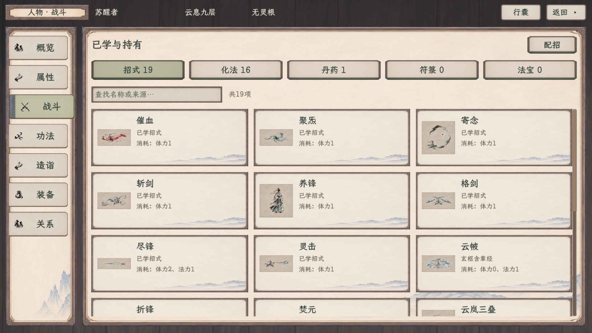
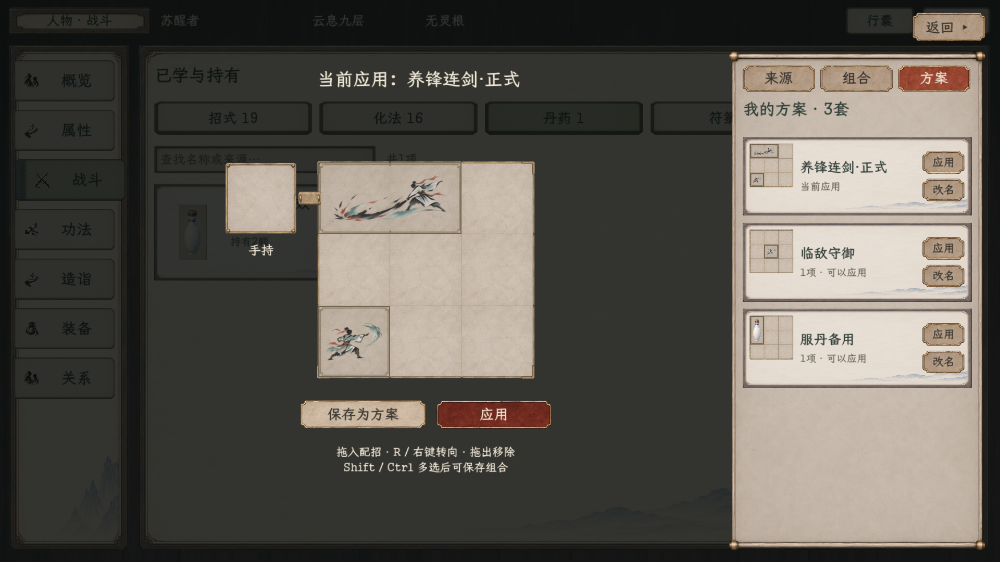
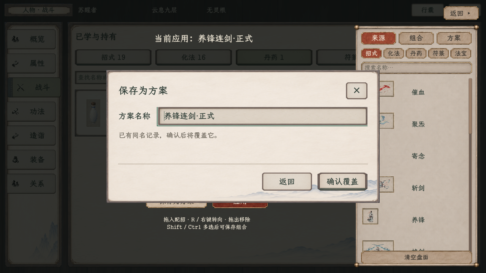
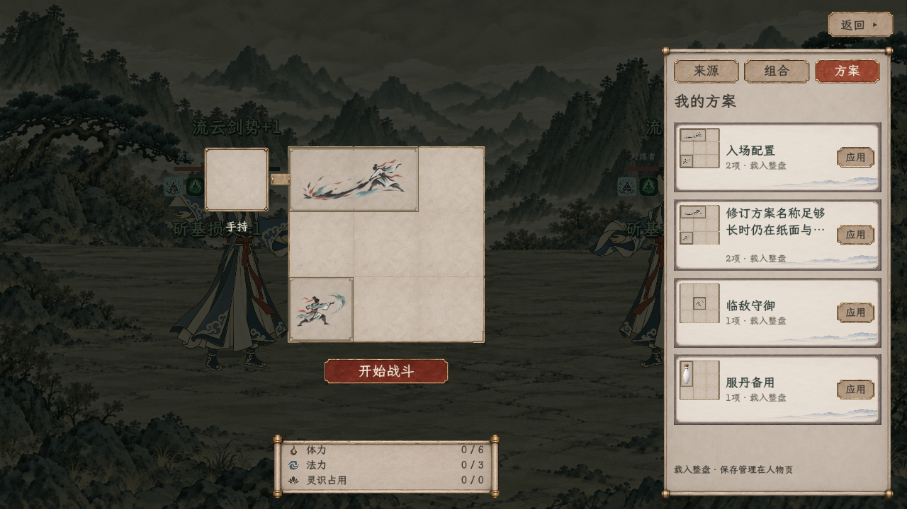

# 人物战斗与配招正式实装

> 同日最新战场与人物已按用户再次确认恢复为[林间石地＋小人物](林间石地小人物/README.md)，正式人类招式盘与查看共用固定表现。下方旧远山、大纸偶截图保留为接入历史，不再代表当前局内外观；目录、配置、存档及只载入边界保持。

> 战中HUD现行效果见[左下招式盘与整物回弹](战中小盘与遍历_20261109/README.md)：开战从中央缩移至左下，真实遍历驱动整物回弹；两档原生各122项通过，包含完整共同回合。

2026-11-09。用户明确要求“实装”后，将已确认的布局接入正式人物页、人物存档和实际战斗。现行范围见[正式接入案](../../plans/界面与美术/人物战斗与配招正式接入_20261109.md)。以下均为 Godot 原生界面，截图使用隔离测试人物，不向正式旅程授予示例招式、物品或模板。

同日按钮尺寸修订：战场右上倍速、暂停、配招统一为122×48设计单位，字号23，上沿21，间距18。[当前实机效果](打开查看/战斗按钮统一.png)；原生运行读取三项尺寸及字号一致，重新构建0警告0错误。本次仅调整排版，不重复计入下方既有功能回归。

## 正式入口和行为

- 人物 → 战斗：五类目录读取当前人物已学招式、化法和真实持有的丹药、符箓、法宝，支持名称、来源及招式标签检索；首页没有配置盘或方案管理区。
- 点击配招：保留人物页并压暗，显示紧凑主盘、外围手持示意、来源／组合／方案纸卷和右上返回。来源只提供实际可配招内容；已有但未定义上盘能力的法宝留在持有目录。
- 盘下保存为方案：命名确认，同名提示覆盖；保存后滚动到对应记录。右侧每项应用与改名竖排、等宽。空名、重名改名和取消均不部分写入；长名称在输入框或有限行数内显示，完整名称可悬停查看。
- 保存与应用分开：命名保存不改默认开局；逐项应用同步草稿与默认，留在列表。盘下应用确认当前草稿后返回人物页。覆盖同名模板不会偷偷覆盖已应用副本。
- 组合：Shift／Ctrl多选盘中对象，命名保存相对位置及朝向；支持覆盖、改名、删除及整组拖入。空隙不占位，重叠、缺来源和库存不足均整组拒绝。
- 局内：读取出战人物冻结的库，只提供载入；开始／继续战斗才提交当前草稿。资源栏放在紧凑盘下。人物默认、本人库及战中运行盘分别保存，局内调整、消耗与战斗回传不覆盖局外意图。









## 验证

| 检查 | 结果 | 记录 |
| --- | --- | --- |
| 全项目构建 | 0警告、0错误 | `output/playwright/combat-native-build.log` |
| 人物原生、存档、开局及局内互通，1920×1080 | 90项通过、9图 | [记录](1920/验收.json) |
| 同上，1280×720 | 90项通过、9图 | [记录](1280/验收.json) |
| 局内真实拖放、整组旋转、原子拒绝、空瓶补药，1920×1080 | 99项通过、9图 | [记录](局内拖放1920/验收.json) |
| 同上，1280×720 | 99项通过、9图 | [记录](局内拖放1280/验收.json) |
| 人物七页与NPC、行囊、返回回归，1280×720固定原生绘制面 | 216项通过、17图 | [记录](七页回归/验证记录_1280.json) |

人物互通脚本包含真实学习／持有过滤、空名与取消、同名覆盖和稳定编号、改名冲突、保存不自动应用、完整旅程保存与重载、后台人物快照、旧档可选字段、旧全局库只读兼容及首次本人导入、多选组合原生拖入、Tab焦点不进入背景、方案名称可见行高、实际战斗管理器开局、局内只读、战斗回传及下一场默认配置隔离。限行名称按可用宽度测量最小行高，避免原生容器将标题压为零高；两档最新截图已人工核对。全部旅程写入仅发生在项目 `output/playwright/` 下的隔离用户目录。

两档人物互通断言均通过；隔离引擎退出仍输出5张纸娃娃图层纹理的回收日志，详细追踪指向 `c1_male_puppet_v2/layers/` 的 head、arm_far、body、arm_near、body_kneel。此日志单独记录，不表述为引擎无清理提示退出；没有出现运行阶段脚本错误。其他人物绘制缓存不在本线修改范围。

原七页脚本须通过既有 `NativePaperCaptureHost` 使用固定绘制面；直接调整桌面窗口的首轮截图分辨率不符合1280断言，改用既定入口后216项全部通过，未放宽尺寸断言。网页和旧原生历史计数不并入本轮。

## 数据与实现

`HumanData.combat_board_preparation` 保存本人应用的开局副本，`combat_board_presets` 保存命名整盘和组合；既有 `combat_board_layout` 继续负责战中布局。`preset_name` 和 `preset_id` 显式导出，后台快照不依赖 `ResourceName`。

本人管理操作完整校验后替换副本并触发现行旅程保存；默认开局在实际人物出战快照中复制给战斗替身。战斗回传继续更新真实库存及运行盘，同时拒绝回写默认和模板。旧 `user://combat_board_presets.tres` 只作兼容读取，首次本人管理复制后保存到人物库，原文件不改写。

主要实现：`CharacterCombatBoardPage`、`CharacterCombatBoardEditor`、`CombatBoardNameDialog`、`CombatBoardPreparationService`；正式 `InfoPanel` 战斗页入口、`MainScene` 保存通知、人物与出战快照及 `BattleBoardHud` 共同接入。为恢复同期全项目构建，符箓悬停的一处结构构造补充了显式类型，未改符箓效果或制作规则。

可复现入口：

```powershell
# APPDATA必须先设置为项目output目录内的隔离用户目录。
tools/run_stacklands_spine38_game.cmd --max-fps 60 res://tscn/debug/CharacterCombatPreparationSmoke.tscn -- --wide
tools/run_stacklands_spine38_game.cmd --max-fps 60 res://tscn/debug/CharacterCombatPreparationSmoke.tscn
tools/run_stacklands_spine38_game.cmd --max-fps 60 res://tscn/debug/CombatBoardInteractionSmoke.tscn -- --interaction-size=1280x720 --unified-editor-checks --layout-only --interaction-output=res://docs/美术规范/人物战斗正式实装_20261109/局内拖放1280
tools/run_stacklands_spine38_game.cmd --max-fps 60 res://tools/NativePaperCaptureHost.tscn -- --native-paper-scene=res://tools/CharacterPaperUiSmoke.tscn --native-paper-width=1280 --paper-width=1280 --character-output=res://docs/美术规范/人物战斗正式实装_20261109/七页回归
```
