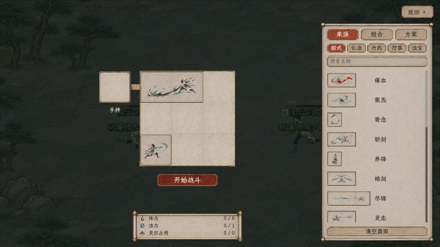
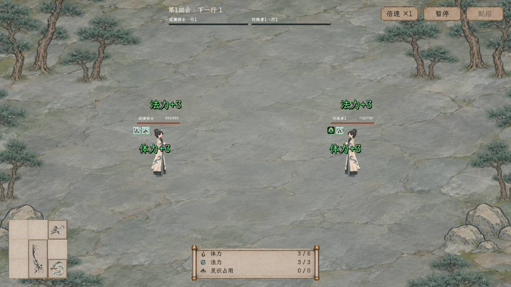
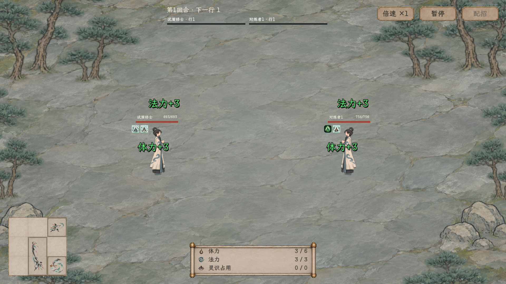

# 战中左下招式盘与整物回弹

2026-11-09，按用户要求调整实际战斗 HUD。规则见[招式盘拖放与遍历反馈](../../../plans/界面与美术/招式盘拖放与遍历反馈_20261108.md)；继续采用[林间石地与小人物](../林间石地小人物/README.md)。本轮不改变卡牌、消耗或遍历次数。

开战后，中央盘按已提交的真实布局缩移到左下。3×3小盘为192×192设计单位，最长边上限240，左下各留28；资源栏留在底部中轴。经过有物格时，整份招式的边框、占形和图标一起放大回弹；经过真正的空格时，该格短暂显示醒目的金色空格底与同材质边框脉冲，轻微放大后淡出，不显示招式图标。有物与空格采用不同反馈。多格对象不增加发动机会。暂停冻结缩移和回弹，回合结束按原流程恢复配招。

动画由当前原生窗口截图按真实采样时间编码，约10秒；原帧和时间戳在 `output/playwright/combat-empty-pulse-live-frames/`。录制使用隔离人物存档副本，通过实际“开始战斗”按钮执行，不合成战斗状态，不写玩家旅程。查看窗口录制后暂停，可点“继续”查看运行。

## 本轮验证

| 验证 | 结果 | 证据 |
| --- | --- | --- |
| 全项目构建 | 0警告、0错误 | `output/playwright/combat-mini-build.log` |
| 1280×720原生真实战斗与拖放 | 122项通过 | [记录](1280/验收.json) |
| 1920×1080原生真实战斗与拖放 | 122项通过 | [记录](1920/验收.json) |

两档均未使用 `--layout-only`，完整经过真实提交、暂停缩移、完成停靠、空格与整物反馈、暂停整物反馈、九格读取计数、痛击真实结算和共同回合结束；同时保留原有来源、整组载入、拖放事务、资源与库存不变检查。小盘不越出画面、不遮挡资源栏。仅九格盘完成本轮原生检查，不将最长边限制当作所有后期容量已验收。

2026-11-09再次提高空格反馈对比度：采用金色整框和亮底，峰值保持后短暂渐淡；全项目重建0警告、0错误。该外观调整后没有重跑两档拖放／遍历专项，表中122项来自刚完成的同布局实战验证。

最初把无损PNG逐帧写入验证循环，导致低帧率及90秒超时，该次未通过；日志保留于 `output/playwright/combat-mini-1280.log`，不计入通过结果。最终两档验证均关闭逐帧录制，日志分别为 `combat-mini-1280-unrecorded.log`、`combat-mini-1920.log`。独立查看录制改用JPEG帧，不参与通过项计数。
