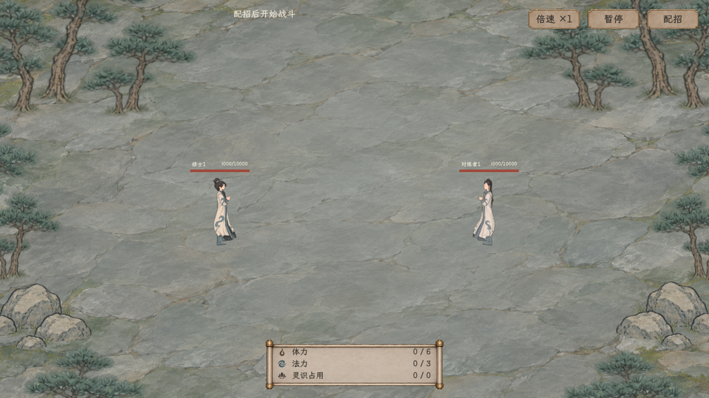
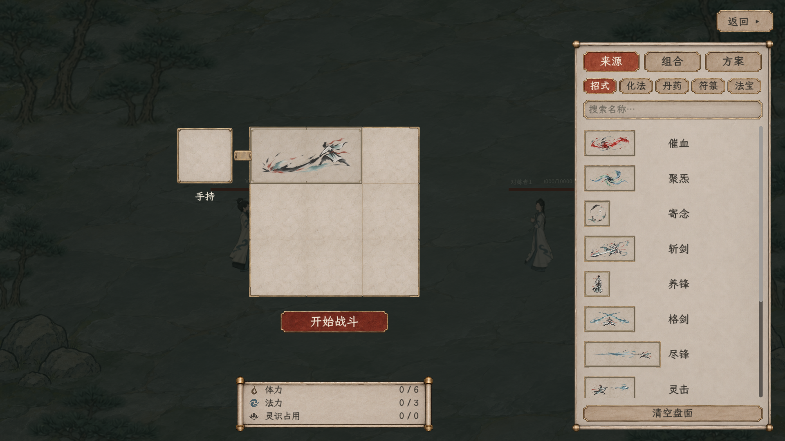
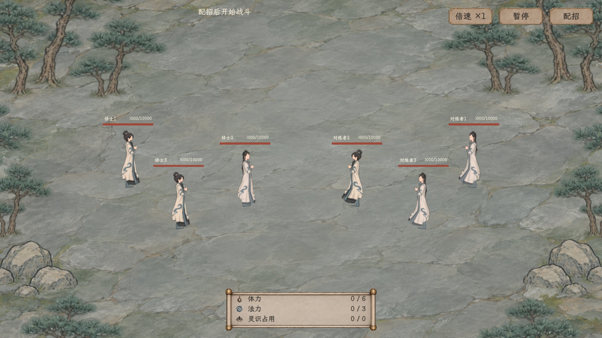

# 固定林间石地与小人物

2026-11-09。用户再次确认恢复[38选定参考](../../局内战斗布阵与开战理想图_20261107/38_用户选定_逐格拼接参考.png)的“俯视林间石地＋小比例人物”，人物和战场一起恢复。现行范围见[固定表现主案](../../../plans/战斗与构筑/招式盘战场固定为林间石地小人物_20261109.md)。

正式人类招式盘与独立查看入口现共用 `forest_stone_small_cultivators_20261109`。不依赖远景美术预览开关，配招、查看战场与实际执行保持同一套人物、场地及相机布局。

## 恢复内容

- 男女角色使用原规格白青常服与现有自有发型骨骼，统一160设计单位高；单挑双方在全屏31%／69%处相向，三对三使用浅纵深错排。完整模型留在视口内，配招开合不改比例和站位。
- 独立查看入口补上人物类型；显示层也能从真实 `HumanData` 肖像快照识别人类，避免漏填类型后走旧C1纸偶。
- 纯俯视石地、松树和山石逐字节复用之前布局引用的项目原图，固定副本位于 `textures/battle/forest_stone_small_20261109/`。三个SHA与来源相同，见该目录 `manifest.json`；没有重新生成或覆盖原素材。
- 双侧林缘不承担碰撞或遮挡规则，中央保持石坪。人类招式盘不再绘制旧横向远山背景；旧队列／妖兽兼容流程保持其原显示入口。
- 原紧凑配招盘、三栏来源、命名组合方案、盘下资源、右上统一按钮和真实结算沿用。未更改技能、数值、费用、资源、射程、物品或存档规则。

## 验证

| 检查 | 结果 | 记录 |
| --- | --- | --- |
| 全项目重新构建 | 0警告、0错误 | `output/playwright/combat-small-stage-build.log` |
| 1280×720原生男女、单挑／三对三、开合与执行 | 48项通过、5图 | [记录](1280/验收.json) |
| 1920×1080同项验证 | 48项通过、5图 | [记录](1920/验收.json) |
| 当前场景下真实拖放、转向、组合及空瓶预留 | 99项通过、9图 | [记录](拖放回归/验收.json) |

专项检查确认实际载入原规格人物而非C1、石地绘制而旧山景隐藏、正式招式盘无需预览标志、人物完整且两态坐标不变、提交后仍是同一模型和地面、来源人物性别／肖像／招式配置不变、原图未改。没有读取或写入正式玩家旅程；旧功能计数不并入本次专项。

同期阵盘代码出现了 `SignalName` 与Godot生成成员重名的编译冲突，仅将文字辅助方法改为 `SignalCaption`，未改阵盘规则；其他阵盘文件的未完成引用在该分线补齐后才进行了当前完整构建，没有排除源文件或用旧程序集冒充通过。

原生入口：`tscn/debug/CombatBoardStoneStageSmoke.tscn`，`--wide`为1920档，否则1280档。独立可操作查看仍用 `tools/CharacterCombatNativeViewer.tscn`，右上配招可打开与收起同一编辑层。
