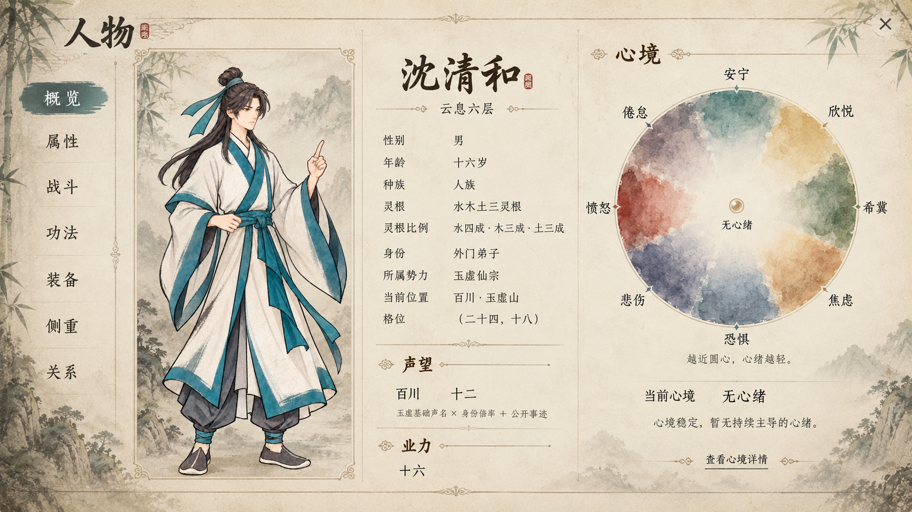

# 人物概览与心境圆盘理想图

状态：当前实现为 v5 心境盘连续色场与悬停修订；人物页布局以 v4 实际截图为参考，心境玩法尚未定数值。规则来源为[人物属性、因果与心境系统设计](../../plans/人物与修炼/人物属性、因果与心境系统设计.md)。

## v4 交互检查与情绪标注

保留已认可的径向水墨渐变；按最新反馈移除安宁扇区，外缘改用强烈情绪候选名称，内侧仍为同类情绪渐弱。首版分类已确认；真实心绪生成规则仍待定。

已补心境详情、悬停状态及来源、退出与切页清理、落点平滑视觉过渡，NPC 复用人物概览。查看[检查与待定事项](界面检查与待定事项_20261010.md)、[NPC 实际页面](人物共用概览_v4.png)、[心境详情](心境详情_v4.png)和[灵根悬停](灵根悬停_v4.png)。

## v5 全盘连续渐变与悬停

将八个情绪色域改为沿圆周连续混合的周期色场，取消按扇区分段着色；悬停只对对应色域增加柔和墨色，色场在扇区边界及首尾闭合处保持连续。降低大块水彩斑驳，只保留轻微颜料颗粒与窄幅渗纸边，让整盘颜色渐变成为主视觉。

## 状态区追加（2026-10-12）

- 在立绘、人物资料与心境圆盘三列内容下方增加独立纸面“状态”区，名称、效果、恢复进度／解除条件与来源分行展示。
- 状态区使用独立内边距与行距；条目增多时在区内滚动，页面空间不足时由概览页面整体滚动。不会压缩资料字号或将文字贴近纸框。
- 无状态时显示“暂无特殊状态”。心境仍只由右侧圆盘及其详情呈现，不在列表重复。

## 状态区位置修订（2026-10-18）

概览页中的“状态”区固定排在全部概览内容之后，位于立绘、人物资料与心境圆盘区域的最下方；不插入页标题与三列内容之间。概览内容较长时由页面整体滚动到状态区。

## v3 径向水墨渐变修订

用户指出 v2 的圆周到圆心渐变不清晰。本次改为按离圆心的距离连续控制墨色浓度：圆心透明，向外逐步加深，外围达到最浓后仅在极窄的边缘渗入纸面。取消中心截断平台和扰动半径的大片噪声，避免出现一圈空洞及浓淡不连贯；水墨纹理仅轻微影响颜料颗粒，不能掩盖径向渐变。心绪分类与落点含义保持主案定义。

使用正式人物页实际渲染，未生成或加工截图；已通过编译与场景截图检查。捕获参数为 `--capture-overview --capture-v3`，v2 截图保留以便比较。

## v2 用户修订与实际界面

- 直接复用 `InfoPanel.tscn`、实际宣纸山水背景、导航素材、字体及人物立绘渲染器，未生成新的整页图或替换人物素材。
- 灵根只常驻名称；资料列与左侧人物摘要的灵根名称均可悬停查看角色真实五行权重。不存在额外“灵根比例”资料行。
- 声望、业力使用阿拉伯数字；正业力带加号，零显示 `0`。
- 心境盘以实时材质绘制八种沿圆周连续混合的矿物色域，向内淡入宣纸；悬停时仅柔和显出对应色域，不显示扇区边界。外围为断续细墨。落点采用柔晕墨珠、错开围笔和淡金点睛，只有轻微明暗呼吸，位置不会自行移动。
- 正式人物页不从旧轴值推导新情绪，未有圆盘状态数据时显示“未详”。独立演示读取最近存档的角色数据副本，展示圆心时明确注明“外观预览”，不载入正式旅程、不修改存档或推进时间。
- 预览入口：`res://tscn/scene/CharacterOverviewPreviewScene.tscn`。带 `--capture-overview` 启动可保存实际人物页及灵根悬停截图。

[灵根权重悬停实际截图](灵根悬停_v2.png)。已通过全项目编译和实际场景截图检查；未增加心境迁移或修炼效果。启动日志仍有项目原有窗口图标缺失和渲染器退出时的资源释放提示，不影响截图呈现。

## 整页排版

采用现有人物页暖宣纸、山水竹影、细金边和墨色文字。左侧保留“概览、属性、战斗、功法、装备、侧重、关系”导航；主体按完整立绘、人物资料、心境三列排布。

| 区域 | 布局与内容 |
| --- | --- |
| 页眉 | 沿用实际人物页“概览”标题与返回入口 |
| 导航 | 约占画幅一成，当前页用克制的墨青底衬标明 |
| 立绘 | 左侧大画框内完整展示，脚部保留余量；资料不堆在立绘下方 |
| 资料 | 姓名为第一层；沿用实际字段，性别、年龄、境界、灵根、身份、所属势力、当前位置逐行对齐；灵根权重仅在悬停时显示 |
| 声望与业力 | 位于资料列下半部，各有独立标题；声望构成用小字展示，业力保持单一有符号数值 |
| 心境 | 右侧圆盘为视觉重点，下方显示当前心绪、简短说明和详情入口 |

横向画幅以约一成导航、近三成立绘、约四分之一资料、其余心境及间距为起点，实施时按实际可用画幅调整。所有标签、数值与标题按各自的纵线对齐；不以缩小正文塞入资料。姓名、地点或势力名过长时允许换行，不能挤入相邻区域。

## 心境圆盘

- 八片低饱和矿物淡彩沿圆周铺开，颜色边界轻微渗化，内缘逐渐淡入宣纸。保留可辨识的八个扇区，不画成硬切饼图。
- 首版顺时针排列：狂喜、渴求、焦灼、惊惧、悲恸、暴怒、怨恨、绝望。名称位于圆盘外侧，不压在落点上；分类与界面顺序按主案首版确认处理。
- 圆心标“无心绪”，表示没有持续占主导的情绪、当前心境稳定。圆心留白，不占一个扇区。
- 唯一落点为一枚小墨珠，配细亮边提高辨识度；到圆心的距离只表示当前心绪强度。概念图使用落点正处圆心的状态。
- 圆盘下方固定短说明“越近圆心，心绪越轻”。当前状态文字为“当前心境　无心绪”及“心境稳定，暂无持续主导的心绪。”
- 八风不常驻叠加在圆周外，以免与八种心绪混淆。详情里结合实际事件说明诱因。

## 交互与动态提案

平时圆盘固定方向，颜料仅有极轻的浓淡呼吸；标签保持静止。落点可以缓慢明暗变化，但不自行游走，以免让玩家误认为心境在随机变化。

悬停扇区时，外侧名称和对应淡彩略微显现，说明该心绪含义；悬停当前落点时显示当前心绪与缘由。点击“查看心境详情”后查看真实已有的持久变化和事件来源；没有记录时显示“暂无记录”。

短暂喜怒只产生一圈淡涟漪，长期状态变化才移动落点。落点向外移动时相关色域渐浓，向内移动时渐淡；演出不引入额外数值或心魔判定。

## 素材与制作记录

理想图：`人物概览与心境圆盘_理想图_v1.png`。

生成图仅用于确认构图、比例与材质；中文以本文及主案为准，接入时全部采用真实文字控件，不能将生成图中文字作为界面素材直接使用。

参考现有素材：`textures/ui/infopanel_fullscreen_bg_v1.png` 与 `textures/characters/c1_spine_ingame_rig_v6/source/character_full_reference_720x960.png`。角色立绘在图中仅作位置与比例参考，实际接入时使用人物已有外观。

使用内置图像生成工具制作。完整生成提示见同目录 `生成提示_v1.txt`。静态理想图只展示布局与材质，动态效果须在后续界面实现中确认。
