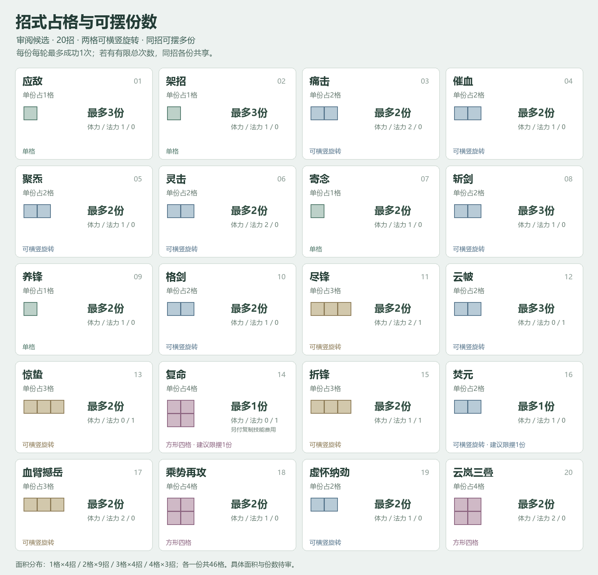

# 人类招式占格与份数审阅

2026-11-07。对应[人类二十招与化法新版迁移方案](../../plans/战斗与构筑/人类二十招与化法新版迁移方案_20261107.md)。两格长条可横竖旋转、同招可按上限摆多份已经确认；图中的具体面积和份数是本轮平衡候选，尚未写入正式招式或战斗。图形仅表示真实格形，不是生成的招式图标。



## 占格与份数

20招各放一份共46格：4招单格、9招两格、4招三格、3招四格。18招建议可同时摆2～3份，复命和焚元建议同时各1份；这两个上限是本角色的盘面限制，不是新增全游戏唯一关键词。每份每轮最多成功一次，有限总次数继续由同招各份共享。

单份长条有2格／3格，转向后交换宽高，面积与身份不变。方块为2×2，多格始终是同一份；图上一个占格块不能当作多次发动。扩盘不会自动增加可摆上限。

## 布阵几何检查

以下只检验候选尺寸、旋转、重叠、份数和化法邻接，不授予图中学习资格，也不保证一轮资源足够全部发动。A／B是同招不同摆放份，字母重复是同一份跨格。

### 九格基础双应敌

```text
架招   应敌A  应敌B
痛击   痛击   空
空     空     空
```

共5格，留4空。两份应敌是两个独立摆放对象；痛击虽然出现两格，仍只是一份。该布局用于验证早期就能选择同招多份，不将重复构筑全部推迟到后期。

### 九格剑意构筑

```text
养锋   格剑   格剑
斩剑   斩剑   空
尽锋   尽锋   尽锋
```

共8格，留1空。三格尽锋并不迫使初盘扩大；养锋、格剑与斩剑仍可同场，但费用和法力须逐次满足。

### 十六格双云岚

```text
养锋   格剑   格剑   空
云岚A  云岚A  云岚B  云岚B
云岚A  云岚A  云岚B  云岚B
斩剑   斩剑   化法↑  空
```

共14格，留2空。两份云岚分别拥有自己的本轮机会，均须付体力2；化法只指向B份，对A份无效，不按四个占格重复追加。同源化法没有因此得到第二份。

即使只算养锋、斩剑与两份云岚，主动费用合计也是6体力；格剑真实触发另需1。假设本轮轮初前余额为0、仅作敏感性试算令每空格回1，轮初3加两空格名义回复也至多提供5点，本轮不能保证四项主动全部发动。该试算不将空格回复1设为定案，也不计其他明确体力来源。

### 十六格三云帔

```text
云帔A  云帔A  云帔B  云帔B
云帔C  云帔C  聚炁   聚炁
化法↑  应敌   架招   空
空     空     空     空
```

共11格，留5空。三份云帔分别支付法力；化法只指向C份。是否产生玄枢二卷的队友护盾还须满足该化法的周天来源条件，不能仅凭几何邻接就触发。

## 适配与验证

几何检查记录见[检查结果](几何检查结果.json)。检查覆盖20招面积／份数、两格和三格旋转、上述四套示例、单份身份、多份上限、化法准确指向，以及超上限／重叠／越界的拒绝样例。

16／25／36格是成长文档的检查尺寸，未指定解锁境界。现有20招各一份的面积为46，大于36，也不表示36是终局上限；玩家须持续取舍招式、化法、器物和空格。

费用、基础公式与目标仍按原专题和资源；未新增属性、资源、关键词、射程或位移。0体力招式保留真实法力成本，未增加返费、抽牌或额外行动。正式图标、draw.io与游戏展示将在定稿实施时同步；本次只完成方案及几何检查，没有执行正式战斗编译、场景或旧档迁移验收。
