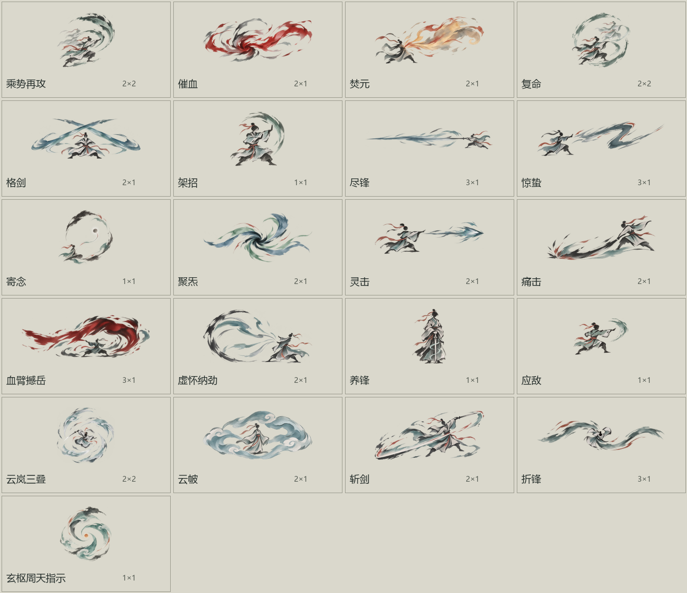
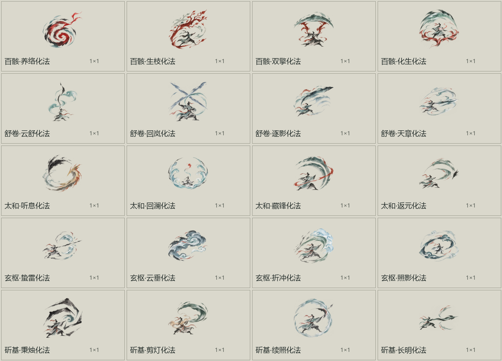
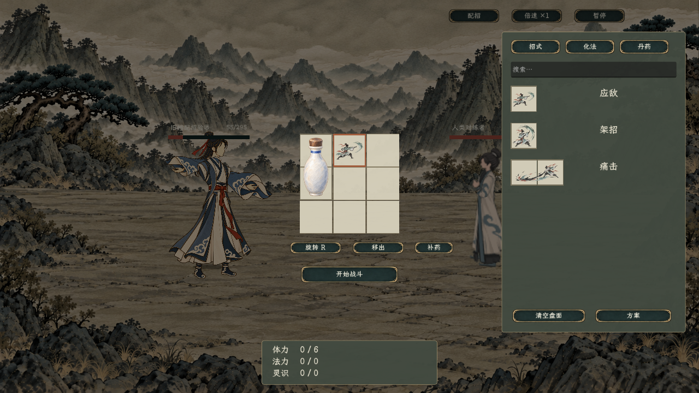

# 人类招式与化法新版图标

2026-11-07。20招、20项卷章化法与玄枢周天指示，共41张独立正式PNG已导出并链接资源。玩法与范围以[当前实施规则](../../plans/战斗与构筑/人类招式盘实施与验收_20261107.md)为准。

## 图标

透明底水墨淡彩，人物采用无五官小人；没有使用具象孤立手、拳或肢体。20招包含正面、居中、右向左、俯视环形等构图，避免统一的左人右招。

每格128源像素：单格128×128、两格256×128、三格384×128、方块256×256；长条随摆放横竖旋转。化法与指示物均128×128，转向箭头由界面另画。轮廓等比缩放、透明留边；复命显示复制对象时，仍完整等比放入其自身2×2占格。

正式资源目录：`textures/ui/combat/board_skill_icons/`。完整来源、尺寸、透明通道及导出路径见[图标清单](图标清单.json)；每张生成提示词和原稿记录在`records/`、`raw/`。带`_v2`的是构图修订，原图保留供追溯，正式资源采用清单的逻辑键。

## 图文与实机

[玩家正文](玩家文案.json) · [化法正文](化法文案.json) · [40项详细draw.io](../../卡牌词典/招式盘/README.md)。主图使用详细公式，内部来源单独放“策划说明”。

上述截图读取真实资源和库存，不以生成的界面理想图代替运行；1672×941与1280×720均已目视核对。另有[实际扫盘画面](正式场景_扫盘战斗.png)和[隐藏配招查看战场](正式场景_查看战场.png)。

## 最终验收

2026-11-08验收：编译0警告0错误，四组共1004项通过。原20招费用、公式、目标、状态和使用限制均保留，新增行为仅来自用户确认的新盘规则及太和化法。

| 检查 | 通过数 | 覆盖内容 |
| --- | ---: | --- |
| 基础状态与迁移 | 121 | 真实占格／转向、份数、相邻指向、共享限制、首次检查变暗、复制机会、旧十槽与化法备份 |
| 人类真实对战 | 126 | 正式纹理加载、原生多格拖放、真实伤害与应对、每轮配招、复命、周天及心法切换、丹药双格／空瓶／补药、太和、兽战兼容 |
| 正式场景往返 | 21 | 战前页进入正式战斗、两档截图、真实服丹与结算、返回世界、重复恢复、隔离存档重载 |
| 图文与数据 | 736 | 20招原字段、41张独立RGBA与透明边角、批准尺寸和份数、40张卡图、五本秘籍玩家文字与独立策划页 |

[静态验收记录](静态验收.json) · [运行验收记录](运行验收.json) · [五项完整验收与当前范围](../../plans/战斗与构筑/人类招式盘实施与验收_20261107.md#验证记录) · [器物现有字段](../../plans/物品与装备/器物现有字段与新盘改卡对照_20261107.md)。

测试使用隔离角色、库存和存档，不打开或覆盖玩家正式旅程。功能验证已完成，平衡未作完成声明。寄念目标、器物新卡、妖兽布阵及新版撤退仍另定。

已知退出提示：旧人物`c1_male_puppet_v2`的`head`、`arm_far`、`body`、`arm_near`、`body_kneel`五张压缩贴图在Godot退出时报告缓存未释放；未发现其导致本轮战斗或重载检查失败。本任务没有改造旧人物贴图缓存。
