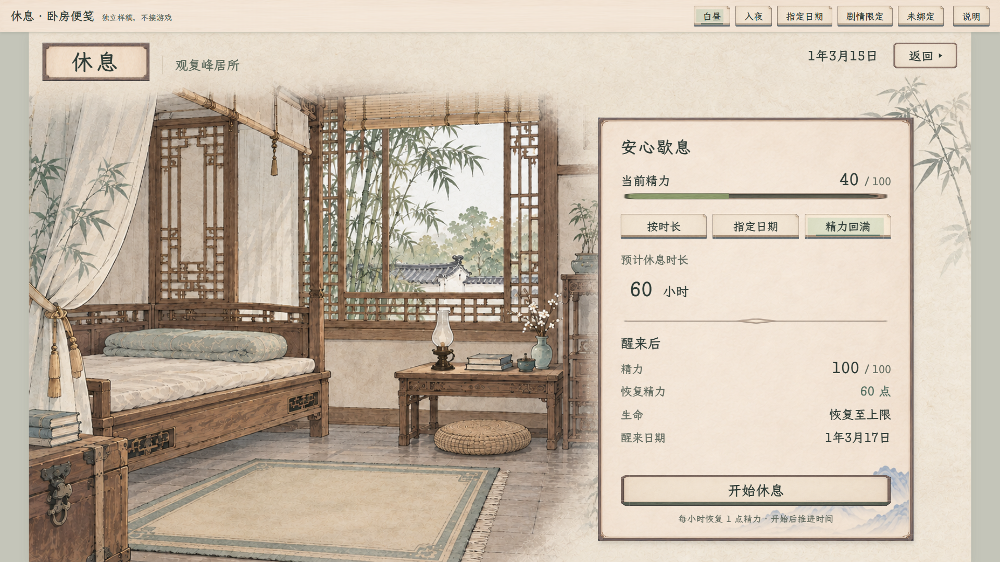
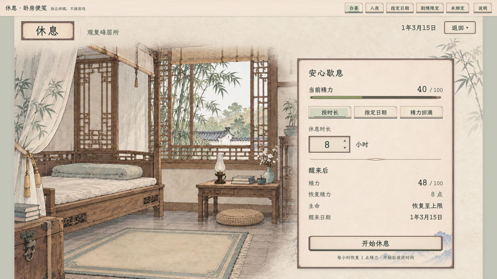
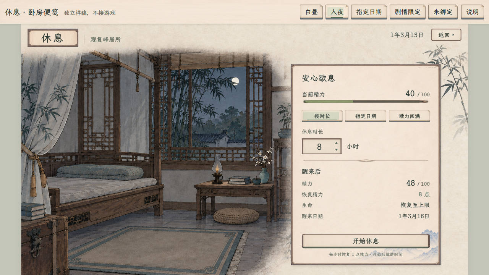

# 休息 · 卧房便笺样稿

2026-11-08 · **当前修订2，独立候选，待用户查看，未接入游戏。** 新增精力回满，并与静室对齐窄木压边、题签与字级。

最新位置调整：“休息”题签移至游戏画面左上角，地点随题签排列；日期与返回保持右上。可查看[隐藏样稿工具栏的完整效果](休息_左上题签_1920.png)。

最新导航调整：日期只显示年月日；右上角统一为“返回 ▸”，三角在文字右侧，与静室共用样式，后续新页面沿用。查看[本次位置、日期与返回专项验收](统一返回验收.json)；下方修订2记录仍为此前休息功能验收。

[打开可操作样稿](index.html) · [与静室并排对照](静室与休息风格对照.html) · [专属主案](../../plans/界面与美术/休息纸墨木石样稿_20261108.md) · [素材来源](素材来源.json) · [验收记录](验收记录.json)

保留当前同一卧房的昼夜原图，床榻和窗景占左侧，右侧放一张窄木压边纸页。与静室使用同源纸色、字体、按钮和角件，标题补同族题签；纸页压边为12设计单位，仍保留休息页较轻的卧房构图。主画面不放额外题辞或样稿说明，样稿身份只在顶部工具栏说明。

普通休息现在可选按时长、指定日期、精力回满。回满按当前缺口与现行恢复速率计算最少整小时，向上取整；40／100的示例需要60小时，预览至100／100。已满时为0小时且不可开始；固定剧情仍锁定原时长，未绑定时不能执行。切回时长或日期保留原输入，数字增减继续用裸三角。“开始休息”只展示安排，不结算。

[回满1280](休息_精力回满_1280.png) · [与静室对照](静室与休息风格对照.html)

| 状态 | 1920×1080 | 1280×720 |
| --- | --- | --- |
| 白昼 | [完整图](休息_白昼_1920.png) | [完整图](休息_白昼_1280.png) |
| 入夜 | [完整图](休息_入夜_1920.png) | [完整图](休息_入夜_1280.png) |
| 精力回满 | [完整图](休息_精力回满_1920.png) | [完整图](休息_精力回满_1280.png) |
| 指定日期／跨年 | [完整图](休息_指定日期_1920.png) | [完整图](休息_指定日期_1280.png) |
| 剧情限定 | [完整图](休息_剧情限定_1920.png) | [完整图](休息_剧情限定_1280.png) |
| 未绑定 | [完整图](休息_未绑定_1920.png) | [完整图](休息_未绑定_1280.png) |
| 无效日期 | — | [不可开始状态](休息_无效日期_1280.png) |
| 选定安排 | — | [安排预览](休息_安排预览_1280.png) |

样例日期、40／100精力取自已有 `QuietRoomSmoke`，默认8小时、1—720小时范围、30日／月、12月／年及日期的隐含小时对齐沿 `RestPanel`。每小时恢复1点精力、不超过容量，生命恢复至上限，沿现有定义与结算。地点使用现行“观复峰居所”，不恢复废弃李宅或后山。剧情限定只示范原 `fixedHours` 接口的固定8小时与隐藏自由选择，不增加当前剧情事件。未绑定资料显示“—”，主行动不可用。

本页只在内存中演示；没有人物、库存、存档、贡献、实际历法或本机显示偏好写入，也不使用 localStorage。没有新增费用或收益，不把样例当作玩家当前状态。实际休息与既有行动过渡仍留在正式游戏中，本轮不连接。本次同步静室样稿的返回排版，善功堂、藏经阁、角色、凝核及共享源位图均保持。

修订2检查覆盖原时长／日期、跨月／跨年、回满整数小时、已满／不足1点、三模式保留输入、固定剧情、未知数据、两档完整布局及无持久写入，实际结果见[本轮验收](验收记录_修订2.json)。正式游戏及原静室没有改动；本页新回满模式仍为独立样稿功能。
