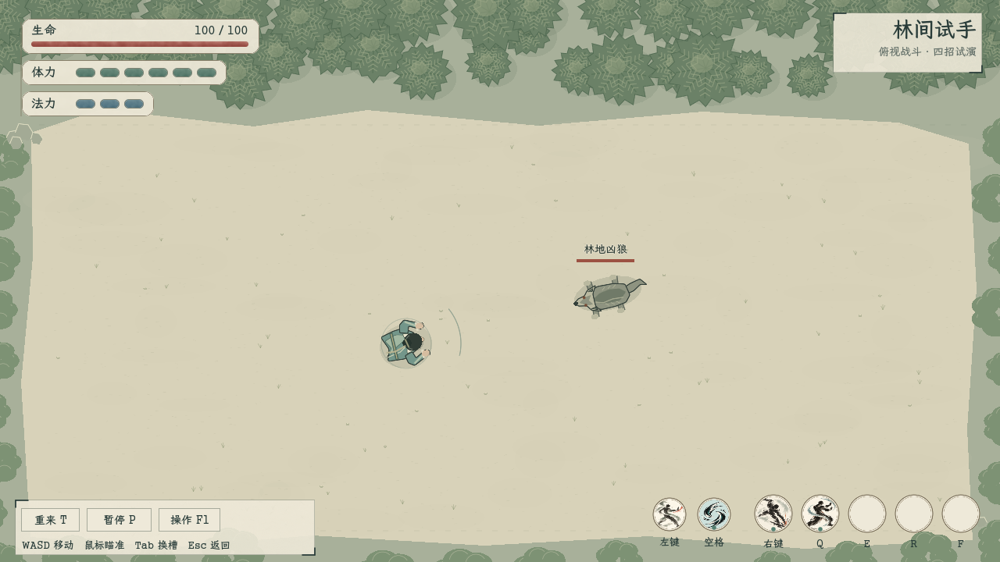
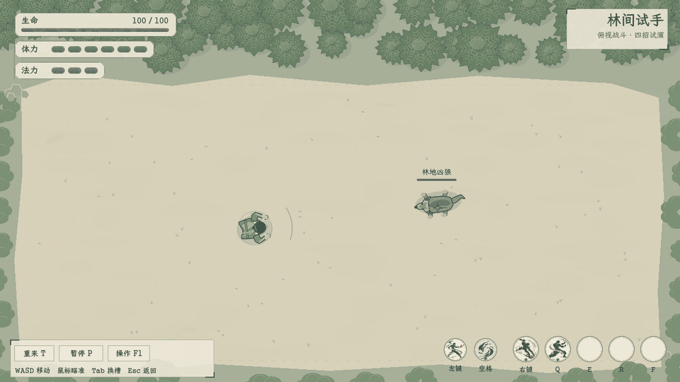

# 俯视战斗试玩实装记录

衣服表现已更新至[骨骼蒙皮与七套男装试装](../俯视衣服骨骼化_20261104/README.md)，以下画面为首版固定人物记录。四招、凶狼和独立试玩边界继续沿用。

2026-11-04。独立试玩已接首页「试演与预览 → 俯视战斗 · 四招与凶狼试玩」。正式队列未替换。规则、样例属性、方向适配和实施边界见[本轮方案](../../plans/俯视角四招凶狼试玩_20261104.md)。

## 动态演示

演示为脚本通过真实移动/技能入口驱动的实际OpenGL场景，共360个30FPS模拟帧，采集180张窗口渲染帧制作GIF；包含移动接近、架招化解、痛击、错步避让、拳掌与击败凶狼。该次结果为玩家生命68、凶狼生命0，不代表平衡评价或人工试玩通过。

## 窗口检查

- [痛击与凶狼蓄势](02_heavy.png)
- [架招成功](03_guard.png)
- [操作说明](04_help.png)
- [暂停界面](05_pause.png)

人物与凶狼均为从上方观察的原生连续转向轮廓；检查八方向、步态、攻击伸手、架招和错步残影。场地采用淡土色与灰绿林缘，植被/碎石仅作边缘装饰。已有水墨拳掌、痛击和架招图集沿用；其位置映射到地面，不再沿侧视人物抬高。

## 验证

- 新场景 `topdown_smoke.gd`：66项规则及输入检查通过；覆盖八方向命中、费用、释放位置、范围外落空、冷却、取消不返费、架招单次消耗、无敌末段、资源恢复、狼扑咬、死亡、首次进入等待开始、帮助/配置/失焦暂停、重开、实际按键输入及换槽保留冷却。
- 同一检查在1280×720和1920×1080实际OpenGL窗口中运行，含13项画面保存共79项通过；见 `output/topdown_trial_20261104/` 及 `output/topdown_trial_20261104_1080/`。原型自然度与手感仍待用户实机评价。
- 原四招 `smoke_basic_skills.gd`：24项通过；原 `ui_smoke.gd`：通过。
- 主项目 `tools/topdown_menu_smoke.gd`：首页入口存在、点击进入、样例隔离及Esc返回通过。主项目新场景单独启动通过。
- `dotnet build Stacklands.csproj --no-restore --verbosity quiet`：0警告、0错误。

独立试玩使用固定样例生命与属性；未接正式防御、心法、化法、天赋、存档或奖励。角色能够重叠，林缘装饰不构成碰撞；不把原有测试判定描述为正式战场的完整碰撞系统。
