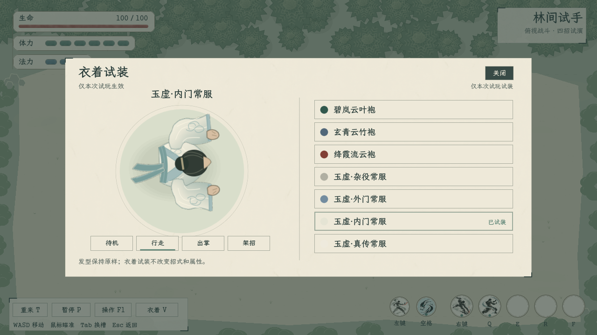
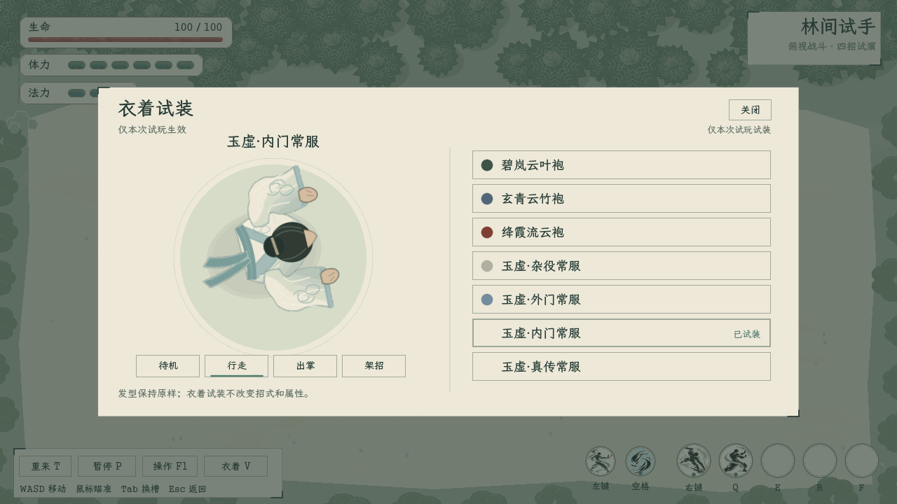
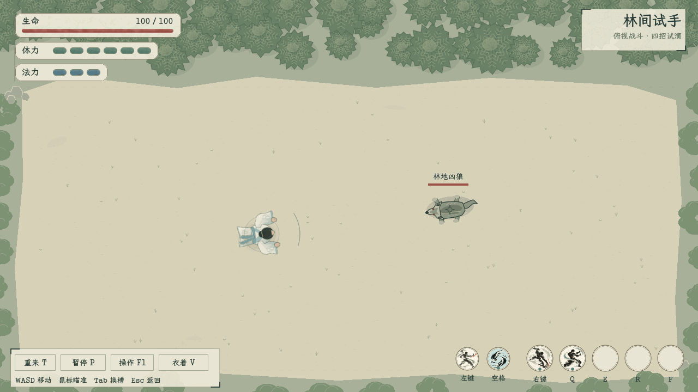

# 俯视衣服骨骼化实装

> **附件恢复说明（2026-11-09）：**9张静帧从本次试演输出按原字节恢复；两段原GIF已缺失，现用该次保留的截图序列按原采样时间重编（14秒与12秒），重编版不冒称原GIF。[原始帧、逐帧SHA与重编记录](原帧恢复来源与SHA_20261109.json)；[原GIF缺失记录](../../引用与附件核对.md#ref-797922c6c046)、[战斗原GIF缺失记录](../../引用与附件核对.md#ref-479fc689f831)。

2026-11-04。用户要求先做衣服，发型留后；本轮已在独立俯视试玩接入26根原生骨骼和真实蒙皮。正式队列、现有立绘和衣着持有规则保持现状。[规则、来源与接入边界](../../plans/界面与美术/俯视角色衣服骨骼与换装_20261104.md)。

入口：首页「试演与预览 → 俯视战斗 · 四招与凶狼试玩」，按V或点击左下「衣着」。可试装7套现有男修衣着，切换待机、行走、出掌和架招；关闭面板后，场上人物保留试装效果。

## 连续动态

上述为真实OpenGL窗口的脚本驱动录制，420个30FPS模拟帧、210张渲染截图，依次展示七套男装。不同领襟、袖宽、衣摆和纹样分别制作；衣服实际绑定肩、肘、腕、腰与衣摆骨骼。没有把固定整张人物贴图转动冒充骨骼动画。

## 实际战斗

同一俯视骨架读取真实四招试玩状态。该次脚本驱动演示包括架招、错步、拳掌与痛击；演示不代替用户手感与美术验收。

## 各款与动作

- [碧岚云叶袍](male_clothes_00.png)、[玄青云竹袍](male_clothes_01.png)、[绛霞流云袍](male_clothes_02.png)
- [玉虚杂役](male_clothes_03.png)、[玉虚外门](male_clothes_04.png)、[玉虚内门](male_clothes_05.png)、[玉虚真传](male_clothes_06.png)
- [出掌中的衣袖](02_sleeve_attack.png)、[实际战场](01_clothing_arena.png)

## 验证与限制

- 骨骼/衣料专项 `topdown_clothing_smoke.gd`：28项通过，包含原生骨骼、逐顶点权重、跨关节混合、7款材质、64朝向及动作相位、暂停、衣摆惯性和主副手挂点；实际窗口增加鼠标试装/关闭及9张截图检查，共39项通过。
- 主项目 `tools/topdown_clothing_catalog_smoke.gd`：11项通过，逐款核对真实ID、名称和文件，检查V/Esc输入、资源保持及建角外观副本隔离。
- 原俯视四招 `topdown_smoke.gd`：66项通过；主项目首页进入/返回检查通过。新脚本已由实际Godot窗口加载和运行。本轮未修改C#文件。

本轮没有制作可换发型，保持旧固定发髻。只支持表中七套男修俯视衣服，女修衣服待制作。当前衣料为骨骼权重和阻尼惯性，没有布料自碰撞；主副手武器挂点已验证，武器战斗尚未接入。
