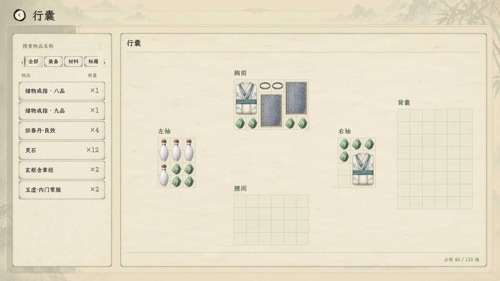
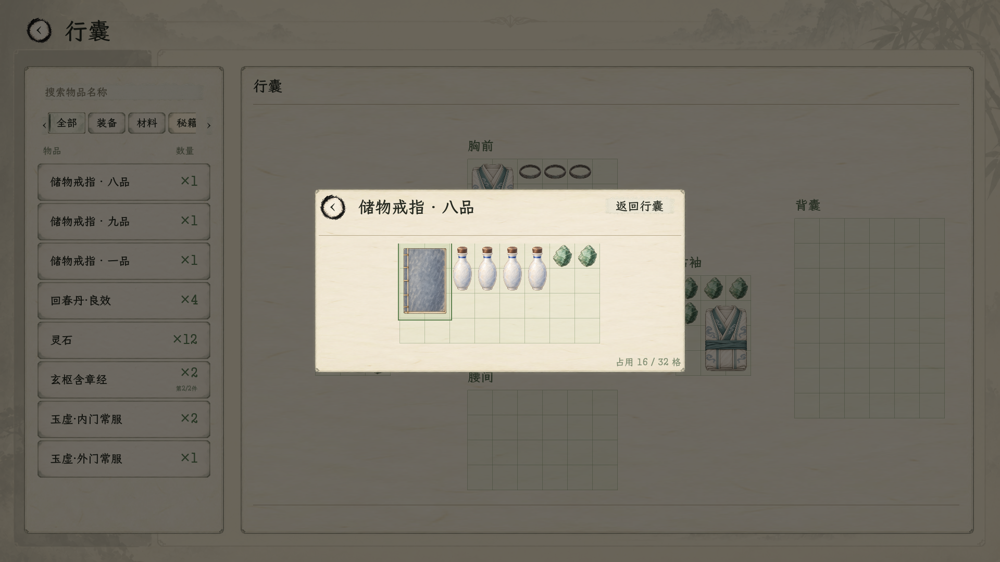

# 储物戒指与行囊尺度

2026-11-04。收纳机制与本轮图标已接入，实际窗口和隔离回归通过；品质容量表及正式获取渠道尚未配置。规则以[本轮主案](../../plans/储物戒指与行囊尺度修订_20261104.md)为准。测试戒指仅为夹具，不写玩家存档或加入正式商品。

2026-11-05最新：戒指以模态子页覆盖主行囊，下层五区与清册保持可见并压暗55%，鼠标与键盘输入被隔离。点击子页外暗罩返回主行囊，点击戒内空格不返回；拖动到暗罩松手只撤销移动。小空间居中、大空间扩展到38×18整屏样板，单格48设计单位保持；它是布局参考，不是已定的极品容量。正式品质容量表仍未定。

命名最新裁定：物品统一叫“储物戒指”，标题、清册、悬停与移入菜单用品级区分，如“储物戒指 · 九品”。原宽腔、窄腔、整屏等昵称和试样标签已从玩家展示移除。同品级多枚只在展示/选择时附序号，真实物品名保持一致。当前九品/八品/一品为夹具展示标签，不把原测试尺寸当作正式品级容量表；超界滚动夹具不出现在交付截图中。编译0警告0错误、实际窗口80项与跨进程读取3项通过：[本轮窗口](../../../outputs/inventory_scale_20261104/ring_grade_names_window.log)、[读取](../../../outputs/inventory_scale_20261104/ring_grade_names_restart.log)。

## 当前画面

- [暗罩子页1920×1080](07_戒指暗罩1920.png)、[暗罩子页1280×720](08_戒指暗罩1280.png)：保留压暗的主行囊，点击暗罩返回。
- [整屏戒指1920×1080](05_整屏戒指1920.png)、[整屏戒指1280×720](06_整屏戒指1280.png)：38×18矩形填满正文，窗口变化不改容量。
- [行囊1920×1080](01_行囊尺度1920.png)：直立秘籍、1×2小药瓶、2×3折衣及1×1戒指同格距对照。
- [戒指1920×1080](02_戒指矩形收纳1920.png)：实际物品、占格、跨容器清册与返回行囊。
- [戒指1280×720](03_戒指矩形收纳1280.png)、[行囊1280×720](04_行囊尺度1280.png)：保持比例与可见范围。

## 最终尺度与接入

| 项目 | 当前规则 |
| --- | --- |
| 单格 | 48×48界面设计单位，源图每格128×128像素，随整个界面等比缩放 |
| 书册 | 2×3；正俯视、边缘端正；仅玩家旋转时改变方向 |
| 丹药瓷瓶 | 用户明确修订为1×2；首轮1×1预览已撤回 |
| 衣着 | 十件统一2×3；袖子与下摆收进折叠包，保留各自配色 |
| 戒指 | 本体1×1；品质和矩形内腔长宽按实例配置，禁止互装 |

核对90份正式资源绑定，其中66份瓷瓶/丹药定义及10份衣着改变了真实占地，14份秘籍沿用2×3并更换共用原画。药效、用量、配方、穿戴和堆叠规则保持。瓷瓶缩图与实际占格、悬停、领取预览同步，不能只缩图不减占地。

修复物品格先赋尺寸、后清最小尺寸时留下旧点击框的问题：现在先清除最小尺寸，再设置真实占格。新检查要求点击框与占地严格一致，避免小件点击到邻物。普通行囊、领取和戒指共用格距常量；大内腔保持格距，通过滚动浏览。

戒指逐件存物并保留身份、朝向与器物快照；清册跨普通行囊和各枚戒指汇总，双击定位真实实例。收纳/取出失败保持两边数据；在用装备和突破预留药沿用保护，有内容的戒指不能出售或丢弃。戒内物品先取回再进入使用、交易、炼制和战备。未实现战斗技能库、制作门槛数值、正式品级表、赠送或兑换渠道。

## 素材、源图与提示词

使用内置 **image_gen** 重绘，共13张：一张书册、一张瓶子、十张折衣、一张戒指。源图保留原生Alpha；装配只裁透明外边、等比缩小和补透明画布，无放大、非等比拉伸、抠底或合成新物体。主体最大使用画布约88%。

完整最终提示词、参考图、生成模式、生成原路径及项目保存路径见[生成记录](生成记录.json)。瓷瓶源图沿用生成结果，按用户后续1×2裁定重新装配为128×256；保留原始提示词，不把它改写成后来的生成记录。[接入结果](接入结果.json)登记最终尺寸；[旧图备份](before/)保留替换前12张图。

| 素材 | 格数 | 游戏使用PNG | 生成源图 |
| --- | --- | --- | --- |
| 通用秘籍 | 2×3 | [游戏PNG](../../../textures/items/inventory_density_20261029/manual_generic_2x3.png) | [透明源图](../../../textures/items/inventory_scale_20261104/raw/manual_generic_2x3.png) |
| 通用丹药瓷瓶 | 1×2 | [游戏PNG](../../../textures/items/inventory_density_20261029/pill_container_empty_porcelain.png) | [透明源图](../../../textures/items/inventory_scale_20261104/raw/pill_container_empty_porcelain.png) |
| 玉虚杂役常服 | 2×3 | [游戏PNG](../../../textures/items/inventory_density_20261029/portrait_clothing_yuxu_zayi.png) | [透明源图](../../../textures/items/inventory_scale_20261104/raw/portrait_clothing_yuxu_zayi.png) |
| 玉虚外门常服 | 2×3 | [游戏PNG](../../../textures/items/inventory_density_20261029/portrait_clothing_yuxu_waimen.png) | [透明源图](../../../textures/items/inventory_scale_20261104/raw/portrait_clothing_yuxu_waimen.png) |
| 玉虚内门常服 | 2×3 | [游戏PNG](../../../textures/items/inventory_density_20261029/portrait_clothing_yuxu_neimen.png) | [透明源图](../../../textures/items/inventory_scale_20261104/raw/portrait_clothing_yuxu_neimen.png) |
| 玉虚真传常服 | 2×3 | [游戏PNG](../../../textures/items/inventory_density_20261029/portrait_clothing_yuxu_zhenchuan.png) | [透明源图](../../../textures/items/inventory_scale_20261104/raw/portrait_clothing_yuxu_zhenchuan.png) |
| 月白竹影袍 | 2×3 | [游戏PNG](../../../textures/items/inventory_density_20261029/portrait_clothing_female_yuebai_zhuying.png) | [透明源图](../../../textures/items/inventory_scale_20261104/raw/portrait_clothing_female_yuebai_zhuying.png) |
| 藕荷花云袍 | 2×3 | [游戏PNG](../../../textures/items/inventory_density_20261029/portrait_clothing_female_ouhe_huayun.png) | [透明源图](../../../textures/items/inventory_scale_20261104/raw/portrait_clothing_female_ouhe_huayun.png) |
| 青瓷云梅袍 | 2×3 | [游戏PNG](../../../textures/items/inventory_density_20261029/portrait_clothing_female_qingci_yunmei.png) | [透明源图](../../../textures/items/inventory_scale_20261104/raw/portrait_clothing_female_qingci_yunmei.png) |
| 玄青云竹袍 | 2×3 | [游戏PNG](../../../textures/items/inventory_density_20261029/portrait_clothing_male_xuanqing_yunzhu.png) | [透明源图](../../../textures/items/inventory_scale_20261104/raw/portrait_clothing_male_xuanqing_yunzhu.png) |
| 碧岚云叶袍 | 2×3 | [游戏PNG](../../../textures/items/inventory_density_20261029/portrait_clothing_male_bilan_yunye.png) | [透明源图](../../../textures/items/inventory_scale_20261104/raw/portrait_clothing_male_bilan_yunye.png) |
| 绛霞流云袍 | 2×3 | [游戏PNG](../../../textures/items/inventory_density_20261029/portrait_clothing_male_jiangxia_liuyun.png) | [透明源图](../../../textures/items/inventory_scale_20261104/raw/portrait_clothing_male_jiangxia_liuyun.png) |
| 储物戒指本体 | 1×1 | [游戏PNG](../../../textures/items/inventory_scale_20261104/storage_ring_1x1.png) | [透明源图](../../../textures/items/inventory_scale_20261104/raw/storage_ring_1x1.png) |

## 验收

最终 `dotnet build --no-restore -v:q`：0警告、0错误。

### 暗罩修订的本轮复验

| 场景 | 结果 | 日志 |
| --- | --- | --- |
| 戒指数据与交互 | 72项，包含暗罩点击、子页内点击、拖动取消、焦点隔离、筛选和定位进度保持 | [无窗口](../../../outputs/inventory_scale_20261104/ring_modal_headless.log) |
| 实际1920/1280窗口 | 80项，含同样72项与8张截图；子页面保持明亮，下层压暗 | [窗口](../../../outputs/inventory_scale_20261104/ring_modal_window.log) |
| 普通行囊 | 23项，核对原分类、定位、拖动与返回 | [行囊回归](../../../outputs/inventory_scale_20261104/inventory_modal_regression.log) |

暗罩不仅依靠绘制层级：当前页和弹窗在场景输入顺序上也置于暗罩之后，防止能看见却点不到。暗罩覆盖窗口留白；下层真实库存以无交互视图展示，清册保留，返回后恢复焦点能力。未改库存模型或品质数值。

### 前轮完整基线

复验脚本：[run_inventory_scale_regression_20261104.ps1](../../../tools/run_inventory_scale_regression_20261104.ps1)，加 `-IncludeWindow` 运行以下7组。全部通过。

| 场景 | 本轮结果 | 日志 |
| --- | --- | --- |
| 戒指数据与真实控件 | 64项，含42项数据检查及22项交互检查 | [无窗口](../../../outputs/inventory_scale_20261104/ring_final.log) |
| 跨进程重新读档 | 3项，核对内容身份、坐标朝向、品质与矩形 | [重启读取](../../../outputs/inventory_scale_20261104/ring_restart.log) |
| 原空间模型 | 29项 | [模型](../../../outputs/inventory_scale_20261104/spatial_model.log) |
| 原行囊交互 | 23项 | [行囊](../../../outputs/inventory_scale_20261104/inventory_ui.log) |
| 原交易 | 24项 | [交易](../../../outputs/inventory_scale_20261104/trade.log) |
| 原空间领取及真实炼丹领取 | 53项 | [领取](../../../outputs/inventory_scale_20261104/claim.log) |
| 实际1920/1280窗口 | 70项，含同样64项与6张截图；整屏、固定格距、隐藏主栏及Esc返回均核对 | [最终整屏窗口](../../../outputs/inventory_scale_20261104/ring_fullscreen_window.log) |

另核对原65张图的密度、96份目录绑定及本轮90份引用，正式资源与PNG宽高一致。窗口检查不与无窗口重复项相加成独立功能数量。真实窗口测试先同步测试指针位置，避免操作系统指针和注入事件混杂；生产的失焦取消机制保留。

日志边界：部分场景保留既有《卸力》资源UID按路径回退的1条警告，无本轮运行错误。一次全工程导入在其他历史素材扫描阶段内存不足而中断；随后对本轮13张运行图进行隔离定向导入，并在项目4.7.2运行时核对绑定、实际渲染和交互通过，不宣称全工程导入通过。未进行导出发行包验证。

11月5日整屏复验：机器一度出现进程创建1455及渲染初始化内存不足。无窗口6组已通过；释放本轮编译服务器后台资源后，使用同一编译结果单独运行窗口场景，70项及6张截图全部通过。失败日志保留，不以失败的自动批次宣称完整通过；本表列出的最终窗口证据以独立整屏日志为准。

