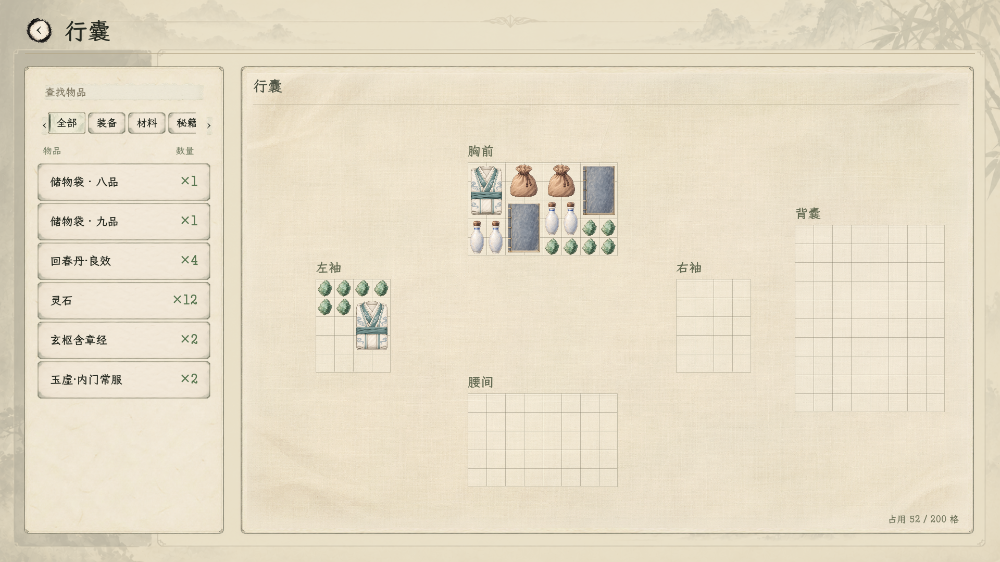
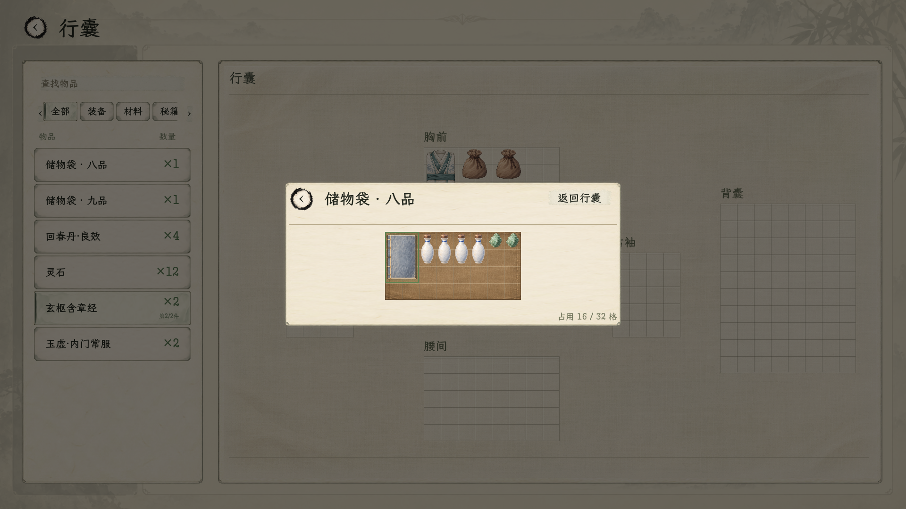

# 储物袋迁移与四格图标

2026-11-08。用户要求将现有储物戒指改成储物袋、生成图标，随后明确本体占四格，并表示不用管旧档。现行规则见[储物袋命名与材质专题](../../plans/物品与装备/收纳空间材质与储物袋命名_20261107.md)。

状态：已接入；编译0警告0错误，7组场景通过，1920×1080与1280×720实机已核对。

## 图标与实际占地

| 项目 | 当前结果 |
| --- | --- |
| 名称 | 储物袋，品级单列；同品级多袋用展示序号区分 |
| 本体 | **2×2，共4格**；真占格、点击范围、旋转、悬停和领取按同一尺寸 |
| 图标 | 256×256透明PNG，每格128源像素；水墨淡彩、暖褐织物、系绳袋口 |
| 显示格距 | 36设计单位；袋体72×72，1280窗口随全界面等比缩小 |
| 袋内 | 已认可的暖褐布衬、薄缝边及深浅细格线；沿用各袋矩形宽高 |
| 内容与操作 | 每袋独立身份，保留物品身份、坐标、朝向和器物快照；禁止互装，有物不得丢弃或出售 |
| 存档范围 | 用户明确不处理旧档；不新增兼容、满包旧档整理或自动发放 |

## 资源与接入

图标由内置`image_gen`生成；瓷瓶与折衣只作画风参考。原生透明源图保存在[raw/storage_bag.png](../../../textures/items/storage_bag_20261108/raw/storage_bag.png)，实际使用[storage_bag_2x2.png](../../../textures/items/storage_bag_20261108/storage_bag_2x2.png)。只裁透明外边、等比缩小并补透明画布，保持原生Alpha，不放大、不拉伸或重绘袋子。生成时按旧一格案描述，之后用户改为四格；生成提示词保持原始记录，最终以2×2装配，不改写生成历史。

[完整提示词、参考图及生成路径](生成记录.json) · [源像素和透明装配记录](图标装配.json) · [可复现装配工具](../../../tools/pack_storage_bag_icon_20261108.py)。

运行模型统一为`StorageBagItemData`、`StorageBagContentsData`、`StorageBagStoredItemData`；角色字段为`storage_bag_contents`，容器字段为`bag_instance_id`。收纳查询、移动、保护、清册、子页、领取、交易过滤及回归入口同步改用储物袋。类型脚本、资源路径和测试场景均已更名，旧存档不在本次兼容范围。

| 隔离规格 | 品级文字 | 内腔 | 本体 |
| --- | --- | --- | --- |
| storage_bag_narrow.tres | 九品 | 3×2 | 2×2 |
| storage_bag_wide.tres | 八品 | 8×4 | 2×2 |
| storage_bag_large.tres | 一品 | 40×22，超界滚动检查 | 2×2 |
| storage_bag_fullscreen.tres | 一品 | 38×18，布局检查 | 2×2 |

这些规格延续原测试容量，仅验证不同矩形和滚动，不定义正式品质容量表。当前未配置制作配方、获取渠道或新商品。普通行囊五区200格及浅绢v5、已有药瓶／书册／衣着尺寸、坊市规则保持。

袋内材质直接引用[既有材质图](../../../textures/ui/inventory_material_20261107/storage_surface_materials_v1.png)中间暖褐区域；不另生成素材、不改变网格或物品命中。历史戒指源图、旧文档和旧截图保留为过程来源，不进入当前袋子绑定。

## 验证

复验入口：[run_storage_bag_migration_20261108.ps1](../../../tools/run_storage_bag_migration_20261108.ps1)，添加`-IncludeWindow`覆盖1920×1080与1280×720真实窗口。所有回归使用隔离人物和独立APPDATA，不写玩家正式存档。跨进程读写仅检查本轮新规格保存读取，不声称验证旧档兼容。

| 检查 | 结果 | 日志 |
| --- | --- | --- |
| 储物袋模型和真实控件 | 79项通过，包含49项模型／图标检查与30项交互检查 | [无窗口](../../../output/storage_bag_20261108/bag.stdout.log) |
| 新规格跨进程保存读取 | 3项通过，核对内腔身份、坐标、朝向、矩形与品级 | [读取](../../../output/storage_bag_20261108/restart.stdout.log) |
| 普通空间模型 | 34项通过 | [模型](../../../output/storage_bag_20261108/spatial.stdout.log) |
| 正常行囊交互 | 31项通过 | [行囊](../../../output/storage_bag_20261108/inventory.stdout.log) |
| 交易 | 25项通过 | [交易](../../../output/storage_bag_20261108/trade.stdout.log) |
| 空间领取 | 83项通过 | [领取](../../../output/storage_bag_20261108/claim.stdout.log) |
| 1920／1280实际窗口 | 87项通过，含上述79项与8张截图 | [窗口](../../../output/storage_bag_20261108/bag_window.stdout.log) |

窗口与无窗口重复的79项不相加为独立功能数量。完整标记、运行警告与截图尺寸见[验收记录](验收记录.json)。96份原正式资源的图标绑定及65张原行囊图密度同时通过；储物袋四份隔离定义单独验证新256×256图和2×2真实占格。检查覆盖禁止互装、独立内腔、空间不足回滚、满行囊取回、在用物品保护、带物不可交易／丢弃、跨容器坐标朝向与器物快照、新规格保存读取及模态返回。

七组运行均无ERROR。部分场景仍有既有《卸力》资源UID回退路径警告；原空间模型场景退出时另有CanvasItem／ObjectDB回收警告，未修改对应战斗资源。资产导入完成；导入时第二个编辑器桥因既有端口占用报警，运行验证不依赖该桥。截图路径已统一到本目录，复验脚本保留UTF-8 BOM以支持Windows PowerShell中文路径。

## 实机

[储物袋1280](实机/储物空间/03_储物袋矩形收纳1280.png) · [行囊1280](实机/储物空间/04_行囊尺度1280.png) · [38×18布局1920](实机/储物空间/05_整屏储物袋1920.png) · [38×18布局1280](实机/储物空间/06_整屏储物袋1280.png) · [暗罩1920](实机/储物空间/07_储物袋暗罩1920.png) · [暗罩1280](实机/储物空间/08_储物袋暗罩1280.png)。
