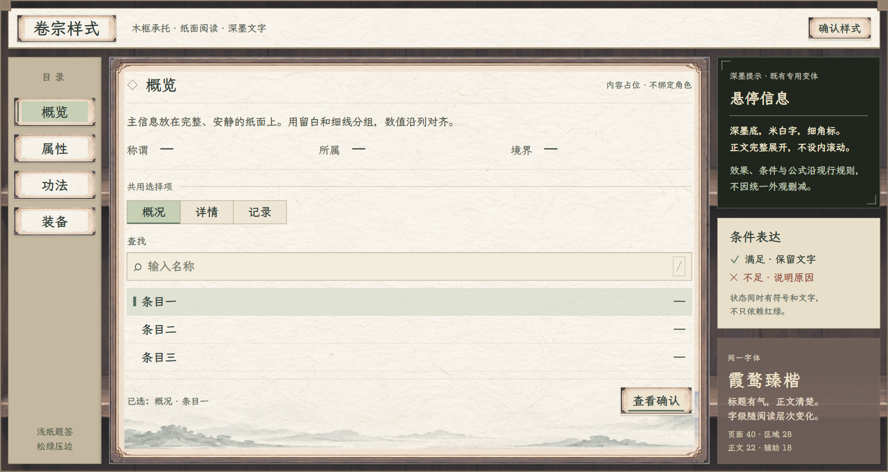

# 全局界面风格母板：纸墨木石

2026-11-08 · 用户已同意按本方向制作[角色与静室首批样稿](../角色与静室纸墨木石样稿_20261108/README.md)，并要求所有控件使用素材。母板保留为全局基准；本轮仍不改正式游戏面板。

[打开可切换母板](index.html) · [正式规范](../../plans/界面与美术/全局界面统一风格规范_20261108.md) · [视觉参数](视觉参数.json) · [素材清单](素材来源.json) · [浏览器验收](验收记录.json)

新页面的返回约定：“返回”右侧带小实心右三角，统一位于右上角。休息与静室样稿共用 [return-control.css](return-control.css)，返回按钮直接属于整页容器；底图继续使用各页同族按钮素材，三角独立绘制。具体边距与字级见正式规范，尚未迁移正式游戏。

母板分为三页：

1. **风格基准**：善功堂、藏经阁当前实机对照，纸／木／石／绢材质与配色。
2. **公共控件**：页框、题签、列表、按钮六种状态、输入与深墨提示；可以实际切换选项和打开确认样式。
3. **面板应用**：人物、静室、行囊、设施入口的材质组合示意与迁移边界。示意不新增玩法，不重定各页布局。

所有插图和纹理直接引用项目现有资源，通过网页区域引用显示；未生成或修改源位图。主要字体为项目 LXGWZhenKaiSlabGB-Regular。

| 来源 | 母板用途 |
| --- | --- |
| `docs/美术规范/行囊交易善功堂实装_20261031/07_善功堂去装备与滑轨_20261107.png` | 已满意的当前实机基准；完整原图展示 |
| `docs/美术规范/玄览峰拓印接入_20261107/封面侧面_1920.png` | 已满意的当前书架实机基准；完整原图展示 |
| `textures/ui/yuxu_library_20261107/library_frame.png` | 木架、石材、纸边的母板区域引用；不将整页框套给其他面板 |
| `textures/ui/forging_20261021/material_panel_v3.png` | 纸面、淡山纹样本；不改既有炼器页 |
| `textures/ui/inventory_material_20261107/garment_inventory_panel_v5.png` | 已认可行囊浅绢样本；不改变占格与物品 |
| `resources/font/LXGWZhenKaiSlabGB-Regular.ttf` | 母板实际文字 |

后续顺序是母板审阅 → 公共素材／组件 → 人物与静室试点 → 按系统逐步适配。当前善功堂、藏经阁、炼丹炼器操作页、行囊容量、卡牌、交易与租用规则均未在本轮修改。

天工峰租用入口 v2 仍保留为待改进历史样稿，不作为本轮统一风格的完成度标准；租用单价等未知项继续待定。

本页的界面文字包含审阅标签与说明，属于风格验收台；这些说明不复制到游戏内玩家界面。母板确认弹窗只演示外观，不进行实际扣费、租用或保存。

## 查看方式

通过项目本地预览服务查看 `index.html`，本轮已使用以下地址核验：

`http://127.0.0.1:8876/docs/美术规范/全局界面风格母板_20261108/index.html`

## 预览与验收

1920×1080、1280×720 两档共 42 项网页检查通过，覆盖分册／应用切换、文字和横向边界、六种按钮状态、输入、确认弹窗、Esc 与焦点归还、键盘页签、减少动画和字体／素材加载。新规范及本页的本地链接另做文件核验。仅代表网页样稿，正式游戏尚未迁移。

| 预览 | 大窗口 | 小窗口 |
| --- | --- | --- |
| 风格基准 | [1920](风格基准_1920.png) | [1280](风格基准_1280.png) |
| 公共控件与六种状态 | [1920](公共控件_1920.png) | [1280](公共控件_1280.png) |
| 人物材质组合 | [1920](人物_材质组合_1920.png) | [1280](人物_材质组合_1280.png) |
| 静室材质组合 | [1920](静室_材质组合_1920.png) | [1280](静室_材质组合_1280.png) |
| 行囊材质组合 | [1920](行囊_材质组合_1920.png) | [1280](行囊_材质组合_1280.png) |
| 设施入口材质组合 | [1920](设施入口_材质组合_1920.png) | [1280](设施入口_材质组合_1280.png) |
| 确认弹窗 | — | [1280](确认样式_1280.png) |

边框通过现有藏经阁无字框架的八个区域拼接，中心留给真实纸面、文字与状态；这里复用的是做工，不是整页截图。图示中的空值与示意线均不进入游戏数据。
