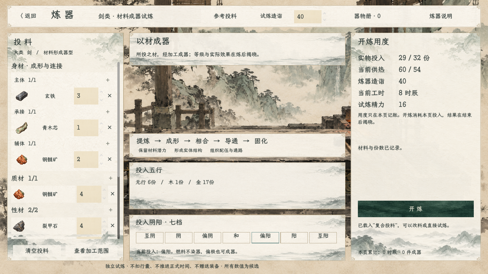
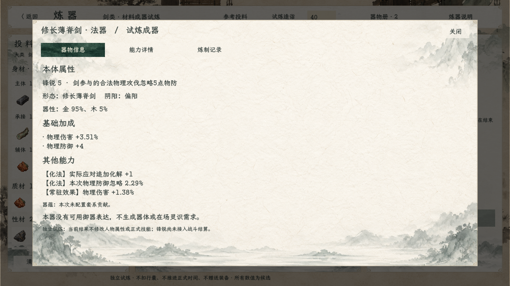

# 凡器法器公式试炼：实机与验收

> v2历史记录。现行已切换[无燃料v3试炼](../无燃料炼器试炼_20261022/README.md)，本页供热和五行百分比截图不代表当前界面。

2026-10-22。现行候选v2，沿用齐边水墨宣纸、玉色按钮及锻造工坊背景。本轮没有另造丹炉背景或替换已批准素材。实施与公式见[主案](../../plans/凡器法器公式试炼实施_20261022.md)。

进入方式：首页“试演与预览→炼器工坊·剑类试炼”，或“百工→法宝→进入炼器工坊·试炼”。点击参考投料，选择中性名称样方；可改造诣、材料和份数，开炼后在器物册重看。本页独立库存，离开清空，不改变人物与存档。

## 画面

其他画面：[选材](02_选材.png)、[凡器](03_凡器.png)、[能力详情](05_能力详情.png)、[炼制记录](06_炼制记录.png)、[失败](07_失败.png)、[多材成器](08_多材成器.png)。材料岗位区域和长详情可滚动，不把所有信息塞进固定高度。

## 验证

本轮编译零警告、零错误；Godot实机驱动通过1152项断言，进程退出码0。4套参考投料得到3次成器（1凡器、2法器）和1次供热失败。

以[运行记录](运行记录.md)和[引擎日志](运行验收.log)记载的本轮结果为准。断言包含真实材料成器、公式守恒、共同预算、分配分散、评阶边界、极端性相、通关实物消费、参数/器物副本、脱离资源复算、库存与重复提交，以及同一场景按钮和详情弹层。截屏后逐张检查主要页面，界面没有提前输出成品等级、锋锐、效力或达标提示。

编译：`dotnet build --no-restore -v quiet`。运行：Godot .NET 4.7.2，兼容渲染，打开 `res://tscn/scene/ProcessForgingScene.tscn` 并传用户参数 `--audit-process-forging`。测试驱动会点击按钮、检查状态、截屏并以退出码报告结果；不等于真人手动游玩或正式战斗回归。

范围：凡器/法器及效果描述生成；未改战斗卡，未用无关战斗27项代替炼器验证。正式属性生效、主动技能费用和目标模板、锋锐结算、器蕴、小档与耐久尚未接入。
