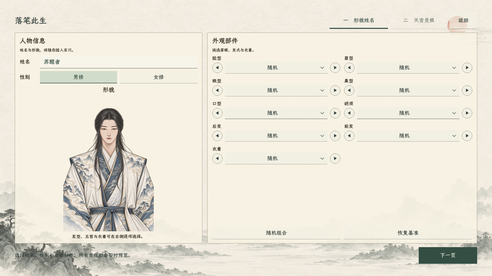
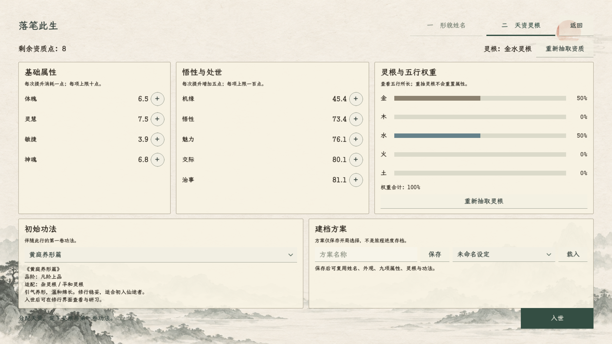
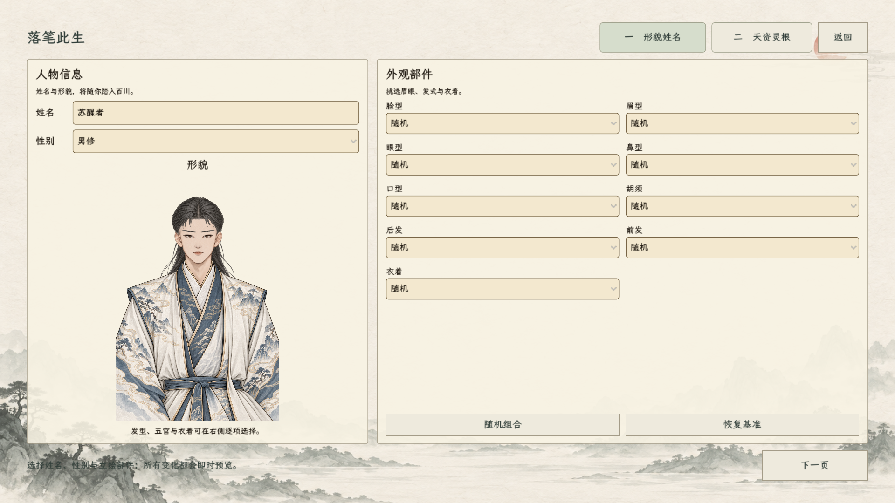
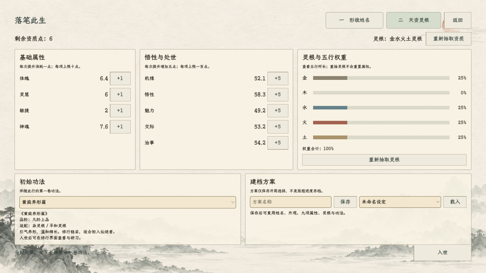

# 创建旅程：形貌、天资与入世加载

2026-10-24 当前增补：创建增加第三页「初始造诣」，九项免费设为 0～10、默认 5；下方两步流程与旧截图仅记录此前版本。见[现行规则](../../plans/创建角色初始造诣设置_20261024.md)。

> 2026-10-15，现行界面实施。规则来源为正式存档设计、人物属性方案与当前无剧情自由修行开局；本次不调整灵根概率、属性点数、属性上限、功法收益及出生地点。

## 控件重做（2026-10-15 用户纠正后的当前版本）

用户明确要求重点重做按钮等控件。当前版由 `StartMenu.CreationControls.cs` 统一实现，上一版通用矩形按钮样式不再作为现行控件方案。

- 主按钮「下一页／入世」：深松墨实底、浅纸文字，悬停轻提墨色、按下加深；保持主入口突出。
- 次按钮「返回／随机／恢复／重抽／保存／载入」：浅纸底配细墨下沿，悬停与按下加深下沿和纸色；禁用时弱化文字与边线。
- 分页：取消大矩形色块，以标题下方墨线标记当前页；键盘焦点有独立可见细框。
- 性别：男修／女修并列互斥按钮，当前项浅绿与墨线标示。
- 外观：左圆框三角、中央款式选择、右圆框三角；左右可循环切换且即时更新立绘，中央仍可展开原有正式选款列表。继承原随机项、部件名与选中数据。
- 属性加点：紧凑圆框加号，悬停提示消耗与实际 +1／+5；沿用原费用、次数和上限，不增加新的加点规则。
- 姓名／方案输入：书写线式控件，聚焦时深墨双线，统一字色、光标与选择底色。
- 下拉与弹层：统一浅纸、深墨箭头、松绿选中底和常规楷体，移除旧黄底金色默认箭头；按钮状态均无泛光。

构建通过，0 警告、0 错误。已生成正式控件画面预览；未执行加点、预设写入或新档入世的功能回归。新箭头是项目内 SVG 控件素材，不使用位图代替文字或原生交互。

## 创建界面

- 两步流程：「形貌姓名」「天资灵根」，右下「下一页／入世」，顶部可返回前一页。
- 统一浅暖宣纸、松绿选中态、1 像素整齐细框和常规楷体，无泛光。新绘山水底图用于创建页，主要内容区留白。
- 形貌页左侧为姓名、性别与大幅即时立绘；右侧为两列部件选款与随机／恢复。继续读取当前有效的男女部件，不把缺失素材列入选择。
- 天资页上方明确剩余点数；中部依次为基础四属性、悟性与处世五属性、五行灵根权重。数值与加点按钮对齐，五行用低饱和灰金／灰绿／灰蓝／赭红／土黄区分，精确百分比常显。全资质重抽与仅灵根重抽仍按原服务分别执行。
- 下方放初始功法和建档方案。删除旧「玄鉴夜里传功」说明，改为入世后在修行界面查看与研习，与当前白石镇自由开局相符。
- 按 1600×900 设计画布等比适配，小窗口保留全部操作；不把控件最小尺寸撑出视口。

## 入世加载

入世的加载视觉遵守[全项目统一加载规范](../../UI视觉规范.md)，复用暗哑水墨底、旧金笔触圆环与常规楷体。本次生成的浅色山水不替换统一加载素材。

点击入世后禁用重复提交，先显示根窗口 CanvasLayer 240 上的加载画面，并等待实际绘制一帧，再创建旅程会话和读取正式主场景。加载层跨场景保留，直到主场景初始化、落地地图显示及初始人物安排结束；不再停留在形貌／资质页面上等待。

| 显示阶段 | 实际工作 |
| --- | --- |
| 正在落笔此生 | 建立新的独立旅程会话 |
| 正在铺展百川山河 | 读取正式主场景 |
| 正在布置行旅界面 | 取得并连接主场景控件 |
| 正在安放百川地貌 | 加载并实例化正式格网地图 |
| 正在整理各地人物 | 绑定世界人物服务与恢复入口 |
| 正在描摹你的形貌与天资 | 从创建模板生成主角 |
| 正在落定入世之处 | 设置当前白石镇自由开局 |
| 正在编排见闻与行囊 | 绑定角色、物品及任务信息 |
| 正在安排各地人物与行旅 | 创建百川初始人口并安排世界行旅 |
| 山河已定，即刻入世 | 主场景就绪、地图落地后淡出 |

以上是本项目原创文案，仅参考生成世界时逐阶段反馈的表达方式，不引用其他游戏原文。进度按实际阶段推进，不是预计剩余秒数；不虚构地形随机生成、城镇重建等未执行工作。较重的单阶段仍为主线程工作，其间文字可能保持不动；本轮实现的是及时切入加载页及阶段间绘制，不声称所有加载计算已改为后台线程。

MainScene 新增启动完成／错误状态，初始化未完时不执行常规每帧更新。初始化异常时不写退出存档；失败发生在切场前则回到原创建页并提示，切场后则显示失败与返回首页入口。普通读档和战斗的统一加载实现继续由其原服务管理。

## 素材与实现

- 内置 ImageGen 生成 [paper_landscape.png](../../../textures/ui/journey_creation_20261015/paper_landscape.png)，[完整提示](../../../textures/ui/journey_creation_20261015/paper_landscape.prompt.txt)同目录保存；未使用 CLI 回退。
- [创建控件](../../../csharp/panel/StartMenu.Creation.cs)、[入世阶段控制](../../../csharp/panel/JourneyCreationLoadingView.cs)、[主场景初始化](../../../csharp/MainScene.cs)。加载显示直接复用 ActionTransitionPanel。

## 检查范围

- .NET 构建通过，0 警告、0 错误。
- 使用项目 Godot 引擎渲染真实创建控件：两页与小窗口完整显示；预览仅使用内存中的创建模板，不点击正式入世、不创建进度存档。
- 加载图是同一正式控件的阶段展示预览，不代表完整创建新存档流程已完成运行回归。完整新档创建／进入／重载仍未在本轮运行。
- Godot 预览退出仍有既有纹理释放／ObjectDB 诊断。素材导入时另有已打开编辑器导致的扩展库与 MCP 端口占用日志，运行预览未因此中断。

