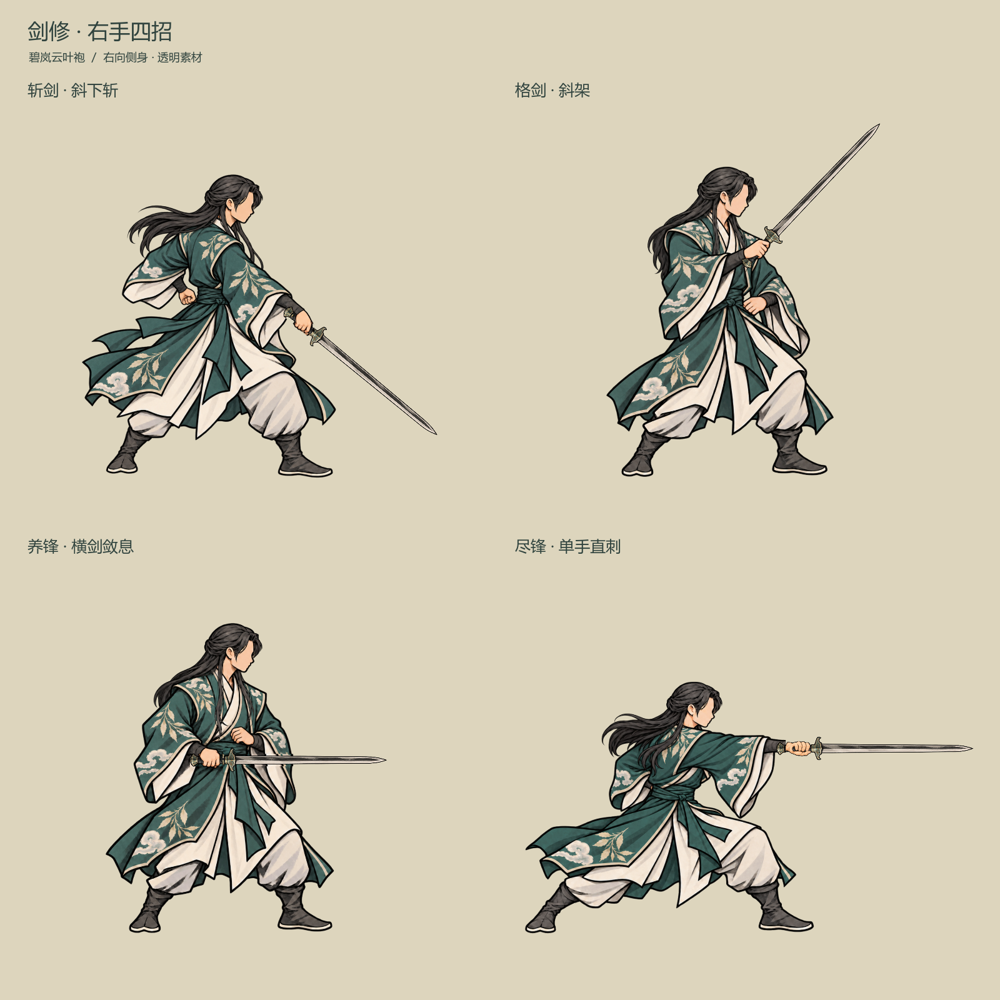
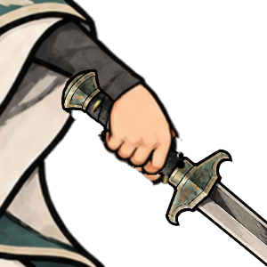
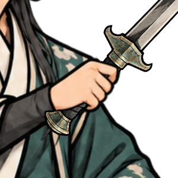
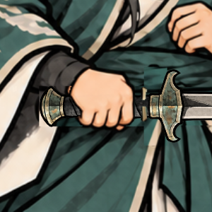
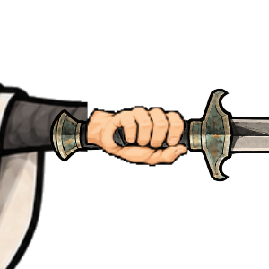

# 剑修四招重新绘制

2026-10-24的动作与拆层素材记录；已于2026-10-25[接入正式战斗](../剑招正式接入_20261025/README.md)。用户决定斩剑暂用原版，新绘`cut_relaxed.png`已撤回运行引用，其他已确认素材保留。**人物以已确认的[男修持剑待机](../持剑与御剑待机_20261023/README.md)为准**：同一半束黑长发、无五官右向侧脸、碧岚云叶袍、身材比例、线条与色阶。

**持剑手最新修正**：用户明确要求全用右手，以此次所附原动作图为准。四招采用v5右手版，尽锋握柄另按下文修正；旧持剑待机改到右手。v6将动作改成远侧持剑的处理撤回。[四招特效与游戏内预览](../剑招序列帧特效_20261024/README.md)保留，正式接入状态见上方2026-10-25记录。

**尽锋单独修正（2026-10-24）**：用户指出旧尽锋的持剑手仍不对。现将近侧右臂从胸前伸出，右手握剑直刺；左臂与空手收在身体后侧。头发、衣装、头部和落脚点沿用原图，其他三招不变。使用同一无剑母版拆出人物底层和前景指节，独立剑图沿水平握点插入，仍为2048²透明角色层。源图`source/finish_right_hand.png`，提示词见[尽锋右手局部编辑记录](finish_right_hand_prompt.txt)。原版本留在`source/finish_before_right_arm_*`。

**尽锋握柄最新修正**：上一轮`finish_grip_closeup_edit.png`／`finish_right_grip_corrected.png`虽然画了环扣，但被用户指出画成左手，已撤回。现以握柄轴为基准，只改手部手性：四指在柄上侧环扣，拇指在靠护手的下侧对扣；袖口、剑和整条近侧右臂不翻转。当前内置编辑源为`source/finish_grip_right_closeup.png`，接回原动作的无剑母版为`source/finish_right_grip_final.png`。身体、衣袖和落脚点沿用原像素；仍保留掌部底层、近侧手指与拇指前景层和独立剑。提示词见[右手手性修正记录](finish_right_chirality_prompt.txt)，局部接回工具为`tools/patch_finish_sword_grip.gd`。

此前未引用待机原图而另起造型的批次已被用户否定，不作为本轮成果；`side_ink_sword_actions_fresh_20261024_v4`仅为废弃过程稿。此前四招有错误手部的设计稿也不作为运行素材。

## 四招

| 动作键 | 姿势 | 空手 |
| --- | --- | --- |
| `cut` | 转肩沉膝，单手斜下斩收势 | 后腰自然松握 |
| `parry` | 重心微收，右手提剑斜架 | 左手在腰腹前自然半握 |
| `nurture` | 原地横剑敛息，右手小幅屈肘 | 左手在胸腹间自然松握，不使用复杂指诀 |
| `finish` | 沉身弓步、近侧右臂从胸前伸出，单手水平直刺 | 左手随远侧手臂收在身后，局部遮挡 |

[深色背景对照](four_actions_dark.png)。已检查浅／深背景上的轮廓与透明边缘。

此前漏指处的局部修正图留档为`parry_hand_corrected.png`；当前握柄图与游戏内预览恢复v5右手动作。

## 素材和实际图层

素材目录：`textures/characters/side_ink_sword_actions_20261024_v5/`。每招都提供两张2048×2048 RGBA角色图，人物原点为(1024,1900)，参考高度1375：

1. `{pose}_body_back.png`：人物、衣袖、手腕及后侧手部。
2. 独立剑：复用现有炼器剑图标，按握点和剑尖轴定位；握点到剑尖为780，四招相同。
3. `{pose}_hand_front.png`：近侧指节、弯曲手指和可见拇指，遮挡应当被手扣住的柄段。

原画都引用同一已确认待机角色。手部前景从对应新姿势的同一源图取样，不混用旧动作的手。两层在不改变人物缩放的情况下共同镜像；图层边界有重叠，防止缩小时出现切缝。单独武器可以越出角色画布，因此`{pose}_assembled.png`是3072×2048完整取景的合成评审图，**不是另一种人物素材规格**。角色两层始终2048²，运行时按角色原点定位。

透明源图、去剑编辑源图保留于素材目录`source/`；斩剑、格剑、养锋仅在武器覆盖的小区域采用去剑修补。尽锋改用独立无剑右臂母版，握点更新为画布约(1366.59,1084.94)、水平0度；其他三招保持原v5素材与握点。导出脚本保留透明边缘并清理脱离人物的残片。

## 评审边界

- 已逐张放大查看空手、握剑手和两层合成；格剑漏指处单独修正。
- 已用Godot实际导出、合成和渲染查看。当前是美术静帧与拆层样片，仍待用户评审；没有新增自动化测试。
- 素材现已接入正式表现路由；不改战斗卡牌、费用、资源、目标、伤害、化解、剑意或存档。四招的结算继续按[现行技能定义](../../plans/公共技能节点网与首批节点实施.md)。
- 使用内置图像生成与编辑工具；[提示词及来源记录](generation_prompts.json)。运行图层布局见素材目录`layer_layout.json`。
