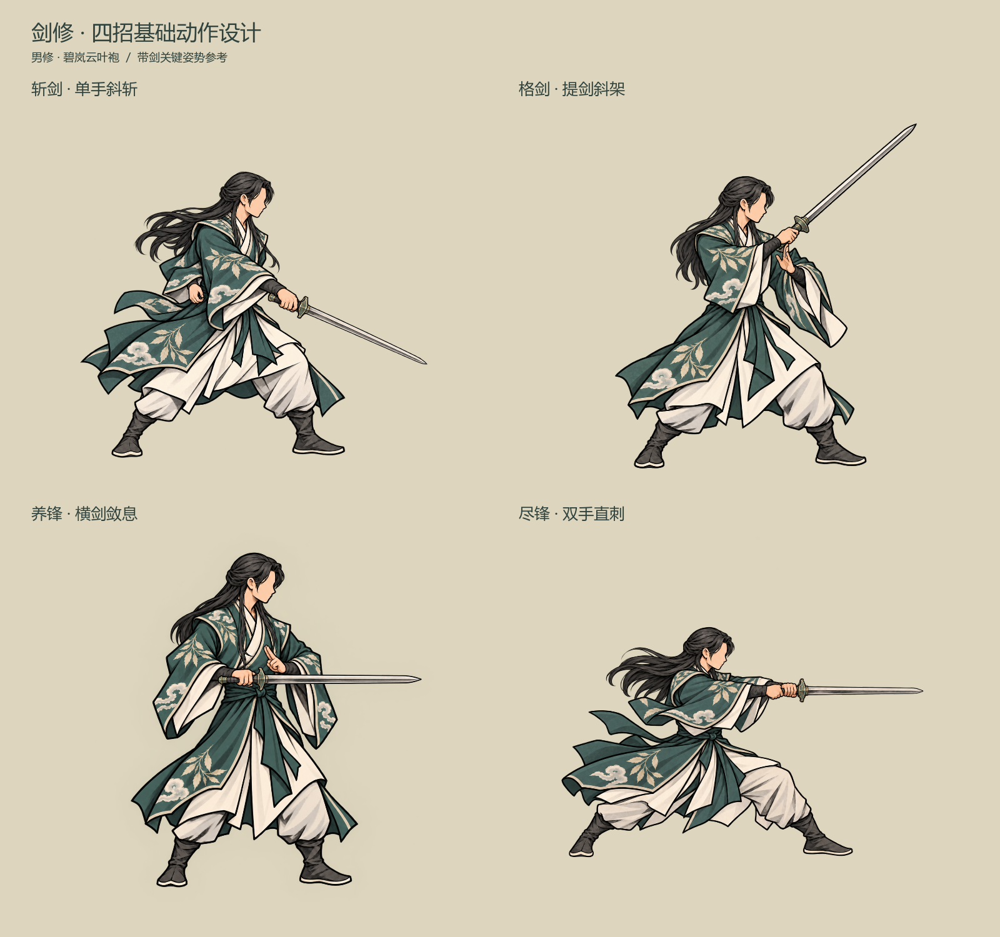

# 剑修基础动作设计

> 本稿的旧手部与动作图不再采用。当前评审转至[沿用原人物重新绘制的四招与拆层](../剑修动作重新生成_20261024/README.md)，尽锋改为单手直刺；本页仅留档。

2026-10-24，动作姿势设计稿。以[现行四招定义](../../plans/战斗与构筑/公共技能节点网与首批节点实施.md)和[当前持剑／御剑待机](../持剑与御剑待机_20261023/README.md)为依据。本轮先设计男修碧岚云叶袍的持剑四招，使用带剑完整关键姿势检查解剖与握法；设计图尚未拆成可换剑的运行素材，尚未替换正式战斗。

## 四招动作

| 技能 | 动作关键姿势 | 衔接与发力 | 效果配合 |
| --- | --- | --- | --- |
| 斩剑 | 单手斜斩，结束时剑锋指向前下方；剑臂略屈，另一手收在腰侧 | 从低位持剑待机短促提锋，转肩带腕斜斩；不拉成长蓄势，命中短停后收回 | 一道窄而清楚的淡青灰剑痕，沿真实剑锋落向斜下；命中小范围亮点与碎墨，不做大爆炸 |
| 格剑 | 侧身提剑斜架，握点在胸前，剑尖斜向敌人上方；剑身在脸外侧 | 对实际来袭抬剑，重心略后坐；交锋时短停，随后回持剑待机 | 同步攻方轨迹与格剑姿势、局部取景；不另叠一轮受击动作或旧防御墨效 |
| 养锋 | 横剑敛息，剑身保持水平，另一手小剑诀停在剑根上方 | 留在原站位，肩臂轻收，幅度小；指诀不接触刃口，结束回原待机 | 贴近剑根的一点淡青气息沿刃轻收，透明序列帧收散，不用大法阵、光柱或全身爆光 |
| 尽锋 | 双手合握、沉身直刺，剑从胸前水平指向敌人；前手近护手，后手紧邻其后 | 重心比斩剑更低，以肩背向前送剑，双腕不交叉；接触短停后拔剑收势 | 一道窄长、有白芯的青灰直锋，强化一次贯入与局部取景，不演成多次攻击或远程飞剑 |

本轮四招都从**手持剑待机**衔接。御剑待机维持剑尖水平朝敌、人物后方层级与慢浮动；四招设计不自动改变其玩法，也不把近身技能改为远程。

## 握手与拆层

先以完整带剑图验证：前手拇指／食指靠护手，小指靠剑首；剑柄从掌心前穿过，被近侧弯曲手指与拇指扣住。不得画成先握空拳、再把剑贴到拳头上。

后续运行素材依当前确认拆为：

1. 人物底层，包含掌心、手背、远侧手指和衣袖。
2. 独立可换剑图，使用真实握点、剑尖轴和固定剑长。
3. 近侧弯曲手指与拇指前景层，只遮住其应遮挡的柄段；双手招式分别标定两只手。

正式素材保持2048×2048透明画布、地面原点(1024,1900)和参考人物高度1375。统一剑长和人物缩放，手、剑、人物围绕同一原点镜像。动作伸展不通过拉长剑刃或手臂表现；近身接近与回位沿用原战斗时序。

## 与战斗规则的边界

- 斩剑仍为体力1／法力0、相邻一敌的单次近身物理伤害。
- 养锋仍为体力1／法力0、自身获得1层剑意。
- 格剑仍只在实际物理攻击应对触发时支付体力1／法力0、获得原公式化解和1层剑意。
- 尽锋仍为体力2／法力1、相邻一敌的近身物理伤害，命中后才消耗全部剑意，未命中保留。
- 不新增伤害段、费用、状态、武器规则、位移判定或存档字段。演出方向与墨痕只服务现有结算。

## 设计图与生成记录

[斩剑](cut.png) · [格剑](parry.png) · [养锋](nurture.png) · [尽锋](finish.png)

使用内置图像生成工具，风格和握法参考当前带剑待机原图。四张带剑关键姿势见本目录`cut.png`、`parry.png`、`nurture.png`、`finish.png`，完整提示词见`generation_prompts.json`。本目录为新设计，先前被否定的2026-10-23四招草稿仍为历史留档。
