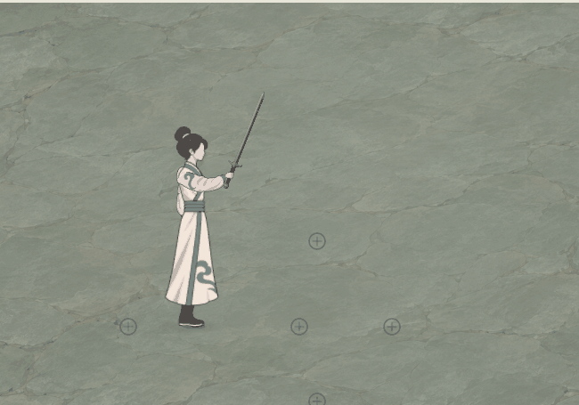

# 剑式水墨质感修订

后续当前动势见[剑式动势与水墨尾迹](../剑式动势与水墨尾迹_20261105/README.md)。用户认为本轮圆润候选仍显僵硬，随后要求同时学习本机鬼谷和龙胤；当前已修订接触速度、前锋与尾迹分龄，并将真实前压交给现有腿部和衣摆。本页图像与数据保留为圆润轮廓阶段的实际记录，不作为最新动态。

2026-11-05，用户先指出现有剑斩像气丝，要求更有质感、更水墨，并允许观察本机《龙胤立志传》素材；随后指出候选扭曲，明确要求圆润。本轮当前表现以平滑月牙和连片墨腹为准，仅修订[持剑四段主案](../../plans/战斗与构筑/持剑普攻剑式四段与特效试作_20261105.md)的剑痕；原人物、剑路、握柄、伤害、判定几何、前压、动作与CD保持。

## 本机参考依据

本机来源为`D:/SteamLibrary/steamapps/common/LongYinLiZhiZhuan/LongYinLiZhiZhuan_Data/resources.assets`。只读追踪实际对象、材质与纹理引用：

- `墨圆斩`（对象7297）通过`Effect_34_Slash`使用`Slash_6`（纹理752），为10×10序列图集。原始帧可见厚月弧、较实的亮墨腹部、不连续深色边、头尾浓淡差，以及后段拆开的细余痕。
- `墨斩`（6078）和`墨劈`（7260）的主层使用`Smoke_1`（1415）；部分子层另有短碎粒及`Smoke_2`余烟。该原始纹理具有强明暗和体积变化，不能只据灰阶图集断言最终游戏合成配色。
- `Sword Slash 7`将主斩、次斩和碎光分层，主材质引用`Trail66`和`Noise43b`。图集和材质能说明素材组成；本轮未运行参考游戏，不把原图当作其实际窗口效果。

借鉴宽主笔、浓淡分层、成片飞白和后段断裂。游戏使用自己的程序笔刷与材质，未将参考游戏纹理、图集或预制对象引入运行素材。研究记录在[引用链](../../../output/longyin_sword_vfx_research_20261105/reference_map.json)与[原图格抽样](../../../output/longyin_sword_vfx_research_20261105/frame_samples.json)；参考图仅存本机研究目录，不作为本项目素材发布。

## 表现调整

原两道窄、浅的弧痕改为同一剑路上的淡墨铺底和圆润实笔。扇面剑痕由两圆相交形成月牙，内外两条轮廓均为平滑圆弧，保留厚腹与收尖；移除径向摆动、不对称鼓包和独立外侧黑细线。浓墨、淡墨及成片飞白留在主笔内部，后段按原时钟断裂消散，没有加色发光或独立霓虹线。

同时修复弯曲墨纹的拉扯：整片凹月牙的自动三角化会跨长对角线，导致中腹出现纹理捏折。当前按相邻内外弧截面显式连接短三角带，UV沿同一圆弧顺序铺开；反向回斩也不折返。直刺仍为窄梭形，删除微小左右摆动，并在显锋初期按真实胶囊端帽限制横宽，避免短笔刚出现时越出近端。

斜斩仍短，回斩反向且更舒展，直刺保持窄梭形和明确尖端，横扫为更厚的月弧。笔触加厚向原扇面内侧进行，最远端、角度与直刺宽20的胶囊保持；不把整片扇面填成实心色块。显锋时间与0.30／0.34／0.26／0.44秒总寿命沿原规则，不增加旅行或持续伤害时钟。

使用独立[剑墨材质](../../../tools/action_battle_test/sword_brush_ink.gdshader)与[剑痕层](../../../tools/action_battle_test/sword_combo_vfx.gd)。其他普攻和血气的共享材质默认表现保持。所有笔刷噪声由固定独立种子生成，计时只读本段视觉年龄；暂停、清场和释放后世界锚定沿原接口。

## 规则验收边界

1. **效果、费用与目标**：剑式仍须持剑，0体力、0法力、不占灵识，近身四段按原伤害、扇面／胶囊和高度逐目标结算。
2. **属性、资源与范围**：不新增属性、资源、关键词、射程、位移或状态；第二／三段前压6／14单位，原体魄、神魂及剑道成长保持。
3. **0费与联动**：保留连段互斥、一次缓存、结束后CD及中断规则，无返费、额外行动、抽牌或资源生成；余墨不追加判伤或触发秘籍。
4. **数据与展示**：规则数据、技能身份、词典玩家正文和图谱不改，仅同步表现记录。独立四段演练仍为预览，不冒称世界持剑战斗已接入，也不把几何采样标记写成NPC实际伤害。
5. **验证**：当前圆润版119项专项通过，覆盖八方向四段、160个显锋／消散时刻案例、28,800个实际顶点，越出原范围的顶点为0；同时覆盖原寿命、展开、暂停、世界锚定、只读、清理、16条上限及随机隔离。原四段203项回归通过。相邻三角索引与反向UV配对已只读复核；连续采集提供实际材质编译和绘制验证。

[圆润版专项119项](../../../output/sword_brush_round_geometry_20261105.log) · [原四段203项](../../../output/sword_brush_combo_regression_v2_20261105.log) · [专项工具](../../../tools/action_battle_test/smoke_sword_brush.gd)

## 当前实机

[四段原尺寸对照](stages_grid.png) · [真实范围对照](stages_geometry_grid.png) · [完整窗口动画](combo_full.gif) · [直接打开剑式演练](../../../tools/run_sword_combo_preview.cmd)

最终圆润版实际窗口采集248项、0失败，日志无脚本、材质或引擎错误。所有原图1280×720，连续录制102帧／30帧每秒／3.4秒，包含完整四段、收势及CD；近景为同一区域原尺寸650×455裁切，全景等比缩至960×540。四段峰值另取单段真实施放，不指定虚假命中。图像只裁切、排版与编码，未补画或增强。

连续记录检查当前两层直刺的6204个顶点，越界违规为0；最大浮点残差约0.0000153单位，低于原判定0.0001单位容差。两圆月牙及新三角带为本轮最终画面；之前厚墨但有中腹捏折的候选记录仅保留在旧output目录，不作为本页当前素材。

本演练只有真实范围采样标记，不模拟NPC生命或承伤。原伤害与规则由119项专项和203项回归共同约束；没有把独立演练声称为正式世界战斗接入。

[最终录制日志](../../../output/sword_ink_round_final_20261105.log) · [实际时刻、范围与几何采样](capture_manifest.json) · [编码尺寸与时长](encoding_manifest.json) · [原生捕获](../../../tools/action_battle_test/capture_sword_combo.gd) · [帧排版工具](../../../tools/encode_sword_combo_preview.py)
