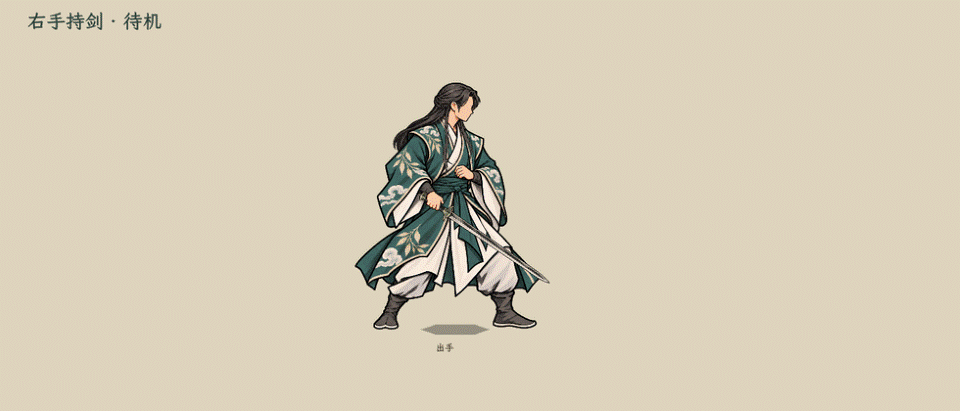
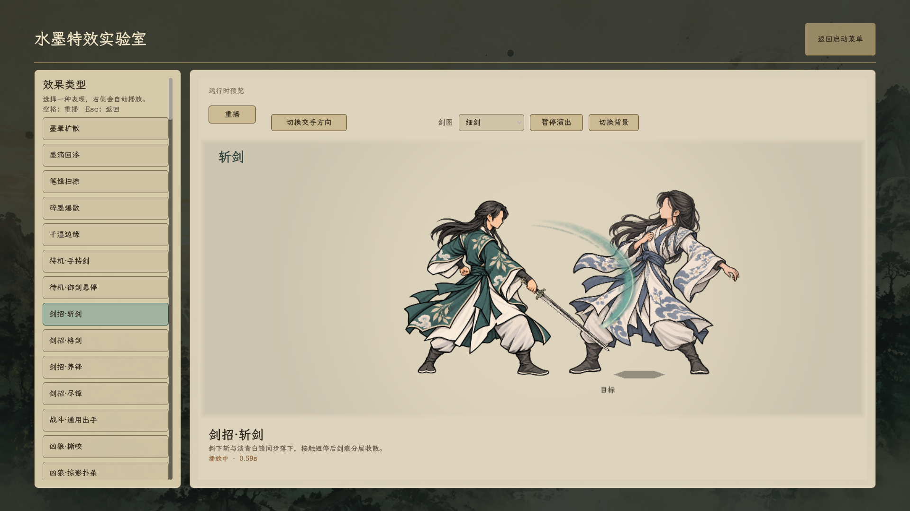
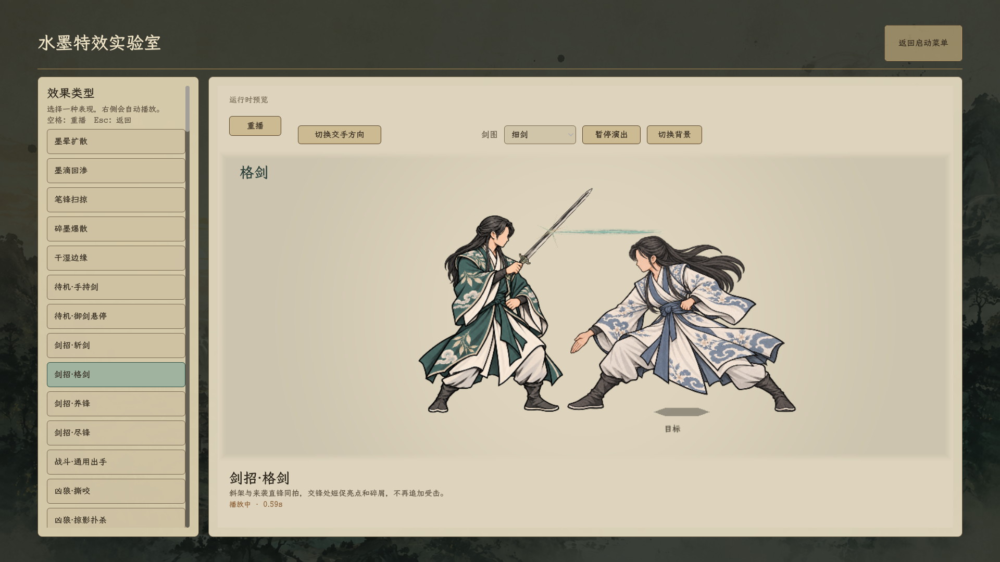
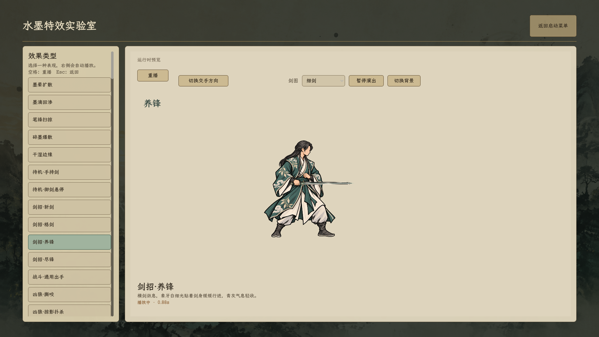
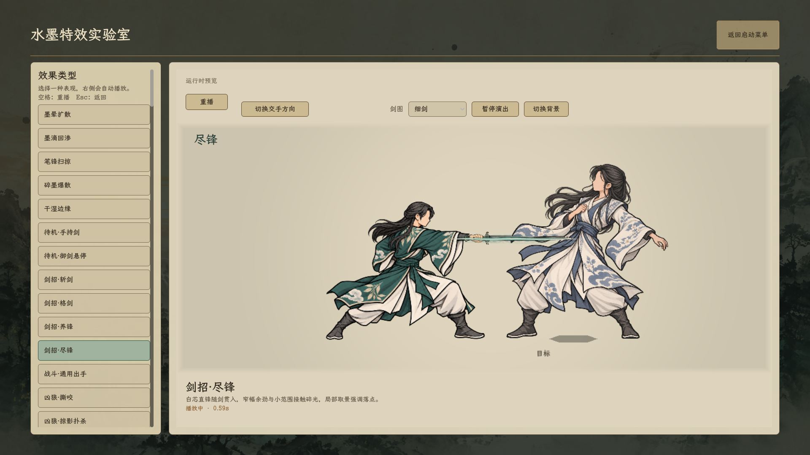

# 剑招序列帧特效

**2026-10-25更新：已接入正式战斗，见[正式运行与验证](../剑招正式接入_20261025/README.md)。斩剑按用户要求使用原版，新绘候选暂不采用。下方保留素材预览过程记录。**

2026-10-24，男修四招的表现样片，接入原游戏内**水墨特效实验室**。人物沿用已确认的半束黑长发、碧岚云叶袍和水墨画法。**用户最新裁定：全用右手；四招恢复原右手动作，只把旧持剑待机改到右手。**此前迁就旧待机而改格剑／养锋持剑手的v6撤回，当前四招恢复`textures/characters/side_ink_sword_actions_20261024_v5/`。

## 查看

启动菜单 → 水墨特效实验室 → **剑招·斩剑／格剑／养锋／尽锋**。

可重播、切换方向、暂停／继续、切换三种剑图及浅深背景。手掌与近侧手指分层，剑位于两者之间；人物回到原来的持剑待机，换剑同时应用于动作和待机。

最新录像先展示右手持剑待机，再依次播放恢复后的原右手四招。右手待机已清除旧剑残影，使用两张2048²真透明角色层；浅深背景与镜像均已实际渲染，编译0警告、0错误。录制结束先释放演出节点后正常退出。

尽锋在本轮另修持剑手：近侧右臂从胸前伸出，左手收在身后；两个角色图层与水平剑握点同步更新。直刺序列帧跟随新握点注册，其他三招与特效帧保持原样。

尽锋握柄手性修正：撤回上一轮画成左手的局部，只改手部结构，四指从柄上侧环扣、拇指在靠护手的下侧对扣。袖口、剑和整条近侧右臂不翻转，仍由独立剑夹在角色前后两层之间。角色两层保持2048² RGBA；当前录像、细剑实机、阔剑镜像和脊剑截图均更新。[局部合成细节](../剑修动作重新生成_20261024/finish_layered_grip.png)及[内置图像编辑记录](../剑修动作重新生成_20261024/finish_right_chirality_prompt.txt)可查看。

| 招式 | 序列帧 | 轮廓与节奏 |
| --- | --- | --- |
| 斩剑 | 24帧 | 淡青灰剑痕随斜下斩落下，象牙白窄锋勾边；接触短停，余痕断开、漂移收散 |
| 格剑 | 18帧 | 来袭直锋和斜架同拍，接触为小范围尖锐碎光、克制的暖赭亮点；不再叠一轮受击 |
| 养锋 | 36帧 | 横剑敛息，一点细光沿剑身走过，贴剑的青灰细气和少量微屑渐收，无大阵、光柱或全身爆光 |
| 尽锋 | 24帧 | 单手直刺与窄长白芯直锋同步，首尾收尖；接触短停后余劲自然断散 |
| 共用接触 | 18帧 | 小范围切点与不对称碎光，不做末端大爆炸 |

共120张768×768 RGBA PNG、30fps。原帧在`textures/vfx/sword_action_sequences_20261024_v1/frames/`，运行时使用同目录图集和帧索引。图集按每页4列、最多16帧排列；清单见`manifest.json`。

## 层级与演出

- 特效采用普通Alpha混合，在人物上层；淡青、象牙白为主体，少量暖赭交锋点，不使用叠加泛光铺满人物。
- 特效的生成、拖尾、分段出生、弧线漂移与消散都烘焙在序列帧内；运行时按同一演出时钟选帧。
- 斩剑／尽锋在接触的有效亮点帧停顿；格剑来袭轨迹与接触同步冻结，人物和特效暂停时一并冻结。
- 局部放大复用战场取景，放大范围包含人物与特效；人物素材显示比例固定。
- 养锋不使用攻击式镜头冲击。预览缺少动作拆层时保留原衣装持剑待机，缺少特效图集时跳过该层；正式战斗回退未改。

[深色背景](cut_dark.png) · [左向阔剑](finish_mirrored_broad.png)。

## 素材与边界

- 特效由Godot原生着色器绘制并烘焙为PNG，源文件`textures/vfx/sword_action_sequences_20261024_v1/bake.gdshader`，烘焙工具`tools/bake_sword_action_sequences.gd`。运行展示不依赖着色器实时生成。
- 右手待机修正使用内置图像编辑，记录位于`textures/characters/side_ink_sword_idle_right_20261024_v3/`。前后手从同一对应姿势取样，不混用另一招的手；v6左手统一提示词仅留作错误过程记录。
- 已完成编译和实际Godot渲染查看，留有四招运行录像与镜像、深色截图；未新增自动化测试。
- 原预览仍只作美术演示；2026-10-25另将四招接入正式战斗的真实执行链。不改卡牌、伤害、费用、目标、资源、剑意、化解或存档，正式状态与截图见上方接入记录。
