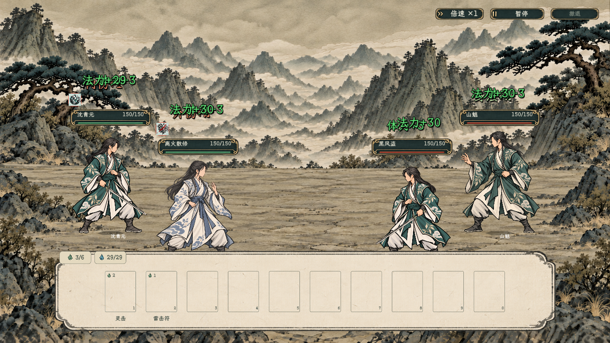
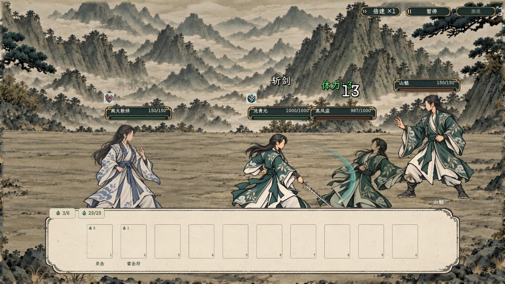
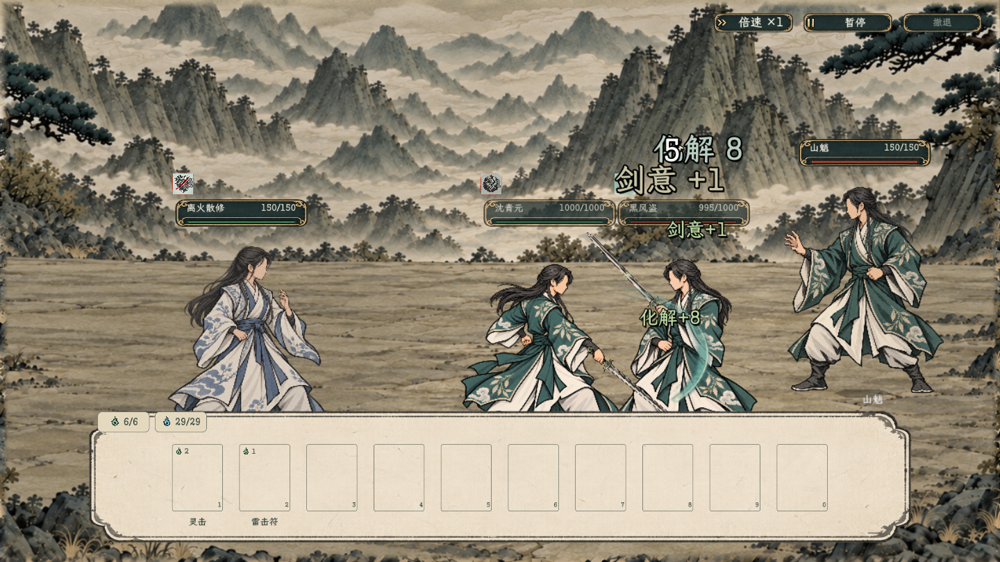
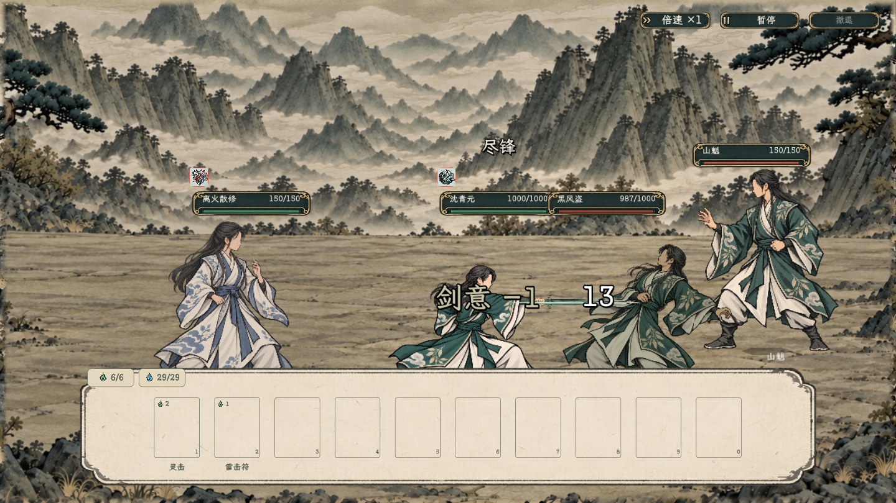

# 剑招动作与序列帧正式接入

2026-10-25，当前运行记录。用户决定斩剑暂用原版，先把已确认的表现接入正式战斗。

同日后续已[补齐男女持剑受击与女修剑招](../持剑受击与女修剑招_20261025/README.md)，正式战斗与原实验室均使用新素材。下文“仅男修”的描述保留为本次首次接入的历史范围，当前覆盖以补齐记录为准。

## 当前素材

- 斩剑已恢复修改前的v5人物底层、前景手部、握点和剑角度。新绘`source/cut_relaxed.png`暂不采用，已从运行布局覆盖中撤回，仅保留过程稿。
- 格剑、养锋保留原版；尽锋保留最后修正的右手环扣握柄。当前角色包为`textures/characters/side_ink_sword_actions_20261024_v5/`。
- 持剑待机使用`side_ink_sword_idle_right_20261024_v3`；人物两层均2048²透明PNG，共用地面原点(1024,1900)、参考高度1375。剑图独立夹在身体／后侧手与近侧手指之间，统一镜像。
- 细剑、阔剑、脊剑按实际装备的炼成剑快照形态选择；普通制式剑及没有装备快照的基础剑式使用细剑表现占位，不添加装备或改变技能可用条件。

## 正式战斗表现

| 招式 | 人物与特效 | 接入时点 |
| --- | --- | --- |
| 斩剑 | 原版右手斜下斩、淡青／象牙白剑痕和小范围接触序列 | 原有接近结束后出手，原有命中时点接触，随后退回 |
| 尽锋 | 修正后的近侧右臂直刺、窄长白芯剑气和接触序列 | 同一正式近身攻击流程 |
| 格剑 | 右手斜架；攻方轨迹继续保留，交锋点播放一次格剑序列 | 原有自动应对插入；接触时出光，不另叠受击／应对爆光 |
| 养锋 | 横剑敛息、贴剑细光和少量收散气息 | 原有自身增益流程，原地施展 |

使用既有`BattlePaperDoll`与`BattleInkCombatVfx`，不把实验室的演示执行器搬进正式战斗。攻击特效挂入既有演出组，沿用暂停、应对时间停止、局部取景、接近、命中和回位；出手者移除后清理其攻击序列。常驻持剑待机不阻塞下一项行动。

动作与特效专用拆层当前覆盖已确认的男修默认衣装。女修和缺少对应图的角色继续保留自身原有外观与表现，不替换成男修素材。御剑悬停的独立预览保留，本轮没有增加御器机制或改变器体生命周期。

## 规则边界

未修改四招资源文件、伤害公式、目标、费用、剑意上限／生成／消耗、格剑的物理攻击触发条件、射程、逻辑格、武器要求或存档字段。所有资源与结算继续按[首批技能节点实施](../../plans/战斗与构筑/公共技能节点网与首批节点实施.md)及[炼成剑通用适配](../../plans/百工技艺/炼器/炼成剑通用装备与战斗适配_20261024.md)。本轮只替换表现路由；序列帧用延迟与命中停顿对齐既有接触时点。

## 验证

- 项目编译：0警告、0错误。
- `SwordBattlePresentationSmoke`：32项通过。使用真实`SkillExecutor`与自动应对，包括四招姿势和PNG序列、暂停恢复、准确回位、持剑待机恢复、格剑只扣一次体力并获得剑意、养锋增剑意、尽锋命中消耗剑意、三种实际装备快照选图、女性／缺图回退及出手者移除后的清理。
- 既有`BattleAttackStagingSmoke`回归通过：近战／远程、左右方向、应对插入、局部放大不改单人缩放、暂停、护持无重复受击、闪避、狼与人物互攻、接近途中目标移除。
- 截图来自隔离对练中的真实执行链；测试将相关角色显示高度统一为300便于观察，不代表调整正式战斗默认显示尺寸。未写角色存档。
- 三种外形用合法成器快照的隔离形态样本核验映射，不代表本轮实际炼制了三把正式成品，也没有写入行囊。
- 联调时清理`HumanData`中重复的旧`float pill_toxicity`声明，保留当前丹毒系统使用的`double`声明；未改丹毒规则或参数。
- 最终刷新资源时，Godot误扫描本地工具依赖`node_modules`中的PDF字体并崩溃；为该本地依赖目录添加`.gdignore`后，导入完成，再次编译与专项运行均通过。该标记不改变游戏素材或Node工具行为。
- 隔离冷启动还曾偶发Godot托管对象句柄（`GCHandle`）初始化／回收错误；同一构建复跑后，32项专项检查与既有演出回归均通过。该启动问题原因尚未定位，列为待观察问题，不能据复跑通过认定已经消除。

[精简验证输出](verification.txt)

## 实现入口

- `csharp/battle/BattleSwordArt.cs`：角色布局、序列帧图集与装备外形读取。
- `csharp/battle/BattlePaperDoll.SwordActions.cs`、`BattlePaperDoll.SwordIdle.cs`：人物前后层、剑与待机／动作切换。
- `csharp/battle/BattleInkCombatVfx.Sword.cs`：正式出手、接触、格剑与养锋路由。
- `csharp/debug/SwordBattlePresentationSmoke.cs`、`tools/SwordBattlePresentationSmoke.tscn`：隔离执行与截图。

原[素材与拆层记录](../剑修动作重新生成_20261024/README.md)、[实验室序列帧与连播](../剑招序列帧特效_20261024/README.md)继续保留。
