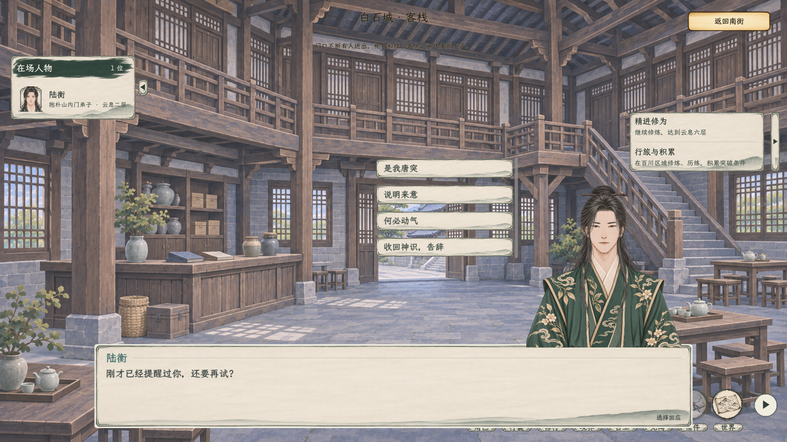
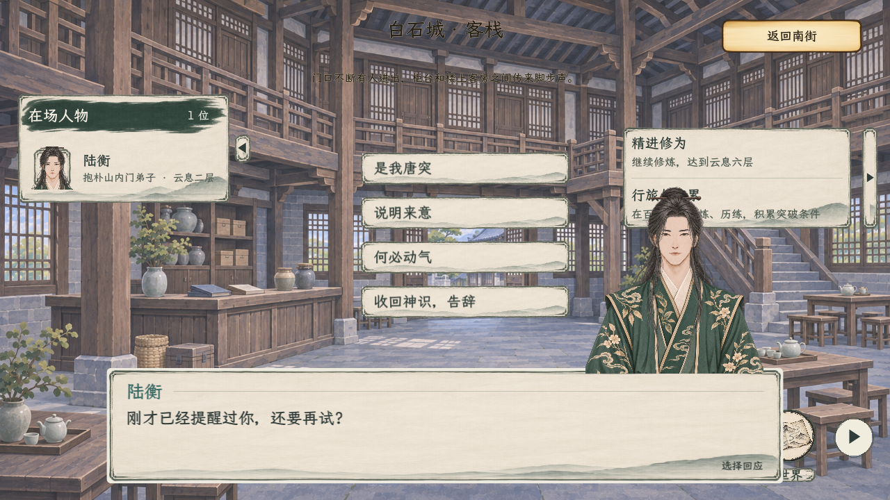
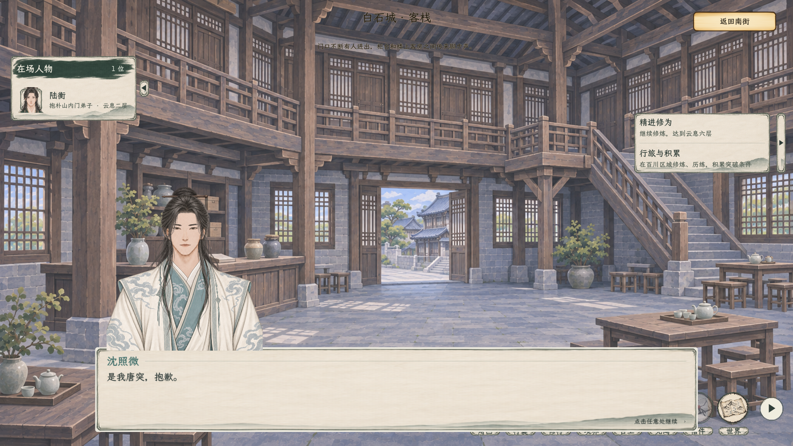

# 剧情对话排版与悬浮选项

2026-11-06，原布局记录。2026-11-07 用户将选项改为对话栏右上方，底边随对话栏动态贴合，不再随立绘避让；[当前实机与说明](../对话选项贴合对话栏_20261107/README.md)。本页图片保留调整前状态。对应[当前主案](../../plans/界面与美术/剧情对话排版与悬浮选项_20261106.md)与[UI规范](../../plans/界面与美术/UI视觉规范.md)。[打开全部实机画面](实机预览.html)。

后续术语已按用户纠正统一为“灵识”；下方图片记录此前排版验收，图中的旧称不再代表当前文案。

底部使用水平居中的有限宽度纸卡，两侧与底部留出背景；姓名、正文和继续提示分层，纸面加实。立绘按照纸卡宽高缩放，底沿贴住卡片上缘。左侧名单实际延伸到对话区域时对称收窄纸卡，不再将整框推向右边。

原回应位置为画面中间偏右并避开名单和当前立绘，此位置已被上述最新修订覆盖。短选项不重复弹出同文悬停框；长选项被截断时才显示浅纸深墨的完整提示。人物小页、台词顺序、取消、费用和判定继续沿用原流程。

## 验证

| 分组 | 本轮结果 |
| --- | --- |
| C#编译 | 0警告、0错误 |
| 原生窗口 | 149项通过，14张截图；覆盖2560×1440、1920×1080、1280×720 |
| 探查完整流程 | 108项通过 |
| 白石序章与同行常规回归 | 73项通过 |

原生窗口检查纸卡水平居中、四边留空、立绘与纸卡比例、名单及选项避让、竖排选择、实际鼠标点选和点击正文继续；同时保留读档后回应、禁斗与野外反击、正式战场往返、实际领取和探查快照检查。各组有重叠，不将数量相加视作互不重复用例。图形检查使用隔离人物数据及存档，由正式主场景原生渲染，不是绘制的概念稿，也不覆盖玩家正式存档。

逐组日志和截图尺寸见[验收记录](排版验收.json)。首轮图形检查曾在战斗技能资源读取时出现GCHandle异常，后续完整原生复跑均通过；本次未修改技能资源或引擎，不据复跑通过宣称该资源生命周期问题已经根除。另一次序章截图模式在行旅断言处中止，常规模式73项通过；不将该次截图模式记为完整通过。既有UID回退等提示保留在日志。
