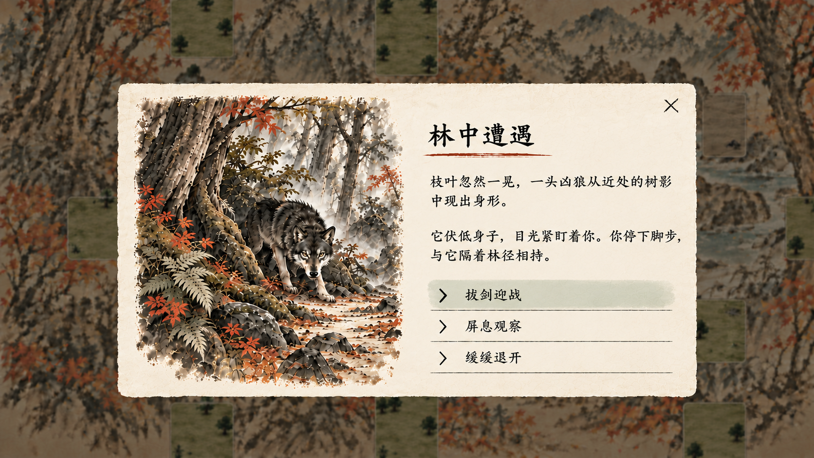
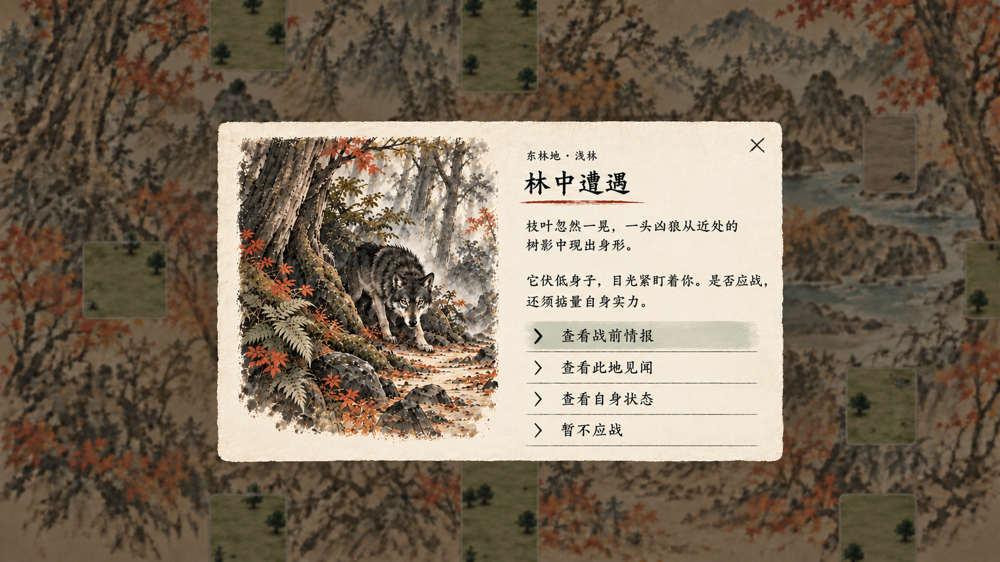
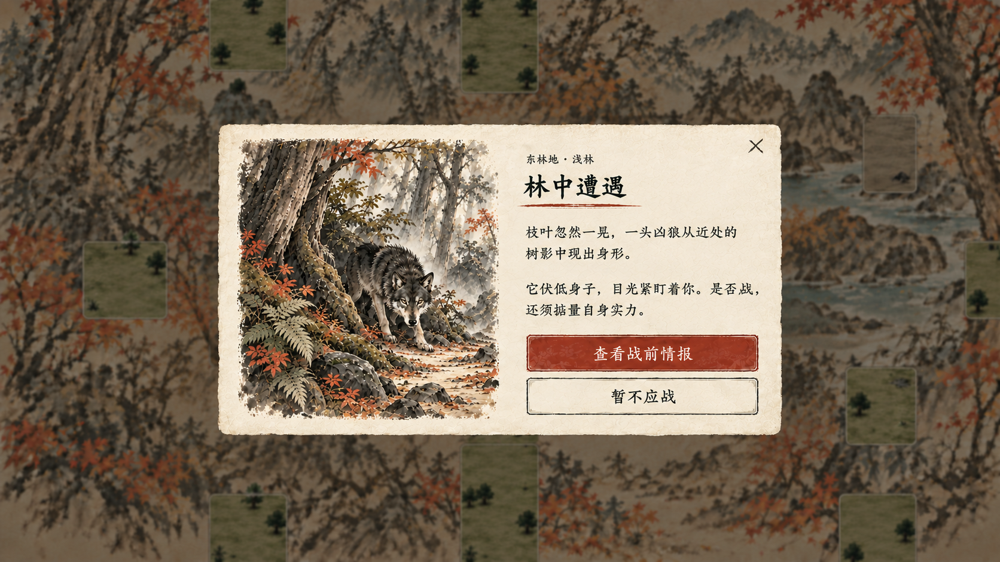
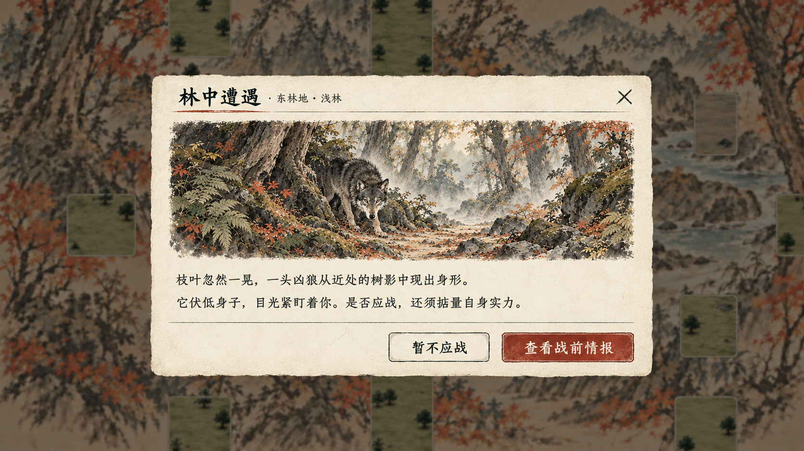
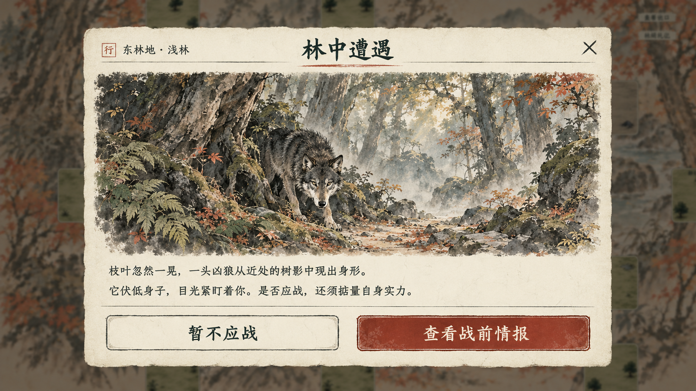

# 副本事件插画弹窗理想图

2026-10-27：用户已授权实装首个完整遇狼事件。后续以[实装界面与验证](../林中遇狼实装_20261027/README.md)及其主案为准，下方各版为视觉设计过程留档，不再代表运行时尚无插画窗口。

后续用户要求部分应对需要判定、能进入连续事件页，最新确认“相关属性计算概率，不设硬性属性门槛”。见[判定与后续窗口框架](../../plans/世界与探索/副本事件条件判定与后续窗口_20261026.md)及[林中遇狼完整事件](../../plans/世界与探索/林中遇狼首个完整事件设计_20261026.md)；完整稿另拟驱赶分支，以下第五版仍是此前三选项静态视觉稿，尚未包含完整判定与连续页面。

2026-10-26，状态：视觉提案，待用户审图，尚未修改游戏界面。用户要求事件以更大的独立窗口弹出并配图，先生成理想图。

## 第五版：情境应对选择，当前待审

用户最新要求：选项应体现对事件的应对，“查看战前情报”移到选择战斗之后；取消地点小标题以节省空间，并评估稍大窗口。本轮生成第五版视觉稿，同时提出以下交互分类，未修改运行界面或实际事件规则。

### 应对选项的四类模板（候选）

| 类型 | 表达玩家意图 | 例子与使用条件 |
| --- | --- | --- |
| 直接处理 | 采取事件的主要行动 | 遇敌迎战、遇人交涉、发现材料后采集；使用该事件已有的真实执行流程 |
| 谨慎试探 | 先获得能帮助决定的现场信息 | 观察动作、辨认痕迹、询问来意；必须有新的、与现场一致的有效内容，按事件状态更新后续叙述或选项 |
| 另寻办法 | 使用现场明确支持的其他处理方式 | 沿已知通路绕行、使用已定义的专用行动；必须有真实路径或专题规则支持，不能作为所有事件的万能跳过 |
| 放弃离开 | 停止处理本次事件 | 缓缓退开、收手离开；当前地图按关闭现场旁白、留在实际格位处理，后续移动仍由玩家沿真实通路进行 |

分类用于策划配置，不在玩家界面显示四个抽象类别。每个事件选择适合自身的2～4项；额外分支必须带来实际区别。现有角色页、见闻和地图入口各自保留，不占事件应对选项。

### 本例：遇狼先提供三项

1. **拔剑迎战**：拟点击后进入原战前情报，再确认开始战斗；原战前取消仍有效。本页将“拔剑迎战”作为意向选择，未借此取消战前确认。
2. **屏息观察**：候选叙事分支，补充眼前能看见的狼的姿态与动静，再保留迎战／退开的选择。若事件没有额外可用信息，则删去观察项。观察耗时与费用尚待实施前收敛，本轮不据此新增免费侦察、潜行、先手或属性判定。
3. **缓缓退开**：拟结束当前现场窗口，返回原位置地图，由玩家选择后续道路；不等于正式战斗内撤退，不清除狼、不发物品、不传送出副本。

### 排版调整

取消“东林地 · 浅林”地点行，从事件标题直接开始。窗口较第四版加宽并适度增高，新增宽度优先用于右侧文字；保留左图右文、淡墨选项列表和浅色焦点。三个选项仍用紧凑行高，后续多项继续采用独立限高列表，不随条目数无限放大窗口。

通过内置 imagegen 编辑第四版，完整提示词：[prompt_v5.txt](prompt_v5.txt)。已目视检查标题、两段旁白与三条应对选择、地点行移除及画面完整性。生成图不作为控件精确尺寸依据，实际排版及滚动仍待运行界面实现验证。

## 第四版：紧凑选项列表（留档）

用户指出第三版按钮偏大，要求考虑多选项适配。本次沿用左图右文，以4个示例选项呈现紧凑列表，去掉大面积朱色按钮与粗重方框；淡墨分隔、左对齐，当前悬停项用浅色底与箭头强调。

“查看此地见闻”“查看自身状态”仅作多选项排版示例，未新增正式事件规则或修改当前事件操作。未来控件建议选项区独立限高，选项增多时只在该区域滚动，长选项换行增高，插画与标题保持位置；本图仅展示4项，不能视为6项、长文本或真实滚动已经通过验收。

内置 imagegen 基于第三版编辑，完整提示词：[prompt_v4.txt](prompt_v4.txt)。已目视检查4项均可见、文字完整、图文分栏与浅色焦点；具体控件尺寸由后续运行界面落实。本轮只生成理想图，未修改游戏。

## 第三版：左右图文分栏（留档）

用户建议一侧放图、另一侧放文字，并要求参考类似游戏学习排版。本轮检索了相关游戏的事件界面，参考以下功能安排；画面仍为本项目原创水墨插画，不复制参考游戏美术。

- [《Roadwarden》开发日志：Improving The Basics](https://www.indiedb.com/news/improving-the-basics-roadwarden-devlog)：场景与叙述／选择分别占据独立区域，长文与选择保留连续阅读方向。
- [《十字军之王3》事件窗口截图研究](https://playcraft.space/gallery/e/crusader-kings-iii-event-window-lives-or-gold/)：叙述、场景与选择放在同一事件窗口。该例的文字在左、场景在右，本项目按用户建议调整为左图右文；未将CK3描述为固定左图右文。

本项目的取舍：左右并列，左侧完整近方形／偏竖的现场插画，右侧依次为地点、标题、两段旁白和纵向选项。选项紧随文字，只在右栏，不跨到插画下方。窗口高度收紧，四周保留地图背景；标题也缩小，避免再次形成大幅海报。

通过内置 imagegen 基于第二版编辑，先生成分栏稿，再定向缩小窗口与标题。已目视检查中文字、狼与场景完整性、文字换行及按钮位置。完整两轮提示词：[prompt_v3.txt](prompt_v3.txt)。生成图的实际图文比例接近对半，后续控件实现可精确调到图略窄、文略宽；不把提示词中的目标比例当成实测结果。仍为视觉提案，未改运行界面。

## 第二版：缩小窗口并重新平衡排版（留档）

用户反馈第一版窗口与插画偏大，要求重新设计排版。本版现作历史留档，仍未替换运行界面。

窗口收为屏宽约六成、屏高约三分之二，四周保留更多地图。标题与地点在同一条紧凑页眉中左对齐，插画改为较矮的横幅；下方分开两段旁白，操作按钮缩成正常尺寸并靠右成组。延续原画风、事件含义和两项行动，不新增玩法规则。

通过内置 imagegen 编辑第一版生成，已目视检查文字、边缘留白与图文比例；完整提示词：[prompt_v2.txt](prompt_v2.txt)。

## 第一版留档

本版：居中大窗口，上方事件标题与地点，中部大幅场景插画，下方两句旁白与两个较大的行动按钮。沿用宣纸、墨线、低饱和水墨及少量朱色；底层地图压暗并虚化。以“林中遇狼”为样例，之后可复用框架配采集／调查插画。

“暂不应战”沿用关闭现场旁白的含义；“查看战前情报”仍只请求现有战前页。图中不添加费用、奖励或新战斗规则。画中狼与场景为概念插画，不自动替换已确认的怪物立绘或战斗素材。

制作方式：内置 imagegen，以当前实际截图为编辑参考。参考图为 `../东林地疏路分区_20261026/02_抵达遇狼_1080.png`。完整提示词：[prompt.txt](prompt.txt)。

已目视检查：大幅插画、事件标题、两行旁白与两枚按钮完整；中文文案可读。此图为生成的整体视觉稿，不作为已经完成的可交互窗口，也不把整张效果图直接当作运行UI。
