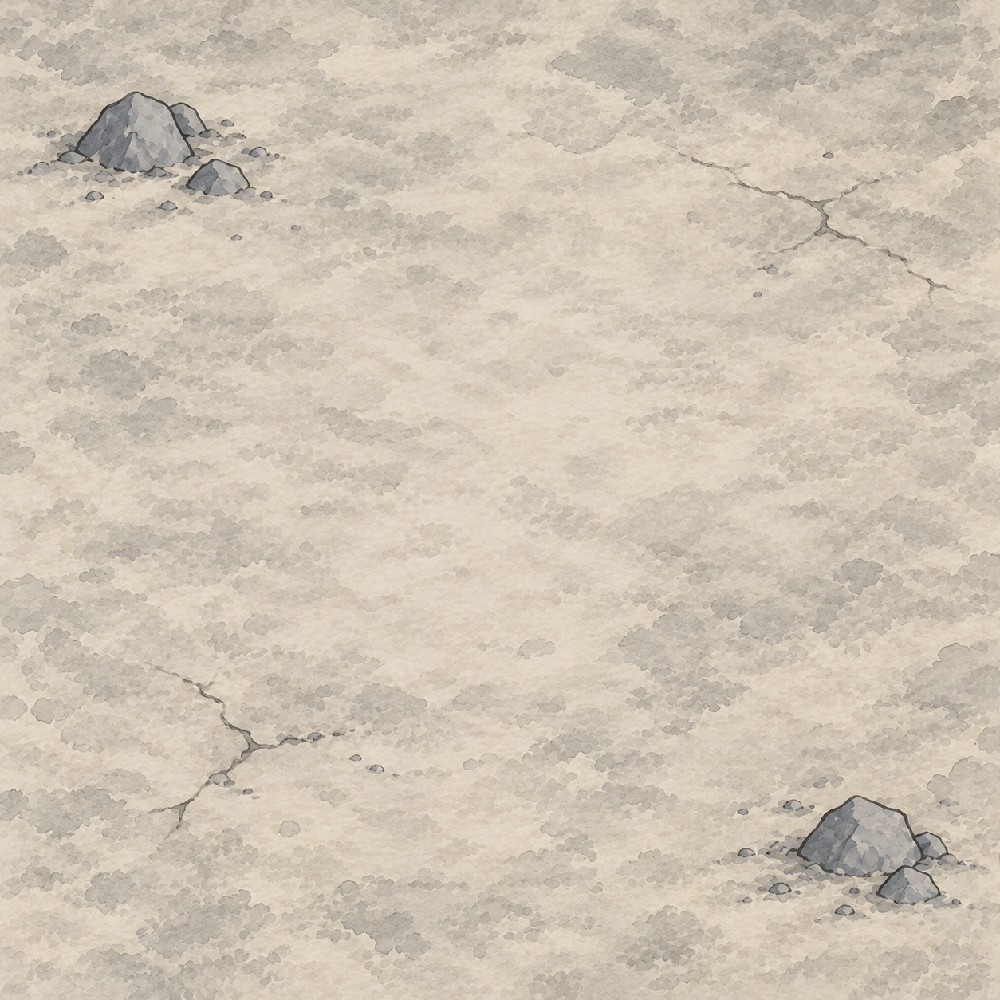
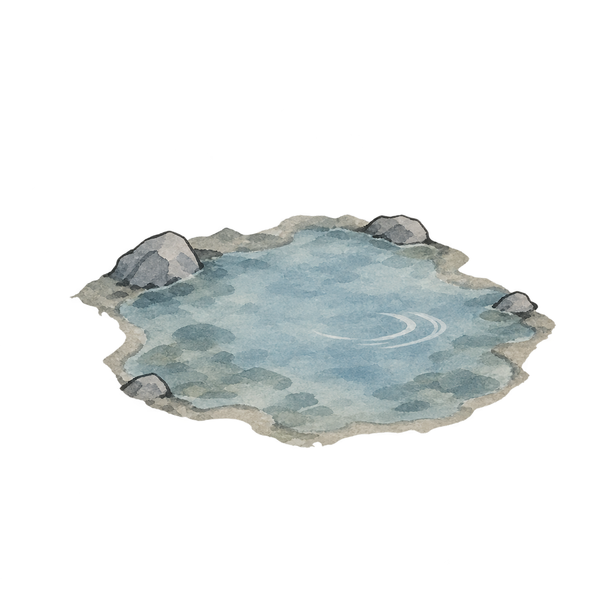

# 副本扩展地形素材 v1

> 2026-10-11 后续实施：七张素材已接入共用地形库及东林地种子外围。游戏内圆角、两款选图、泉眼缩小叠层已运行检查，见[实机截图](实机验收/种子布局与泉眼.png)和[存档／算法／验收记录](../../plans/副本种子地图与扩展地形实施.md)。下文“尚未接入”是生成时阶段记录；新增素材不等于动态机遇调度或新资源池已实施。

状态：2026-10-11 用户授权先生成新地形并保持风格一致。使用 imagegen 技能和内置生图工具，以现有简约地形图集 v2 为参考，生成六张地面及一张泉眼透明叠层。素材已保存、逐张目视检查；尚未接入运行地图，视觉待用户验收。生成素材不表示机遇刷新数值、动态副本或新采集池已经实施。

权威：[副本生态与动态机遇方案](../../plans/副本生态来源刷新与多层地图提案.md)，既有风格：[东林地简约地形库](../东林地节点地图_20261011/README.md)。本轮优先生成素材，覆盖原计划中“先确认时间参数再生图”的顺序，不自动确认时间参数。

## 文件与复用

保存目录：`textures/dungeon/terrain_ink_20261011/expansion_v1/`。七张均为1254×1254 PNG；逐项读取尺寸与像素格式，六张地面为RGB，泉眼为RGBA，角落透明度0、中心252，确认不是绘制棋盘格的伪透明。

| 文件 | 内容 | 类型 |
| --- | --- | --- |
| `bamboo_a_v1.png` | 竹林 A | RGB满幅地面 |
| `bamboo_b_v1.png` | 竹林 B | RGB满幅地面 |
| `wetland_a_v1.png` | 湿地 A | RGB满幅地面 |
| `wetland_b_v1.png` | 湿地 B | RGB满幅地面 |
| `cave_floor_a_v1.png` | 洞窟地面 A | RGB满幅地面 |
| `cave_floor_b_v1.png` | 洞窟地面 B | RGB满幅地面 |
| `spring_overlay_v1.png` | 泉眼特征 | 透明叠层，不替代纯水地形 |

满幅地面不预烘焙圆角白边，后续沿用现有统一圆角材质。中央保留多棋子站位空间，边缘疏置景物。泉眼按特征图叠加于合适地面；运行时可缩小，不把整张透明画布当成水域地块。竹林仍归森林表现，洞窟只提供地面，不等于开放新洞穴层。水域继续全水，不在纯水格里加岸线。A/B为独立生成构图，不是旋转或翻转同图。

参考图仅作风格、尺度和配色参考：`textures/dungeon/terrain_ink_20261011/terrain_variants_v2.png`。旧素材不覆盖、不修改；生成原件另保留于工具返回的默认保存位置。当前地图仍引用原图集。

## 目视检查与边界

七张分别检查：无文字、UI、棋子、地台侧面或风景远景；暖宣纸底、淡灰绿及蓝灰水墨、远景斜俯视、中央留空。竹林用稀疏小丛，湿地用浅水洼与少量芦草，洞窟地面用低矮石块及稀疏裂纹，泉眼无发光魔法装饰。实际缩至90–170像素地格、叠棋子与圆角的游戏画面尚未验收；本轮只做图片生成、落盘和静态检查，未运行玩法或编译测试。

## 最终生成提示词

模式：内置image_gen，未使用CLI/API回退；每张独立调用。六张地面均传入上述v2图集作为reference image，transparent_background=false。以下公共提示加各自Subject构成实际完整提示。

### 地面公共提示

Use case: stylized-concept. Asset type: ONE individual square reusable terrain ground tile for Chinese ink-wash cultivation RPG 天光有渡. Input image 1 is STYLE AND SCALE reference ONLY: it is a 4x4 atlas, but output MUST be ONE single tile, not an atlas, not a grid. Match one cell of reference: pale warm rice-paper ground, subtle sage-grey ink wash, simple hand-painted ink outlines and soft matte watercolor, tiny sparse terrain features, most ground open. Distant elevated oblique view about 55 degrees looking down, not vertical satellite, not eye-level landscape. Camera orthographic, no horizon, no sky, no mountains background, no diorama pedestal or vertical tile sides. Full-bleed square ground fills all image edges; no border, labels, lettering, frames, icons, characters, chess pieces, glowing effects, strong shadows, clutter or photorealism. Keep central 55% largely open to place many game pawns. Sparse objects no bigger than roughly 15-20% tile width, viewed far away; preserve reference uniform feature scale and muted contrast. Round corners will be applied by engine, DO NOT paint rounded white margins or border. 

### bamboo_a_v1

Bamboo grove variant A: three small airy clumps of slender bamboo along upper left, upper right and lower left margins. Short pale green segmented stalks, a few muted grey-green brush leaves, warm very pale olive ground. No dense forest wall.

### bamboo_b_v1

Bamboo grove variant B: three small airy clumps of slender bamboo along upper left, right middle and bottom left margins, different placement from A. Short pale green segmented stalks and a few muted grey-green brush leaves, warm very pale olive ground. No dense forest wall.

### wetland_a_v1

Wetland variant A: pale grey sage damp ground, two small irregular very shallow pale blue-grey puddles near top left and bottom right, two tiny sparse reed tufts. Mostly open continuous ground, no shoreline landscape, no deep pond, no mud speckle clutter.

### wetland_b_v1

Wetland variant B: pale grey sage damp ground, two small irregular very shallow pale blue-grey puddles near top right and lower left, two tiny sparse reed tufts differently positioned. Mostly open continuous ground, no shoreline landscape, no deep pond, no mud speckle clutter.

### cave_floor_a_v1

Cave floor variant A: lightly cool grey-beige stone floor ink wash, two tiny low dark grey rock clusters at top left and bottom right margins, two or three soft sparse cracks. Central open plain pale grey-beige floor. NOT a cave entrance, NO tunnel view, NO enclosing cliff walls, NO stalactites covering centre, NO dramatic cave lighting. Same bright muted value and tiny object scale as reference rock cells.

### cave_floor_b_v1

Cave floor variant B: lightly cool grey-beige stone floor ink wash, two tiny low dark grey rock clusters at top right and bottom left margins with differently shaped rocks, two or three soft sparse cracks. Central open plain pale grey-beige floor. NOT a cave entrance, NO tunnel view, NO enclosing cliff walls, NO stalactites covering centre, NO dramatic cave lighting. Same bright muted value and tiny object scale as reference rock cells.

### spring_overlay_v1

transparent_background=true，参考图同上。

Use case: stylized-concept. Asset type: transparent place-feature OVERLAY for a reusable Chinese ink-wash terrain game tile. Reference image is style reference ONLY: match the muted pale sage/blue-grey and warm rice paper, thin soft hand-painted ink outlines, matte ink wash, distant elevated oblique about 55 degrees. Generate ONE small natural spring eye: irregular shallow pale blue-grey water, just three or four tiny low grey stones around part of its perimeter, one understated ripple. Absolutely no glow, magic symbols, vegetation, characters, text, UI, frame, sky or scenic background. Transparent background outside the water and small rocks, genuine alpha, no white paper rectangle, no checkerboard painted in image. The water should be softly colored but visible, not fully transparent. Square canvas, spring feature fills central 60% width with transparent margin; very flat against the ground, not a floating island, no vertical sides. Simple sparse brush shapes, no elaborate pebble ring or photorealistic reflections. Must sit atop an existing grass/rock ground tile without carrying its own backdrop.

## 预览

竹林A：

湿地A：

洞窟地面A：

泉眼透明叠层：

