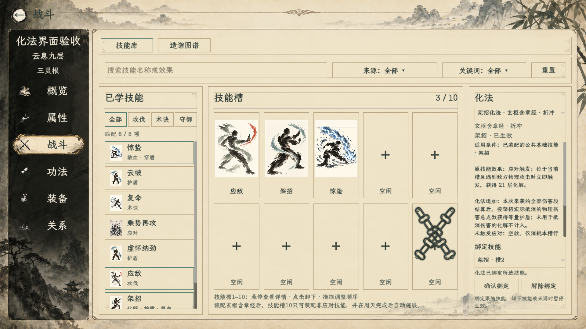

# 角色技能页：化法选择

沿用角色页现有纸墨底纹、字体和边框。化法与技能库同屏：左侧已学技能、中间十个术法槽、右侧化法来源清单。短按来源查看适用范围与化法追加；范围直接列技能名，或列出实际受支持的关键词范围，不写绑定资格或装配状态解释。长按拖向高亮的合法术法槽即绑定；其他槽变暗，已绑定来源前显示勾，受化法技能显示来源标记。目标技能自身的信息栏仍显示完整效果。顶部保留技能库、造诣图谱两个标签，不新增化法子页面。

规则见[化法来源汇总与技能绑定](../../plans/战斗与构筑/化法来源汇总与技能绑定_20261024.md)。自动化场景使用临时人物与内存器物检查真实控件，不操作正式旅程。

