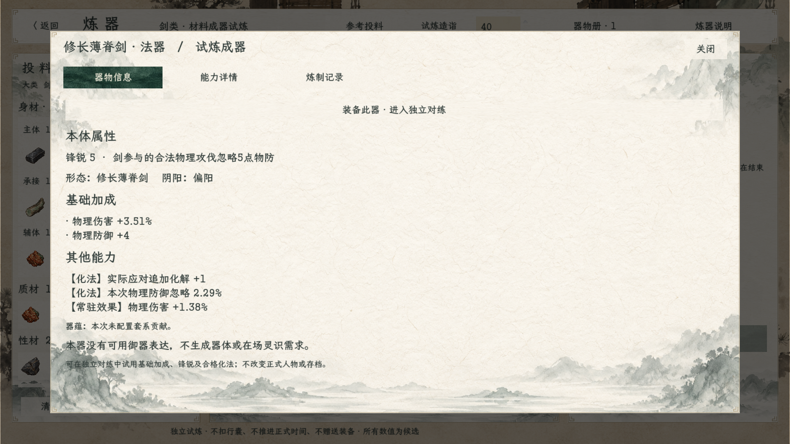
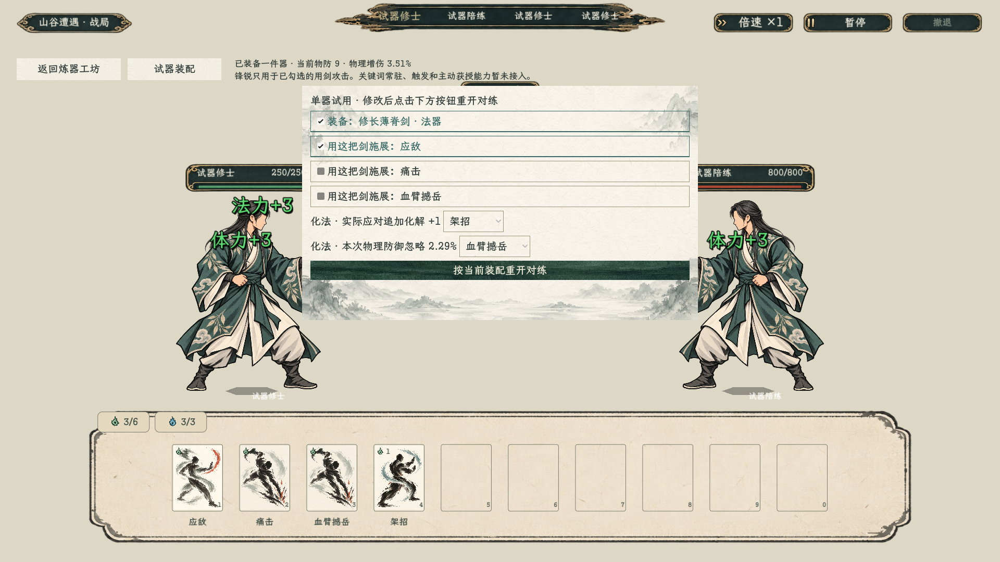
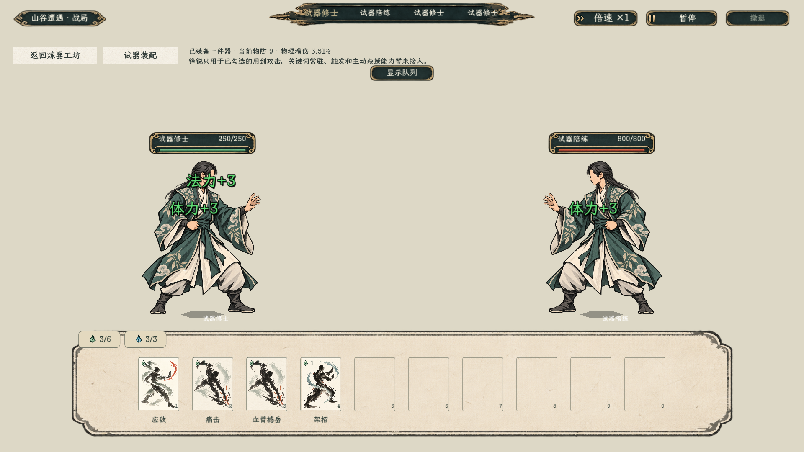

# 单器装备、锋锐与化法试用

> 最新范围：用户澄清器物槽尚未设计，正常工坊的装备/对练入口已撤下，下方入口说明与截图为此前开发记录。当前交付改为[物品图标与信息展示](../炼器物品展示_20261022/README.md)；对练仅保留独立开发测试场景。

2026-10-22。规则与范围见[实施主案](../../plans/单器装备收益与锋锐试炼实施_20261022.md)。

## 进入方式

首页试演或百工法宝页进入原炼器工坊，投料成器，在器物信息页点击“装备此器·进入独立对练”。展开“试器装配”，勾选用剑攻击、选择合格化法绑定，再重开对练。可卸下后重开作比较，返回工坊继续使用本页库存。

## 测试与标定

最终编译零警告、零错误。新单器42项、原炼器1459项，以及下列回归均通过，进程退出码0。新检查包含实际空放/应对、装卸重开、胜负隔离回传、成品按钮进入试器及返回工坊不重复扣料；本轮没有真人完整游玩验收。

- [装备验收记录](装备验收.md)、[引擎日志](装备验收.log)：以最终运行生成的结果为准。
- [90组原始材料试算](数值标定.md)：合法65组，最大H约26.830；没有修改v3系数或用测试样本强定法器四小档。
- [原法器状态底座](runtime.log)：27项通过。
- [回合冷却检查](cooldown.log)：19项通过。
- [防御结算整合](defense.log)：20项通过。
- [旧双剑整合](old-artifact.log)：68项通过；[独立进程存档读回](旧法器重启读回.log)：3项通过，测试文件已由读回检查清理。
- [原炼器回归](炼器回归.log)：1459项通过。

旧检查最初暴露了过期测试前提，现已对齐当前系统：防御脚本按真实队列上下文和行动完成信号等待，保留原化解/减伤/护盾数值断言；旧双剑脚本用当前开放的玄枢架招验证秘籍与器物化法共存，并校验迁移链最终到当前存档版本12。未恢复下架秘籍，未修改旧双剑效果或正式战斗规则来迁就断言。

引擎日志仍记录已有资源UID回退，以及渲染进程退出时纹理/字体与ObjectDB释放告警；没有将“断言通过”描述为“零运行告警”。重开时的C#句柄崩溃已通过显式副本构建和资源保活修复，最终重开、装卸及返回检查通过。退出释放告警仍需在后续生命周期清理中处理。

编译命令：`dotnet build --no-restore -v quiet`。Godot .NET 4.7.2运行 `res://tools/ForgedEquipmentSmoke.tscn`，含真实界面信号与截图；不等于真人完整战斗操作验收。新试器只支持基础物防/物伤、锋锐及合格化法，关键词常驻、触发、主动/御器等仍待接入。
