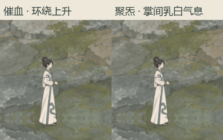
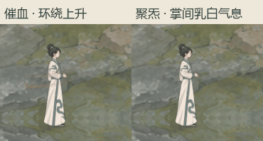
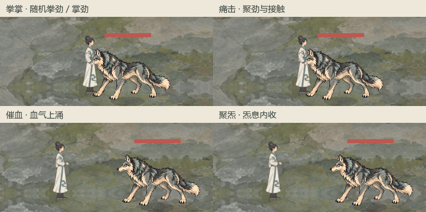

# 即时战斗四技能特效

2026-11-05当前材质已由[攻击、架招与血浪的水墨统一](../战斗特效水墨统一_20261105/README.md)补充。下方跟随、运功、中断及完成规则继续沿用；旧截图保留阶段记录，最新攻击和架招配色、破边及消散请看新同场对照。

## 当前跟随约束

两种自身特效从运功到收尾全程跟随人物／实时手骨，移动与左右转身不会留在旧世界坐标。97项回归、12种实际渲染姿态及44项像素范围检查通过；效果和旧位置逐像素对照，无旧位置残影，资源、运功及冷却不变。

[原回归](../../../output/quiet_self_follow_regression_20261104.log)、[渲染采集](../../../output/quiet_self_follow_capture_20261104.log)、[跟随范围及无旧位置残留检查](../../../output/quiet_self_follow_pixels_20261104.log)。实现为程序三角带与软雾材质，非序列帧或Godot粒子节点；拳掌／痛击使用另一套序列帧表现。

## 当前候选：可追踪环绕、上升收尾与流入聚炁

催血改为一股主血气与一股弱尾，前端绕身体上行，完成后有单独0.64秒向上消散段。聚炁在手边沿曲线流入乳白气息，掌间烟雾渐聚后收束，不扩展到全身。规则边界与五项验收见[当前方案](../../plans/即时战斗四技能特效重制_20261104.md)。

使用实际战斗绘制、姿态和技能路径，在1280×720原生视口连续渲染；采集时省略HUD图标以降低内存占用，两格为原尺寸局部裁切，未增强特效。各60帧，包含1秒运功、完成、收尾与空白停顿；另检查左右挂点。原始图片在 `output/quiet_self_refine_v3_20261104/`。

[97项规则／视觉隔离检查](../../../output/quiet_self_v3_smoke_20261104.log)、[120帧及左右挂点渲染日志](../../../output/quiet_self_v3_capture_20261104.log)。只改表现，无新增属性、资源、关键词、射程、位移或额外收益，词典与玩法数值一致。

以下保留上一版记录，其三段长弧与0.48秒催血余韵不作为当前表现。

## 当前：催血环绕与掌间聚炁

按用户最新反馈重做：催血从下往上旋绕，前后两层分别经过人物背后和身前；聚炁只在手部聚集乳白气息，随实际手骨位置及左右朝向移动。完成和淡出仍按原时序，资源与属性冷却保持。

两格均为实际1280×720窗口原尺寸局部，包含1秒运功、完成与0.48秒消散。原始98帧及左右两张核验截图位于 `output/quiet_self_wrap_20261104/`。

[96项规则及视觉隔离回归](../../../output/quiet_self_wrap_smoke_20261104.log)、[实际窗口及渲染日志](../../../output/quiet_self_wrap_capture_20261104.log)。费用、目标、效果不变，无新增规则元素；零费与资源生成限制保持；词典与技能说明仍按当前六招规则。

[四技能实际窗口回归](../../../output/quiet_self_wrap_four_regression_20261104.log)：136帧无脚本、材质或绘制错误，包含真实接触、运功中断及两种朝向。

## 首版记录

2026-11-04，已接入共享侧向即时战斗及当前角色演练，待用户评价。规则、接入边界与逐项验收见[当前表现方案](../../plans/即时战斗四技能特效重制_20261104.md)。

四格使用实际窗口原尺寸裁切，拳掌格依次显示拳劲与掌劲；催血、聚炁格显示运功、完成及消散。没有重绘或增强截图中的特效。

- [完整场景连续预览](preview_full.gif)：316帧、30帧／秒，含真实周天、错步中断与左向镜像；为方便查看等比缩至960×540。
- [四招静态对照](four_skills.png)。原始1280×720帧在 `output/quiet_vfx_20261104/`。
- [专项96项](../../../output/quiet_vfx_quiet_20261104.log)、[原特效兼容284项](../../../output/quiet_vfx_compat_20261104.log)、[基础四招24项](../../../output/quiet_vfx_basic_20261104.log)、[真实人物18项](../../../output/quiet_vfx_character_20261104.log)。
- [HUD回归](../../../output/quiet_vfx_ui_20261104.log)、[骨架与凶狼回归](../../../output/quiet_vfx_skeleton_20261104.log)、[编译](../../../output/quiet_vfx_build_20261104.log)、[实际窗口采集](../../../output/quiet_vfx_capture_20261104.log)。

保留旧拳掌图集轮廓，重新实现材质、节奏、气流与接触表现；两种运功新增原生软边流痕。没有生成或复制参考游戏的素材。
