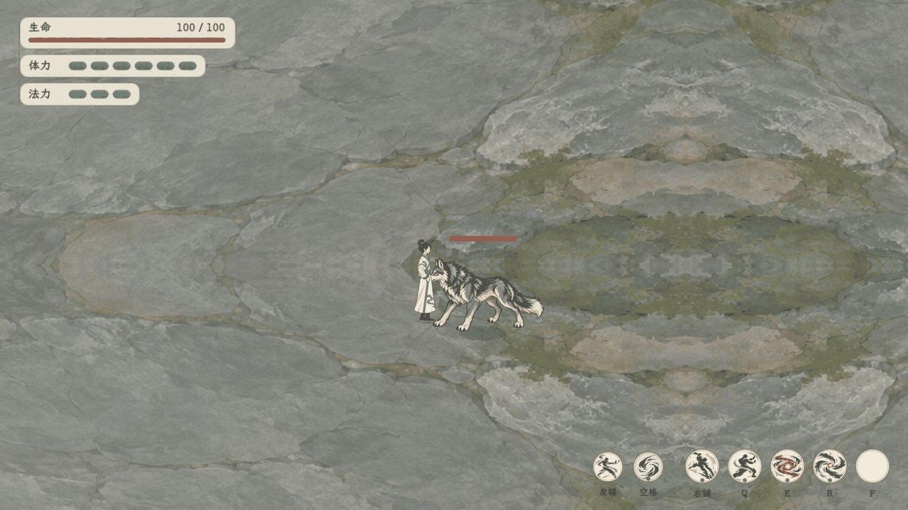
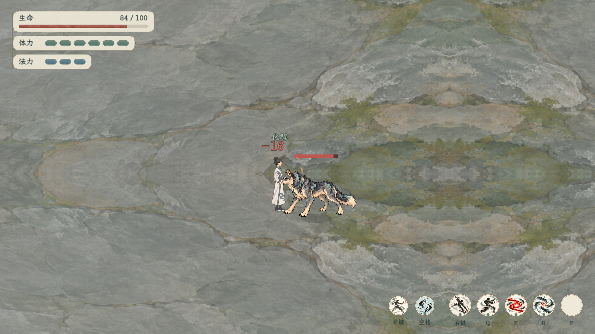

# 即时战斗文本精简

原人物头顶的整句反馈已移除：出招、错步发动、架招空放、落空不再刷字。实际伤害在承受方附近显示简短数字；玩家受伤为朱红，敌方受伤为浅色，真实会心以金色和略大字号区分。化解／闪避只用短词，部分化解仍显示剩余伤害。

录屏由脚本触发真实样例拳掌、凶狼来袭架招和痛击，100帧／20fps，未伪造伤害。共用镜头与地图边界限制已启用；演示场景仍为单玩家单狼，未代表完整正式迁移。角色重叠位置仅用于接触范围内的反馈录制。

飘字采用世界结算位置投影、屏幕固定字号，轻飘约0.76秒后淡出；不额外使用战斗随机数。原内部诊断字符串仍供既有测试使用，游戏人物头顶不绘制它。体力不足保留资源豆／技能区反馈，冷却沿技能槽表现；悬停说明、帮助和真实错误提示仍保留。

验证：[文本专项16项](../../../output/action_combat_text_smoke_20261104.log)、[基础四招24项](../../../output/action_combat_text_basic_correct_20261104.log)、[最终真实角色演练647项](../../../output/realtime_restored_character_final_20261104.log)。覆盖伤害一一对应、残影不重复、落空／空放无飘字、部分化解、零伤害、短词去重、帮助／配置冻结、会心标记、过期清理和重开清空。实际画面已检查数字、描边、化解和剩余伤害的组合显示。

实现仅即时试玩 `action_battle_feel_test.gd`／`action_battle_hud.gd` 表现，不修改正式队列FloatingText或技能费用／伤害公式。规则见[文本精简范围](../../plans/即时战斗飘字与提示精简_20261104.md)。
