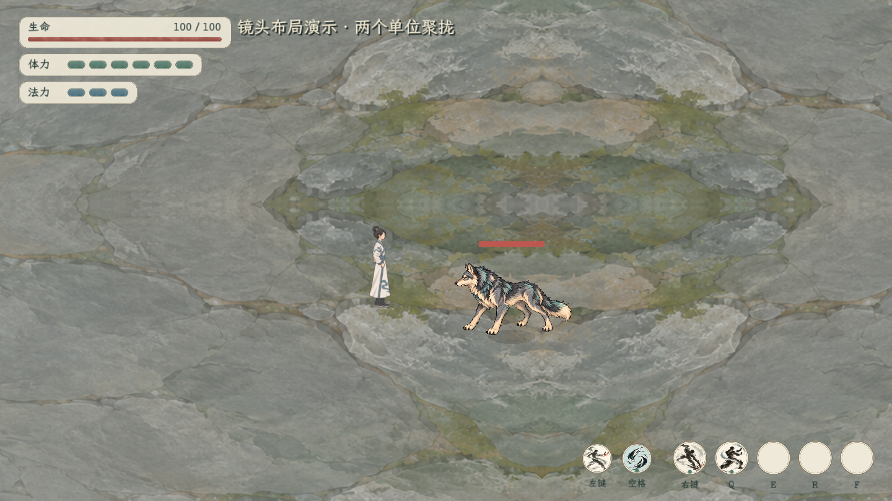
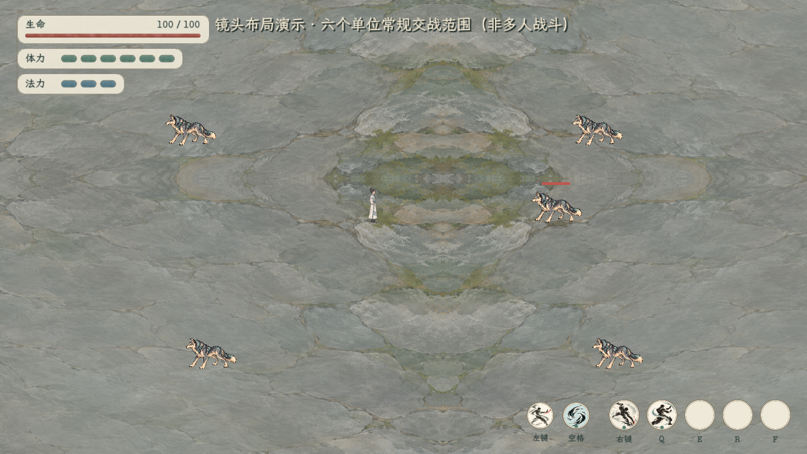
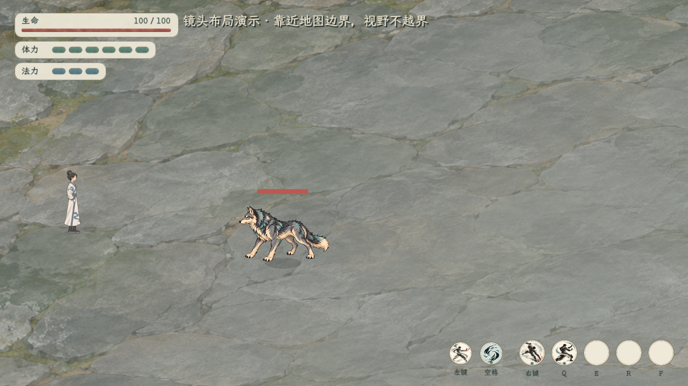

# 即时战斗共同镜头

当前按全体存活参战单位位置共同取景，分散拉远、聚拢拉近；视野严格限制在3344×1882地图内。靠边停止继续平移，边距不足时地图边界优先，不能用地图外补画掩盖越界。

六单位图的额外四狼只用于验证镜头布局，没有加入多人AI或伤害结算。当前可玩即时场景仍为单人对单狼；恢复入口为首页「试演与预览 → 即时战斗·鬼谷式试玩」。人物属性页可进入当前角色即时演练。

镜头60项、原四招24项和HUD检查通过。日志：[镜头](../../../output/shared_combat_camera_smoke.log)、[四招](../../../output/shared_camera_basic_skills.log)、[界面](../../../output/shared_camera_ui_smoke.log)。四种视口、常规六单位入框、远端单位、死亡剔除、每帧视野地图内、暂停／重开／resize均覆盖。极端地图对边与窗口长宽比冲突时记录取景饱和，地图边界优先；不暗中移动单位或扩大地图。

实现：`tools/action_battle_test/adaptive_combat_camera.gd` 与原 `action_battle_feel_test.gd` 相机区域。规则见[本轮恢复主案](../../plans/即时动作战斗恢复与共同取景_20261104.md)。
